## Welcome to Lead-DBS

**Lead-DBS:** A toolbox facilitating Deep Brain Stimulation electrode reconstruction and computer simulation based on postoperative MRI & CT imaging.

{}
{}
Download Lead-DBS

{}
{}
Watch the walkthrough tutorial

{}
{}
{}
> “For me, Lead-DBS is one of the most important developments in the field of DBS research in recent years”
>
> — **Andreas Nowacki**, Associate Professor and Senior Attending of Neurosurgery, Inselspital Bern

> “The spatial mapping approaches of Lead DBS have really accelerated the field.”
>
> — **Simon Little, MBBS MRCP PhD**, Assistant Professor of Neurology, UCSF

> “Lead-DBS is arguably the most established toolbox providing a semi-automatic framework for electrode localization”
>
> — **Husch et al.**, NeuroImage Clinical 2017

> “Lead-DBS is widely used.”
>
> — **Milchenko et al.**, Journal of Neuroscience Methods 2018

> “Two elegant examples were published by Horn et al. 2017 in which a method was described to warp DBS electrode coordinates and histological data to MNI-space (Ewert et al. 2017).”
>
> — **Alkemade et al.**, Frontiers in Neuroanatomy 2018

> “A commitment of the community to open science will also democratize and increase the speed of advances with high uptake of currently available initiatives such as Lead-DBS.”
>
> — **Latorre et al.**, Frontiers in Neurology 2021

> “Lead DBS is an additional tool that allows each member of our multidisciplinary team to visualize the pre-op trajectories, post-op implanted electrodes and more precisely their distinct contacts in a easy and fast way. In the same manner, it helps us also to understand the effects of the stimulations by using the simulation of volume of tissue activated, to obtain selectivity of the stimulation of the desired structure and carry out comparisons across patients. Infinite thanks for sharing this great and usefull tool!”
>
> — **Nadia Berard**, Neurophysiological Engineer, Lausanne University Hospital

> “I really appreciate this brilliant toolbox and the support from Andreas Horn, Ningfei Li and colleagues that comes with it.”
>
> — **Vladimir Litvak**, Professor of Translational Neurophysiology, UCL London

> “Lead-DBS is a clinical research platform that continuously opens new horizons for brain research. It is critical for my ERC project that integrates invasive neurophysiology, brain stimulation and connectomics with Lead-DBS for BCI and neuroprosthetics in Parkinson’s.”
>
> — **Wolf-Julian Neumann, MD, PhD**, Associate Professor of Neurology, Charité Berlin

> “Lead DBS is a game changer in DBS research, this tool is allowing major steps in moving the DBS field forward 🙌🏽🙌🏽 excellent job!”
>
> — **Josue Avecillas-Chasin, MD, PhD**, Assistant Professor of Neurosurgery, University of Nebraska Medical Center

> “Lead-DBS is an amazing tool and managed to popularize neuro-imaging studies and break the barriers of research community. I often use Lead-DBS for my research and I think that it has become a sine qua non for DBS studies. Looking for forward to future collaborations!”
>
> — **Luigi Gianmaria Remore, MD**, Neurosurgeon, University of Milan

> “We use Lead-DBS daily at Mayo Clinic. I also am using it for my PhD based at Monash University. The software capabilities are very broad. Group analysis with dependent variables has streamlined the process of addressing my research questions significantly.”
>
> — **Fiona Permezel, MD, MBBS, BSc(Hons)(Psych), BSc(ScSchProg), FRACP**, Neurologist, Mayo Clinic

> “Lead-DBS represents a significant advancement in translational research for neuromodulation. Its electrode localization methods hold promise for improving patient outcomes, while already driving innovation and enhancing research methodologies for clinicians and researchers worldwide.”
>
> — **Joel Maamary, MD**, Movement Disorders Neurologist at St. Vincent’s Hospital Sydney

> “Lead-DBS has not only dramatically improved the outcomes of our surgeries as functional neurosurgeons but have also helped answer the critical question of why some surgeries do not achieve the desired effect. Thanks to your work, functional neurosurgeons around the world can refine their approaches, ultimately improving the lives of countless patients globally.”
>
> — **Shiro Horisawa, MD**, Director of stereotactic and functional neurosurgery, Tokyo Women’s Medical University
{}

**Lead-OR:** A toolbox facilitating research during Deep Brain Stimulation surgery.

{}
{}
Download Lead-OR

{}
{}
Read the Paper

{}
{}
{}
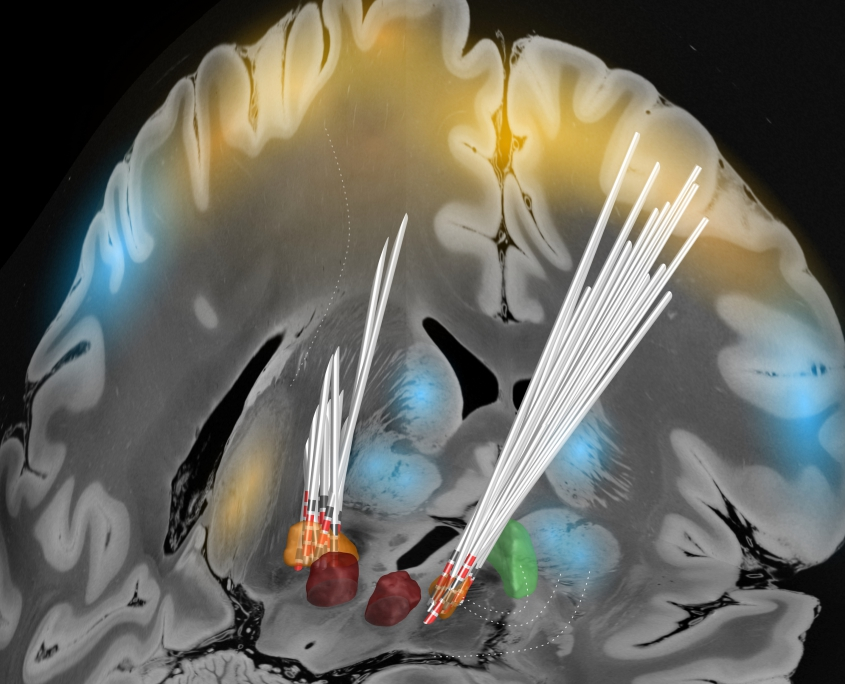
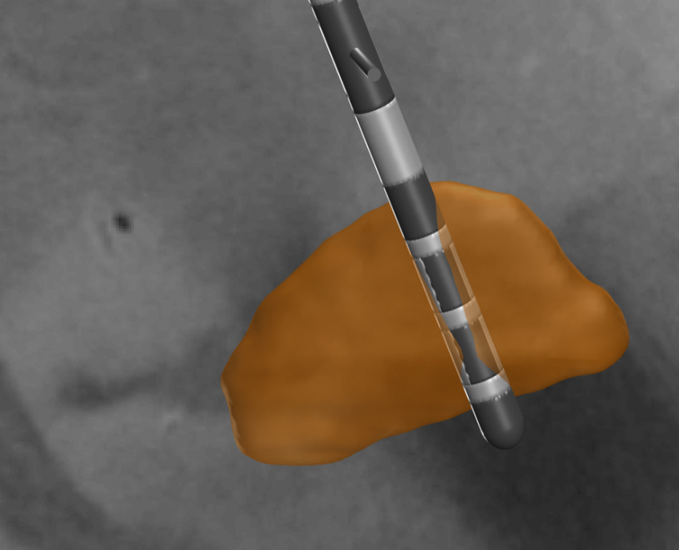
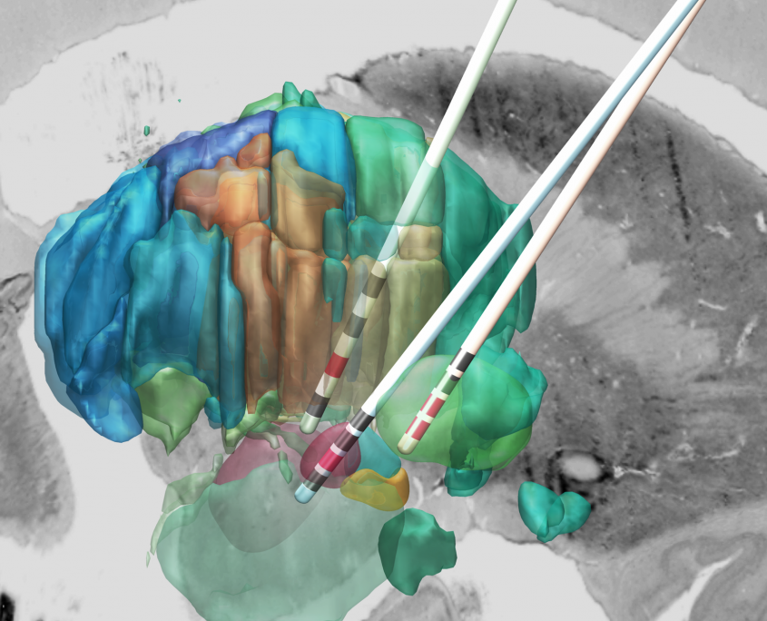
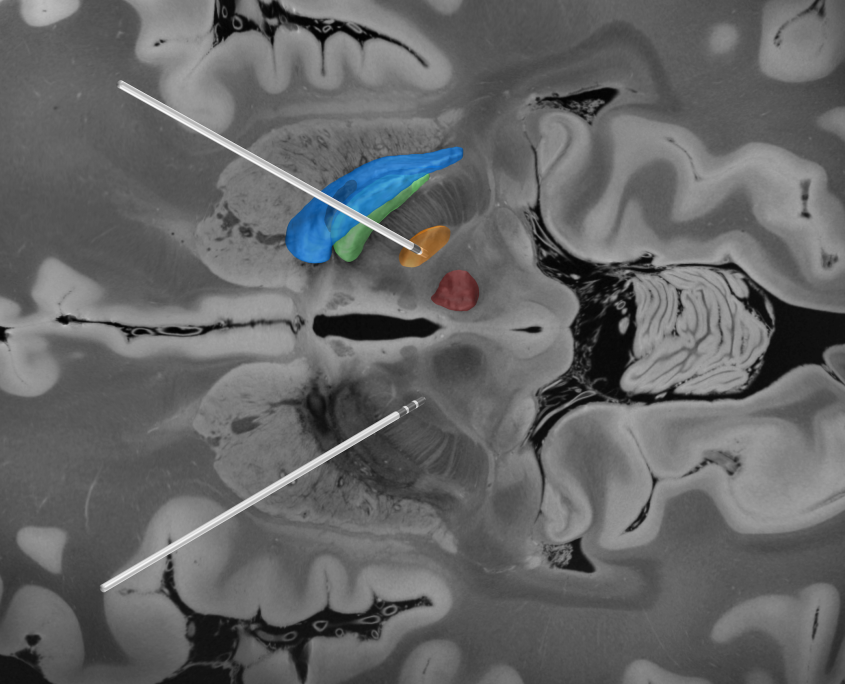
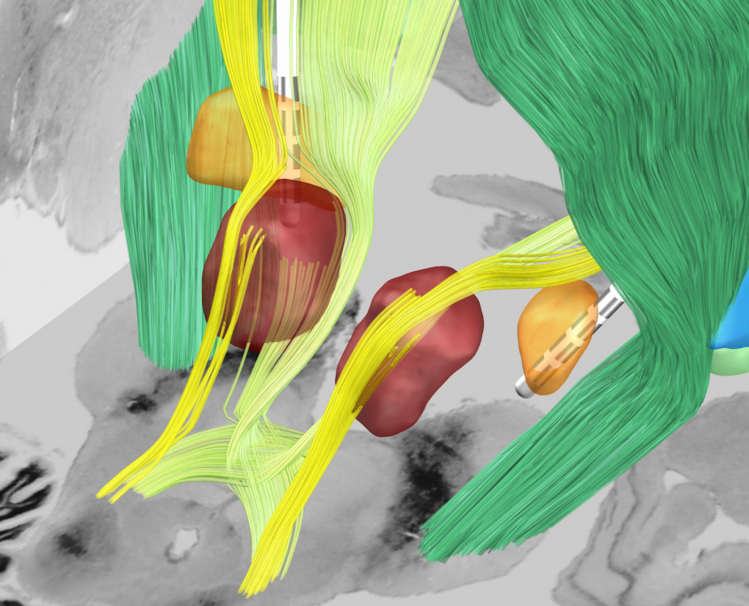
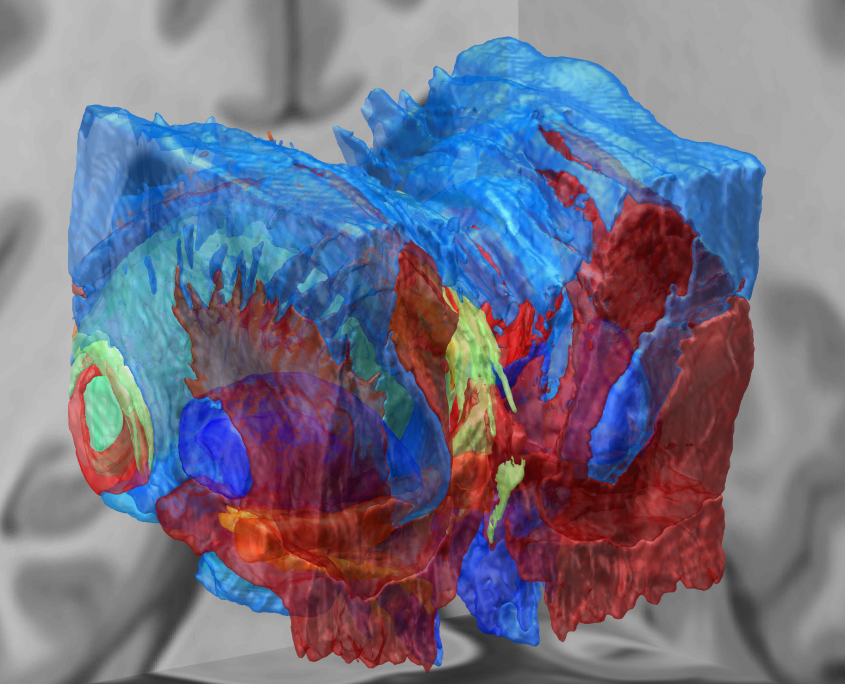
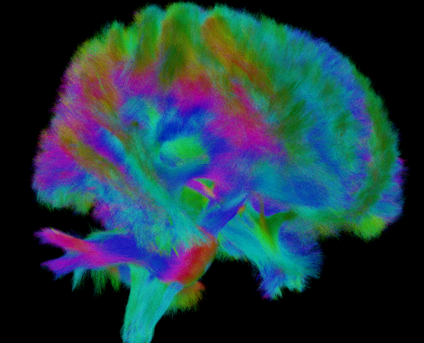
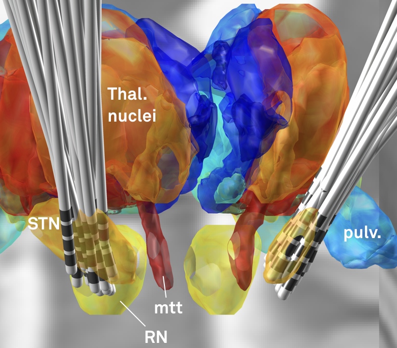
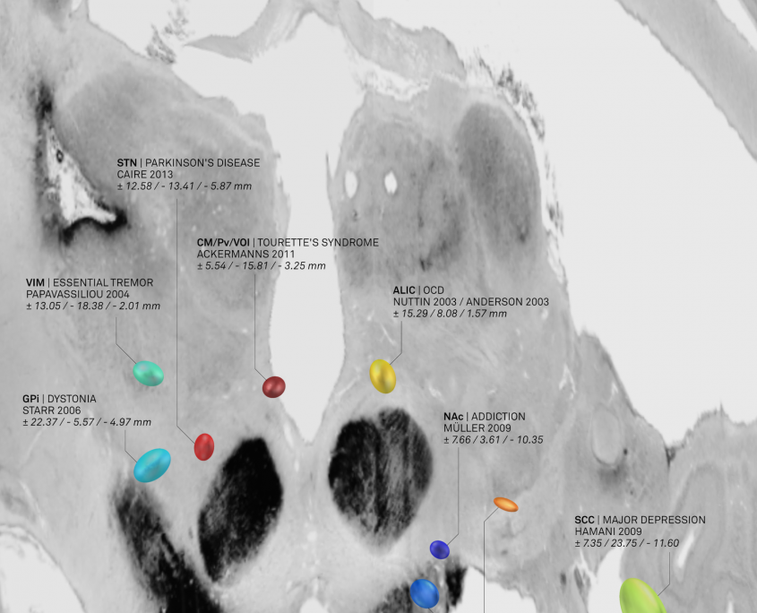
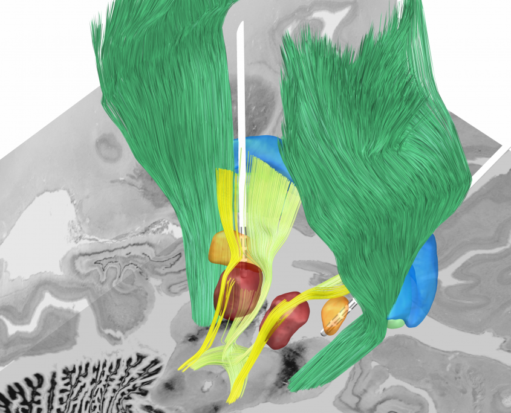
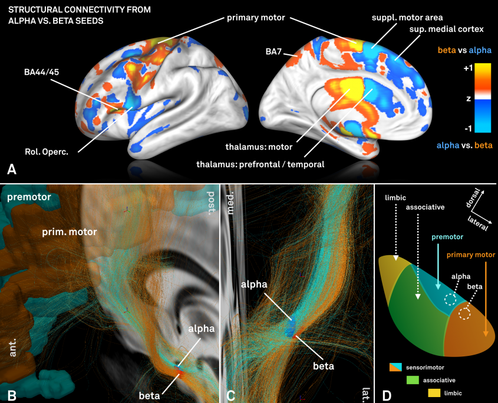
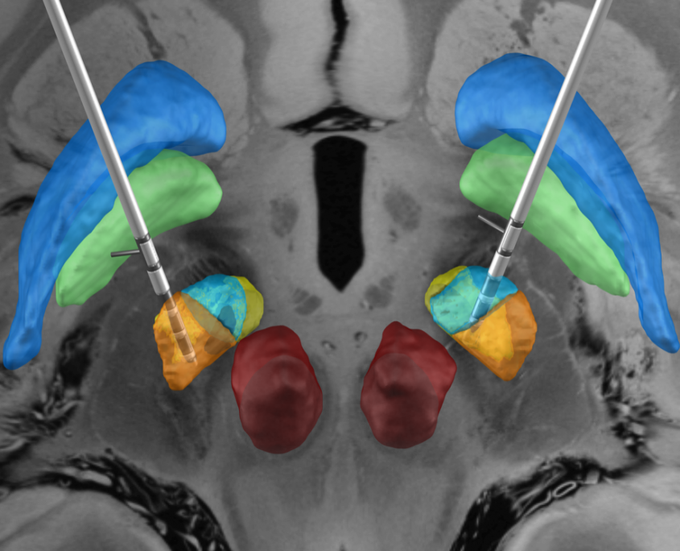
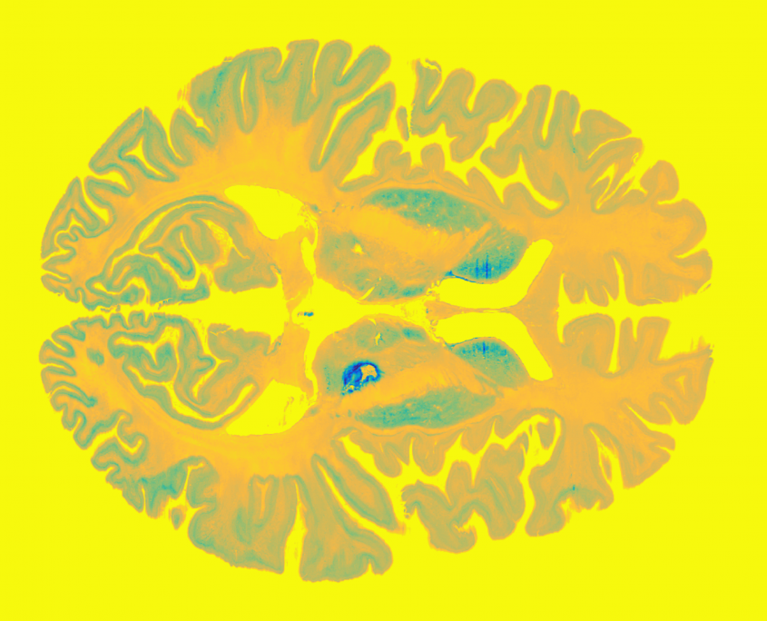
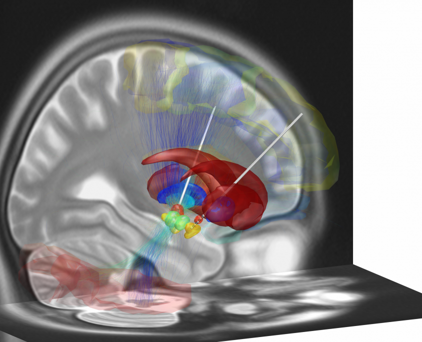
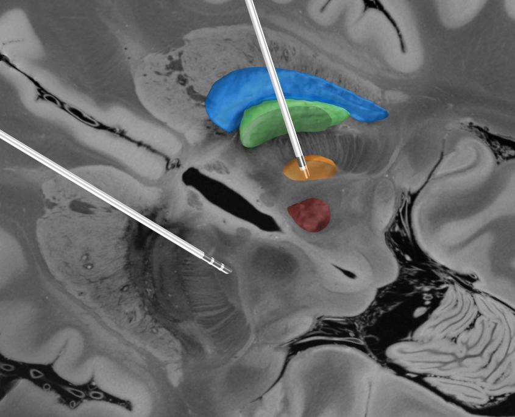
{}

Lead-DBS was initially developed at the [Movement Disorders Unit of Andrea Kühn](https://neurologie.charite.de/forschung/arbeitsgruppen/bewegungsstoerungen_andrea_kuehn "Movement Disorders Unit"), [Department of Neurology](https://neurologie.charite.de/ "Neurology Department, Charité University Medicine Berlin"), [Charité – University Medicine](https://www.charite.de/ "Charité University Medicine, Berlin") (CCM), Berlin, Germany.

Since 2016, development continues among researchers from various institutions (see [about](/about/) page).

Since 2019, development is coordinated by the [Network Stimulation Laboratory](http://www.netstim.org/).

Browse publications empowered by Lead-DBS

### Lead-DBS is supported by

{}
[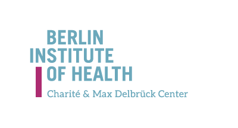](https://www.bihealth.org/en/)

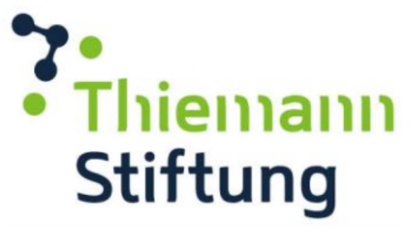
{}
