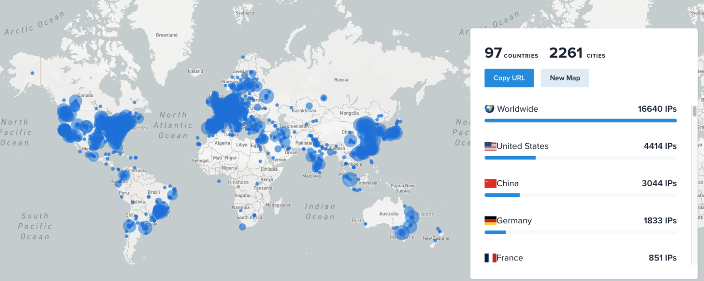

## Prerequisites
To start working with Lead-DBS you either need:

- Postoperative (and if available also preoperative) structural MRI series or
- Postoperative CT and preoperative MRI images

Lead-DBS works with MATLAB >R2021a and needs a few MATLAB toolboxes as well as SPM12 installed. For detail prerequisites, please check out the [download](/download/) page or the [manual](https://netstim.gitbook.io/leaddbs/installation) .

  

---

  

## LEAD-DBS Downloads Across the Globe

---

## Development Team
**Core Development**

- [Ningfei Li](http://www.netstim.berlin/about-us/about-us/), Charité Berlin
- [Simón Oxenford](http://www.netstim.berlin/about-us/about-us/), Charité Berlin
- Till Dembek, University of Cologne
- Nanditha Rajamani, Charité Berlin
- Konstantin Butenko, Harvard Medical School
- Garance Meyer, Harvard Medical School
- Enrico Opri, Emory University, Atlanta
- Johannes Achtzehn, Charité Berlin
- Andreas Husch, University of Luxembourg
- Lauren Hart, Harvard Medical School
- Khoa Nguyen, University Bern
- Kavisha Fernando, University Melbourne
- [Andreas Horn](http://www.netstim.berlin/about-us/about-us/andreashorn/), Harvard Medical School & Charité Berlin

**Feature Development**

- Andrea Kühn, Charité, Germany
- Harald Treuer, University of Cologne
- Veerle Visser-Vandewalle, University of Cologne
- Todd Herrington, Mark Richardson, Massachusetts General Hospital, Boston
- Frank Hertel, Centre Hospitalier de Luxembourg

**Contributors (Code)**

- Wolf-Julian Neumann, Charité Berlin
- Jan Roediger, Charité Berlin
- Johannes Vorwerk, U Münster
- Ari Kappel, University of Pittsburg
- Chadwick Boulay, University of Ottawa
- Jan Roediger, Charité, Berlin
- Qianqian Fang, Northeastern University, Boston
- Johannes Achtzehn, Charité Berlin

**Contributions of Atlases / Data from following authors**

- Siobhán Ewert, Charité, Germany
- Ettore Accolla, University of Fribourg
- Erik Middlebrooks, Mayo Clinic, Jacksonville
- Bogdan Draganski, University Lausanne
- Brian Edlow, Martinos Center / MGH, Boston
- Lingzhong Fan, Chinese Academy of Sciences
- Birte Forstmann / Max Keuken, University Amsterdam
- Alexander Hammers, Imperial College London
- Marc Joliot / Natalie Tzourio-Mazoyer, University Bordeaux
- Antonio Meola, Brigham and Women’s Hospital, Boston
- Janey Prodoehl, Midwestern University
- Anqi Qiu, University of Singapore
- Verena Rozanski, University of Munich
- Thomas Yeo, University of Singapore
- Dongyang Zhang, Washington University, St. Louis
- Eduardo Alho, University of Sao Paulo

**Testing**

- Pierre Deman, Astrid Kibleur, Grenoble Institut of Neurosciences
- Juan Carlos Baldermann, University Hospital Cologne
- Kristen Kanoff, Massachusetts General Hospital, USA
- Konrad Schumacher, University Hospital Freiburg

**Please feel free to join the team! [Fork us on Github](https://github.com/andreashorn/lead_dbs/)**

---

## Alternatives

DBS imaging involves a complex pipeline spanning over multiple scientific disciplines such as precise co-registration, multimodal image fusion, 3D image processing & localization, spatial statistics, surface & volumetric meshing as well as physical modeling using the finite element approach.

If incorporating connectivity measures, it expands to functional magnetic resonance imaging and diffusion-weighted imaging based tractography. Finally, electrophysiological measures such as local field potentials and electro-/magnetoencephalographic data may be incorporated to better understand DBS and enhance DBS modeling.

Thus, creating a “one-step solution” for DBS imaging is a non-trivial task. Although we aim at incorporating the best tools that are openly available for each sub-task into the Lead-DBS pipeline and constantly work hard to improve our tool, alternatives exist (with slight differences in focus) that may be better suited to specific subtasks of the whole collection. Below is a non-exhaustive list of alternatives we are aware of. Also see our [blog post on academic vs. commercial software tools](/commercial-vs-academic-software/) or the discussion of our [Lead-DBS v.2 paper](https://www.researchgate.net/publication/327380509_Lead-DBS_v2_Towards_a_comprehensive_pipeline_for_deep_brain_stimulation_imaging).

- **Academic endeavors / Open source tools**
  - DBSproc ([Lauro 2016](http://onlinelibrary.wiley.com/doi/10.1002/hbm.23039/abstract)), openly available, part of the [AFNI imaging suite](https://afni.nimh.nih.gov/afni/)
  - ELMA ([Johansson 2019](https://pubmed.ncbi.nlm.nih.gov/31947033/)), openly avalable [here](https://liu.se/en/research/dbs)
  - PyDBS ([D’Albis ‎2015](https://www.ncbi.nlm.nih.gov/pubmed/24799270)), available to the [ACouStiC community](http://acoustic.univ-rennes1.fr/doku.php/software)
  - [PaCER](https://adhusch.github.io/PaCER/), developed in Luxembourg (also a part of Lead-DBS)
  - StimVision ([Noecker 2021](https://onlinelibrary.wiley.com/doi/abs/10.1111/ner.13350)), developed at Case Western University
  - DBSmapping ([Moreira da Silva 2015](http://ieeexplore.ieee.org/document/7146617/?tp=&arnumber=7146617&openedRefinements%3D*%26filter%3DAND(NOT(4283010803))%26pageNumber%3D11%26rowsPerPage%3D100%26queryText%3D(3d%20user%20interfaces)metadata)), developed by a group in Porto
  - There is a similar software at MGH, described in [Bonmassar 2014](https://www.ncbi.nlm.nih.gov/pmc/articles/PMC4334388/)
  - The CiceroneDBS ([Miocinovic 2007](https://www.ncbi.nlm.nih.gov/pubmed/17691348), discont.) software which had similar aims made its way into the Boston Scientific GUIDE software (see below)
- **Commercial products**
  - [Boston Scientific GUIDE XT](http://news.bostonscientific.com/2013-05-27-Boston-Scientific-Receives-CE-Mark-Approval-For-GUIDE-DBS-System) software, now a commercial alternative
  - Commercial tools under the name [Optivise](http://www.trademarkia.com/optivise-85498999.html) (discont.) and [SureTune](https://neuronewsinternational.com/ce-mark-granted-to-medtronic-for-suretune2-deep-brain-stimulation-therapy/) are/were available at Medtronic
  - [CranialCloud](https://www.cranialdrive.com/login), developed by the spinoff Neurotargeting LLC out of Vanderbilt University

## Citing Lead-DBS
Please find out how to [best cite Lead-DBS if you use it on this page](/about/citing_leaddbs/).
