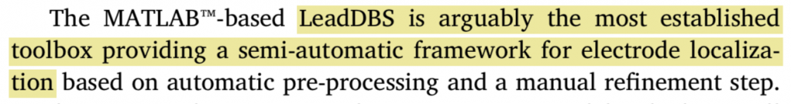
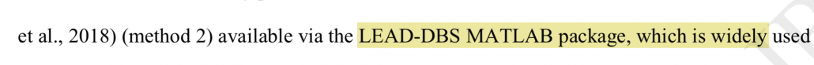
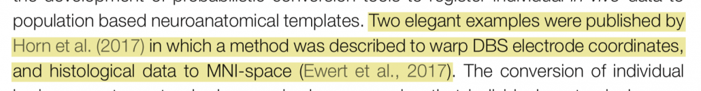
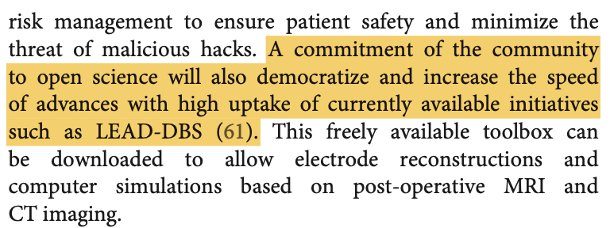
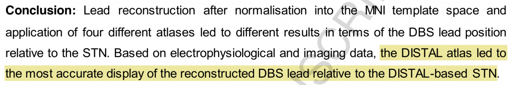
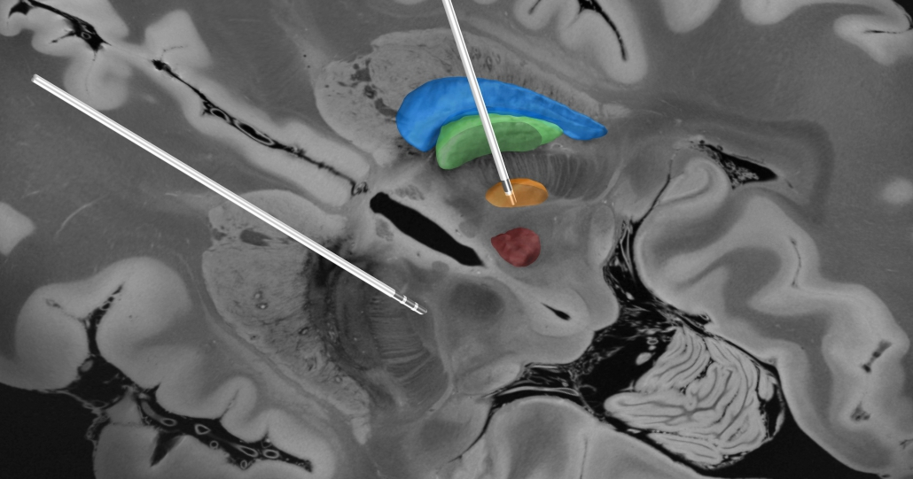

# DEEP BRAIN STIMULATION

  

The main focus of our work is **deep brain stimulation** (DBS) – predominantly in movement disorders such as Parkinson’s Disease, Essential Tremor or Dystonia – more rarely in cognitive disorders such as Depression or Alzheimer’s Disease. In DBS, electrodes are **surgically implanted** into deep (subcortical) areas of the brain and – using an implanted impulse generator – these structures are **stimulated chronically**. The figure below shows a reconstruction of **two DBS leads implanted with target subthalamic nucleus** (orange) to treat **Parkinson’s** **Disease.**

---

## Building tools to reconstruct electrode placement

  

Since 2012, we develop an open-source toolbox to facilitate reconstruction of DBS electrode placement based on postoperative imaging.

**Lead-DBS** has since become a leading platform for **DBS imaging research** with specific focus on **brain connectivity** between DBS stimulation sites and other areas in the brain.

## What others write

  
  

*From: [Husch, A., Petersen, M. V., Gemmar, P., Goncalves, J., & Hertel, F. (2017). PaCER – A fully automated method for electrode trajectory and contact reconstruction in deep brain stimulation. NeuroImage. Clinical, 17, 80–89.](http://doi.org/10.1016/j.nicl.2017.10.004)*

  
  

*From: [Milchenko, M., Snyder, A. Z., Campbell, M. C., Dowling, J. L., Rich, K. M., Brier, L. M., et al. (2018). ESM-CT: a precise method for localization of DBS electrodes in CT images. Journal of Neuroscience Methods, 1–42.](http://doi.org/10.1016/j.jneumeth.2018.09.009)*

  

*From: [Alkemade, A., Groot, J. M., & Forstmann, B. U. (2018). Do We Need a Human post mortem Whole-Brain Anatomical Ground Truth in in vivo Magnetic Resonance Imaging? Frontiers in Neuroanatomy, 12, 110.](http://doi.org/10.3389/fnana.2018.00110)*

  
  

*From:* [Latorre, Anna & Rocchi, Lorenzo & Sadnicka, Anna. (2021). The Expanding Horizon of Neural Stimulation for Hyperkinetic Movement Disorders. Frontiers in Neurology.](https://www.researchgate.net/publication/351579677_The_Expanding_Horizon_of_Neural_Stimulation_for_Hyperkinetic_Movement_Disorders)

  
  

*From: [Nowacki, A., Nguyen, T. A.-K., Tinkhauser, G., Petermann, K., Debove, I., Wiest, R., & Pollo, C. (2018). Accuracy of different three-dimensional subcortical human brain atlases for DBS -lead localisation. NeuroImage. Clinical, 20, 868–874.](http://doi.org/10.1016/j.nicl.2018.09.030)*

---

## Impact of Lead-DBS

  

In 2015, [Lead-DBS](/) was awarded with the [**Max-Rubner-Prize** for Innovation](https://www.google.de/search?q=max+rubner+preis+charite+horn&oq=max+rubn&aqs=chrome.0.69i59j69i57j69i60l4.1653j0j1&sourceid=chrome&ie=UTF-8) by [Stiftung Charité](http://www.stiftung-charite.de/), in 2016 a **[Harvard Radcliffe Exploratory Ventures Grant](https://www.radcliffe.harvard.edu/exploratory-seminars/toward-connectomic-deep-brain-stimulation)** by the [Harvard Radcliffe Institute for Advanced Study](https://www.radcliffe.harvard.edu/). In 2017, Lead-DBS was awarded the **Robert-Koch-Prize** of Charité, Berlin. Further development of Lead-DBS has been [funded on a 6-year term grant by the German Research Council (DFG)](https://gepris.dfg.de/gepris/projekt/410169619?context=projekt&task=showDetail&id=410169619&).

At the time of writing, [Lead-DBS](/) was [**downloaded over 65,000 times**](/download/) by researchers world-wide and currently, [**groups from over 20 institutions contributed**](/about/) to [Lead-DBS](/) code & content.

  

Download Lead-DBS

---

## Ressources and atlases

  

The Lead Suite features a high number of [subcortical atlases](/helpsupport/knowledge-base/atlasesresources/atlases-2/) and [whole-brain parcellations](/helpsupport/knowledge-base/atlasesresources/cortical-atlas-parcellations-mni-space/) from various authors.

  

{}
{}
Browse subcortical atlases

{}
{}
Browse whole-brain parcellations

{}
{}
Download Normative Connectomes

{}
{}
---

## Lead-DBS methods

  

Since 2012, we introduced a number of novel methods to analyze DBS recording sites and brain connectivity. As such, the [subcortical electrophysiology mapping](/helpsupport/knowledge-base/lead-dbs-methods/subcortical-electrophysiology-mapping-sem/) (SEM) approach was introduced in [Horn et al. 2017a](http://onlinelibrary.wiley.com/doi/10.1002/hbm.23594/abstract) and applied in [Neumann et al. 2017](http://onlinelibrary.wiley.com/doi/10.1002/ana.25095/abstract). A summary of the approach can [be found here](/helpsupport/knowledge-base/lead-dbs-methods/subcortical-electrophysiology-mapping-sem/). A novel method to convert AC/PC coordinates into MNI standard space was introduced in [Horn et al. 2017b](https://www.ncbi.nlm.nih.gov/pubmed/28163141) and is [described here](/helpsupport/knowledge-base/lead-dbs-methods/acpc-to-mni-conversion-2/). Finally, a method to predict clinical outcome of DBS patients based on brain connectivity – termed Connectivity Benefit Mapping – was introduced in [Horn et al. 2017c](http://onlinelibrary.wiley.com/doi/10.1002/ana.24974/abstract).

{}
{}
Learn more about subcortical electrophysiology mapping

{}
{}
Learn more about AC/PC to MNI conversion

{}
{}
Learn more about Connectivity Benefit Mapping

{}
{}
