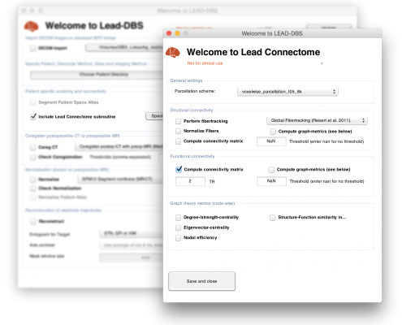

**LEAD Connectome – as part of LEAD DBS – is a complete structural-functional connectomic analysis pipeline in MATLAB**

You can use LEAD Connectome within but [also completely outside the context of deep brain stimulation](http://www.lead-connectome.org). Thus, LEAD Connectome can be used for connectomic analyses of

- healthy subjects
- patients
- patients that undergo DBS surgery.

The foundation of the code is based on the work published here:

[The structural-functional connectome and the default mode network of the human brain. (2014) Horn A, Ostwald D, Reisert M, Blankenburg F. *NeuroImage*.](http://www.ncbi.nlm.nih.gov/pubmed/24099851)

The software can be used to perform structural and functional connectomic analyses which are based on

- dMRI (diffusion-weighted imaging based fiber tractography – often simply referred to as DTI) and
- rs-fMRI (resting-state functional magnetic resonance imaging) data respectively

Structural connectivity may be analyzed using the GQI method implemented in [DSI Studio](http://dsi-studio.labsolver.org/), the global “Gibbs’ tracking” method implemented in the [DTI & Fibertools for SPM](http://www.uniklinik-freiburg.de/mr-en/research-groups/diffperf/fibertools.html) software package, which must be installed and on your Matlab path. Other tracking algorithms can be used, of course, too. As a simple example, a [global tracking algorithm made by Dirk-Jan Kroon](http://www.mathworks.com/matlabcentral/fileexchange/21130-dti-and-fiber-tracking) is pre-installed. The toolbox is easy to extend for implementation of your own fibertracking algorithm, if you prefer so.

Functional connectivity can be analyzed right out of the box (only [SPM](http://www.fil.ion.ucl.ac.uk/spm/software/spm12/) needs to be installed and on your search path).

As always, please use the [forum](/helpsupport/slack-user-channel/ "LEAD-DBS support forum") for questions!
