Which of these papers to cite is on [Cite Lead-DBS](/about/citing_leaddbs/).

## Methodological publications

- Methodological toolbox publications (also see [citing Lead-DBS](/about/citing_leaddbs/))
  - Neudorfer, C., Butenko, K., Oxenford, S., Rajamani, N., Achtzehn, J., Goede, L., et al. (2023). Lead-DBS v3.0: Mapping deep brain stimulation effects to local anatomy and global networks. NeuroImage, 268, 119862. [doi:10.1016/j.neuroimage.2023.119862](https://doi.org/10.1016/j.neuroimage.2023.119862)
  - Horn, A., Li, N., Dembek, T. A., Kappel, A., Boulay, C., Ewert, S., et al. (2019). Lead-DBS v2: Towards a comprehensive pipeline for deep brain stimulation imaging. NeuroImage, 184, 293–316. [doi:10.1016/j.neuroimage.2018.08.068](https://doi.org/10.1016/j.neuroimage.2018.08.068)
  - Horn, A., & Kühn, A. A. (2015). Lead-DBS: A toolbox for deep brain stimulation electrode localizations and visualizations. NeuroImage, 107, 127–135. [doi:10.1016/j.neuroimage.2014.12.002](https://doi.org/10.1016/j.neuroimage.2014.12.002)
  - Horn, A., Kühn, A. A., Merkl, A., Shih, L., Alterman, R., & Fox, M. (2017). Probabilistic conversion of neurosurgical DBS electrode coordinates into MNI space. NeuroImage, 150, 395–404. [doi:10.1016/j.neuroimage.2017.02.004](https://doi.org/10.1016/j.neuroimage.2017.02.004)
  - Ewert, S., Plettig, P., Li, N., Chakravarty, M. M., Collins, D. L., Herrington, T. M., et al. (2018). Toward defining deep brain stimulation targets in MNI space: A subcortical atlas based on multimodal MRI, histology and structural connectivity. NeuroImage, 170, 271–282. [doi:10.1016/j.neuroimage.2017.05.015](https://doi.org/10.1016/j.neuroimage.2017.05.015).
  - Ewert, S., Horn, A., Finkel, F., Li, N., Kühn, A. A., & Herrington, T. M. (2019). Optimization and comparative evaluation of nonlinear deformation algorithms for atlas-based segmentation of DBS target nuclei. NeuroImage, 184, 586–598. [doi:10.1016/j.neuroimage.2018.09.061](https://doi.org/10.1016/j.neuroimage.2018.09.061)
  - Husch, A., Petersen, M. V., Gemmar, P., Goncalves, J., & Hertel, F. (2018). PaCER – A fully automated method for electrode trajectory and contact reconstruction in deep brain stimulation. NeuroImage. Clinical, 17, 80–89. [doi:10.1016/j.nicl.2017.10.004](https://doi.org/10.1016/j.nicl.2017.10.004)
  - Dembek, T. A., Hoevels, M., Hellerbach, A., Horn, A., Petry-Schmelzer, J. N., Borggrefe, J., et al. (2019). Directional DBS leads show large deviations from their intended implantation orientation. Parkinsonism & Related Disorders, 67, 117–121. [doi:10.1016/j.parkreldis.2019.08.017](https://doi.org/10.1016/j.parkreldis.2019.08.017)
  - Treu, S., Strange, B., Oxenford, S., Neumann, W.-J., Kühn, A., Li, N., & Horn, A. (2020). Deep brain stimulation: Imaging on a group level. NeuroImage, 219, 117018. [doi:10.1016/j.neuroimage.2020.117018](https://doi.org/10.1016/j.neuroimage.2020.117018)
  - Lofredi R, Auernig CG, Ewert S, Irmen F, Steiner LA, Scheller U, van Wijk BCM, Oxenford S, Kühn AA, Horn A. Interrater reliability of deep brain stimulation electrode localizations. *NeuroImage*. 2022. [doi:10.1016/j.neuroimage.2022.119552](https://doi.org/10.1016/j.neuroimage.2022.119552)
  - Oxenford S, Ríos AS, Hollunder B, Neudorfer C, Boutet A, Elias GJB, Germann J, Loh A, Deeb W, Salvato B, Almeida L, Foote KD, Amaral R, Rosenberg PB, Tang-Wai DF, Wolk DA, Burke AD, Sabbagh MN, Salloway S, Chakravarty MM, Smith GS, Lyketsos CG, Okun MS, Anderson WS, Mari Z, Ponce FA, Lozano A, Neumann WJ, Al-Fatly B, Horn A. WarpDrive: Improving spatial normalization using manual refinements. *Medical Image Analysis*. 2024. [doi:10.1016/j.media.2023.103041](https://doi.org/10.1016/j.media.2023.103041)
  - Pijar J, Goede LL, Butenko K, Hart LA, Madan S, Dembek TA, Meyer GM, Rajamani N, Li N, Kühn AA, Horn A, Neudorfer C. Modeling Deep Brain Stimulation Effects in Native Patient or Template Space – Does it Matter? *Brain Stimulation*. 2025. [PubMed](https://pubmed.ncbi.nlm.nih.gov/40340022/)
- Mapping methods: network mapping, sweet spots, electrophysiology
  - Horn, A., Reich, M., Vorwerk, J., Li, N., Wenzel, G., Fang, Q., et al. (2017). Connectivity predicts deep brain stimulation outcome in Parkinson disease. *Annals of Neurology*, *82*(1), 67–78. [doi:10.1002/ana.24974](https://doi.org/10.1002/ana.24974)
  - Horn, A., Neumann, W.-J., Degen, K., Schneider, G.-H., & Kühn, A. A. (2017). Toward an electrophysiological “sweet spot” for deep brain stimulation in the subthalamic nucleus. *Human Brain Mapping*, *38*(7), 3377–3390. [doi:10.1002/hbm.23594](https://doi.org/10.1002/hbm.23594)
  - Schönecker, T., Gruber, D., Kivi, A., Müller, B., Lobsien, E., Schneider, G.-H., et al. (2015). Postoperative MRI localisation of electrodes and clinical efficacy of pallidal deep brain stimulation in cervical dystonia. *Journal of Neurology, Neurosurgery, and Psychiatry*, *86*(8), 833–839. [doi:10.1136/jnnp-2014-308159](https://doi.org/10.1136/jnnp-2014-308159)
  - Schönecker, T., Kupsch, A., Kühn, A. A., Schneider, G.-H., & Hoffmann, K. T. (2009). Automated optimization of subcortical cerebral MR imaging-atlas coregistration for improved postoperative electrode localization in deep brain stimulation. *AJNR American Journal of Neuroradiology*, *30*(10), 1914–1921. [doi:10.3174/ajnr.A1741](https://doi.org/10.3174/ajnr.A1741)
- Lead Tutor paper for self-tutoring Lead-DBS
  - Madan S, Hart LA, Li N, Dembek TA, Butenko K, Meyer GM, Rajamani N, Goede L, Bahners BH, Pijar J, Zvarova P, Sahin IA, Friedrich H, Aracil-Bolanos I, Chua M, Neudorfer C, Tasserie J, Horn A. Lead-Tutor: An open-access educational resource for deep brain stimulation electrode localizations. *Aperture Neuro*. 2025. [doi:10.52294/001c.129658](https://doi.org/10.52294/001c.129658)
- Research Resource Identifier (RRID) of the toolbox: RRID:SCR_002915
- Lead Connectome methods publications (its early applications are listed under [Lead tools](/about/tools/#lead-connectome))
  - Andreas Horn, Dirk Ostwald, Marco Reisert, and Felix Blankenburg (2014). The structural-functional connectome and the default mode network of the human brain. NeuroImage, 102, 142–151. [doi:10.1016/j.neuroimage.2013.09.069](https://doi.org/10.1016/j.neuroimage.2013.09.069)
  - Horn, A., & Blankenburg, F. (2016). Toward a standardized structural-functional group connectome in MNI space. *NeuroImage*, *124*(Pt A), 310–322. [doi:10.1016/j.neuroimage.2015.08.048](https://doi.org/10.1016/j.neuroimage.2015.08.048)

## Cover art

Journal covers with images made with Lead-DBS.

{}
[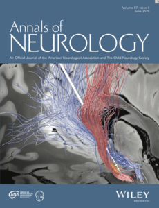](Bildschirmfoto-2020-05-21-um-18.18.28-790x1030.png)
[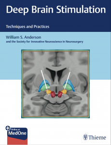](thieme-789x1030.png)
[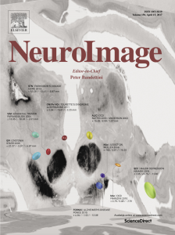](ni_cover-768x1030.png)
[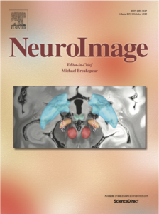](Coverart_NI_2020_Treu_et_al-769x1030.png)
[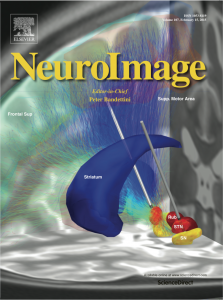](neuroimage_coverart_horn_lead_dbs_2015-766x1030.png)
[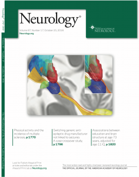](neurology_10_16_lead_dbs-811x1030.png)
[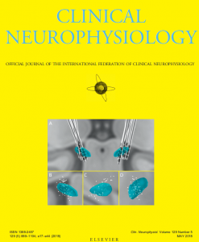](A0EB8F00-EE7D-4E84-AF37-EDABCA068828-10244-000007D3ADD69C7A_tmp.png)
[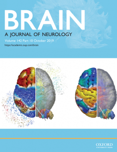](IMG_5825.png)
[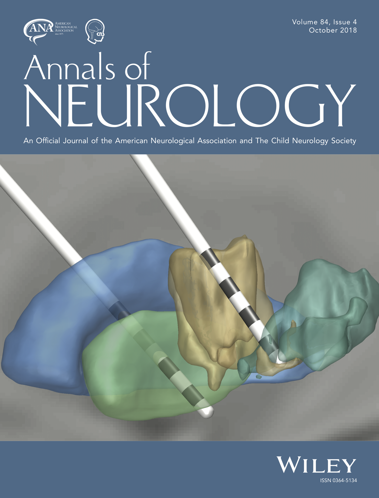](2018-Annals_of_Neurology.png)
[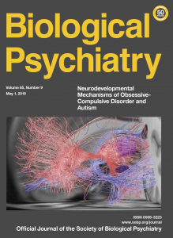](S0006322318X00092-753x1030.png)
[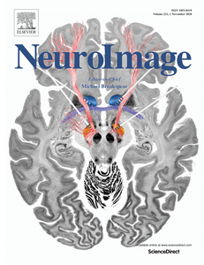](NI_2020b-792x1030.png)
[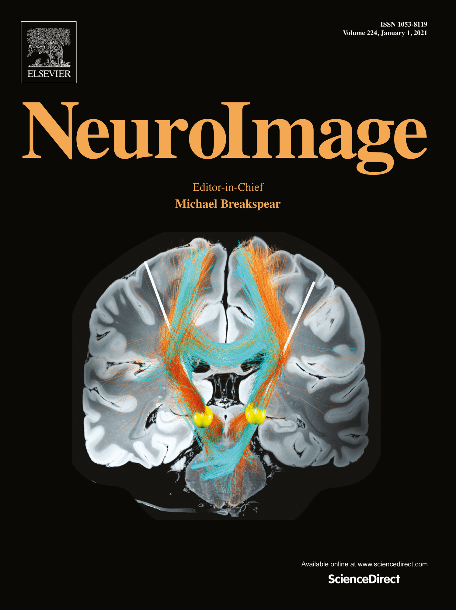](NI_2020c.png)
[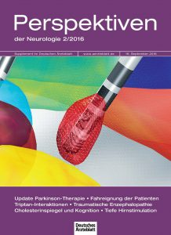](perspektiven_neurologie_cover-749x1030.jpg)
[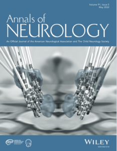](Screen-Shot-2022-04-17-at-2.27.26-PM-801x1030.png)
[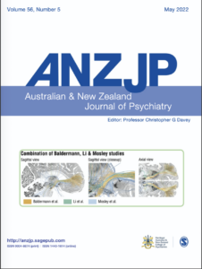](Screen-Shot-2022-05-20-at-8.24.35-AM-777x1030.png)
[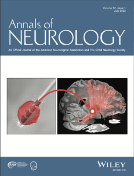](Screen-Shot-2022-07-05-at-7.53.48-AM-787x1030.png)
[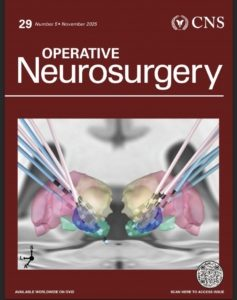](1767187631181.jpeg)
[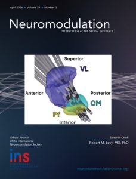](IMG_3254.jpg)
[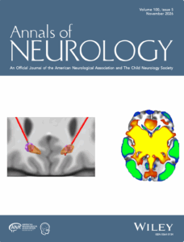](AoN_Luo-783x1030.png)
{}

## Applications of Lead-DBS

Studies that used Lead-DBS are collected in a public Zotero library: [Lead-DBS-publications](https://www.zotero.org/groups/5193749/lead-dbs-publications/library).

## Did we miss a publication?

Used Lead-DBS in a published study that is not in the Zotero library? [Tell us](/contact/).
