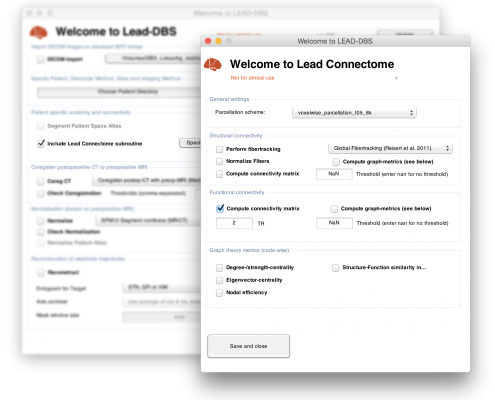

Lead-DBS comes with tools of its own, and has sister tools from the same team. All tools of the
institute are on [GitHub](https://github.com/netstim).

## Inside Lead-DBS

### Lead Group {#lead-group}

Group analyses: electrode placement across a cohort, stimulation volumes, and their relation to
clinical outcome, including sweet-spot and network mapping.

- **Runs in**: Lead-DBS (MATLAB)
- **Manual**: [Group analyses with Lead-DBS](https://netstim.gitbook.io/leaddbs/lead-group/group-analyses-with-lead-dbs)
- **Paper**: Treu, S., Strange, B., Oxenford, S., Neumann, W.-J., Kühn, A., Li, N., & Horn, A. (2020). Deep brain stimulation: Imaging on a group level. *NeuroImage*, *219*, 117018. [doi:10.1016/j.neuroimage.2020.117018](https://doi.org/10.1016/j.neuroimage.2020.117018)

### Lead Connectome {#lead-connectome}

The structural and functional connectome pipeline of Lead-DBS. It computes connectivity from diffusion
MRI (fibre tractography) and from resting-state fMRI, for DBS patients and equally outside DBS studies,
for healthy subjects and other patients. Its Mapper estimates the connectivity of stimulation sites or
any other seed from patient-specific or [normative connectomes](/helpsupport/knowledge-base/atlasesresources/normative-connectomes/).

- **Runs in**: Lead-DBS (MATLAB). Functional connectivity needs only [SPM](https://www.fil.ion.ucl.ac.uk/spm/software/spm12/); for tractography it can use, among others, generalized q-sampling from [DSI Studio](https://dsi-studio.labsolver.org/) and the global "Gibbs' tracking" of [DTI & Fibertools for SPM](https://www.uniklinik-freiburg.de/mr-en/research-groups/diffperf/fibertools.html) (see the [dependencies](/about/lead-dbs-dependencies/)).
- **Manual**: [Connectomics](https://netstim.gitbook.io/leaddbs/connectomics/connectomic-analyses) and [Lead Connectome Mapper](https://netstim.gitbook.io/leaddbs/connectomics/lead-mapper)
- **Paper**: Horn, A., Ostwald, D., Reisert, M., & Blankenburg, F. (2014). The structural-functional connectome and the default mode network of the human brain. *NeuroImage*, *102*, 142–151. [doi:10.1016/j.neuroimage.2013.09.069](https://doi.org/10.1016/j.neuroimage.2013.09.069)

Early applications of Lead Connectome (2014 to 2017)

- Fox MD, Buckner RL, Liu H, Chakravarty MM, Lozano AM, Pascual-Leone A (2014) Resting-state networks link invasive and noninvasive brain stimulation across diverse psychiatric and neurological diseases. *PNAS*. [Link](http://www.pnas.org/content/111/41/E4367.abstract)
- Weigand A\*, Horn A\*, Caballero R, Cooke D, Stern AP, Taylor SF, Press D, Pascual-Leone A, Fox MD (2017) Prospective validation that subgenual connectivity predicts antidepressant efficacy of transcranial magnetic stimulation sites. Biological Psychiatry. [ScienceDirect](http://www.sciencedirect.com/science/article/pii/S0006322317321583)
- Darby R, Horn A, Cushman F, Fox MD (2017) Lesion network localization of criminal behavior. PNAS. [Link](http://www.pnas.org/content/early/2017/12/12/1706587115.full)
- Horn, A., & Blankenburg, F. (2016). Toward a standardized structural-functional group connectome in MNI space. *NeuroImage*. [PubMed](http://www.ncbi.nlm.nih.gov/pubmed/26327244)
- Horn, A. (2015). A structural group-connectome in standard stereotactic (MNI) space. *Data in Brief*, 5, 292–296. [ScienceDirect](http://www.sciencedirect.com/science/article/pii/S2352340915001912)
- Seo S, Mohr J, Li N, Horn A, Obermayer K (2015) Incremental Pairwise Clustering for Large Proximity Matrices. *IJCNN 2015.* [Link](https://ieeexplore.ieee.org/document/7280637/?reload=true&arnumber=7280637)

### OSS-DBS {#oss-dbs}

The stimulation modelling of Lead-DBS since version 3.1: electric field, volume of tissue activated and
pathway activation. It is developed around Ursula van Rienen's team at the University of Rostock and
installs with Lead-DBS.

- **Runs in**: Lead-DBS (in its built-in Python environment), or on its own
- **Code**: [OSS-DBS v2 on GitHub](https://github.com/SFB-ELAINE/OSS-DBSv2)
- **Papers**: OSS-DBS v1 and v2, listed with the [dependencies](/about/lead-dbs-dependencies/#stimulation-modelling-oss-dbs)

## Sister tools

### Lead-OR {#lead-or}

Research in the operating theatre during DBS surgery: real-time views of recordings and of
stimulation, built on the coregistrations of Lead-DBS.

- **Runs in**: [3D Slicer](https://www.slicer.org/), as part of the [SlicerNetstim](https://github.com/netstim/SlicerNetstim) extension
- **Read more**: [Lead-OR](/about/lead-or/), with two videos
- **Paper**: Oxenford, S., Roediger, J., Neudorfer, C., Milosevic, L., Güttler, C., Spindler, P., Vajkoczy, P., Neumann, W.-J., et al. (2022). Lead-OR: A multimodal platform for deep brain stimulation surgery. *eLife*, *11*, e72929. [doi:10.7554/eLife.72929](https://doi.org/10.7554/eLife.72929)

### Lead Tutor {#lead-tutor}

An open training dataset for electrode localization, with a tool that scores your localizations against
those of experts.

- **Runs in**: Lead-DBS (MATLAB)
- **Read more**: [Lead Tutor](/helpsupport/learn-lead-dbs-yourself/), and in the manual: [Self-tutoring with Lead Tutor](https://netstim.gitbook.io/leaddbs/lead-dbs/self-tutoring-with-lead-tutor)
- **Paper**: Madan, S., Hart, L. A., et al. (2025). Lead-Tutor: An open-access educational resource for deep brain stimulation electrode localizations. *Aperture Neuro*. [doi:10.52294/001c.129658](https://doi.org/10.52294/001c.129658)

## Next

What each step of Lead-DBS does, with its manual chapter and paper: [Methods](/helpsupport/knowledge-base/lead-dbs-methods/).
To get started: [First steps](/helpsupport/first-steps/).
