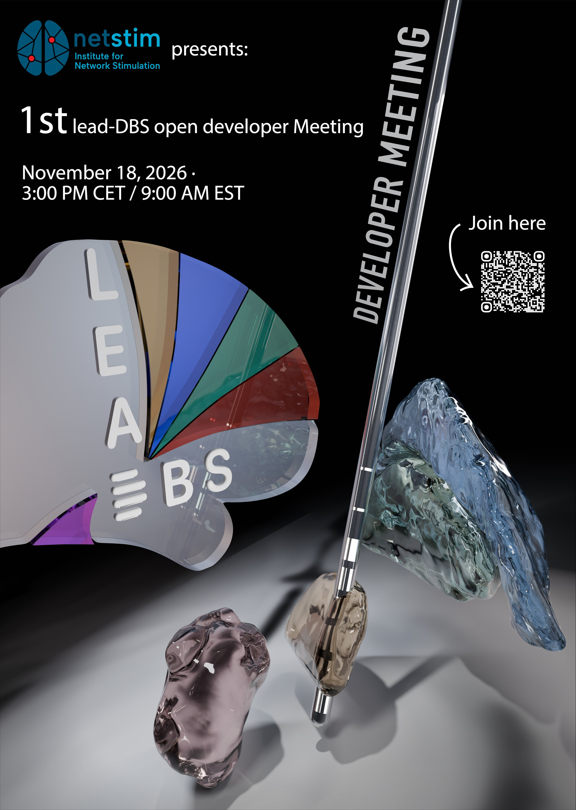

The Lead-DBS Developer Meeting is held on Zoom and is open to anyone who wants to contribute to Lead-DBS or to learn about its ongoing development. The meetings are planned monthly; the date and time of the next one are on the [events page](/events/).

[Register on Zoom](https://uni-koeln.zoom.us/meeting/register/UiZRfHxiRHyyxCMEM0iSPg): you enter your name and e-mail address and Zoom sends you the link to the meeting.

[Download the flyer](lead-dbs-developer-meeting-flyer.jpg) (JPG, A4, 0.6 MB) to share it with colleagues; its QR code leads to the same registration.

To prepare, see [Develop Lead-DBS](/develop/): the source code, how to contribute and how to report a bug.
