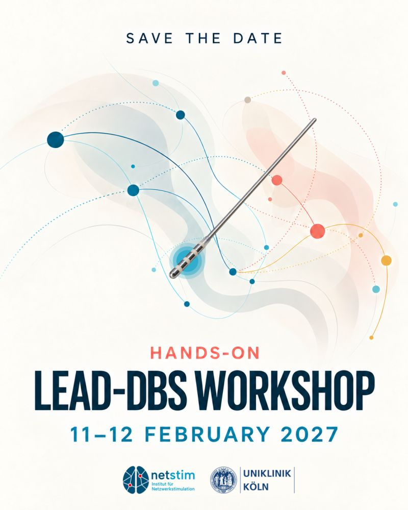

Two days of hands-on work with Lead-DBS in Cologne, hosted by the [Institute for Network Stimulation](https://www.netstim.org/) and Uniklinik Köln (University Hospital Cologne). Participants will be among the first to try the pre-release of Lead-DBS 4.0, rebuilt completely in Python.


Hosted by the Institute for Network Stimulation and Uniklinik Köln.


The venue, programme, fee and registration will be announced in the newsletter and on the [user Slack](/helpsupport/slack-user-channel/).

