## Subcortical Atlases in MNI space

Below you find information about how and where to obtain subcortical atlases suitable for 2D/3D-visualization using Lead-DBS.   If an atlas you know of is missing, please [contact us](/contact/). Also, we are interested in distributing subcortical atlases preinstalled within Lead-DBS, if possible.

**Looking for atlases of the cortex / whole-brain parcellations?** Please see [this page](/helpsupport/knowledge-base/atlasesresources/cortical-atlas-parcellations-mni-space/).

Please read our [philosophy on including code and datasets into Lead-DBS](/about/data-code-inclusion-philosophy/). In brief, inclusion of datasets does not mean endorsement or approval of the datasets you find within Lead-DBS.

### DISTAL Atlas (Ewert 2018) {#distal-atlas-ewert-2017}

This atlas was created especially for use in Lead-DBS and combines multimodal MRI-, histology- and connectivity data into the same atlas to precisely define DBS targets and surrounding structures in [2009b NLIN Asym ICBM space](http://nist.mni.mcgill.ca/?p=904) ([the most modern “MNI space” in highest resolution currently available](/about-the-mni-spaces/)). The histology of this atlas is based on the Chakravarty atlas (see below).

{}
{}
*How to obtain the atlas:*

- The atlas is preinstalled in Lead-DBS
- Current version is v1.1 | Older version: v1.0 (separate downloads of these versions are no longer available)

*Related citations:*

- [Ewert, S., Plettig, P., Li, N., Chakravarty, M. M., Collins, D. L., Herrington, T. M., et al. (2018). Toward defining deep brain stimulation targets in MNI space: A subcortical atlas based on multimodal MRI, histology and structural connectivity. *NeuroImage*, 170, 271–282.](https://doi.org/10.1016/j.neuroimage.2017.05.015)
- [Chakravarty, M. M., Bertrand, G., Hodge, C. P., Sadikot, A. F., & Collins, D. L. (2006). The creation of a brain atlas for image guided neurosurgery using serial histological data. *NeuroImage*, *30*(2), 359–376.](https://doi.org/10.1016/j.neuroimage.2005.09.041)

{}
{}
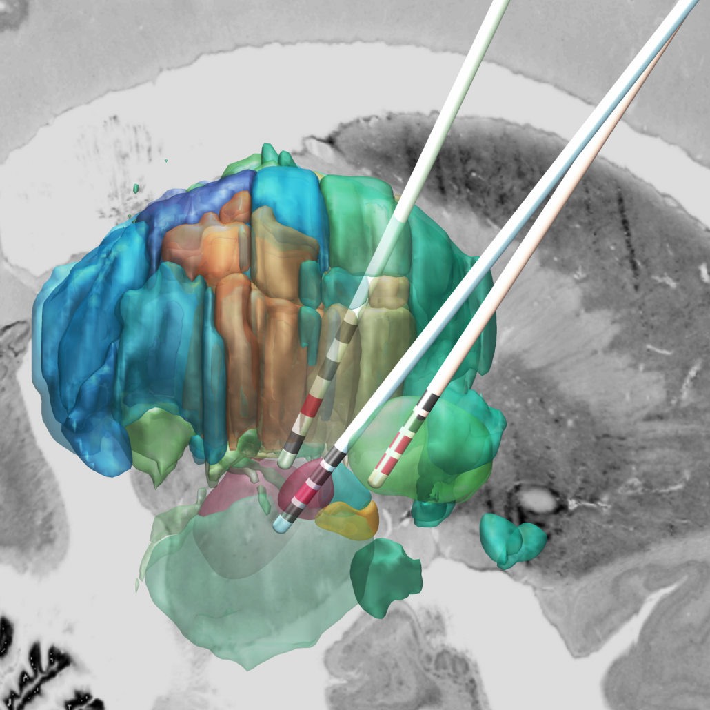  

Subsection of the DISTAL atlas visualized with three typical DBS electrodes

{}
{}

### The Allen Human Reference Atlas (Ding 2020)

The Allen Human Reference Atlas is a parcellation of the adult human brain, labeling every voxel with a brain structure spanning 141 structures. The anatomic structure ontology adapted for use in the atlas was based on the 2016 version of the 2D atlas, published in final form in Ding et al, 2016 and available online [here.](http://www.brainspan.org/static/atlas)

{}
{}
*How to obtain the atlas:*

- You can find more information about this atlas [here](https://community.brain-map.org/t/allen-human-reference-atlas-3d-2020-new/405).
- The atlas is preinstalled within Lead-DBS.

*Related citations:*

- Song‐Lin Ding, Joshua J. Royall, Susan M. Sunkin, Benjamin A.C. Facer, Phil Lesnar, Amy Bernard, Lydia Ng, Ed S. Lein (2020). “Allen Human Reference Atlas – 3D, 2020,” RRID:SCR_017764, version 1.0.0.
- [Ding, S.L., Royall, J.J., […], Lein, E.S. Comprehensive cellular‐resolution atlas of the adult human brain. Journal of Comparative Neurology, Volume 524:16, pages 3127–3481, 1 November 2016.](https://community.brain-map.org/t/allen-human-reference-atlas-3d-2020-new/405)

{}
{}
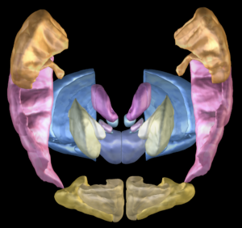

{}
{}

### AHEAD Atlas (Alkemade 2020)

The AHEAD atlas is a freely available multi-modal, 7 Tesla MRI database. Sub-millimeter resolutions for sub cortical structures were achieved by using multi-echo (ME) extension of the second gradient echo imaging of MPRAGE sequences. The probabilistic atlases of the basal ganglia is based on more than 1000 manual delineations. Data is also made available for further analysis.

{}
{}
*How to obtain the atlas:*

- For information about the atlas, see [this link](https://www.sciencedirect.com/science/article/pii/S1053811920306868).
- The atlas is preinstalled in Lead-DBS

*Related citations:*

- [Alkemade A, Mulder MJ, Groot JM, Isaacs BR, van Berendonk N, Lute N, Isherwood SJ, Bazin PL, Forstmann BU. The Amsterdam Ultra-high field adult lifespan database (AHEAD): A freely available multimodal 7 Tesla submillimeter magnetic resonance imaging database. Neuroimage. 2020 Nov 1;221:117200. doi: 10.1016/j.neuroimage.2020.117200. Epub 2020 Aug 1. PMID: 32745682.](https://doi.org/10.1016/j.neuroimage.2020.117200)

{}
{}
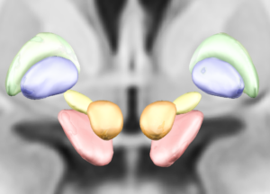

{}
{}

### Human Motor Thalamus atlas (Ilinsky 2018)

*By Ilinsky I. and Kultas-Ilinsky H-K.*

Continuous series of thalamic nuclear maps in three stereotactic planes obtained from a single brain plus the original series of sagittal histological sections and a set of sagittal MRIs from the same brain are available at the site humanmotorthalamus.com.

This is a unique set of images in that the motor related nuclei are outlined based on an immunocytochemical marker specific for terminal zone of each motor-related subcortical afferent system such as cerebellar, pallidal and nigral. These territories are shown within the Talairach coordinate system and their correspondence to Hassler’s parcellations of the motor related nuclei as well as Jones-Morel outlines is discussed in an accompanying manuscript Ilinsky et al., 2018, available at the site referenced below. Also comparison with some related DTI tractography data is given.

{}
{}
*How to obtain the atlas:*

- For information about the atlas, [here](http://www.humanmotorthalamus.com/).
- The atlas is preinstalled in Lead-DBS

*Related citations:*

- [Ilinsky, I., Horn, A., Paul-Gilloteaux, P., Gressens, P., Verney, C., & Kultas-Ilinsky, K. (2018). Human Motor Thalamus Reconstructed in 3D from Continuous Sagittal Sections with Identified Subcortical Afferent Territories. *ENeuro*, *5*(3). https://doi.org/10.1523/ENEURO.0060-18.2018](https://doi.org/10.1523/ENEURO.0060-18.2018)

{}
{}
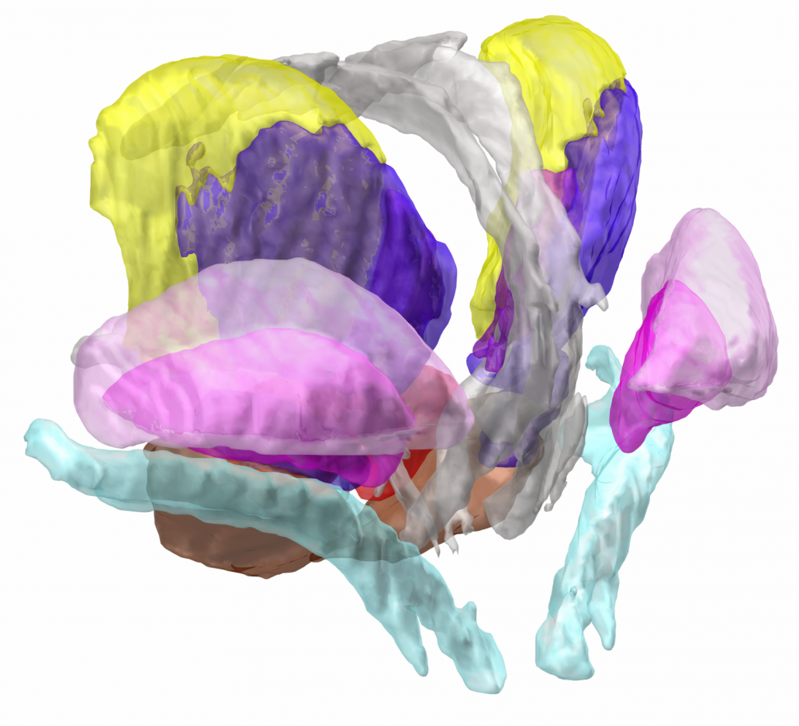

{}
{}

### CIT168 Reinforcement Learning Atlas (Pauli 2017)

Initially built to study structures involved in reinforcement learning processes, this atlas captures all primary DBS targets and structures of interest. Probabilistic atlas based on manual segmentations on HCP data.

{}
{}
*How to obtain the atlas:*

- You can get information about this atlas and download it [here](https://osf.io/jkzwp/).
- The atlas nuclei in ICBM 2009c space are available [here](https://neurovault.org/collections/3145/).
- The atlas was migrated from CIT168 space to ICBM 2009b space and comes preinstalled within Lead-DBS. A refined warp was created in 02/20 and resulted in current version v1.1 | older version: v1.0 (separate downloads of these versions are no longer available)

*Related citations:*

- [Pauli, W. M., Nili, A. N., & Tyszka, J. M. (2018). A high-resolution probabilistic in vivo atlas of human subcortical brain nuclei. *Scientific Data*, *5*, 180063.](https://doi.org/10.1038/sdata.2018.63)

{}
{}
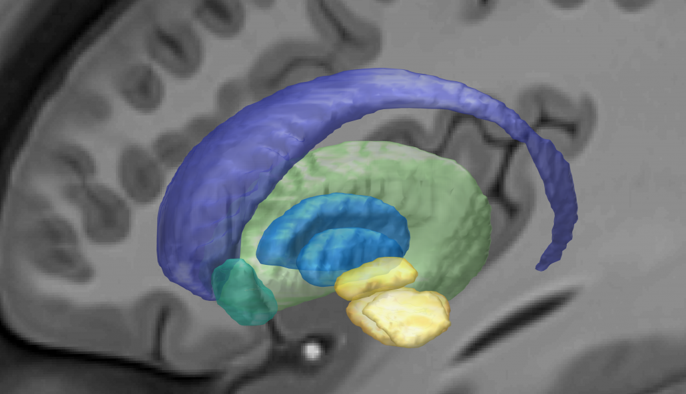

{}
{}

### Thalamic DBS Connectivity atlas (Akram 2018)

This atlas parcellates the thalamus based on connectivity – including a region predominantly connected to the contralateral dentate via the dentatorubrothalamic tract.

{}
{}
*How to obtain the atlas:*

- The atlas comes preinstalled with Lead-DBS.

*Related citations:*

- [Akram, H., Dayal, V., Mahlknecht, P., Georgiev, D., Hyam, J., Foltynie, T., et al. (2018). Connectivity derived thalamic segmentation in deep brain stimulation for tremor. *NeuroImage. Clinical*, *18*, 130–142.](https://doi.org/10.1016/j.nicl.2018.01.008)

{}
{}
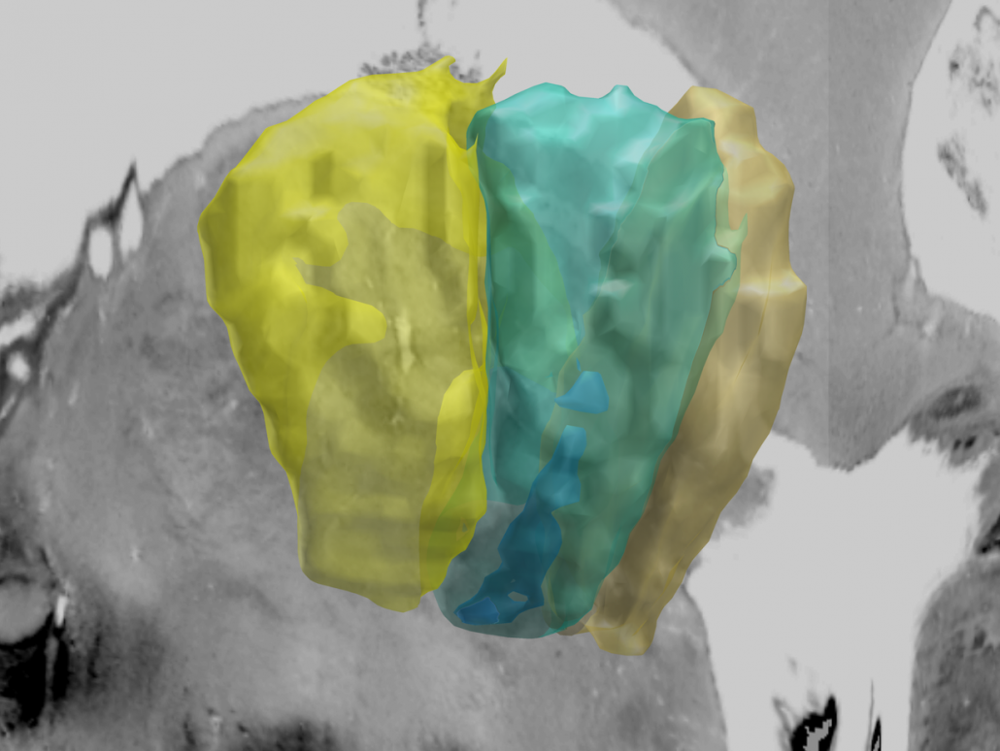

{}
{}

### MNI PD25 atlas (Xiao 2017)

This atlas is defined on a specialized, Parkinson Disease specific template based on multispectral imaging that visualizes primary target regions such as the subthalamic nucleus. Key structures were defined on MRI, further structures were added using the same histological data introduced in the Chakravarty atlas (see above).

{}
{}
*How to obtain the atlas:*

- You can get information about this atlas and download it [here](http://nist.mni.mcgill.ca/?p=1209).
- The atlas comes preinstalled within Lead-DBS.

*Related citations:*

- [Xiao, Y., Fonov, V., Chakravarty, M. M., Bériault, S., Al-Subaie, F., Sadikot, A., et al. (2017). A dataset of multi-contrast population-averaged brain MRI atlases of a Parkinson׳s disease cohort. *NeuroImage*, *12*, 370–379.](https://doi.org/10.1016/j.dib.2017.04.013)
- [Xiao, Y., Bériault, S., Pike, G. B., & Collins, D. L. (2012). Multicontrast multiecho FLASH MRI for targeting the subthalamic nucleus. *Magnetic Resonance Imaging*, *30*(5), 627–640.](https://doi.org/10.1016/j.mri.2012.02.006)
- [Xiao, Y., Fonov, V., Bériault, S., Subaie, F. A., Chakravarty, M. M., Sadikot, A. F., et al. (2014). Multi-contrast unbiased MRI atlas of a Parkinson’s disease population. *International Journal of Computer Assisted Radiology and Surgery*, *10*(3), 329–341.](https://doi.org/10.1007/s11548-014-1068-y)
- [Chakravarty, M. M., Bertrand, G., Hodge, C. P., Sadikot, A. F., & Collins, D. L. (2006). The creation of a brain atlas for image guided neurosurgery using serial histological data. *NeuroImage*, *30*(2), 359–376.](http://www.sciencedirect.com/science/article/pii/S1053811905006993)

{}
{}
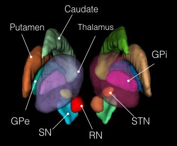

{}
{}

### Computational Brain Anatomy Lab Merged Atlas (CoBrALab Atlas) in MNI Space (Pipitone 2014)

The CoBrALab produces manually segmented MNI-based atlases of brain anatomy on their 5 high-resolution (0.3 mm isotropic) T1 and T2 templates for use with their registration-based [segmentation pipeline MAGeTbrain](https://github.com/CoBrALab/MAGetBrain). In order to enable usage of their atlases for common-space localization in MNI space, they applied the MAGeTbrain pipeline to all publicly available MNI space templates in order to provide MNI space localization. These atlases contain the thamalus, globlus paladus, striatum, hippocampus with its subfields and whitematter, and the amydalaya.

{}
{}
*How to obtain the atlas:*

- You can get information about this atlas and download it [here](https://github.com/CobraLab/atlases/tree/master/mni_models).
- The atlas is preinstalled within Lead-DBS.

*Related citations:*

- [Multi-atlas segmentation of the whole hippocampus and subfields using multiple automatically generated templates. (2014). Multi-atlas segmentation of the whole hippocampus and subfields using multiple automatically generated templates., *101*, 494–512.](https://doi.org/10.1016/j.neuroimage.2014.04.054)
- [Chakravarty, M. M., Steadman, P., van Eede, M. C., Calcott, R. D., Gu, V., Shaw, P., et al. (2012). Performing label-fusion-based segmentation using multiple automatically generated templates. *Human Brain Mapping*, *34*(10), 2635–2654.](https://doi.org/10.1002/hbm.22092)
- Amygdala label: [A reliable protocol for the manual segmentation of the human amygdala and its subregions using ultra-high resolution MRI. (2012). A reliable protocol for the manual segmentation of the human amygdala and its subregions using ultra-high resolution MRI., *60*(2), 1226–1235.](https://doi.org/10.1016/j.neuroimage.2011.12.073)
  - [More info here](https://github.com/CobraLab/atlases/tree/master/amygdala)
- Striatum, pallidum and thamalus: [Warping an atlas derived from serial histology to 5 high-resolution MRIs. (2018). Warping an atlas derived from serial histology to 5 high-resolution MRIs., *5*, 180107.](https://doi.org/10.1038/sdata.2018.107)
  - [More info here](https://github.com/CobraLab/atlases/tree/master/5-atlas-subcortical)
- Hippocampus subfields: [A novel in vivo atlas of human hippocampal subfields using high-resolution 3 T magnetic resonance imaging. (2013). A novel in vivo atlas of human hippocampal subfields using high-resolution 3 T magnetic resonance imaging., *74*, 254–265.](https://doi.org/10.1016/j.neuroimage.2013.02.003)

  - [More info here](https://github.com/CobraLab/atlases/tree/master/hippocampus-subfields)
- Hippocampus / other: [Manual segmentation of the fornix, fimbria, and alveus on high-resolution 3T MRI: Application via fully-automated mapping of the human memory circuit white and grey matter in healthy and pathological aging. (2018). Manual segmentation of the fornix, fimbria, and alveus on high-resolution 3T MRI: Application via fully-automated mapping of the human memory circuit white and grey matter in healthy and pathological aging., *170*, 132–150.](https://doi.org/10.1016/j.neuroimage.2016.10.027)
  - [More info here](https://github.com/CobraLab/atlases/tree/master/hippocampus-subfields)

{}
{}
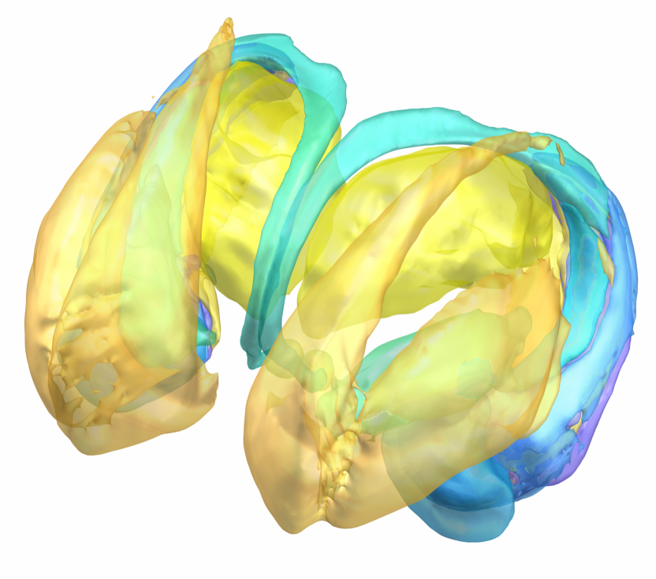

{}
{}

### Subcortical White Matter Pathways (Avecillas 2019)

A set of tractograms generated by targeted tractography describing the main trajectories of some subcortical white matter pathways. These trajectories represent:

1. The thalamocortical system from the associative (Brodmann areas 8, 9, 10, 46, and 47) and limbic cortical regions (Brodmann areas 11, 12, and 32, ventral part of areas 24 and 25) [1] to the thalamus [2–5].
2. The Mesocorticolimbic system. Connections of the associative (Brodmann areas 8, 9, 10, 46, and 47) and limbic cortical regions (Brodmann areas 11, 12, and 32, ventral part of areas 24 and 25) to the midbrain nuclei: substantia nigra compacta and reticulata and the ventral tegmental area [2–5].
3. The cerebellothalamic system concerning the motor circuit from the cerebellar nuclei to the ventral intermediate nucleus [7].

These tractograms were generated using the IT Human template [8]

{}
{}
*How to obtain the atlas:*

- The atlas is preinstalled within Lead-DBS.

*Related citations:*

1. [Fuster JM. The Prefrontal Cortex. Fourth ed. Elsevier; 2008.](https://www.sciencedirect.com/book/9780123736444/the-prefrontal-cortex)
2. [Avecillas-Chasin JM, Hurwitz TA, Bogod NM, Honey CR. An Analysis of Clinical Outcome and Tractography following Bilateral Anterior Capsulotomy for Depression. Stereotact Funct Neurosurg. 2019;97(5-6):369-380.  (details on how these tractograms were generated).](https://www.karger.com/Article/FullText/505077)
3. [Avecillas-Chasin, J. M., Hurwitz, T. A., Bogod, N. M., & Honey, C. R. (2021). Tractography-Guided Anterior Capsulotomy for Major Depression and Obsessive-Compulsive Disorder: Targeting the Emotion Network. *Operative Neurosurgery*, *20*(4), 406–412. https://doi.org/10.1093/ons/opaa420](https://doi.org/10.1093/ons/opaa420)
4. [Lehman JF, Greenberg BD, McIntyre CC, Rasmussen SA, Haber SN. Rules Ventral Prefrontal Cortical Axons Use to Reach Their Targets: Implications for Diffusion Tensor Imaging Tractography and Deep Brain Stimulation for Psychiatric Illness. J Neurosci. 2011;31(28):10392-10402.](https://www.ncbi.nlm.nih.gov/pmc/articles/PMC3445013/)
5. [Jbabdi S, Lehman JF, Haber SN, Behrens TE. Human and Monkey Ventral Prefrontal Fibers Use the Same Organizational Principles to Reach Their Targets: Tracing versus Tractography. J Neurosci. 2013;33(7):3190-3201.](https://pubmed.ncbi.nlm.nih.gov/23407972/)
6. [Schmahmann JD, Pandya DN. Fiber Pathways of the Brain. In: Fiber Pathways of the Brain. Oxford University Press; 2006:501-516.](https://oxford.universitypressscholarship.com/view/10.1093/acprof:oso/9780195104233.001.0001/acprof-9780195104233)
7. Avecillas-Chasin JM, Honey CR, Heran M, Krüger MT. Deep Brain Stimulation of the Pallidofugal and Cerebellothalamic Pathways in Refractory Essential Tremor. Under review. Neuroimage clinical. (details on how these tractograms were generated).
8. [Zhang S, Arfanakis K. Evaluation of standardized and study-specific diffusion tensor imaging templates of the adult human brain: Template characteristics, spatial normalization accuracy, and detection of small inter-group FA differences. Neuroimage. 2018;172:40-50.](https://www.sciencedirect.com/science/article/abs/pii/S1053811918300466?via%3Dihub)

{}
{}
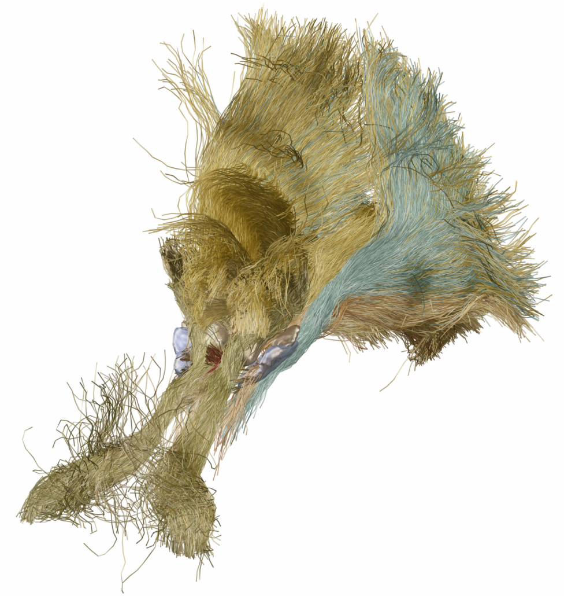

{}
{}

### STN Sweetspots (Dembek 2019)

A set of probabilistic sweetspots based on 449 DBS settings in 21 PD patients which showed utility to predict variance in clinical outcomes following STN-DBS in out-of-sample data.

{}
{}
*How to obtain the atlas:*

- You can find more information about this atlas [here](https://osf.io/ybdjf/).
- The atlas is preinstalled within Lead-DBS.

*Related citations:*

- [Dembek, T.A., Roediger, J., Horn, A., Reker, P., Oehrn, C., Dafsari, H.S., Li, N., Kühn, A.A., Fink, G.R., Visser-Vandewalle, V., Barbe, M.T., Timmermann, L., 2019. Probabilistic Sweetspots Predict Motor Outcome for DBS in Parkinson’s Disease. Ann Neurol ana.25567–35.](https://onlinelibrary.wiley.com/doi/abs/10.1002/ana.25567)

{}
{}
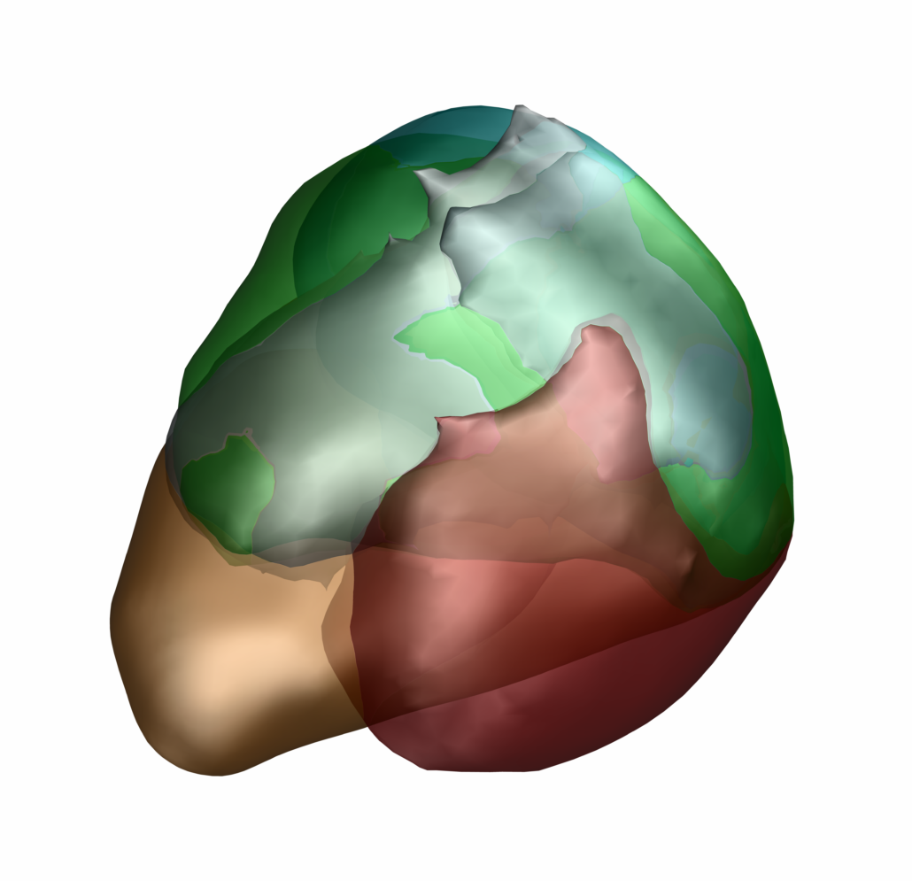

{}
{}

### TOR-PSM (Elias 2020)

An atlas of DBS sweet- & sourspots for PD (STN & GPi), Dystonia, Essential Tremor and psychiatric diseases.

{}
{}
*How to obtain the atlas:*

- The atlas is preinstalled within Lead-DBS.

Related citations:

- [Probabilistic Mapping of Deep Brain Stimulation: Insights from 15 Years of Therapy. (2020). Annals of Neurology, ana.25975–48.](https://doi.org/10.1002/ana.25975)

{}
{}
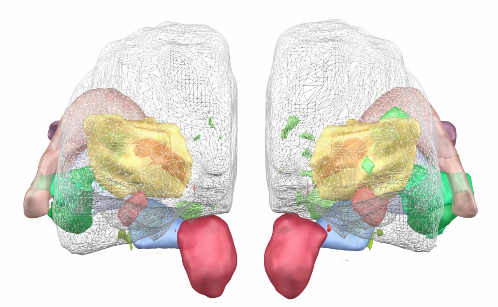

{}
{}

### TOR-signPD (Boutet 2021)

A set of symptom-specific probabilistic mapping regions in PD accounting for sweet- & coldspots for bradykinesia, tremor, rigidity & axial symptoms.

{}
{}
*How to obtain the atlas:*

- You can find more information about this atlas [here](https://doi.org/10.5281/zenodo.4425256).
- The atlas is preinstalled within Lead-DBS.

Related citations:

- [Boutet A, Germann J, Gwun D, Loh A, Elias GJB, Neudorfer C, Paff M, Horn A, Kuhn AA, Munhoz RP, Kalia SK, Hodaie M, Kucharczyk W, Fasano A, Lozano AM. Sign-specific stimulation “hot” and “cold” spots in Parkinson’s disease validated with machine learning. Brain Commun. 2021;3(2):fcab027. doi:10.1093/braincomms/fcab027](https://pubmed.ncbi.nlm.nih.gov/33870190/)

{}
{}
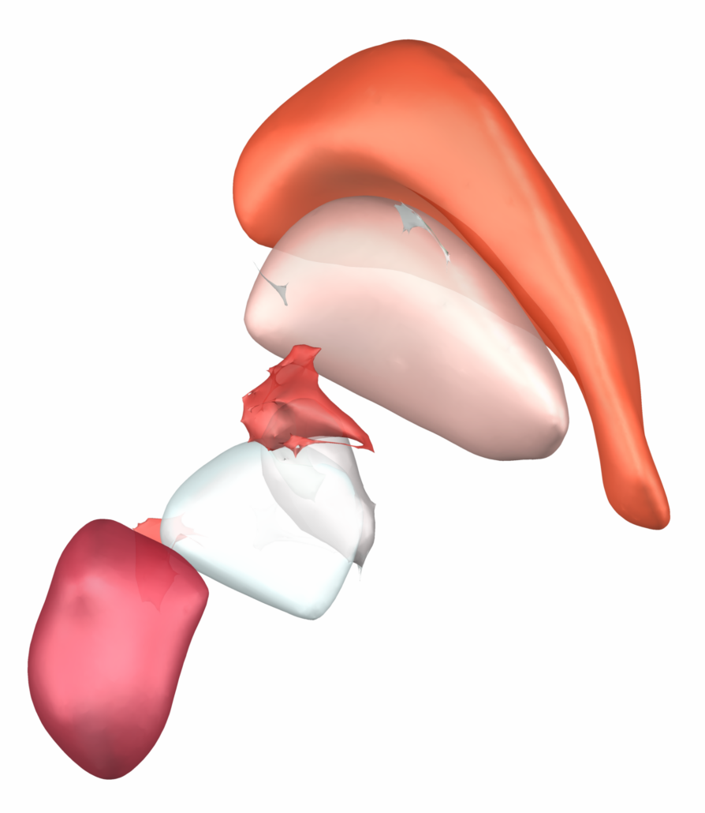

{}
{}

### OCD Response Tract Atlas (Li 2020)

This atlas builds upon networks associated with optimal responses in patients with Obsessive Compulsive Disorder analyzed with the DBS fiber filtering (a.k.a. discriminative tractography) method as implemented within Lead-DBS. Building upon a large collective of N = 50 patients from four centers and a normative connectome calculated in 1,000 participants, this atlas differentiates specific bundles associated with optimal response across two different stimulation targets (subthalamic nucleus and anterior limb of the internal capsule). Relevance of the tract for two additional brain targets (bed nucleus of the stria terminalis and internal pallidum) have been indirectly shown, as well (see Baldermann et al., Biological Psychiatry 2022). Optimal fMRI response networks based on Li & Hollunder et al., Biological Psychiatry 2021) are also provided.

{}
{}
*How to obtain the atlas:*

- The atlas is preinstalled within Lead-DBS.

Related citations:

- [Li N, Baldermann JC, Kibleur A, Treu S, Akram H, Elias GJB, Boutet A, Lozano AM, Al-Fatly B, Strange B, Barcia JA, Zrinzo L, Joyce E, Chabardes S, Visser-Vandewalle V, Polosan M, Kuhn J, Kühn AA, Horn A. A unified connectomic target for deep brain stimulation in obsessive-compulsive disorder. Nature Communications 2020.](https://www.nature.com/articles/s41467-020-16734-3) **[♦ Preprint](https://www.biorxiv.org/content/10.1101/608786v4)** **[♦ Open Access](https://www.nature.com/articles/s41467-020-16734-3)**
- [Li N, Hollunder B, Baldermann JC, Kibleur A, Treu S, Akram H, Al-Fatly B, Strange B, Barcia JA, Zrinzo L, Joyce E, Chabardes S, Visser-Vandewalle V, Polosan M, Kuhn J, Kühn AA, Horn A. A unified functional network target for deep brain stimulation in obsessive-compulsive disorder. Biological Psychiatry. 2021.](https://www.biologicalpsychiatryjournal.com/article/S0006-3223(21)01223-3/fulltext) **[♦ PDF](http://www.netstim.org/published_manuscripts/Li_Hollunder_et_al_2021_Biological_Psychiatry.pdf)**
- [Baldermann JC, Schüller T, Kohl S, Voon V, Li N, Hollunder B, Figee M, Haber SN, Sheth SA, Mosley PE, Huys D, Johnson KA, Butson C, Ackermans L, van der Vlis TB, Leentjens AFG, Barbe M, Visser-Vandewalle V, Kuhn J, Horn A. Connectomic deep brain stimulation for obsessive-compulsive disorder. Biological Psychiatry. 2021.](https://www.biologicalpsychiatryjournal.com/article/S0006-3223(21)01461-X/fulltext) **[♦ Open Access](https://www.biologicalpsychiatryjournal.com/article/S0006-3223(21)01461-X/fulltext) [♦ PDF](http://www.netstim.org/published_manuscripts/Baldermann_et_al_2021_BioPsych.pdf)**
- [Baldermann, M. D., Corina Melzer, M. S., Alexandra Zapf, M. S., Sina Kohl, P. D., Lars Timmermann, P., Marc Tittgemeyer, P. D., et al. (2019). Connectivity profile predictive of effective deep brain stimulation in obsessive compulsive disorder. *Biological Psychiatry*, 1–35.](https://doi.org/10.1016/j.biopsych.2018.12.019) **[♦ PDF](https://www.netstim.org/published_manuscripts/Baldermann_et_al_2019_BioPsych.pdf)**

{}
{}
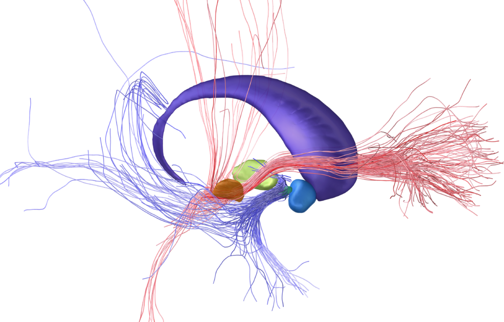

{}
{}

### Dystonia Response Tract Atlas (Horn 2022)

This atlas builds upon networks associated with optimal responses in patients with cervical vs. generalized dystonia analyzed with the DBS fiber filtering (a.k.a. discriminative tractography) method as implemented within Lead-DBS. Building upon a large collective of N = 80 patients from five centers and a precise definition of tracts within the subcortical area defined by the Basal Ganglia Pathway Atlas ([Petersen et al. 2019 Neuron](https://www.cell.com/neuron/pdf/S0896-6273(19)30832-3.pdf)), this atlas differentiates specific bundles associated with optimal responses in the two phenotypes of dystonia. A sweetspot model and optimal fMRI response networks are also provided.

{}
{}
*How to obtain the atlas:*

- The atlas is preinstalled within Lead-DBS.

Related citations:

- [Horn, A., Reich, M. M., Ewert, S., Li, N., Al-Fatly, B., Lange, F., Roothans, J., Oxenford, S., Horn, I., Paschen, S., Runge, J., Wodarg, F., Witt, K., Nickl, R. C., Wittstock, M., Schneider, G.-H., Mahlknecht, P., Poewe, W., Eisner, W., … Kühn, A. A. (2022). Optimal deep brain stimulation sites and networks for cervical vs. Generalized dystonia. *Proceedings of the National Academy of Sciences*, *119*(14), e2114985119. https://doi.org/10.1073/pnas.2114985119.](https://doi.org/10.1073/pnas.2114985119) [**♦** **Pre****print**](https://www.medrxiv.org/content/10.1101/2021.07.28.21261289v1)

{}
{}
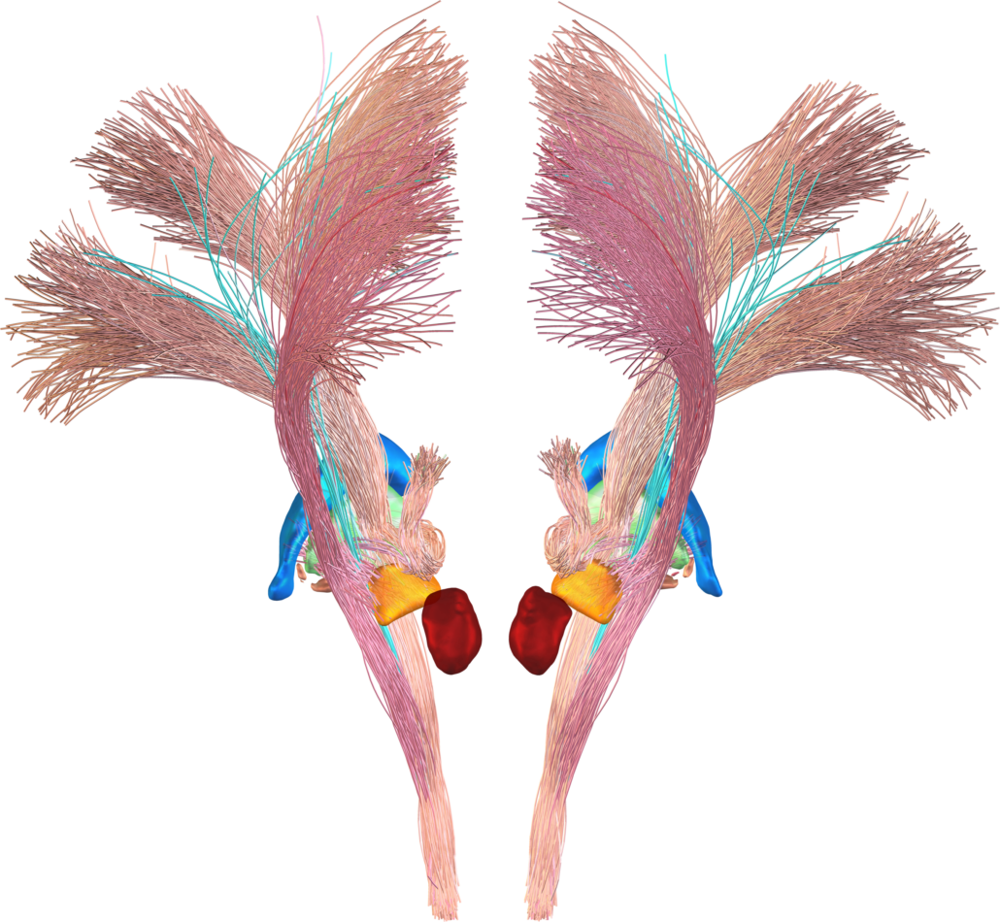

{}
{}

### Essential Tremor Hypointensity (Neudorfer 2022)

Using fast gray matter acquisition T1 inversion recovery (FGATIR) sequences, Neudorfer et al. identified an imaging-based hypointensity marker that has the potential to inform surgical targeting and stimulation programming in Essential Tremor. The clinical applicability of the hypointensity was validated using – among others – a probabilistic map of tremor improvement derived from 36 patients. Both, the hypointensity template and the probabilistic map have been combined into a comprehensive atlas resource featured in Lead-DBS.

{}
{}
*How to obtain the atlas:*

- The atlas is preinstalled within Lead-DBS.

Related citations:

- [Neudorfer C, Kroneberg D, Al-Fatly B, Goede L, Kübler D, Faust K, Rienen U van, Tietze A, Picht T, Herrington TM, Middlebrooks EH, Kühn A, Schneider GH, Horn A. Personalizing Deep Brain Stimulation Using Advanced Imaging Sequences. *Annals of Neurology.*](https://onlinelibrary.wiley.com/doi/abs/10.1002/ana.26326) **[♦](https://www.medrxiv.org/content/10.1101/2021.10.04.21264488v1)** **[Preprint](https://www.medrxiv.org/content/10.1101/2021.10.04.21264488v1) [♦ Open Access](https://onlinelibrary.wiley.com/doi/abs/10.1002/ana.26326)**

{}
{}
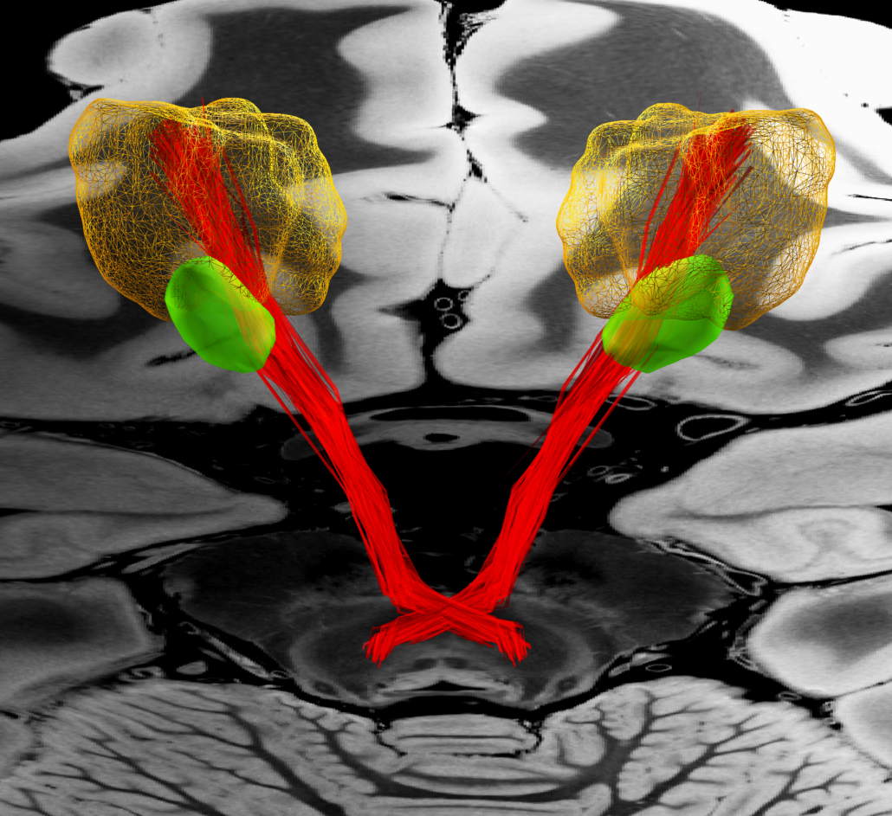

{}
{}

### Essential Tremor Probabilistic Mapping (Nowacki 2022)

The essential tremor probabilistic stimulation map is based on neuroimaging and longterm clinical outcome data (% tremor reduction at 12 months following DBS lead implantation) of 119 patients from five different European centers. The map contains a mean improvement image, which displays the volume of therapeutic effect of DBS where each voxel is assigned the mean tremor improvement of all associated stimulation volumes that activated this particular voxel. Furthermore, it displays a stimulation sweet spot representing a statistically significant volume that is associated with a greater than 50% tremor improvement.

{}
{}
*How to obtain the atlas:*

- The atlas is preinstalled within Lead-DBS.

Related citations:

- [Nowacki A, Barlatey S, Al‐Fatly B, Dembek T, Bot M, Green AL, Kübler D, Lachenmayer ML, Debove I, Segura‐Amil A, Horn A, Visser‐Vandewalle V, Schuurman R, Barbe M, Aziz TZ, Kühn AA, Nguyen TAK, Pollo C. Probabilistic Mapping Reveals Optimal Stimulation Site in Essential Tremor. *Annals of Neurology*. Published online March 3, 2022:ana.26324.](https://doi.org/10.1002/ana.26324)

{}
{}
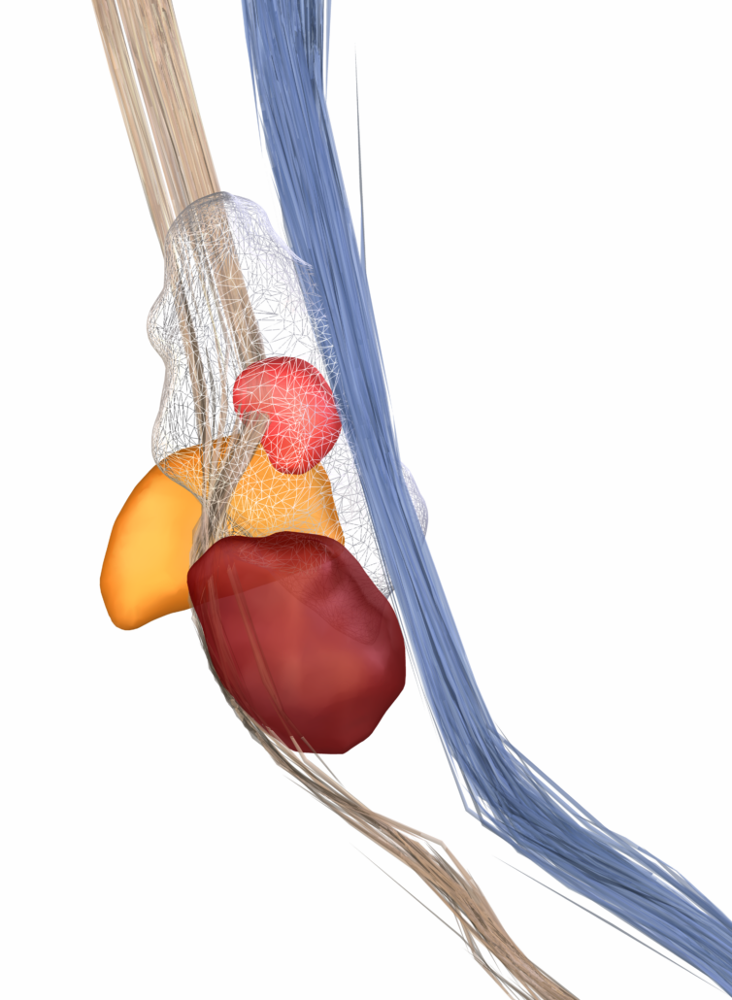

{}
{}

### Enhanced tissue probability maps (Lorio 2016)
The enhanced Tissue Probability Maps are a set of gray-, white- and csf- priors for segmentation of subcortical structures using SPM based on manual labelling of iron and myelin specific parameter maps of nearly 100 individuals aged 25-75yo. Not specifically a subcortical atlas (with strict boundaries for each nucleus), they are still a highly valuable source for patient-specific segmentation and normalization with specific focus on the subcortex. Lead-DBS uses the TPMs to generate customized space-specific TPMs for each “space” that you use (for instance, a TPM for the default ICBM 2009b NLIN Asym space is generated based on the Lorio et al. enhances TPMs).

{}
{}
*How to obtain the atlas:*

- You can get information about this atlas and download it [here](https://www.unil.ch/lren/home/menuinst/teaching--utilities/data--utilities.html).
- As mentioned above, the TPM is used as a fundamental building block in Lead-DBS.

*Related citations:*

- [Lorio, S., Fresard, S., Adaszewski, S., Kherif, F., Chowdhury, R., Frackowiak, R. S., et al. (2016). New tissue priors for improved automated classification of subcortical brain structures on MRI. *NeuroImage*, *130*, 157–166.](https://doi.org/10.1016/j.neuroimage.2016.01.062)

{}
{}
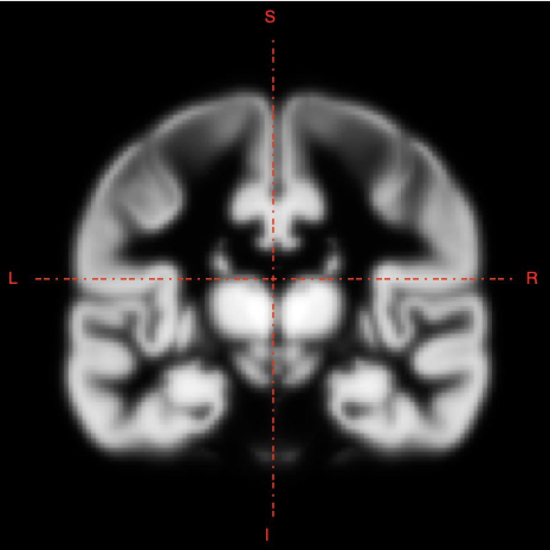

{}
{}

### Brainstem connectome (Meola 2016)
This set of canonical fiber tracts in MNI space have been defined using human connectome project data and include fibertracts that are relevant to DBS surgery such as the dentato-rubro-thalamic tracts, the corticospinal tract and many more. The set of fibers was kindly provided for distribution within Lead-DBS by Antonio Meola from Brigham’s and Womens Hospital in Boston. You can [read more](http://us8.campaign-archive1.com/?u=a5b93846a3a2a714edbcce8ef&id=aa1f8724d5) about the fiber atlas here. You may contact Antonio in case of questions using our [contact us](/contact/) webform.

{}
{}
*How to obtain the atlas:*

- The atlas comes pre-installed with Lead-DBS.

*Related citations:*

- [Meola, A., Yeh, F.-C., Fellows-Mayle, W., Weed, J., & Fernandez-Miranda, J. C. (2016). Human Connectome-Based Tractographic Atlas of the Brainstem Connections and Surgical Approaches. *Neurosurgery*, 1–18. http://doi.org/10.1227/NEU.0000000000001224](http://www.ncbi.nlm.nih.gov/pubmed/26914259)
- [Meola, A., Comert, A., Yeh, F.-C., Sivakanthan, S., & Fernandez-Miranda, J. C. (2015). The nondecussating pathway of the dentatorubrothalamic tract in humans: human connectome-based tractographic study and microdissection validation. *Journal of Neurosurgery*, 1–7. http://doi.org/10.3171/2015.4.JNS142741](http://www.ncbi.nlm.nih.gov/pubmed/26452117)

{}
{}
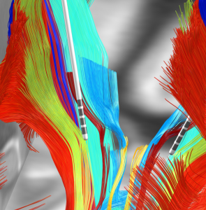

{}
{}

### Electrophysiological Atlas of STN Activity (Horn 2017)

In this atlas, beta power estimates recorded from >50 PD patients were mapped to the subthalamic nucleus, forming an electrophysiological target for DBS.

{}
{}
*How to obtain the atlas:*

- The atlas comes pre-installed with Lead-DBS.
- More information on the subcortical electrophysiology mapping (SEM) approach and the atlas can be found [here](/subcortical-electrophysiology-mapping/).

*Related citations:*

- [Horn, A., Neumann, W.-J., Degen, K., Schneider, G.-H., & Kühn, A. A. (2017). Toward an electrophysiological “sweet spot” for deep brain stimulation in the subthalamic nucleus. *Human Brain Mapping*.](https://doi.org/10.1002/hbm.23594)

{}
{}
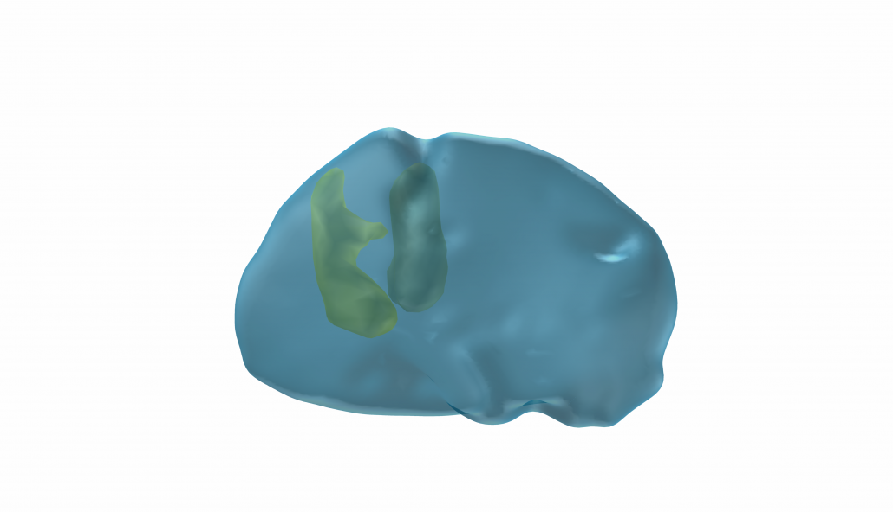

{}
{}

### Electrophysiological Atlas of GPi Activity (Neumann 2017)

In this atlas, theta power estimates recorded from 27 dystonia patients were mapped to the internal pallidum, forming an electrophysiological target for DBS. Literature based similar sweetspots are also included.

{}
{}
*How to obtain the atlas:*

- The atlas comes pre-installed with Lead-DBS.
- More information on the atlas can be found [here](https://us8.campaign-archive.com/?u=a5b93846a3a2a714edbcce8ef&id=5d0c76f0df).
- More information on the subcortical electrophysiology mapping (SEM) approach can be found [here](/subcortical-electrophysiology-mapping/).

*Related citations:*

- [Neumann, W.-J., Horn, A., Ewert, S., Huebl, J., Brücke, C., Slentz, C., et al. (2017). A localized pallidal physiomarker in cervical dystonia. *Annals of Neurology*.](https://doi.org/10.1002/ana.25095)

{}
{}
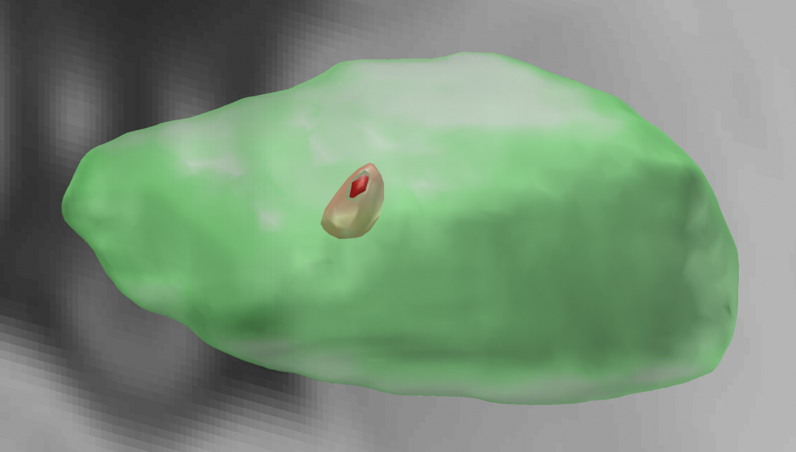

{}
{}

### Accolla 2014 STN functional zones atlas
Atlas with a parcellation of the BGHAT-volume (see above) of the STN into three functional zones (sensorimotor,associative, limbic) based on diffusion-based tractography.

{}
{}
*How to obtain the atlas:*

- The atlas comes pre-installed with Lead-DBS.

*Related citations:*

- [Accolla, E. A., Dukart, J., Helms, G., Weiskopf, N., Kherif, F., Lutti, A., et al. (2014). Brain tissue properties differentiate between motor and limbic basal ganglia circuits. *Human Brain Mapping*. doi:10.1002/hbm.22533](http://www.ncbi.nlm.nih.gov/pubmed/24777915)

{}
{}
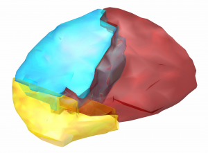

{}
{}

### Ultra-high field atlas for DBS planning

Atlas including STN, pallidum and red nucleus made on 7T data from 12 healthy controls. The templates on which the atlas is defined is not in MNI space but can be used within Lead-DBS for normalizations, as well (instead of using an MNI template). Also, there is an MNI version ported from template to MNI space available within Lead-DBS.

{}
{}
*How to obtain the atlas:*

- An MNI version of the atlas comes preinstalled within Lead-DBS
- Original 7T template space atlases and templates can be downloaded via the Lead-DBS spaces menu, as well
- The raw data can be downloaded [here](https://www.nitrc.org/projects/deepbrain7t/)

*Related citations:*

- [Wang, B. T., Poirier, S., Guo, T., Parrent, A. G., Peters, T. M., & Khan, A. R. (2016).  Generation and evaluation of an ultra-high-field atlas with applications in DBS planning. *SPIE Medical Imaging*, *9784*, 97840H–97840H–10. http://doi.org/10.1117/12.2217126](http://proceedings.spiedigitallibrary.org/proceeding.aspx?articleid=2506160)

{}
{}
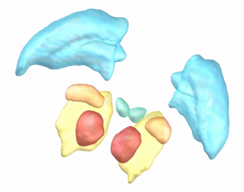

{}
{}

### Melbourne Subcortex Atlas (Tian 2020)

This hierarchical functional MRI Atlas of the human subcortex features

- Volumetric parcellation of the human subcortex representing consensus among more than 1000 healthy adults.
- Available in four hierarchical scales as well as 3 and 7 Tesla versions.
- Personalizable to represent individual variation in regional boundaries.
- Seamlessly integratable into established cortex-only parcellation atlases.
- Includes subdivisions of the striatum, thalamus, hippocampus, amygdala and globus pallidus.

{}
{}
*How to obtain the atlas:*

- The atlas comes preinstalled within Lead-DBS.
- The atlas can be downloaded [here](https://github.com/yetianmed/subcortex).

*Related citations:*

- [Tian, Y., Margulies, D. S., Breakspear, M., & Zalesky, A. (2020). Hierarchical organization of the human subcortex unveiled with functional connectivity gradients. bioRxiv, 2020.01.13.903542.](https://doi.org/10.1101/2020.01.13.903542)

{}
{}
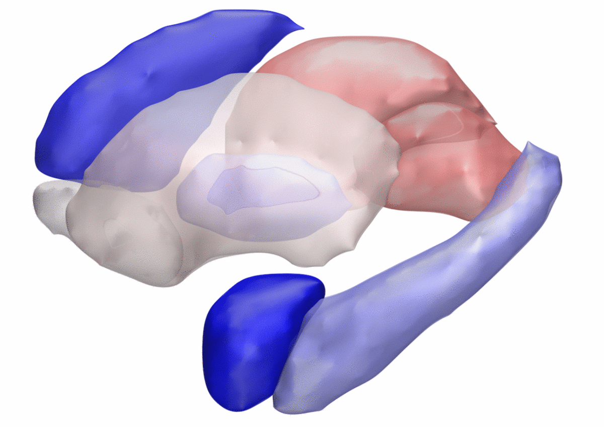

{}
{}

### Atlas of the Basal Ganglia and Thalamus (ABGT)

This atlas was generated in a hybrid manner using both structural and functional information. Components of the basal ganglia were first defined structurally with the “[atlas of the basal ganglia](https://www.nitrc.org/projects/atag/)” ([ATAG](https://www.nitrc.org/projects/atag/); Keuken et al., 2014), including the striatum, globus pallidus externus (GPe) and internus (GPi), subthalamic nucleus (STN), and substantia nigra (SN). We also localized the spatial extent of the thalamus based on the Morel atlas (Morel et al., 1997; Krauth et al., 2010). Due to the relatively small size of the GPi, GPe, STN, and SN, these components were kept in consistent with ATAG without any additional processing. For the striatum and thalamus, we then performed a masked independent component analysis (ICA) based functional parcellation (Moher Alsady et al., 2016) to divide them into functionally distinctive subdivisions.

{}
{}
*How to obtain the atlas:*

- The atlas is preinstalled within Lead-DBS

*Related citations:*

- [He, X., Chaitanya, G., Asma, B., Caciagli, L., Bassett, D. S., Tracy, J. I., & Sperling, M. R. (2020). Disrupted basal ganglia–thalamocortical loops in focal to bilateral tonic-clonic seizures. *Brain : a Journal of Neurology*, *143*(1), 175–190.](https://doi.org/10.1093/brain/awz361)

{}
{}
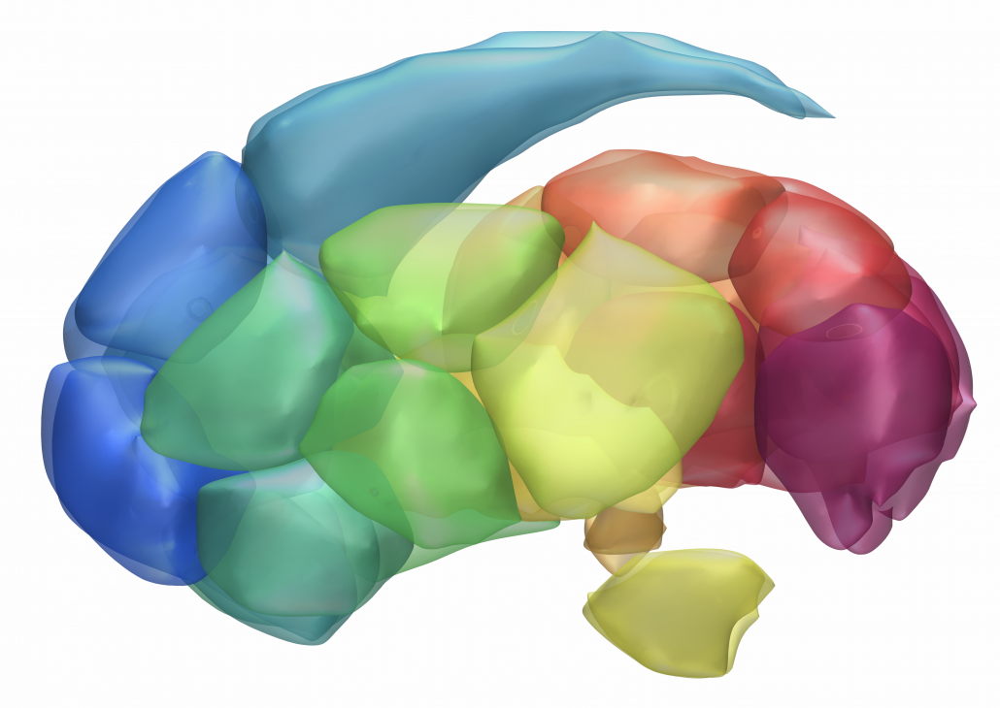

{}
{}

### DBS targets atlas
Atlas defining DBS targets for nine diseases in MNI space. A systematic literature research defined optimal stimulation targets for each disease in AC/PC (functional) coordinates that were warped into MNI space based on a probabilistic mapping via an age-matched cohort.

{}
{}
*How to obtain the atlas:*

- The atlas comes preinstalled within Lead-DBS
- Current version is v1.1 | Older version: v1.0 (separate downloads of these versions are no longer available)

*Related citations:*

- [Horn, A., Kühn, A. A., Merkl, A., Shih, L., Alterman, R., & Fox, M. (2017). Probabilistic conversion of neurosurgical DBS electrode coordinates into MNI space. *NeuroImage*. http://doi.org/10.1016/j.neuroimage.2017.02.004](https://doi.org/10.1016/j.neuroimage.2017.02.004)

{}
{}
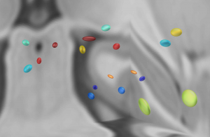

{}
{}

### Morel-Atlas
Histological atlas that has been normalized to MNI-Space.

Optimal for STN or thalamic targets. In case your DBS target is the ventral intermediate nucleus (VIM), please note that this nucleus (commonly appearing in Walker or Hassler nomenclatures of thalamic nuclei) is not directly represented in this atlas which follows the Jones / Hirai & Jones nomenclatures.

The VLpv is the nucleus of the atlas best corresponding to the VIM although it may not be exactly the same. For more information about conversions between thalamic nomenclatures e.g. see Paxinos, G. (2012). The Human Nervous System. Academic Press.

{}
{}
*How to obtain the atlas:*

- The atlas comes pre-installed with Lead-DBS. It has been made [openly available by its authors](https://zenodo.org/records/13918589).
- [A surface based version can be downloaded from here](https://www.research-collection.ethz.ch/handle/20.500.11850/669887).

*Related citations:*

- [Generation of Individualized Thalamus Target Maps by Using Statistical Shape Models and Thalamocortical Tractography. A Jakab, R Blanc, E L Berenyi, and G Szekely. AJNR Am J Neuroradiol, 2012 vol. 33 (11) pp. 2110-2116. http://www.ajnr.org/content/33/11/2110.full](http://www.ncbi.nlm.nih.gov/pubmed/22700756)
- [A mean three-dimensional atlas of the human thalamus: Generation from multiple histological data. Axel Krauth, Remi Blanc, Alejandra Poveda, Daniel Jeanmonod, Anne Morel, and Gábor Székely. NeuroImage, 2010 vol. 49 (3) pp. 2053-2062.http://linkinghub.elsevier.com/retrieve/pii/S1053811909011136](http://www.ncbi.nlm.nih.gov/pubmed/19853042)
- Morel, A. (2013). Stereotactic Atlas of the Human Thalamus and Basal Ganglia. CRC Press.

{}
{}
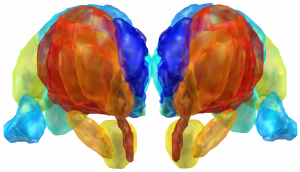

{}
{}

### Chakravarty 2006 Atlas

To the best of our knowledge, this atlas is the most detailed subcortical atlas available. Since its structural descriptions are in nomenclature of the Schaltenbrand-Wahren atlas, it also is very relevant to the field of DBS.

Please note that the original version of this atlas was registered to the MNI colin space whereas Lead-DBS conventionally uses the MNI152 ICBM 2009 space. [These spaces are similar](/about-the-mni-spaces/), but a 2009b version of the same data exists in the DISTAL atlas (see above). Alternatively, the same data was used to create the MNI PD25 atlas – which again uses a slightly different template space based on patients suffering from Parkinson’s Disease (see below).

{}
{}
*How to obtain the atlas:*

- You can get information about this atlas by contacting the [author](http://cobralab.ca/members/commander/).
- The histological labels have made their way into both the DISTAL and MNI 25 PD atlases (and build the seminal groundwork for these two atlases)

*Related citations:*

- [Chakravarty, M. M., Bertrand, G., Hodge, C. P., Sadikot, A. F., & Collins, D. L. (2006). The creation of a brain atlas for image guided neurosurgery using serial histological data. *NeuroImage*, *30*(2), 359–376.](http://www.sciencedirect.com/science/article/pii/S1053811905006993)

{}
{}
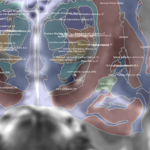  

2D slice visualization of the atlas

{}
{}

### Saranathan THOMAS Atlas (Saranathan 2021)

This atlas has been generated by label fusion of the 20 manually segmented WMn-MPRAGE datasets warped to MNI space via a local averaged template space. It can essentially be thought of a parcellation of the MNI T1 template using Thalamus optimized multi-atlas segmentation (THOMAS) algorithm.

{}
{}
*How to obtain the atlas:*

- The atlas comes pre-installed with Lead-DBS.
- You can also download it from [Zenodo](https://zenodo.org/doi/10.5281/zenodo.3952826).

*Related citations:*

- [Saranathan, M., Iglehart, C., Monti, M., Tourdias, T., Rutt, B. (2021). In vivo high-resolution structural MRI-based atlas of human thalamic nuclei. Sci Data 8, 275.](https://doi.org/10.1038/s41597-021-01062-y)
- [Su, J.H., Thomas, F.T., Kasoff, W.S., Tourdias, T., Choi, E.Y., Rutt, B.K., Saranathan, M. (2019). Thalamus Optimized Multi Atlas Segmentation (THOMAS): fast, fully automated segmentation of thalamic nuclei from structural MRI. NeuroImage 194, 272–282.](https://doi.org/10.1016/j.neuroimage.2019.03.021)

{}
{}
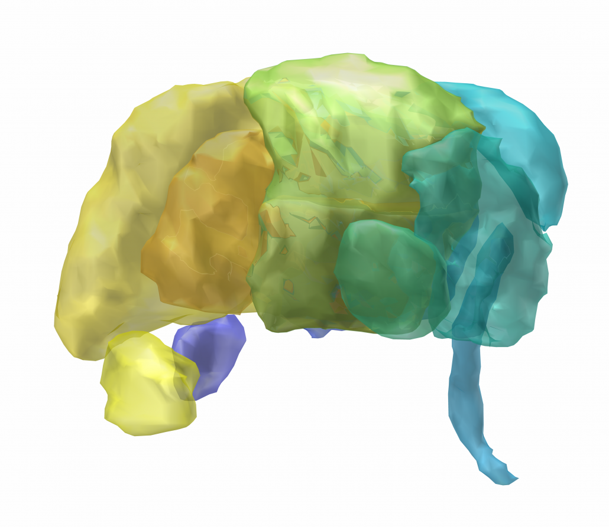

{}
{}

### HIPS-THOMAS Segmentation (Vidal 2024)

As opposed to the Saranathan THOMAS atlas in MNI space, this is a multi-atlas based parcellation in patient space using a variant of the THOMAS algorithm called Histogram-based polynomial synthesis (HIPS) THOMAS for handling standard T1 MRI data. HIPS algorithm synthesizes WM-nulled like images from T1 before running the standard THOMAS algorithm leveraging the high intrathalamic contrast of WM-nulled contrast. For WMn/FGATIR images, standard THOMAS is directly run.

{}
{}
*How to obtain the atlas:*

- The atlas will be generated in patient native space by clicking the menu *Tools* -> *Run THOMAS for T1w/WMn/FGATIR* in Lead-DBS.

*Related citations:*

- [Vidal, J.P., Danet, L., Péran, P., Pariente, J., Bach Cuadra, M., Zahr, N.M., Barbeau, E.J., Saranathan, M., 2024. Robust thalamic nuclei segmentation from T1-weighted MRI using polynomial intensity transformation. Brain Struct. Funct.](https://doi.org/10.1007/s00429-024-02777-5)
- [Su, J.H., Thomas, F.T., Kasoff, W.S., Tourdias, T., Choi, E.Y., Rutt, B.K., Saranathan, M. (2019). Thalamus Optimized Multi Atlas Segmentation (THOMAS): fast, fully automated segmentation of thalamic nuclei from structural MRI. NeuroImage 194, 272–282](https://doi.org/10.1016/j.neuroimage.2019.03.021)

{}
{}
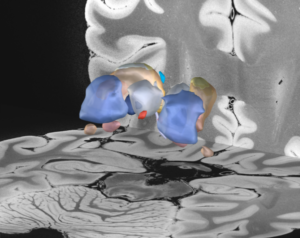

{}
{}

### Nigral organization atlas (Zhang 2017)

An atlas displaying the anatomical and functional organization of the human substantia nigra (SN) using diffusion and functional MRI data from the Human Connectome Project.

{}
{}
*How to obtain the atlas:*

- The atlas comes pre-installed with Lead-DBS.
- The atlas can be downloaded from [Neurovault](https://neurovault.org/collections/2860/).

*Related citations:*

- [Zhang, Y., Larcher, K. M.-H., Misic, B., & Dagher, A. (2017). Anatomical and functional organization of the human substantia nigra and its connections. *eLife*, *6*.](https://doi.org/10.7554/eLife.26653)

{}
{}
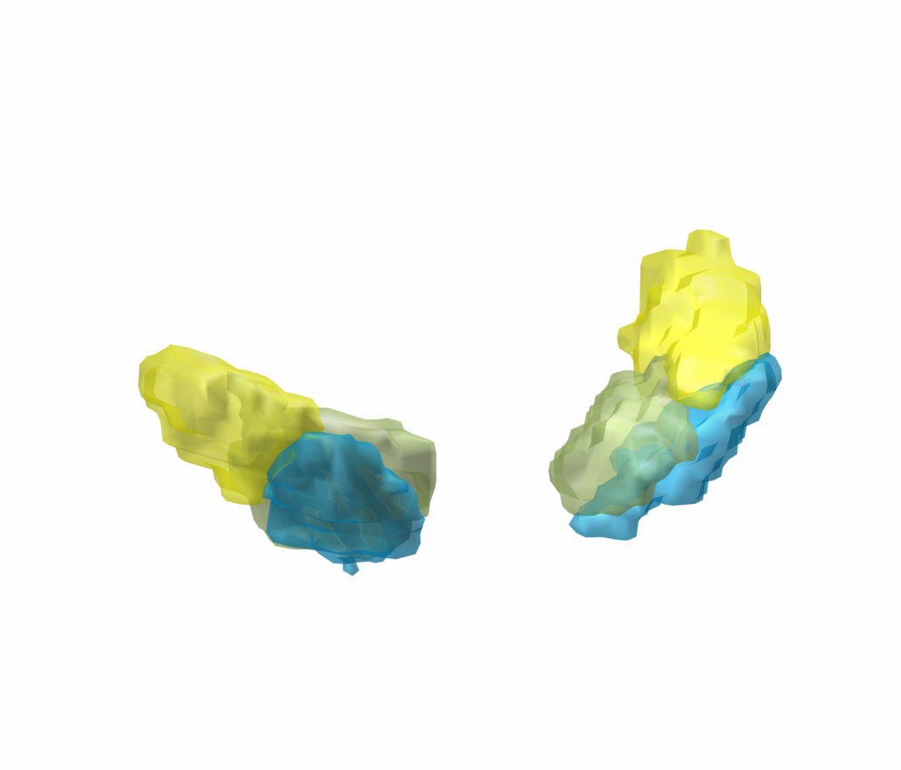

{}
{}

### ATAG-Atlas
An atlas of the basal ganglia that is based on 7T MR imaging

{}
{}
*How to obtain the atlas:*

- The atlas comes pre-installed with Lead-DBS.
- The atlas can be downloaded [here](https://www.nitrc.org/projects/atag)

*Related citations:*

- [Keuken, M. C., Bazin, P. L., Crown, L., Hootsmans, J., Laufer, A., Müller-Axt, C., et al. (2014). Quantifying inter-individual anatomical variability in the subcortex using 7T structural MRI. *NeuroImage*, *94*, 40–46. doi:10.1016/j.neuroimage.2014.03.032](http://www.ncbi.nlm.nih.gov/pubmed/24650599)

{}
{}
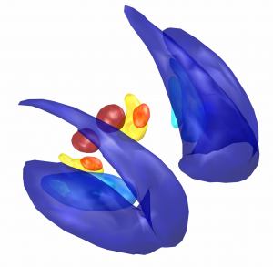

{}
{}

### ATAG-Atlas STN young–middle-aged–elderly
An atlas of the STN based on 7T MR imaging

{}
{}
*How to obtain the atlas:*

- The atlas comes pre-installed with Lead-DBS.
- The atlas can be downloaded [here](https://www.nitrc.org/projects/atag)

*Related citations:*

- [Ultra-high 7T MRI of structural age-related changes of the subthalamic nucleus. Max C Keuken, Pierre-Louis Bazin, Andreas Schäfer, Jane Neumann, Robert Turner, and Birte U Forstmann. Journal of Neuroscience, 2013 vol. 33 (11) pp. 4896-4900. http://eutils.ncbi.nlm.nih.gov/entrez/eutils/elink.fcgi?dbfrom=pubmed&id=23486960&retmode=ref&cmd=prlinks](http://www.ncbi.nlm.nih.gov/pubmed/23486960)

{}
{}
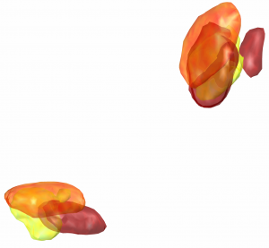

{}
{}

### PPN Histological Atlas (Alho 2017)

In this atlas, the pedunculopontine nucleus has been segmented based on postmortem MRI and histology.

{}
{}
*How to obtain the atlas:*

- The atlas is included within Lead-DBS

*Related citations:*

- [Alho, A. T. D. L., Hamani, C., Alho, E. J. L., da Silva, R. E., Santos, G. A. B., Neves, R. C., et al. (2017). Magnetic resonance diffusion tensor imaging for the pedunculopontine nucleus: proof of concept and histological correlation. *Brain Structure and Function*, *12*(1), 26.](https://doi.org/10.1007/s00429-016-1356-0)

{}
{}
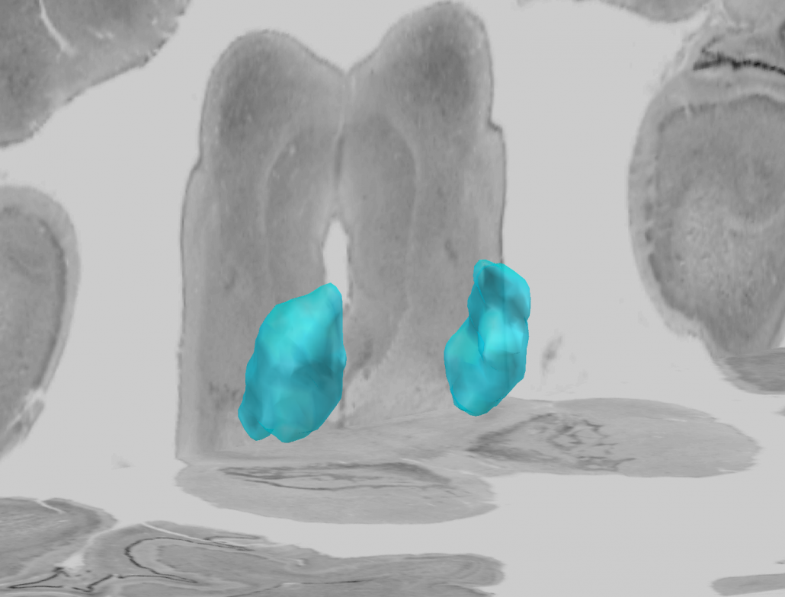

{}
{}

### BigBrain (Amunts 2013)

Not in particular an atlas but rather a highly detailed whole-brain histological map available in MNI/ICBM 152 2009b nonlinear symmetric space.

{}
{}
*How to obtain the atlas:*

- Further information about BigBrain can be found [here](http://bigbrain.loris.ca/main.php)
- An adaptation into ICBM 2009b NLIN Asym space (the “default space” used by Lead-DBS) can be found [here](http://nist.mni.mcgill.ca/?p=1209).

*Related citations:*

- [Amunts, K., Lepage, C., Borgeat, L., Mohlberg, H., Dickscheid, T., Rousseau, M.-É. et al. (2013). BigBrain: an ultrahigh-resolution 3D human brain model. *Science (New York, NY)*, *340*(6139), 1472–1475.](https://doi.org/10.1126/science.1235381)
- Warp into 2009b space: [Xiao, Y., Lau, J. C., Anderson, T., DeKraker, J., Collins, D. L., Peters, T., & Khan, A. R. (2019). Bridging micro and macro: accurate registration of the BigBrain dataset with the MNI PD25 and ICBM152 atlases. *bioRxiv*, *4*, 561118.](https://doi.org/10.1101/561118)

{}
{}
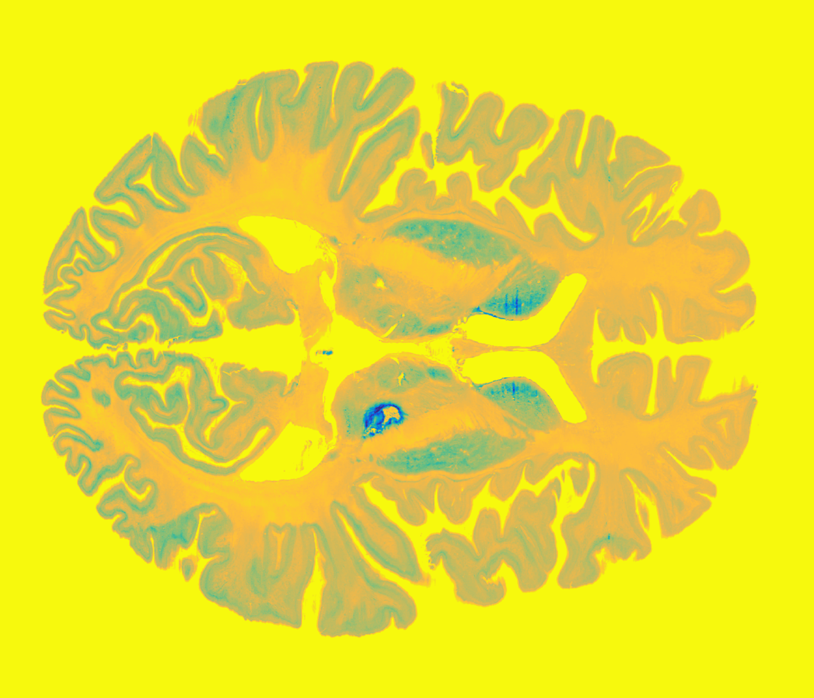

{}
{}

### GPi probabilistic parcellation atlas (Moreira da Silva 2016)

An atlas parcellating the GPi by structural connectivity to brainstem, GPe and cortical regions.

{}
{}
*How to obtain the atlas:*

- The atlas comes preinstalled within Lead-DBS

*Related citations:*

- [da Silva, N. M., Ahmadi, S.-A., Tafula, S. N., Cunha, J. P. S., Bötzel, K., Vollmar, C., & Rozanski, V. E. (2016). A diffusion-based connectivity map of the GPi for optimised stereotactic targeting in DBS. *NeuroImage*, *, 1–9* http://doi.org/10.1016/j.neuroimage.2016.06.018](https://doi.org/10.1016/j.neuroimage.2016.06.018)

{}
{}
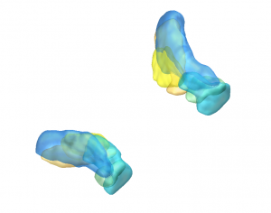

{}
{}

### Zhang thalamic connectivity atlas (Zhang 2008)

An atlas parcellating the thalamus into Motor/Premotor, Somatosensory, Parietal/Occipital, Prefrontal and Temporal functional zones based on functional and structural connectivity.

{}
{}
*How to obtain the atlas:*

- The atlas comes preinstalled within Lead-DBS

*Related citations:*

- [Zhang, D., Snyder, A. Z., Fox, M. D., Sansbury, M. W., Shimony, J. S., & Raichle, M. E. (2008). Intrinsic functional relations between human cerebral cortex and thalamus. *Journal of Neurophysiology*, *100*(4), 1740–1748. http://doi.org/10.1152/jn.90463.2008](https://doi.org/10.1152/jn.90463.2008)

{}
{}
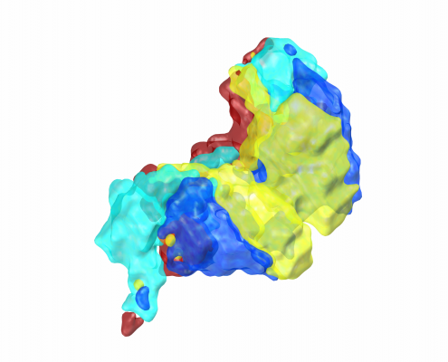

{}
{}

### Oxford Thalamic Connectivity Atlas (Behrens 2003)

An atlas parcellating the thalamus into seven functional zones based on structural connectivity.

{}
{}
*How to obtain the atlas:*

- The atlas comes preinstalled within Lead-DBS
- More information about this atlas can be found [here](http://fsl.fmrib.ox.ac.uk/fsl/fslwiki/Atlases)

*Related citations:*

- [Behrens, T. E. J., Johansen-Berg, H., Woolrich, M. W., Smith, S. M., Wheeler-Kingshott, C. A. M., Boulby, P. A., et al. (2003). Non-invasive mapping of connections between human thalamus and cortex using diffusion imaging., *6*(7), 750–757. http://doi.org/10.1038/nn1075](https://doi.org/10.1038/nn1075)

{}
{}
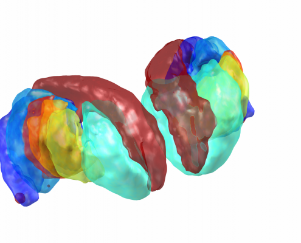

{}
{}

### Thalamic Connectivity Atlas (Horn 2016)

A reproduction of the Oxford thalamic connectivity atlas – obtained on 169 subjects of the NKI-RS enhanced dataset and computed entirely within ICBM 2009b (MNI152) nonlinear space.

{}
{}
*How to obtain the atlas:*

- The atlas comes preinstalled within Lead-DBS

*Related citations:*

- [Horn, A., & Blankenburg, F. (2016). Toward a standardized structural-functional group connectome in MNI space. *NeuroImage*, *124*(Pt A), 310–322. http://doi.org/10.1016/j.neuroimage.2015.08.048](https://doi.org/10.1016/j.neuroimage.2015.08.048)

{}
{}
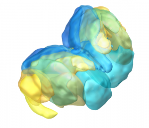

{}
{}

### Harvard Ascending Arousal Network Atlas (Edlow 2012)

An atlas focusing on the Ascending Arousal Network of the brainstem which also includes the pedunculo-pontine nucleus targeted for freezing of gait with DBS. Also, the ventral tegmental area is included.

{}
{}
*How to obtain the atlas:*

- The atlas comes preinstalled within Lead-DBS.
- Further information about the atlas can be found [here](https://datadryad.org/stash/dataset/doi:10.5061/dryad.zw3r228d2) (version 2.0).

*Related citations:*

- [Edlow, B. L., Takahashi, E., Wu, O., Benner, T., Dai, G., Bu, L., et al. (2012). Neuroanatomic connectivity of the human ascending arousal system critical to consciousness and its disorders. *Journal of Neuropathology and Experimental Neurology*, *71*(6), 531–546. http://doi.org/10.1097/NEN.0b013e3182588293](http://www.ncbi.nlm.nih.gov/pubmed/22592840)

{}
{}
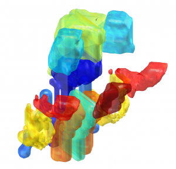

{}
{}

### Ahsan 2007 Basal ganglia atlas
An atlas of the basal ganglia based on MR-imaging data – including pallidum, substantia nigra, thalamus and more. The subthalamic nucleus is not included.

{}
{}
*How to obtain the atlas:*

- The atlas may be obtained by contacting the author of the paper cited below.

*Related citations:*

- [Ahsan, R. L., Allom, R., Gousias, I. S., Habib, H., Turkheimer, F. E., Free, S., et al. (2007). Volumes, spatial extents and a probabilistic atlas of the human basal ganglia and thalamus. *NeuroImage*, *38*(2), 261–270. http://doi.org/10.1016/j.neuroimage.2007.06.004](http://www.ncbi.nlm.nih.gov/pubmed/17851093)

{}
{}
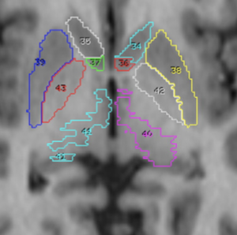

{}
{}

### BGHAT-Atlas
An atlas of the basal ganglia based on MR-imaging data

{}
{}
*How to obtain the atlas:*

- The atlas comes pre-installed with Lead-DBS.
- The atlas can be obtained by contacting the author of the paper cited below.

*Related citations:*

- [Region of interest template for the human basal ganglia: Comparing EPI and standardized space approaches. Janey Prodoehl, Hong Yu, Deborah M Little, Ivy Abraham, and David E Vaillancourt. NeuroImage, 2008 vol. 39 (3) pp. 956-965. http://linkinghub.elsevier.com/retrieve/pii/S1053811907008117](http://www.ncbi.nlm.nih.gov/pubmed/17988895)

{}
{}
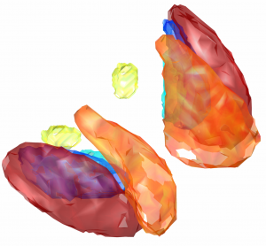

{}
{}

### Functional Striatum parcellation atlas (Choi 2012)
As in the Yeo 2011 brain parcellation atlas, 1000 rs-fMRI scans were used to create this striatal parcellation atlas.

{}
{}
*How to obtain the atlas:*

- The atlas comes preinstalled within Lead-DBS and matches with the Yeo 2011 parcellation (labeling atlas).
- More info about the atlas can be found [here](https://surfer.nmr.mgh.harvard.edu/fswiki/StriatumParcellation_Choi2012).

*Related citations:*

- [Choi EY, Yeo BT, Buckner RL (2012) The organization of the human striatum estimated by intrinsic functional connectivity. J Neurophysiol. In Press.](http://www.ncbi.nlm.nih.gov/pubmed/22832566)

{}
{}
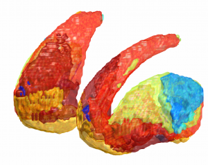

{}
{}

### Cortical Functional Networks (Yeo 2011)
Combining results from multiple landmark studies around Thomas Yeo, Randy Buckner and others, we have built a combined atlas that divides the cortex, striatum, cerebellum and thalamus into the famous seven or seventeen networks based on resting-state functional connectivity acquired in 1000 subjects. The atlas of the thalamus is unpublished.

{}
{}
*How to obtain the atlas:*

- The atlas comes preinstalled within Lead-DBS and matches with the Yeo 2011 parcellation (labeling atlas).
- A twitter thread with multiple resources for this atlas can be found [here](https://twitter.com/bttyeo/status/1248992127985434624?s=20).

*Related studies:*

- [Cortex](https://journals.physiology.org/doi/full/10.1152/jn.00338.2011)
- [Striatum](https://pubmed.ncbi.nlm.nih.gov/22832566/)
- [Cerebellum](https://www.ncbi.nlm.nih.gov/pmc/articles/PMC3214121/)

{}
{}
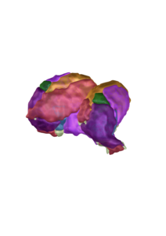

{}
{}

### PPN atlas (Snijders 2016)
Not really an “atlas” but rather an MNI coordinate defining the position of the PPN within MNI space. Lined out by an experienced neuroanatomist using multiple MNI templates and the Bigbrain dataset.

{}
{}
*How to obtain the atlas:*

- The atlas comes preinstalled within Lead-DBS.

*Related citations:*

- [Snijders, A. H., Takakusaki, K., Debu, B., Lozano, A. M., Krishna, V., Fasano, A., et al. (2016). Physiology of freezing of gait. *Annals of Neurology*, *80*(5), 644–659. http://doi.org/10.1002/ana.24778](https://doi.org/10.1002/ana.24778)

{}
{}
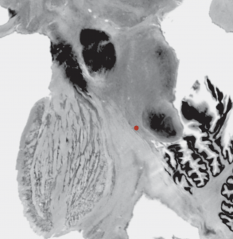

{}
{}

### AICHA subcortical regions
The AICHA atlas is an atlas of intrinsic connectivity of homotopic areas. It also features a subcortical section functionally parcellating the thalamus and other deep nuclei such as Caudate, Pallidum, Putamen and Amygdama.

{}
{}
*How to obtain the atlas:*

- The atlas comes preinstalled within Lead-DBS both in form of a parcellation (labeling atlas) and a subcortical atlas (nuclei only).
- More info about the atlas can be found [here](http://www.gin.cnrs.fr/AICHA).

*Related citations:*

- [Joliot, M., Jobard, G., Naveau, M., Delcroix, N., Petit, L., Zago, L., et al. (2015). AICHA: An atlas of intrinsic connectivity of homotopic areas. Journal of Neuroscience Methods, 254, 46–59. http://doi.org/10.1016/j.jneumeth.2015.07.013](https://doi.org/10.1016/j.jneumeth.2015.07.013)

{}
{}
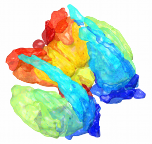

{}
{}

### Harvard-Oxford subcortical/cortical atlas
A widely used atlas of subcortical structures. Does not separate between subparts of the pallidum / thalamus and does not contain a volume for the subthalamic nucleus. In the context of DBS, this atlas can for example be used for whole pallidum, thalamus, nucleus accumbens, as well as subcortical subcallosal cortex visualization.

{}
{}
*How to obtain the atlas:*

- The atlas is distributed together with [FSL](http://fsl.fmrib.ox.ac.uk/fsl/fslwiki/), for a description of the atlas see [here](http://fsl.fmrib.ox.ac.uk/fsl/fslwiki/Atlases).

*Related citations:*

- [Makris N, Goldstein JM, Kennedy D, Hodge SM, Caviness VS, Faraone SV, Tsuang MT, Seidman LJ. Decreased volume of left and total anterior insular lobule in schizophrenia. Schizophr Res. 2006 Apr;83(2-3):155-71](http://www.ncbi.nlm.nih.gov/pubmed/16448806)
- [Frazier JA, Chiu S, Breeze JL, Makris N, Lange N, Kennedy DN, Herbert MR, Bent EK, Koneru VK, Dieterich ME, Hodge SM, Rauch SL, Grant PE, Cohen BM, Seidman LJ, Caviness VS, Biederman J. Structural brain magnetic resonance imaging of limbic and thalamic volumes in pediatric bipolar disorder. Am J Psychiatry. 2005 Jul;162(7):1256-65](http://www.ncbi.nlm.nih.gov/pubmed/15994707)
- [Desikan RS, Ségonne F, Fischl B, Quinn BT, Dickerson BC, Blacker D, Buckner RL, Dale AM, Maguire RP, Hyman BT, Albert MS, Killiany RJ. An automated labeling system for subdividing the human cerebral cortex on MRI scans into gyral based regions of interest. Neuroimage. 2006 Jul 1;31(3):968-80.](http://www.ncbi.nlm.nih.gov/pubmed/16530430)
- [Goldstein JM, Seidman LJ, Makris N, Ahern T, O’Brien LM, Caviness VS Jr, Kennedy DN, Faraone SV, Tsuang MT. Hypothalamic abnormalities in schizophrenia: sex effects and genetic vulnerability. Biol Psychiatry. 2007 Apr 15;61(8):935-45](http://www.ncbi.nlm.nih.gov/pubmed/17046727)

{}
{}
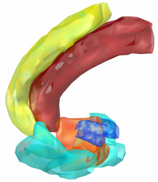  

Exemplary use of the HO-Atlas – target structures for DBS in depression.

{}
{}

### MIDA model

One of the most detailed image-based anatomical head models available for computational life sciences.  
If you are interested in whole-head anatomy, this is probably your atlas of choice. Regarding DBS, it contains interesting structures such as blood vessels, ventricles and subcortical structures such as thalamus and pallidum.

**Please note that this atlas is not registered into MNI space which limits its use with Lead-DBS.**

{}
{}
*How to obtain the atlas:*

- The atlas can be downloaded [here](http://www.itis.ethz.ch/virtual-population/regional-human-models/mida-model/)

*Related citations:*

- [Iacono, M. I., Neufeld, E., Bonmassar, G., Akinnagbe, E., Jakab, A., Cohen, E., et al. (n.d.). A computational model for bipolar deep brain stimulation of the subthalamic nucleus. *2014 36th Annual International Conference of the IEEE Engineering in Medicine and Biology Society (EMBC)*, 6258–6261.](https://doi.org/10.1109/EMBC.2014.6945059)
- [Iacono, M. I., Neufeld, E., Akinnagbe, E., Bower, K., Wolf, J., Oikonomidis, I. V., et al. (2015). MIDA: A Multimodal Imaging-Based Detailed Anatomical Model of the Human Head and Neck. *PLoS ONE*, *10*(4), e0124126.](https://doi.org/10.1371/journal.pone.0124126)

{}
{}
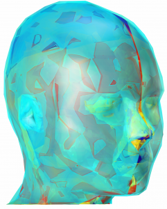

{}
{}

### CFA subcortical shape atlas

An atlas based on MRI data

{}
{}
*How to obtain the atlas:*

- Information about this atlas used to be available on a website of the National University of Singapore (www.bioeng.nus.edu.sg), which can no longer be reached.

*Related citations:*

- [Qiu, A., Brown, T., Fischl, B., Ma, J., & Miller, M. I. (2010). Atlas generation for subcortical and ventricular structures with its applications in shape analysis. *IEEE Transactions on Image Processing : a Publication of the IEEE Signal Processing Society*, *19*(6), 1539–1547.](https://doi.org/10.1109/TIP.2010.2042099)

{}
{}
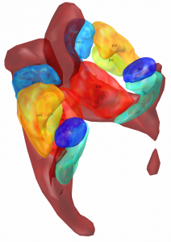

{}
{}

### Yelnik-Atlas
An atlas of the basal ganglia based on histological data

{}
{}
*How to obtain the atlas:*

- to our knowledge, this atlas is not publicly available.

*Related citations:*

- [A three-dimensional, histological and deformable atlas of the human basal ganglia. I. Atlas construction based on immunohistochemical and MRI data. Jérôme Yelnik, Eric Bardinet, Didier Dormont, Grégoire Malandain, Sébastien Ourselin, Dominique Tandé, Carine Karachi, Nicholas Ayache, Philippe Cornu, and Yves Agid. NeuroImage, 2007 vol. 34 (2) pp. 618-638.](http://www.ncbi.nlm.nih.gov/pubmed/17110133)

{}
{}
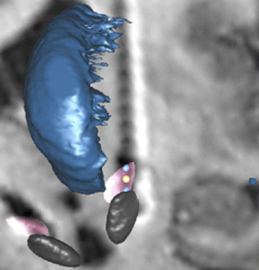

{}
{}

### Brainstem Connectome Atlas

This is a probabilistic atlas of 23 brainstem bundles using high-quality connectome imaging data and advanced analysis techniques.  Rigorous quality control on connectome imaging data from the Human Connectome Project (HCP) were performed and only accepted high-quality imaging data with minimal residual distortions for atlas construction.

{}
{}
*How to obtain the atlas:*

- You can get information about this atlas [here](https://www.nitrc.org/projects/brainstem_atlas/)

*Related citations:*

- [Tang, Y., Sun, W., Toga, A.W., Ringman, J.M., Shi, Y., 2018. A probabilistic atlas of human brainstem pathways based on connectome imaging data. Neuroimage 169, 227–239.](https://www.sciencedirect.com/science/article/pii/S1053811917310650?via%3Dihub)

{}
{}
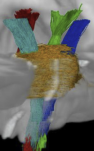

{}
{}

### Fornix FMRIB FA Template

This atlas merged younger-older adult template of the fornix and demonstrated its utility for studies of aging and preclinical Alzheimer’s disease (AD).

{}
{}
*How to obtain the atlas:*

- The atlas comes preinstalled within Lead-DBS

*Related citations:*

- [Brown, C.A., Johnson, N.F., Anderson-Mooney, A.J., Jicha, G.A., Shaw, L.M., Trojanowski, J.Q., Van Eldik, L.J., Schmitt, F.A., Smith, C.D., Gold, B.T., 2017. Development, validation and application of a new fornix template for studies of aging and preclinical Alzheimer’s disease. NeuroImage Clin. 13, 106–115.](https://www.sciencedirect.com/science/article/pii/S2213158216302327?via%3Dihub)

{}
{}

{}
{}

### DBS Tractography Atlas

A collection of manually curated dMRI-based tracts relevant to deep brain stimulation.

{}
{}
*How to obtain the atlas:*

- The atlas comes preinstalled within Lead-DBS

*Related citations:*

- [Middlebrooks, E. H., Domingo, R. A., Vivas-Buitrago, T., Okromelidze, L., Tsuboi, T., Wong, J. K., Eisinger, R. S., Almeida, L., Burns, M. R., Horn, A., Uitti, R. J., Wharen, R. E., Holanda, V. M., & Grewal, S. S. (2020). Neuroimaging Advances in Deep Brain Stimulation: Review of Indications, Anatomy, and Brain Connectomics. *American Journal of Neuroradiology*, *41*(9), 1558–1568. https://doi.org/10.3174/ajnr.A6693](https://doi.org/10.3174/ajnr.A6693)

{}
{}

{}
{}

### Cerebellar Functional Networks (Buckner 2011)

This atlas is from rs-fMRI data acquired in 1000 young healthy adults that were registered using nonlinear deformation of the cerebellum in combination with surface-based alignment of the cerebral cortex.

{}
{}
*How to obtain the atlas:*

- You can get information about this atlas [here](https://www.freesurfer.net/fswiki/CerebellumParcellation_Buckner2011)

*Related citations:*

- [Buckner RL, Krienen FM, Castellanos A, Diaz JC, Yeo BT. The organization of the human cerebellum estimated by intrinsic functional connectivity. J Neurophysiol. 2011;106(5):2322‐2345.](https://journals.physiology.org/doi/full/10.1152/jn.00339.2011)
- [Yeo BT, Krienen FM, Sepulcre J, Sabuncu MR, Lashkari D, Hollinshead M, Roffman JL, Smoller JW, Zollei L., Polimeni JR, Fischl B, Liu H, Buckner RL. The organization of the human cerebral cortex estimated by intrinsic functional connectivity. J Neurophysiol. 2011;106(3):1125‐1165.](https://journals.physiology.org/doi/full/10.1152/jn.00338.2011)

{}
{}

{}
{}

### Nucleus Accumbens atlas (Cartmell 2019)

Taking advantage of the distinct structural connectivity of nucleus accumbens subregions, this probabilistic atlas was generated using tractography-based segmentation results from 245 Human Connectome Project subjects. Segmentation results were corroborated using data from several modalities including MRI-based measures of function and microstructure and human post-mortem immunohistochemical staining. The atlas closely matches the traditional core and shell divisions based on cytoarchitecture.

{}
{}
*How to obtain the atlas:*

- The atlas comes preinstalled within Lead-DBS

*Related citations:*

- [Cartmell, S.C., Tian, Q., Thio, B.J., Leuze, C., Ye, L., Williams, N.R., Yang, G., Ben-Dor, G., Deisseroth, K., Grill, W.M. and McNab, J.A., 2019. Multimodal characterization of the human nucleus accumbens. *Neuroimage*, *198*, pp.137-149.](https://www.sciencedirect.com/science/article/pii/S1053811919304021)

{}
{}

{}
{}

### Thalamic Functional Atlas (Kumar 2017)

This altas is based on resting state-fMRI to investigate the functional anatomy of the thalamus

{}
{}
*How to obtain the atlas:*

- The atlas comes preintalled within Lead-DBS

*Related citations:*

- [Kumar VJ, van Oort E, Scheffler K, Beckmann CF, Grodd W. Functional anatomy of the human thalamus at rest. Neuroimage. 2017;147:678‐691.](https://www.sciencedirect.com/science/article/pii/S1053811916307947)
- [van Oort ESB, Mennes M, Navarro Schröder T, Kumar VJ, Zaragoza Jimenez NI, Grodd W, Doeller CF, Beckmann CF. Functional parcellation using time courses of instantaneous connectivity. Neuroimage. 2018;170:31‐40.](https://www.sciencedirect.com/science/article/pii/S1053811917305955)

{}
{}

{}
{}

### Zona Incerta Atlas (Lau 2020)

This atlas shows direct visualization and characterization of the human zona incerta and surrounding structures.

{}
{}
*How to obtain the atlas:*

- The atlas comes preintalled within Lead-DBS

*Related citations:*

- [Lau JC, Xiao Y, Haast RAM, Gilmore G, Uludag K, MacDougall KW, Menon RS, Parrent AG, Peters TM, Khan AR. Direct visualization and characterization of the human zona incerta and surrounding structures. bioRxiv. 2020.03.25.008318.](https://www.biorxiv.org/content/10.1101/2020.03.25.008318v2.full)

{}
{}

{}
{}

### Subcortical Default Mode Network Functional Atlas (Li 2021)

This atlas was derived from a group of 7T HCP resting-state fMRI data using the Nadam-Accelerated SCAlable and Robust (NASCAR) tensor decomposition method after a temporal synchronization via the BrainSync algorithm. It provides a comprehensive view of the subcortical functional connectivity of the default mode network, showing both positively correlated and negatively (anti) correlated regions to the cortical default mode network nodes.

{}
{}
*How to obtain the atlas:*

- The atlas comes preintalled within Lead-DBS

*Related citations:*

- [Li, J., Curley, W. H., Guerin, B., Dougherty, D. D., Dalca, A. V., Fischl, B., Horn, A., & Edlow, B. L. (2021). Mapping the subcortical connectivity of the human default mode network. *NeuroImage*, *245*, 118758. https://doi.org/10.1016/j.neuroimage.2021.118758](https://doi.org/10.1016/j.neuroimage.2021.118758)

{}
{}

{}
{}

### HybraPD Atlas (Yu 2021)

The HybraPD atlas is constructed by using fused quantitative susceptibility mapping (QSM) and T1w images from 87 patients with PD. It contains a parcellation map with 12 bilateral subcortical nuclei, which are highly related to PD pathology, such as sub-regions in globus pallidus, substantia nigra and subthalamic nucleus etc. Furthermore, a whole-brain parcellation map is achieved by combining existing cortical parcellation and white-matter segmentation with the proposed subcortical nuclei map.

{}
{}
*How to obtain the atlas:*

- The atlas comes preintalled within Lead-DBS

*Related citations:*

- [Yu, B., Li, L., Guan, X., Xu, X., Liu, X., Yang, Q., Wei, H., Zuo, C., & Zhang, Y. (2021). HybraPD atlas: Towards precise subcortical nuclei segmentation using multimodality medical images in patients with Parkinson disease. *Human Brain Mapping*, *42*(13), 4399–4421. https://doi.org/10.1002/hbm.25556](https://doi.org/10.1002/hbm.25556)

{}
{}

{}
{}

### Levinson-Bari Limbic Brainstem Atlas (Levinson 2022)
This atlas of the human brain stem is based on 3T T1 and T2 data from approximately 200 Human Connectome subjects that were used to delineate five brainstem nuclei involved in limbic processing: the Locus Coeruleus, Nucleus Tractus Solitarius, Periaqueductal Grey, Ventral Tegmental Area and Dorsal Raphe Nucleus. Each structure was masked based on radiographic anatomic boundaries and then registered to MNI space using the 0.5mm 2009b nonlinear asymmetric MNI template.

{}
{}
*How to obtain the atlas:*

- The atlas comes preintalled within Lead-DBS

*Related citations:*

- [Levinson, S., Miller, M., Iftekhar, A., Justo, M., Arriola, D., Wei, W., Hazany, S., Avecillas-Chasin, J.M., Kuhn, T.P., Horn, A., Bari, A.A., 2023. A structural connectivity atlas of limbic brainstem nuclei. Frontiers in Neuroimaging 1. https://doi.org/10.3389/fnimg.2022.1009399](https://doi.org/10.3389/fnimg.2022.1009399)

{}
{}

{}
{}

### TWH Thalamotomy Sweetspot (Boutet 2018)
Sweetspot for optimal tremor response based on 66 patients with essential tremor who underwent MRgFUS.

{}
{}
*How to obtain the atlas:*

- The atlas comes preintalled within Lead-DBS

*Related citations:*

- [Boutet, A., Ranjan, M., Zhong, J., Germann, J., Xu, D., Schwartz, M.L., Lipsman, N., Hynynen, K., Devenyi, G.A., Chakravarty, M., Hlasny, E., Llinas, M., Lozano, C.S., Elias, G.J.B., Chan, J., Coblentz, A., Fasano, A., Kucharczyk, W., Hodaie, M., Lozano, A.M., 2018. Focused ultrasound thalamotomy location determines clinical benefits in patients with essential tremor. Brain 141, 3405–3414. https://doi.org/10.1093/brain/awy278](https://doi.org/10.1093/brain/awy278)

{}
{}

{}
{}

### Human Dysfunctome Atlas (Hollunder 2024)
Sweet streamlines and sweet spots calculated based on 197 STN-DBS patients including dystonia (n = 70), Tourette’s syndrome (n = 14), Parkinson’s disease (n = 94) and obsessive-compulsive disorder (n = 19).

{}
{}
*How to obtain the atlas:*

- The atlas comes preintalled within Lead-DBS

*Related citations:*

- [Hollunder, B., Ostrem, J.L., Sahin, I.A., Rajamani, N., Oxenford, S., Butenko, K., Neudorfer, C., Reinhardt, P., Zvarova, P., Polosan, M., Akram, H., Vissani, M., Zhang, C., Sun, B., Navratil, P., Reich, M.M., Volkmann, J., Yeh, F.-C., Baldermann, J.C., Dembek, T.A., Visser-Vandewalle, V., Alho, E.J.L., Franceschini, P.R., Nanda, P., Finke, C., Kühn, A.A., Dougherty, D.D., Richardson, R.M., Bergman, H., DeLong, M.R., Mazzoni, A., Romito, L.M., Tyagi, H., Zrinzo, L., Joyce, E.M., Chabardes, S., Starr, P.A., Li, N., Horn, A., 2023. Mapping Dysfunctional Circuits in the Frontal Cortex Using Deep Brain Stimulation. medRxiv: The Preprint Server for Health Sciences 2023.03.07.23286766.](https://doi.org/10.1101/2023.03.07.23286766)

{}
{}

{}
{}
Contact us to make your subcortical atlas available for distribution with Lead-DBS
