## Cortical Atlas Parcellations in MNI space

Below you find information about how and where to obtain cortical atlas parcellations suitable for fMRI/dMRI based connectomic analyses using Lead-DBS.   If an atlas you know of is missing, please [contact us](http://andreas-horn.de/leaddbs/?page_id=74 "Contact"). Also, we are interested in distributing cortical parcellation atlases preinstalled within Lead-DBS, if possible.

**Looking for subcortical atlases in MNI space?** Please see [this page](/helpsupport/knowledge-base/atlasesresources/atlases-2/).

{}
{}
> ##### **Please read our [philosophy on including code and datasets into Lead-DBS](/about/data-code-inclusion-philosophy/). In brief, inclusion of datasets does not mean endorsement or approval of the datasets you find within Lead-DBS.**

{}
{}

{}
{}

### Mindboggle 101 (Klein 2012)

The Mindboggle 101 dataset consists of 101 labeled brain images that have been manually labeled largely following the Desikan protocol. It also consists of a group-level parcellation atlas which has been included into Lead-DBS for connectomic analyses.

{}
{}
*How to obtain the atlas:*

- The atlas comes preinstalled within Lead-DBS
- [You can get information about the atlas here](http://www.mindboggle.info/data.html)

*Related citations:*

- [Klein, A., & Tourville, J. (2012). 101 labeled brain images and a consistent human cortical labeling protocol. *Frontiers in Neuroscience*. http://doi.org/10.3389/fnins.2012.00171/abstract](http://doi.org/10.3389/fnins.2012.00171/abstract)

{}
{}
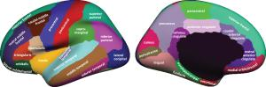

{}
{}

### Cortical Area Parcellation from Resting-State Correlations (Gordon 2016)

The Cortical Area Parcellation from Resting-State Correlations dataset consists of 333 cortical patches segmented using resting-state fMRI (Gordon 2014).

{}
{}
*How to obtain the atlas:*

- The atlas comes preinstalled within Lead-DBS
- [You can get information about the atlas here](http://www.nil.wustl.edu/labs/petersen/Resources.html)

*Related citations:*

- [Gordon, E. M., Laumann, T. O., Adeyemo, B., Huckins, J. F., Kelley, W. M., & Petersen, S. E. (2016). Generation and Evaluation of a Cortical Area Parcellation from Resting-State Correlations.  *Cerebral Cortex*, 26(1), 288–303. http://doi.org/10.1093/cercor/bhu239](https://academic.oup.com/cercor/article/26/1/288/2367115/Generation-and-Evaluation-of-a-Cortical-Area)

{}
{}
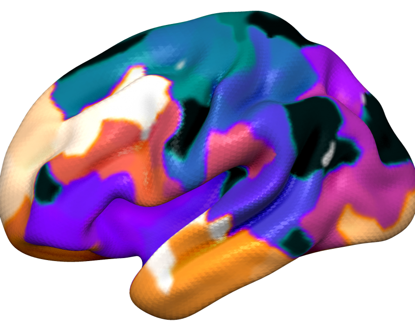

{}
{}

### Consensual Atlas of REsting-state Network (CAREN, Doucet 2019)

The Consensual Atlas of Resting-state Networks (CAREN) consists of 5 networks. It was constructed based on four reliable functional brain atlases, using a hierarchical clustering approach to iteratively link pairs of voxels with highest probability of belonging to the same network.

{}
{}
*How to obtain the atlas:*

- The atlas comes preinstalled within Lead-DBS

*Related citations:*

- [Doucet, G. E., Lee, W. H., & Frangou, S. (2019). Evaluation of the spatial variability in the major resting‐state networks across human brain functional atlases. *Human Brain Mapping*, *40*(15), 4577–4587.](http://doi.org/10.1002/hbm.24722)

{}
{}
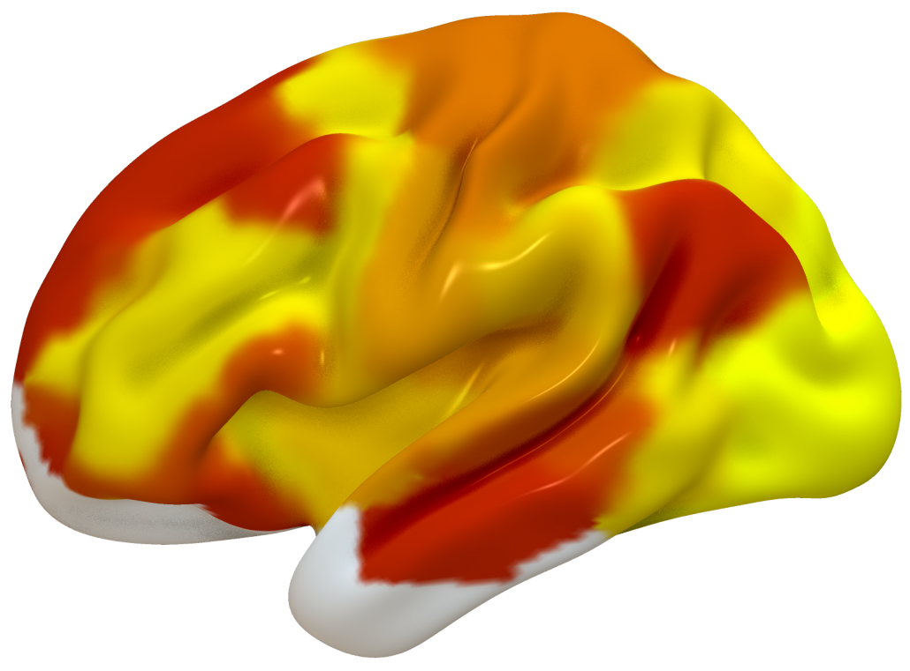

{}
{}

### MICCAI 2012 Multi-Atlas Labeling Workshop and Challenge (Neuromorphometrics)

The MICCAI 2012 Multi-Atlas Labeling Workshop and Challenge dataset is a manually segmented whole-brain parcellation (see refs).

{}
{}
*How to obtain the atlas:*

- The atlas comes preinstalled within Lead-DBS
- [You can get information about the atlas here](http://www.neuromorphometrics.com/)

{}
{}
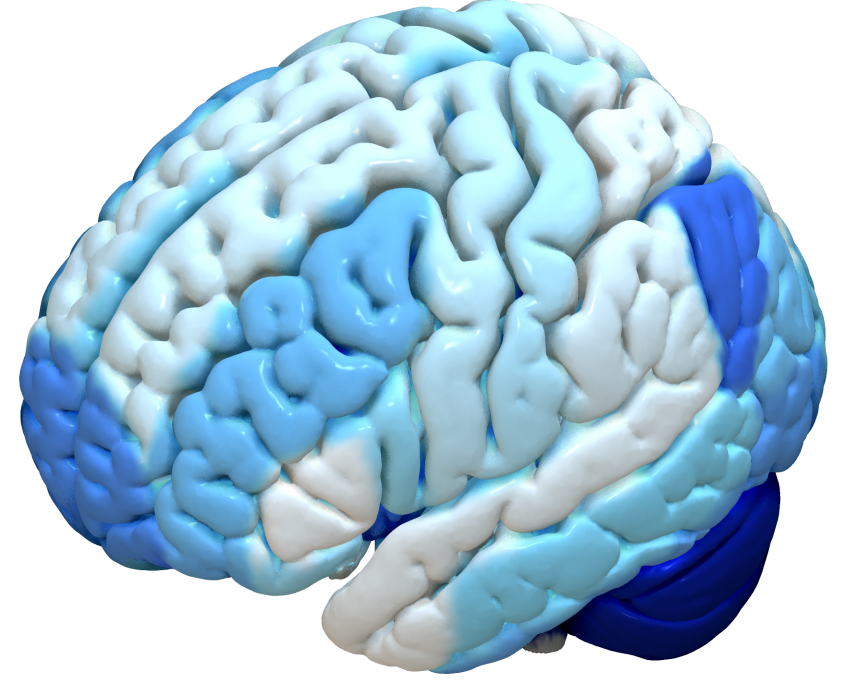

{}
{}

### Brainnetome Atlas parcellation (Fan 2016)

The Brainnetome atlas is an in vivo map based on fMRI and dMRI, with more fine-grained functional brain subregions and detailed anatomical and functional connection patterns for each area. Currently, the Brainnetome atlas contains 246 subregions of the bilateral hemispheres.

{}
{}
*How to obtain the atlas:*

- The atlas comes preinstalled within Lead-DBS
- [You can get information about the atlas here](http://atlas.brainnetome.org/)

*Related citations:*

- [Fan, L., Li, H., Zhuo, J., Zhang, Y., Wang, J., Chen, L., et al. (2016). The Human Brainnetome Atlas: A New Brain Atlas Based on Connectional Architecture. *Cerebral Cortex (New York, N.Y. : 1991)*, *26*(8), 3508–3526. http://doi.org/10.1093/cercor/bhw157](http://doi.org/10.1093/cercor/bhw157)

{}
{}
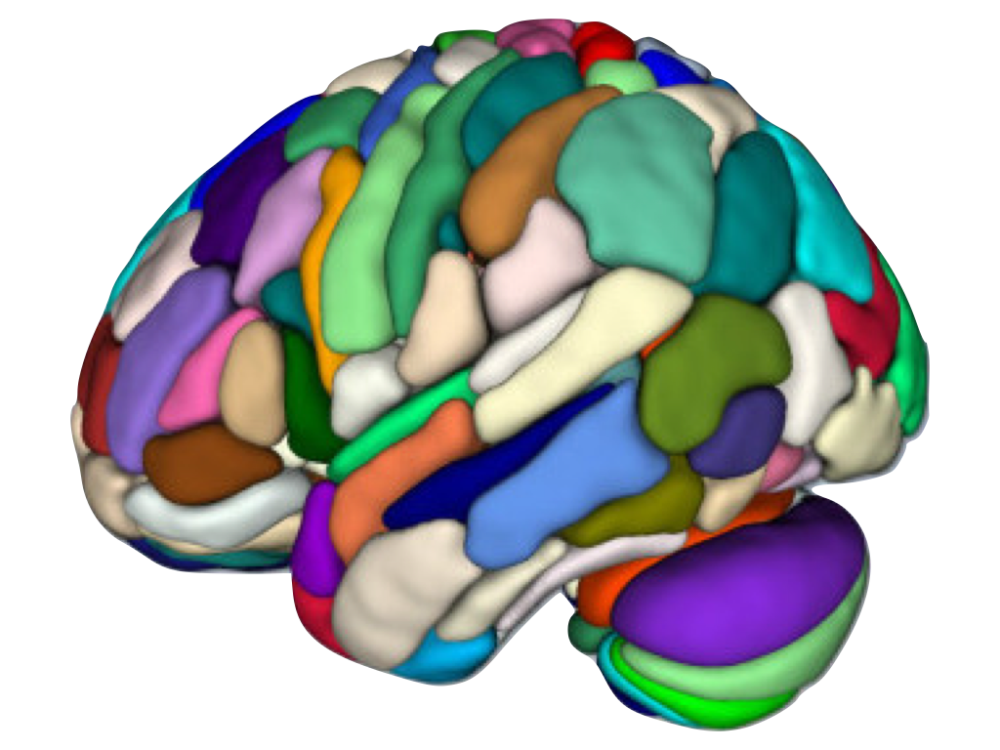

{}
{}

### Automated Anatomical Labeling (Tzourio-Mazoyer 2002)

The AAL atlas is probably the most widely used cortical parcellation map in connectomic literature.  
On 7th August 2015, an updated version (AAL2) has been released.

{}
{}
*How to obtain the atlas:*

- The atlas comes preinstalled with Lead-DBS
- [You can get information about the AAL atlas here](http://www.gin.cnrs.fr/AAL)
- [Updates on the AAL-2 atlas are described here](http://www.gin.cnrs.fr/AAL2)

*Related citations:*

- [Tzourio-Mazoyer, N., Landeau, B., Papathanassiou, D., Crivello, F., Etard, O., Delcroix, N., et al. (2002). Automated anatomical labeling of activations in SPM using a macroscopic anatomical parcellation of the MNI MRI single-subject brain., *15*(1), 273–289. http://doi.org/10.1006/nimg.2001.0978](http://www.ncbi.nlm.nih.gov/pubmed/11771995)

{}
{}
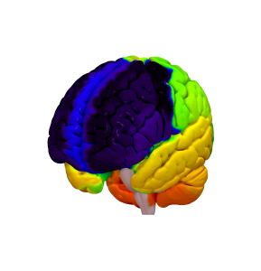

{}
{}

### Local-Global Parcellation of the Human Cerebral Cortex (Schaefer 2018)

Based on the influential brain networks published by Thomas Yeo (2011), these novel parcellations add further refinement by subparcellating the global networks based on a local gradient approach. Parcellations come in several version, breaking down the cortex into up to 1000 regions based on rs-fMRI.

{}
{}
*How to obtain the atlas:*

- The atlas comes preinstalled with Lead-DBS
- [You can get more information here](https://github.com/ThomasYeoLab/CBIG/tree/master/stable_projects/brain_parcellation/Schaefer2018_LocalGlobal)

*Related citations:*

- [Schaefer, A., Kong, R., Gordon, E. M., Laumann, T. O., Zuo, X.-N., Holmes, A. J., et al. (2017). Local-Global Parcellation of the Human Cerebral Cortex from Intrinsic Functional Connectivity MRI. *Cerebral Cortex*, 1–20.](http://doi.org/10.1093/cercor/bhx179)

{}
{}
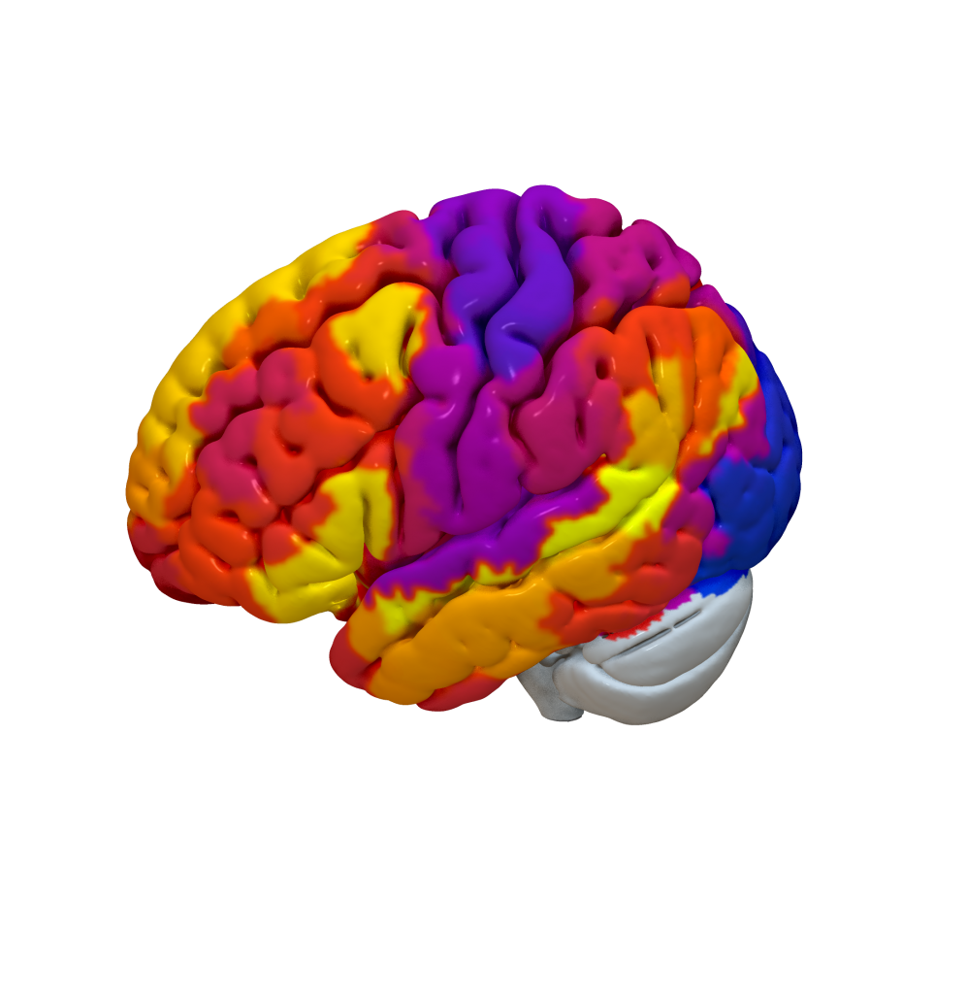

{}
{}

### Human Motor Area Template (Mayka 2005)

Not exactly a whole-brain parcellation but a parcellation of the human (pre-)motor cortex.

{}
{}
*How to obtain the atlas:*

- The atlas comes preinstalled with Lead-DBS
- [You can get more information here](http://lrnlab.org/)

*Related citations:*

- [Mayka, M. A., Corcos, D. M., Leurgans, S. E., & Vaillancourt, D. E. (2006). Three-dimensional locations and boundaries of motor and premotor cortices as defined by functional brain imaging: A meta-analysis. *NeuroImage*, *31*(4), 1453–1474.](http://doi.org/10.1016/j.neuroimage.2006.02.004)

{}
{}
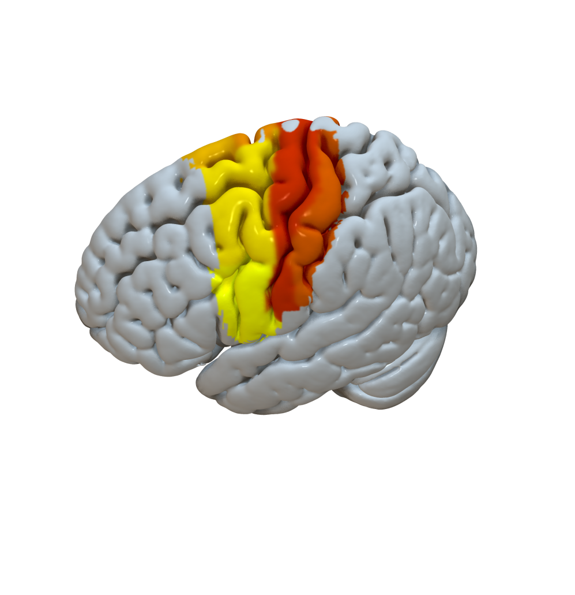

{}
{}

### Sensorimotor Area Tract Template (Archer 2017)

Not exactly a whole-brain parcellation but a template of the corticospinal tract originating from sensory & motor areas in MNI space.

{}
{}
*How to obtain the atlas:*

- The atlas comes preinstalled with Lead-DBS
- [You can get more information here](http://lrnlab.org/)

*Related citations:*

- [Archer, D. B., Vaillancourt, D. E., & Coombes, S. A. (2017). A Template and Probabilistic Atlas of the Human Sensorimotor Tracts using Diffusion MRI. *Cerebral Cortex*, 1–15.](http://doi.org/10.1093/cercor/bhx066)

{}
{}
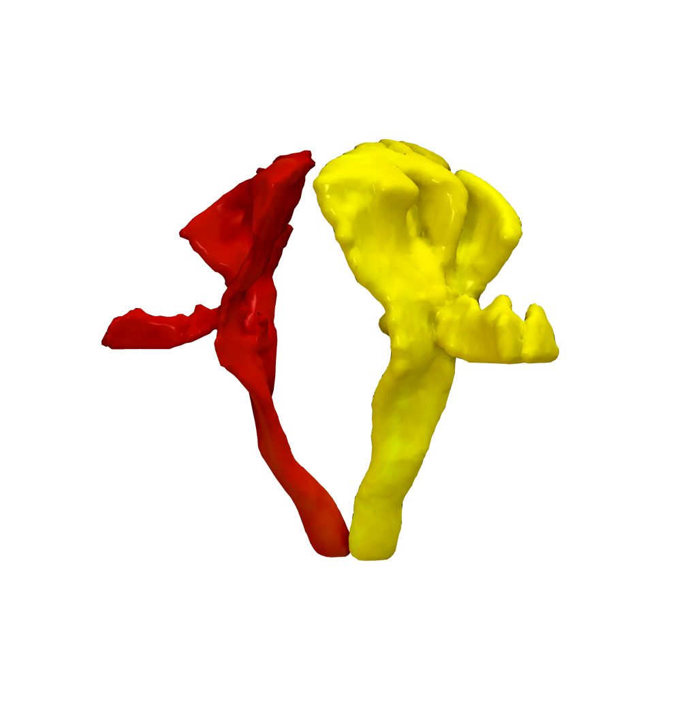

{}
{}

### Harvard-Oxford cortical/subcortical atlases (Makris 2006)

A frequently applied cortical atlas motivated by macroanatomical boundaries.

{}
{}
*How to obtain the atlas:*

- The atlas comes preinstalled with Lead-DBS
- [You can get more information here](http://www.cma.mgh.harvard.edu/)
- [Additionally, you can get information about the atlas on the FSL atlases page here](http://fsl.fmrib.ox.ac.uk/fsl/fslwiki/Atlases)

*Related citations:*

- [Makris N, Goldstein JM, Kennedy D, Hodge SM, Caviness VS, Faraone SV, Tsuang MT, Seidman LJ. Decreased volume of left and total anterior insular lobule in schizophrenia. Schizophr Res. 2006 Apr;83(2-3):155-71](http://www.ncbi.nlm.nih.gov/pubmed/16448806)
- [Frazier JA, Chiu S, Breeze JL, Makris N, Lange N, Kennedy DN, Herbert MR, Bent EK, Koneru VK, Dieterich ME, Hodge SM, Rauch SL, Grant PE, Cohen BM, Seidman LJ, Caviness VS, Biederman J. Structural brain magnetic resonance imaging of limbic and thalamic volumes in pediatric bipolar disorder. Am J Psychiatry. 2005 Jul;162(7):1256-65](http://www.ncbi.nlm.nih.gov/pubmed/15994707)
- [Desikan RS, Ségonne F, Fischl B, Quinn BT, Dickerson BC, Blacker D, Buckner RL, Dale AM, Maguire RP, Hyman BT, Albert MS, Killiany RJ. An automated labeling system for subdividing the human cerebral cortex on MRI scans into gyral based regions of interest. Neuroimage. 2006 Jul 1;31(3):968-80.](http://www.ncbi.nlm.nih.gov/pubmed/16530430)
- [Goldstein JM, Seidman LJ, Makris N, Ahern T, O’Brien LM, Caviness VS Jr, Kennedy DN, Faraone SV, Tsuang MT. Hypothalamic abnormalities in schizophrenia: sex effects and genetic vulnerability. Biol Psychiatry. 2007 Apr 15;61(8):935-45](http://www.ncbi.nlm.nih.gov/pubmed/17046727)

{}
{}
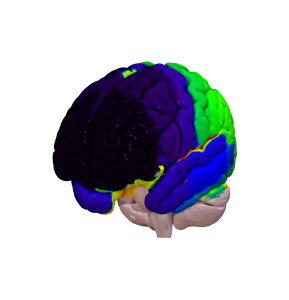

{}
{}

### AICHA: An atlas of intrinsic connectivity of homotopic areas (Joliot 2015)

The AICHA atlas – a detailed cortical atlas based on functional connectivity in 281 subjects.

{}
{}
*How to obtain the atlas:*

- The atlas comes preinstalled within Lead-DBS
- [The AICHA atlas is described here](http://www.gin.cnrs.fr/AICHA-344)

*Related citations:*

- [Joliot, M., Jobard, G., Naveau, M., Delcroix, N., Petit, L., Zago, L., et al. (2015). AICHA: An atlas of intrinsic connectivity of homotopic areas. *Journal of Neuroscience Methods*, *254*, 46–59. http://doi.org/10.1016/j.jneumeth.2015.07.013](http://www.ncbi.nlm.nih.gov/pubmed/26213217)

{}
{}
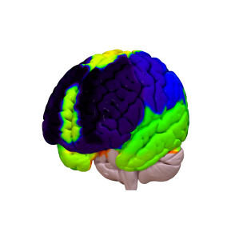

{}
{}

### Hammersmith atlas (Hammers 2003, Gousias 2008, Faillenot 2017, Wild 2017)

Adult brain maximum probability map (“Hammersmith atlas”; exists with either 83 or 95 parcels) in MNI space.

{}
{}
*How to obtain the atlas:*

- [The Hammersmith atlas is described here](http://brain-development.org/brain-atlases/adult-brain-maximum-probability-map-hammers-mith-atlas-n30r83-in-mni-space/)

*Related citations:*

- [Hammers, A., Allom, R., Koepp, M. J., Free, S. L., Myers, R., Lemieux, L., et al. (2003). Three-dimensional maximum probability atlas of the human brain, with particular reference to the temporal lobe. *Human Brain Mapping*, *19*(4), 224–247. http://doi.org/10.1002/hbm.10123](http://www.ncbi.nlm.nih.gov/pubmed/12874777)
- [Gousias, I. S., Rueckert, D., Heckemann, R. A., Dyet, L. E., Boardman, J. P., Edwards, A. D., & Hammers, A. (2008). Automatic segmentation of brain MRIs of 2-year-olds into 83 regions of interest. *NeuroImage*, *40*(2), 672–684. http://doi.org/10.1016/j.neuroimage.2007.11.034](http://www.ncbi.nlm.nih.gov/pubmed/18234511)
- [Faillenot, I., Heckemann, R. A., Frot, M., & Hammers, A. (2017). Macroanatomy and 3D probabilistic atlas of the human insula. *NeuroImage*, *150*, 88–98.](http://doi.org/10.1016/j.neuroimage.2017.01.073)
- [Wild, H. M., Heckemann, R. A., Studholme, C., & Hammers, A. (2017). Gyri of the human parietal lobe: Volumes, spatial extents, automatic labelling, and probabilistic atlases. PLoS ONE, 12(8), e0180866.](http://doi.org/10.1371/journal.pone.0180866)

{}
{}
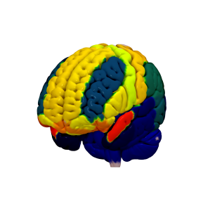

{}
{}

### Yeo 2011 functional parcellations (Yeo 2011)

fMRI atlas based on 1000 subjects exhibiting co-activations of the brain. Two versions are available that include 7 vs. 17 neworks.

{}
{}
*How to obtain the atlas:*

- The atlas comes preinstalled with Lead-DBS
- [The atlas is described here](https://surfer.nmr.mgh.harvard.edu/fswiki/CorticalParcellation_Yeo2011)

*Related citations:*

- [Yeo BT, Krienen FM, Sepulcre J, Sabuncu MR, Lashkari D, Hollinshead M, Roffman JL, Smoller JW, Zollei L., Polimeni JR, Fischl B, Liu H, Buckner RL. The organization of the human cerebral cortex estimated by intrinsic functional connectivity. J Neurophysiol 106(3):1125-65, 2011.](http://www.ncbi.nlm.nih.gov/pubmed/21653723)

{}
{}
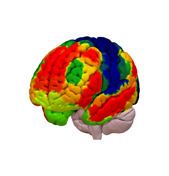

{}
{}

### HCP MMP 1.0 (Glasser 2016)

Probably the most detailed cortical in-vivo parcellation yet, the HCP MMP 1.0 has been built using surface-based registrations of multimodal MR acquisitions from 210 HCP subjects. 180 areas per hemisphere have been identified. Please note that due to the nature of how this parcellation has been built, it may not be ideally suited for usage within Lead-DBS.

{}
{}
*How to obtain the atlas:*

- [You can get information about the atlas here](https://balsa.wustl.edu/WN56)
- [A freesurfer version of this atlas can be found here](https://figshare.com/articles/HCP-MMP1_0_projected_on_fsaverage/3498446)
- A volumetric version in MNI/ICBM 152 2009b NLIN Asymmetric space can be found [here](http://neurovault.org/collections/1549/) and [here](https://figshare.com/articles/HCP-MMP1_0_projected_on_MNI2009a_GM_volumetric_in_NIfTI_format/3501911) (read description, use with care)

*Related citations:*

- [Glasser, M. F., Coalson, T. S., Robinson, E. C., Hacker, C. D., Harwell, J., Yacoub, E., et al. (2016). A multi-modal parcellation of human cerebral cortex. *Nature*. http://doi.org/10.1038/nature18933](http://doi.org/10.1038/nature18933)

{}
{}
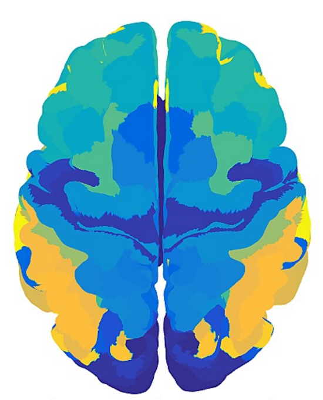

{}
{}

### JuBrain / Juelich histological atlas (Eickhoff 2005)

A probabilistic atlas created by averaging multi-subject post-mortem cyto- and myelo-architectonic segmentations, performed by the team of Profs Zilles and Amunts in Jülich and Düsseldorf. Cytoarchitectonic areas were analyzed in histological sections of ten human postmortem brains. The maps are based on image analysis and statistical criteria for localizing areal borders. Cytoarchitectonic maps have been developed during the past 20 years as a joint effort of many doctoral students, post docs and guest scientists. Maps, which have been published, are available for the scientific community.

{}
{}
*How to obtain the atlas:*

- The atlas comes preinstalled within Lead-DBS
- [More information about this atlas can be found here](http://www.fz-juelich.de/inm/inm-1/EN/Forschung/JuBrain/Jubrain_Webtools/Jubrain_Webtools_node.html)

*Related citations:*

- [Zilles, K., & Amunts, K. (2010). Centenary of Brodmann’s map–conception and fate. *Nature reviews. Neuroscience* (Vol. 11, pp. 139–145). http://doi.org/10.1038/nrn2776](http://doi.org/10.1038/nrn2776)
- [Amunts, K., Schleicher, A., & Zilles, K. (2007). Cytoarchitecture of the cerebral cortex–more than localization. *NeuroImage*, *37*(4), 1061–5– discussion 1066–8. http://doi.org/10.1016/j.neuroimage.2007.02.037](http://doi.org/10.1016/j.neuroimage.2007.02.037)
- [Eickhoff, S. B., Stephan, K. E., Mohlberg, H., Grefkes, C., Fink, G. R., Amunts, K., & Zilles, K. (2005). A new SPM toolbox for combining probabilistic cytoarchitectonic maps and functional imaging data., *25*(4), 1325–1335. http://doi.org/10.1016/j.neuroimage.2004.12.034](http://doi.org/10.1016/j.neuroimage.2004.12.034)
- [Eickhoff, S. B., Jbabdi, S., Caspers, S., Laird, A. R., Fox, P. T., Zilles, K., & Behrens, T. E. J. (2010). Anatomical and functional connectivity of cytoarchitectonic areas within the human parietal operculum., *30*(18), 6409–6421. http://doi.org/10.1523/JNEUROSCI.5664-09.2010](http://doi.org/10.1523/JNEUROSCI.5664-09.2010)
- [Eickhoff, S. B., Heim, S., Zilles, K., & Amunts, K. (2006). Testing anatomically specified hypotheses in functional imaging using cytoarchitectonic maps. *NeuroImage*, *32*(2), 570–582. http://doi.org/10.1016/j.neuroimage.2006.04.204](http://doi.org/10.1016/j.neuroimage.2006.04.204)

{}
{}
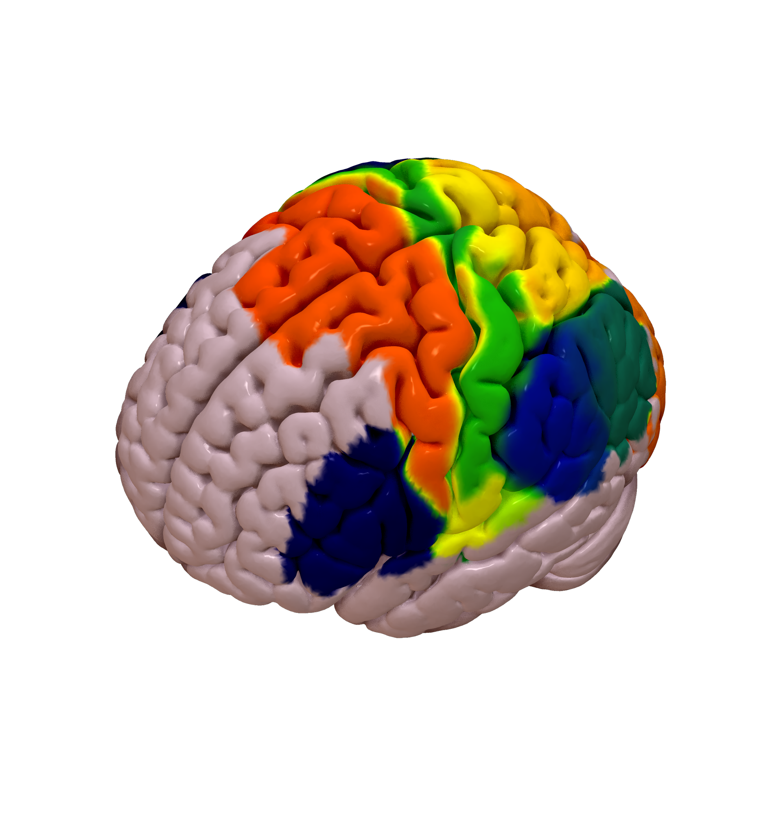

{}
{}

### PrAGMATiC (Huth 2016)

Advanced and modern functional atlas based on task fMRI.

{}
{}
*How to obtain the atlas:*

- [An interactive version of the PrAGMATiC atlas can be found here.](http://gallantlab.org/huth2016/)

*Related citations:*

- [Huth, A. G., de Heer, W. A., Griffiths, T. L., Theunissen, F. E., & Gallant, J. L. (2016). Natural speech reveals the semantic maps that tile human cerebral cortex. *Nature*, *532*(7600), 453–458. http://doi.org/10.1038/nature17637](http://www.ncbi.nlm.nih.gov/pubmed/27121839)
- [Huth, A. G., Griffiths, T. L., Theunissen, F. E., & Gallant, J. L. (2015, April 14). PrAGMATiC: a Probabilistic and Generative Model of Areas Tiling the Cortex.](https://arxiv.org/pdf/1504.03622.pdf)

{}
{}
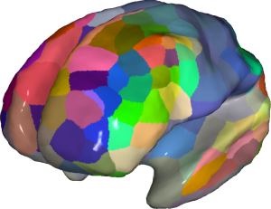

{}
{}

### Desikan-Killiany Atlas (Desikan 2006)

A parcellation scheme widely used in the freesurfer world subdividing the human cerebral cortex on MRI scans into gyral based regions of interest.

{}
{}
*How to obtain the atlas:*

- [More information about this atlas can be found here.](https://surfer.nmr.mgh.harvard.edu/fswiki/CorticalParcellation)
- Please also cf the Mindboggle 101 parcellation listed on this page which follows an adapted Desikan protocol, is available in volumetric space and is being distributed within Lead-DBS.

*Related citations:*

- [Desikan, R. S., Ségonne, F., Fischl, B., Quinn, B. T., Dickerson, B. C., Blacker, D., et al. (2006). An automated labeling system for subdividing the human cerebral cortex on MRI scans into gyral based regions of interest. *NeuroImage*, *31*(3), 968–980. http://doi.org/10.1016/j.neuroimage.2006.01.021](http://doi.org/10.1016/j.neuroimage.2006.01.021)

{}
{}
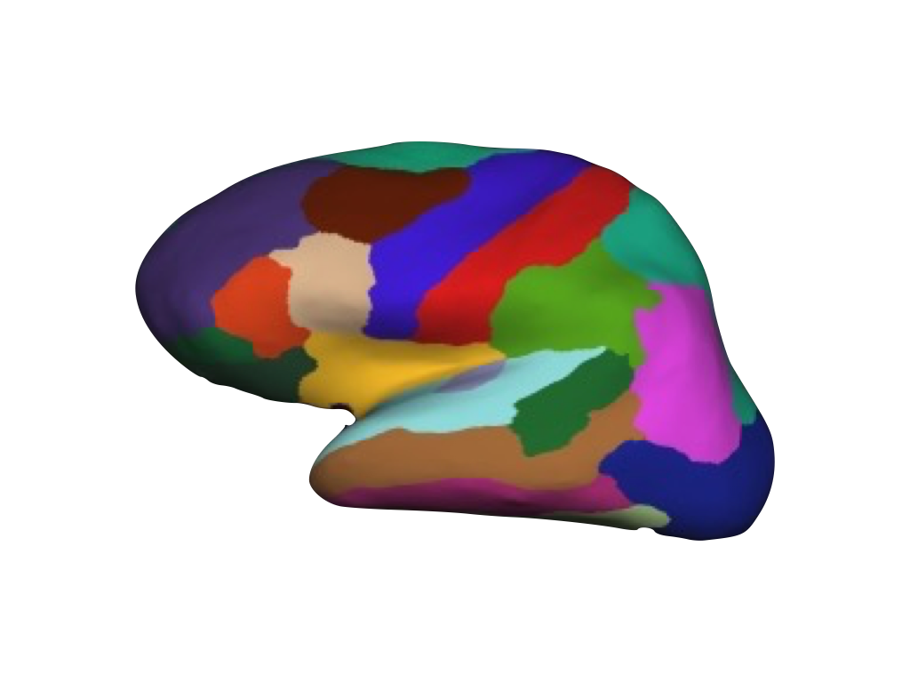

{}
{}

### Destrieux Atlas (Destrieux 2010)

A parcellation scheme widely used in the freesurfer world based on sulcal depth and yielding precise automated definition of cortical gyri and sulci.

{}
{}
*How to obtain the atlas:*

- [More information about this atlas can be found here.](https://surfer.nmr.mgh.harvard.edu/fswiki/CorticalParcellation)

*Related citations:*

- [Destrieux, C., Fischl, B., Dale, A., & Halgren, E. (2010). Automatic parcellation of human cortical gyri and sulci using standard anatomical nomenclature. *NeuroImage*, *53*(1), 1–15. http://doi.org/10.1016/j.neuroimage.2010.06.010](http://doi.org/10.1016/j.neuroimage.2010.06.010)
- [Fischl, B. (2004). Automatically Parcellating the Human Cerebral Cortex. *Cerebral Cortex (New York, N.Y. : 1991)*, *14*(1), 11–22. http://doi.org/10.1093/cercor/bhg087](http://doi.org/10.1093/cercor/bhg087)

{}
{}
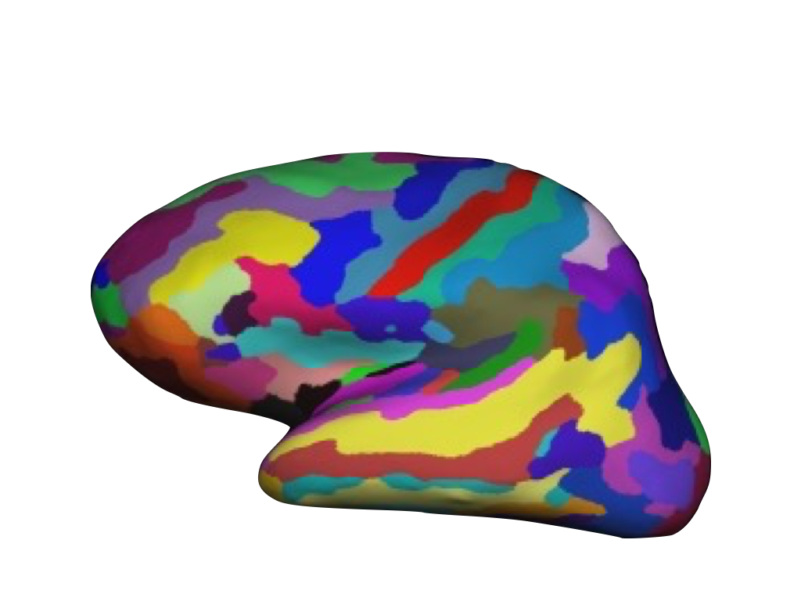

{}
{}

### MarsAtlas (Auzias 2016)

A cortical parcellation model based on macroanatomical information.

{}
{}
*How to obtain the atlas:*

- [More information about this atlas can be found here.](http://www.meca-brain.org/softwares/cortical-parcellation-marsatlas/)

*Related citations:*

- [Auzias, G., Coulon, O., & Brovelli, A. (2016). MarsAtlas: A cortical parcellation atlas for functional mapping. *Human Brain Mapping*. http://doi.org/10.1002/hbm.23121](http://www.ncbi.nlm.nih.gov/pubmed/26813563)
- [Auzias, G., Lefèvre, J., Le Troter, A., Fischer, C., Perrot, M., Régis, J., & Coulon, O. (2013). Model-Driven Harmonic Parameterization of the Cortical Surface: HIP-HOP. *IEEE Transactions on Medical Imaging*, *32*(5), 873–887. http://doi.org/10.1109/TMI.2013.2241651](http://www.ncbi.nlm.nih.gov/pubmed/23358957)

{}
{}
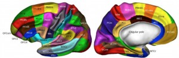

{}
{}

### fMRI-based random parcellations (Craddock 2011)

Fine-grained random parcellations informed by rs-fMRI data.

{}
{}
*How to obtain the atlas:*

- Two of the functional parcellations come preinstalled within Lead-DBS.
- [For more information please see this page.](http://ccraddock.github.io/cluster_roi/atlases.html)

*Related citations:*

- [Craddock, R. C., James, G. A., Holtzheimer, P. E., Hu, X. P., & Mayberg, H. S. (2012). A whole brain fMRI atlas generated via spatially constrained spectral clustering. *Human Brain Mapping*, *33*(8), 1914–1928. http://doi.org/10.1002/hbm.21333](http://www.ncbi.nlm.nih.gov/pubmed/21769991)

{}
{}
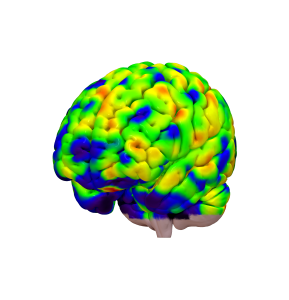

{}
{}

### Voxelwise parcellations (Lead-DBS)

Three voxel-wise parcellations are supplied with Lead-DBS and have been built to create standardized connectivity matrices that exhibit off-diagonal elements that appear as parallel lines to the main diagonal (inter-hemispheric connections between homologous regions). Three versions (35 thousand, 15 thousand and 8 thousand nodes) are pre-installed within Lead-DBS. Together with advanced normalization algorithms (such as multimodal ANTs defaults and DARTEL pipelines), these connectivity matrices allow for high-definition connectomic analyses in parcellation schemes that are comparable across studies.

{}
{}
*How to obtain the atlas:*

- These parcellation schemes come preinstalled within Lead-DBS.

*Related citations:*

- Parcellation schemes are not described in a separate publication. Please cite Lead-DBS software including version and webpage to describe the data used in a reproducible fashion.

{}
{}
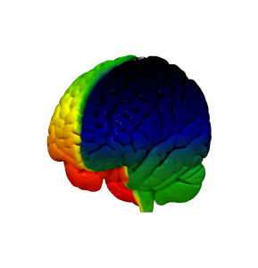

{}
{}

### SUIT Cerebellar parcellation (Diedrichsen 2006)

Not a whole-brain parcellation but parcellating the cerebellum into anatomical regions. Useful to test structural/functional connectivity between DBS leads and cerebellar subregions.

{}
{}
*How to obtain the atlas:*

- [You can find more information about SUIT here.](http://www.diedrichsenlab.org/imaging/suit.htm)
- These parcellation schemes come preinstalled within Lead-DBS.

*Related citations:*

- [Diedrichsen, J. (2006). A spatially unbiased atlas template of the human cerebellum. *NeuroImage*, *33*(1), 127–138.](http://doi.org/10.1016/j.neuroimage.2006.05.056)
- [Diedrichsen, J., Maderwald, S., Küper, M., Thürling, M., Rabe, K., Gizewski, E. R., et al. (2011). Imaging the deep cerebellar nuclei: a probabilistic atlas and normalization procedure. *NeuroImage*, *54*(3), 1786–1794.](http://doi.org/10.1016/j.neuroimage.2010.10.035)

{}
{}
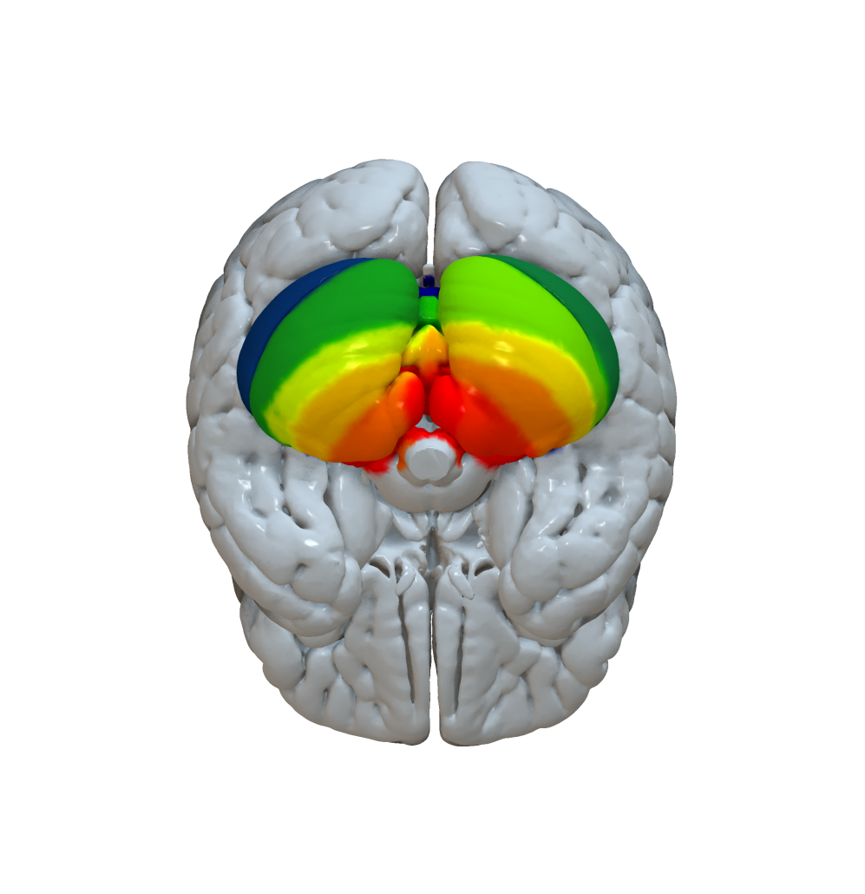

{}
{}

### Buckner functional cerebellar parcellation (Buckner 2011)

Not a whole-brain parcellation but a parcellation of the cerebellum into seven (or seventeen) functional zones that correspond to the Yeo 2011 whole-brain parcellations based on 1000 healthy subjects.

{}
{}
*How to obtain the atlas:*

- [The parcellation was released within the freesurfer software.](http://www.freesurfer.net/fswiki/CerebellumParcellation_Buckner2011)
- These parcellation schemes come preinstalled within Lead-DBS.

*Related citations:*

- [Buckner, R. L., Krienen, F. M., Castellanos, A., Diaz, J. C., & Yeo, B. T. T. (2011). The organization of the human cerebellum estimated by intrinsic functional connectivity. *Journal of Neurophysiology*, *106*(5), 2322–2345.](http://doi.org/10.1152/jn.00339.2011)
- [Yeo, B. T. T., Krienen, F. M., Sepulcre, J., Sabuncu, M. R., Lashkari, D., Hollinshead, M., et al. (2011). The organization of the human cerebral cortex estimated by intrinsic functional connectivity. *Journal of Neurophysiology*, *106*(3), 1125–1165.](http://doi.org/10.1152/jn.00338.2011)

{}
{}
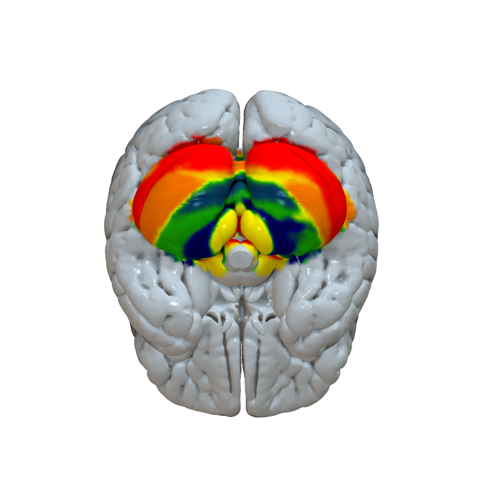

{}
{}

### Cortical Functional Networks (Yeo 2011)

An atlas based on same functional and structural sequences from 1000 young, healthy adults were registered using surface-based alignment.

{}
{}
*How to obtain the atlas:*

- [The parcellation was released here.](https://surfer.nmr.mgh.harvard.edu/fswiki/CorticalParcellation_Yeo2011)
- These parcellation schemes come preinstalled within Lead-DBS.

*Related citations:*

- [Yeo BT, Krienen FM, Sepulcre J, Sabuncu MR, Lashkari D, Hollinshead M, Roffman JL, Smoller JW, Zollei L., Polimeni JR, Fischl B, Liu H, Buckner RL. The organization of the human cerebral cortex estimated by intrinsic functional connectivity. J Neurophysiol. 2011](https://journals.physiology.org/doi/full/10.1152/jn.00338.2011)

{}
{}
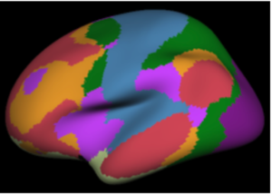

{}
{}

### Functional Connectivity Atlas 7 Networks (Yeo 2011)

An atlas based on same functional and structural sequences from 1000 young, healthy adults were registered using surface-based alignment.

{}
{}
*How to obtain the atlas:*

- [The parcellation was released here.](https://surfer.nmr.mgh.harvard.edu/fswiki/CorticalParcellation_Yeo2011)
- These parcellation schemes come preinstalled within Lead-DBS.

*Related citations:*

- [Yeo BT, Krienen FM, Sepulcre J, Sabuncu MR, Lashkari D, Hollinshead M, Roffman JL, Smoller JW, Zollei L., Polimeni JR, Fischl B, Liu H, Buckner RL. The organization of the human cerebral cortex estimated by intrinsic functional connectivity. J Neurophysiol. 2011](https://journals.physiology.org/doi/full/10.1152/jn.00338.2011)
- [Choi EY, Yeo BT, Buckner RL. The organization of the human striatum estimated by intrinsic functional connectivity. J Neurophysiol. 2012;108(8):2242‐2263.](https://www.ncbi.nlm.nih.gov/pmc/articles/PMC3545026/)
- [Buckner RL, Krienen FM, Castellanos A, Diaz JC, Yeo BT. The organization of the human cerebellum estimated by intrinsic functional connectivity. J Neurophysiol. 2011;106(5):2322‐2345.](https://journals.physiology.org/doi/full/10.1152/jn.00339.2011)

{}
{}
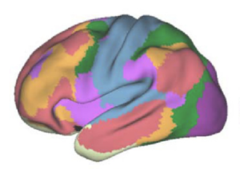

{}
{}

### Shen Atlas (Shen 2009)

The Shen268 atlas was derived based on a group-wise spectral clustering algorithm using resting-state fMRI data from 45 subjects acquired at Yale MRRC. The atlas contains 268 functional coherent nodes, which are further grouped into eight resting state networks.

The Shen368 atlas has 327 cortical nodes that were constructed using the group-wise spectral clustering  
algorithm, 14 subcortical nodes that were defined using the anatomical definition, and 26 cerebellum  
nodes that were derived based on Yeo’s 17 networks, and one brain stem node.

{}
{}
*How to obtain the atlas:*

- [The parcellation was released here.](https://www.nitrc.org/frs/?group_id=51)
- These parcellation schemes come preinstalled within Lead-DBS.

*Related citations:*

- [Shen, X., Tokoglu, F., Papademetris, X., Constable, R.T.. Groupwise whole-brain parcellation from resting-state fMRI data for network node identification, Neuroimage, 82, 403-15, 2013.](https://doi.org/10.1016/j.neuroimage.2013.05.081)
- [Finn, E., Shen, X., Scheinost, D. et al. Functional connectome fingerprinting: identifying individuals using patterns of brain connectivity. Nat Neurosci 18, 1664–1671, 2015.](https://doi.org/10.1038/nn.4135)
- [Horien, C., Shen, X., Scheinost, D., Constable, R.T.. The individual functional connectome is unique and stable over months to years. NeuroImage 189, 676–687, 2019.](https://doi.org/10.1016/j.neuroimage.2019.02.002)

{}
{}
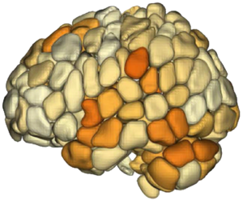

{}
{}

### Myelo- and cytoarchitectonic microstructural and functional human cortical atlases (Pijnenburg 2021)

Digital versions of six classical human brain atlases in common MRI space. The cortical atlases represent a range of modalities, including cyto- and myeloarchitecture (Campbell, Smith, Brodmann and Von Economo), myelogenesis (Flechsig), and mappings of symptomatic information in relation to the spatial location of brain lesions (Kleist).

{}
{}
*How to obtain the atlas:*

- The parcellation was released [here](http://www.dutchconnectomelab.nl).
- These parcellation schemes come preinstalled within Lead-DBS.

*Related citations:*

- [Pijnenburg, R., Scholtens, L.H., Ardesch, D.J., de Lange, S.C., Wei, Y., van den Heuvel, M.P., 2021. Myelo- and cytoarchitectonic microstructural and functional human cortical atlases reconstructed in common MRI space. NeuroImage 239, 118274.](https://doi.org/10.1016/j.neuroimage.2021.118274)

{}
{}
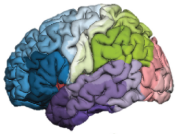

{}
{}

### Julich-Brain Cytoarchitectonic Atlas (Amunts 2020)

The Julich-Brain Cytoarchitectonic Atlas presents cytoarchitectonic maps in several coordinate spaces, such as MNI colin27, MNI152, and freesurfer. These maps originate from peer-reviewed probability maps that define both cortical and subcortical brain regions. Notably, these probability maps account for the brain’s inter-individual variability by analyzing data from ten post-mortem samples. For a whole-brain parcellation, the available probability maps are combined into a maximum probability map by considering for each voxel the probability of all cytoarchitectonic brain regions, and determining the most probable assignment. Continuously evolving, the Atlas is regularly updated with new areas. Furthermore, it stands as a reference atlas for the Human Brain Project and is deeply embedded within the European research infrastructure platform, EBRAINS. The *siibra* toolsuite provides an automated access to the Atlas, to speed up your work.

{}
{}
*How to obtain the atlas:*

- Download most recent version at [EBRAINS Knowledge Graph](https://search.kg.ebrains.eu/?category=Dataset&q=julich%20brain%20brain).
- These parcellation schemes come preinstalled within Lead-DBS.

*Related citations:*

- [Amunts, K., Mohlberg, H., Bludau, S., & Zilles, K. (2020). Julich-Brain: A 3D probabilistic atlas of the human brain’s cytoarchitecture. Science, 369(6506), 988–992. DOI: 10.1126/science.abb4588](https://doi.org/10.1126/science.abb4588)

{}
{}
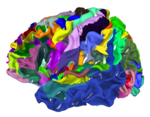

{}
{}
Contact us to make your atlas available for distribution within LEAD-DBS
