DISTAL is a subcortical atlas of DBS targets and the structures around them in MNI space (ICBM 2009b
NLIN Asym), built for Lead-DBS from multimodal MRI, histology and structural connectivity. **It comes
with Lead-DBS** (current version 1.1), so there is nothing to download.

**What to cite:**

{}
Ewert, S., Plettig, P., Li, N., Chakravarty, M. M., Collins, D. L., Herrington, T. M., et al. (2018). Toward defining deep brain stimulation targets in MNI space: A subcortical atlas based on multimodal MRI, histology and structural connectivity. *NeuroImage*, 170, 271–282. https://doi.org/10.1016/j.neuroimage.2017.05.015
{}

## Motivation

Summarized from the methods paper above (2017).

When work on Lead-DBS was started in 2012, we began [collecting subcortical atlases](/helpsupport/knowledge-base/atlasesresources/atlases-2/) of the brain to best define anatomy. For instance, the ATAG atlas [was made freely available](https://www.nitrc.org/projects/atag) by the Forstmann group in Amsterdam.

Over the years, with growing experience, we noticed that none of the available atlases was precisely suited for use in Lead-DBS, none of them was explicitly built for our toolbox.

One limitation of most available atlases (when used in Lead-DBS) can be seen in the figure below:

{}
{}
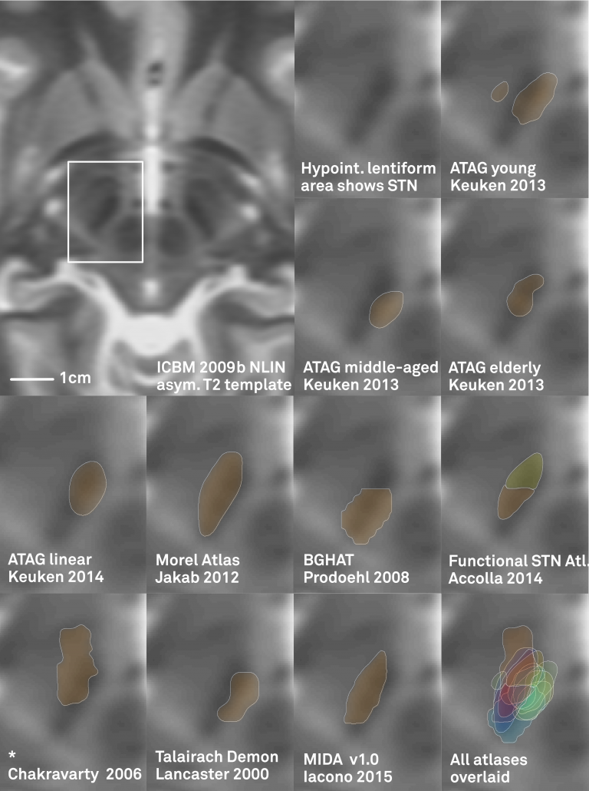

{}
{}
*Left: In the left upper panel you see the hypointense region of the subthalamic nucleus as defined by the [most modern MNI template available](/about-the-mni-spaces/). The region of the STN is further magnified in the next panel. Subsequent panels overlay available atlases of the STN to this region. As you can see, neither of them precisely matches the STN of the template. The reasons for this are manifold but since in DBS imaging, millimeters matter, such discrepancy really does matter.*

{}
{}
Your patient data will (if quality allows) show a similar hypointense region that defines (part) of the STN.

- If you use a nonlinear deformation algorithm (like the Advanced Normalization Tools, FSL- or SPM-based implementations in Lead-DBS) to register the hypointense region of your patient’s brain to the MNI template AND
- If data & algorithms were perfect => this would lead to the hypointense region of your patient’s brain exactly matching the STN of the template.

> If you now combine this image with an atlas that doesn’t exactly fit the MNI template, a systematic mismatch will result!

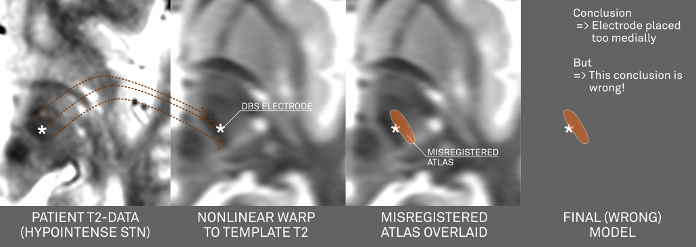

*Above: This figure further illustrates the systematic error introduced by a misplaced atlas (i.e. an atlas not precisely matching the template that is used for normalization).*

> Above conclusions forced us to create an atlas that is “made for Lead-DBS”

---

## Methods

We wanted to create an atlas that is i) very precisely aligned to the ICBM 2009b MNI template and ii) accurate enough to visualize all structures relevant for DBS surgery. This resulted in three separate stages.

### Stage 1: A multimodal region-growing algorithm applied to MNI templates
In this stage, the T1-, T2-, PD- and T2rlx weighted templates were segmented simultaneously, incorporating all information in parallel. First, a multimodel region-growing-like algorithm was applied that produced probability maps. These maps were then used to manually segment subthalamic nucleus, red nucleus, internal and external pallidum directly within the space of the template series.

{}
{}
*Right: The final result of manual segmentations that were performed directly on the MNI template using its four spectra simultaneously. These four structures i) align perfectly with the template and ii) were used as anchorpoints to warp histology to the template.*

{}
{}
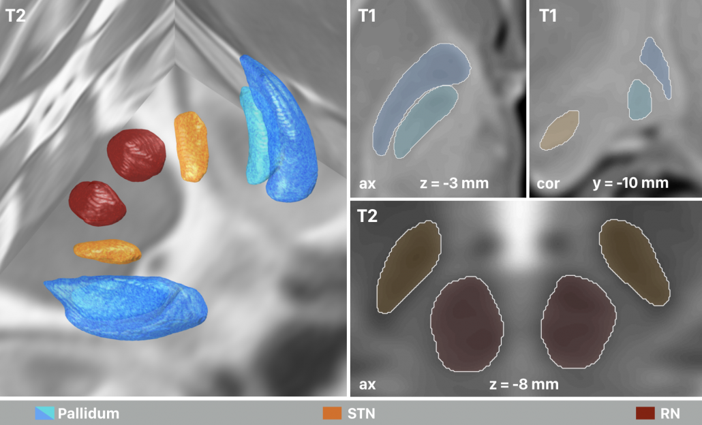

{}
{}
### Stage 2: Precise co-registration of histology, using Stage 1 as additional anchor points
To “fill the gaps” between the regions defined on the template itself, a precise histological atlas was graciously provided by Mallar Chakravarty (Douglas Institute) and Louis Collins (MNI). To align this data as precisely as possible to the MNI space, manual structures were used as additional anchorpoints in a nonlinear pseudo-MRI to template warp.

{}
{}
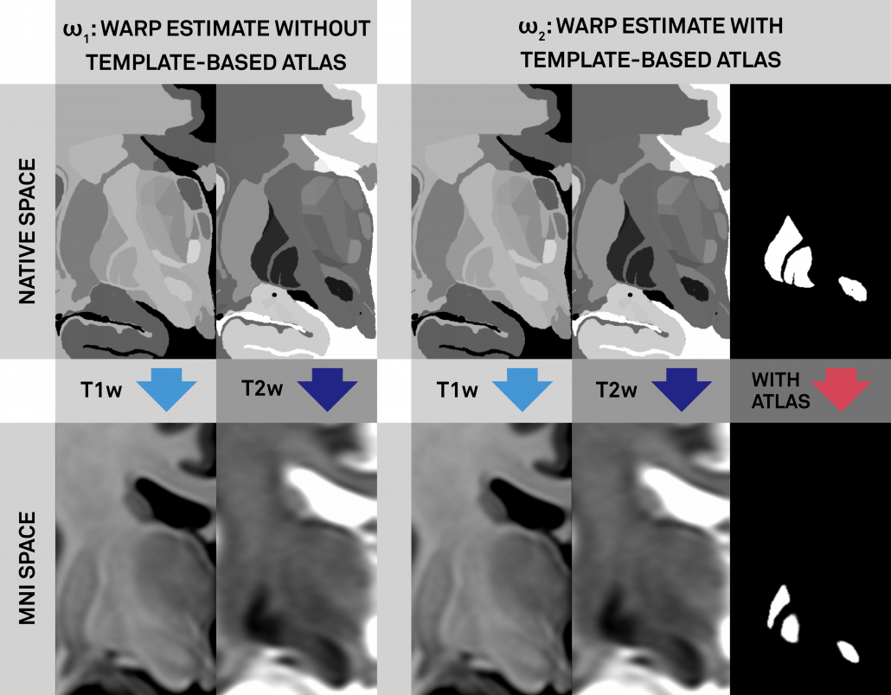

{}
{}
*Left: Conventional (left panel) and additional anchor point warp (right panel). Both warps apply multiple spectra to align histology to the template. The right warp includes an additional high signal-to-noise (binary) manual segmentation of the same structures (STN, RN, GPi/GPe) defined on histology and the template (manual anchorpoints). This leads to a very precise alignment of i) these structures and ii) structures ultimately neighboring them. Notably, these structures are the most important ones in DBS imaging.*

{}
{}

{}
{}
*Right: Comparisons of results when warping the STN as defined by histology onto the template. Top panels show the conventional approach (without additional anchor points), bottom panels the approach with additional anchorpoints, showing a clearly superior alignment to the hypointense STN region defined by the template.*

{}
{}
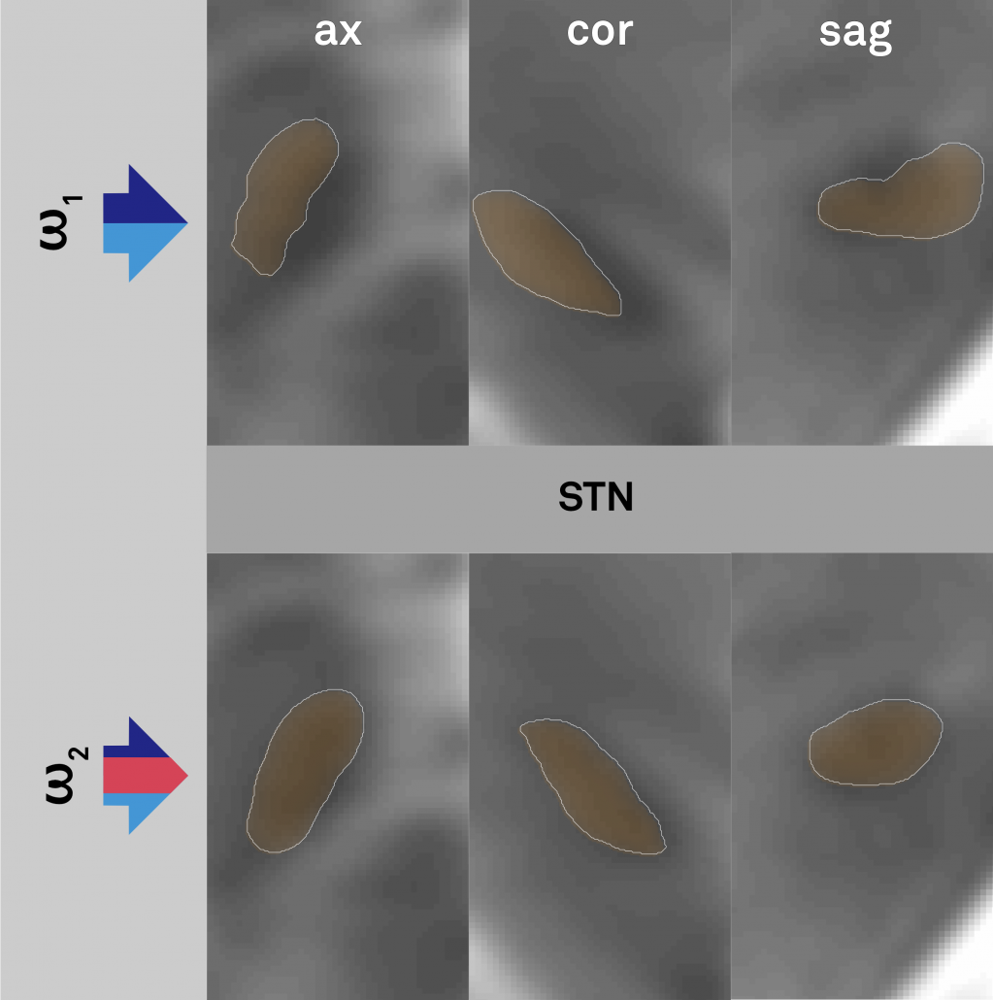

{}
{}
### Stage 3: Further parcellation of core DBS targets by means of structural connectivity
The final stage was to further subdivide the primary DBS targets, namely the STN and the GPi by means of structural connectivity. This has been done in multiple studies for the STN, subdividing it into sensorimotor, associative and limbic subregions. It has not been done for the GPi, potentially given its closeness to efferent and afferent structures. We used the efferent connectivity of the GPi that projects to thalamic functional zones as they were defined in the famous [Behrens 2003](https://www.ncbi.nlm.nih.gov/pubmed/12808459) study.

{}
{}
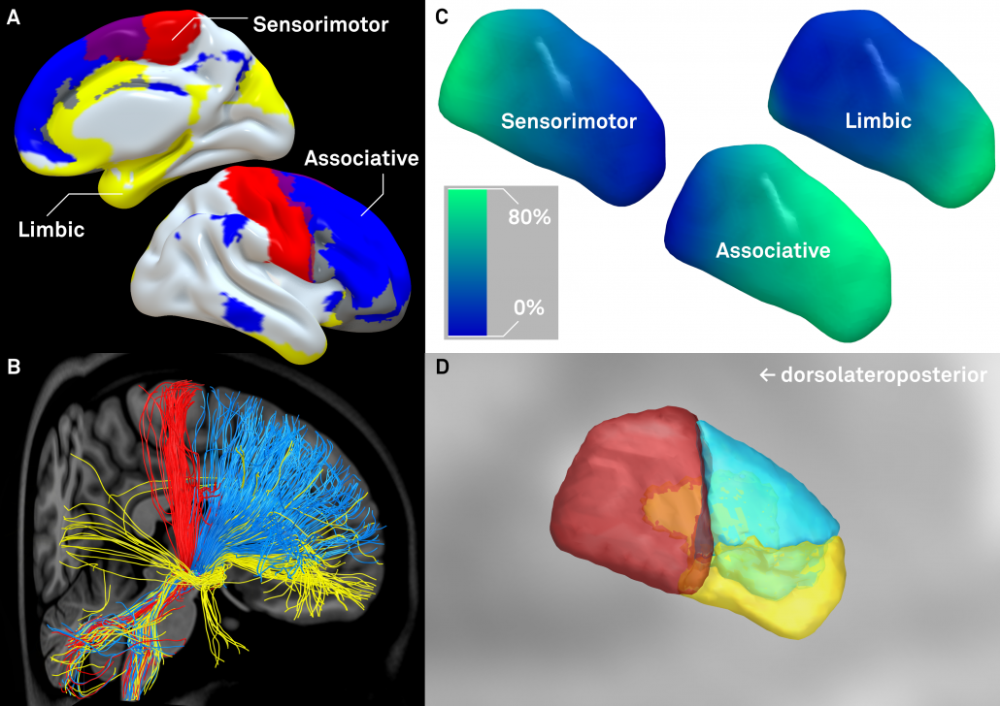

{}
{}
*Left: Afferent connectivity to different cortical regions defines a sensorimotor, associative prefrontal and limbic functional zone of the subthalamic nucleus. Of note, in our study, this was done with both connectivity data from healthy subjects and patients suffering from Parkinson’s disease. Results were highly similar and replicate findings published by [Accolla et al.](http://onlinelibrary.wiley.com/doi/10.1002/hbm.22533/full) and [Lambert et al.](https://www.ncbi.nlm.nih.gov/pmc/articles/PMC3315017/) in humans and various studies published based on animal models (e.g. see this study by [Haynes & Haber](https://www.ncbi.nlm.nih.gov/pmc/articles/PMC3755746/))*

{}
{}

{}
{}
*Right: A similar approach was used to parcellate the GPi into seven functional zones using the Oxford thalamic connectivity atlas as seed-regions. Of note, the postero-ventral third of the nucleus corresponds to its sensorimotor functional zone, as previously published (e.g. [Cif et al.](https://www.ncbi.nlm.nih.gov/pubmed/22339165), [Tisch et al.](https://www.ncbi.nlm.nih.gov/pmc/articles/PMC2095629/))*

{}
{}
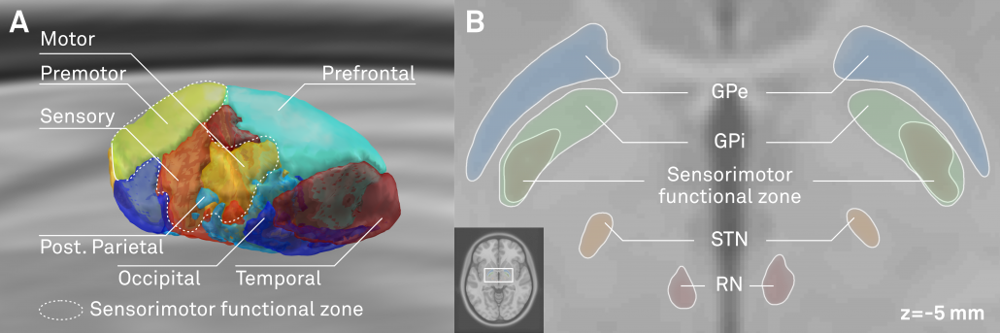

{}
{}
### Methods summary

{}
{}
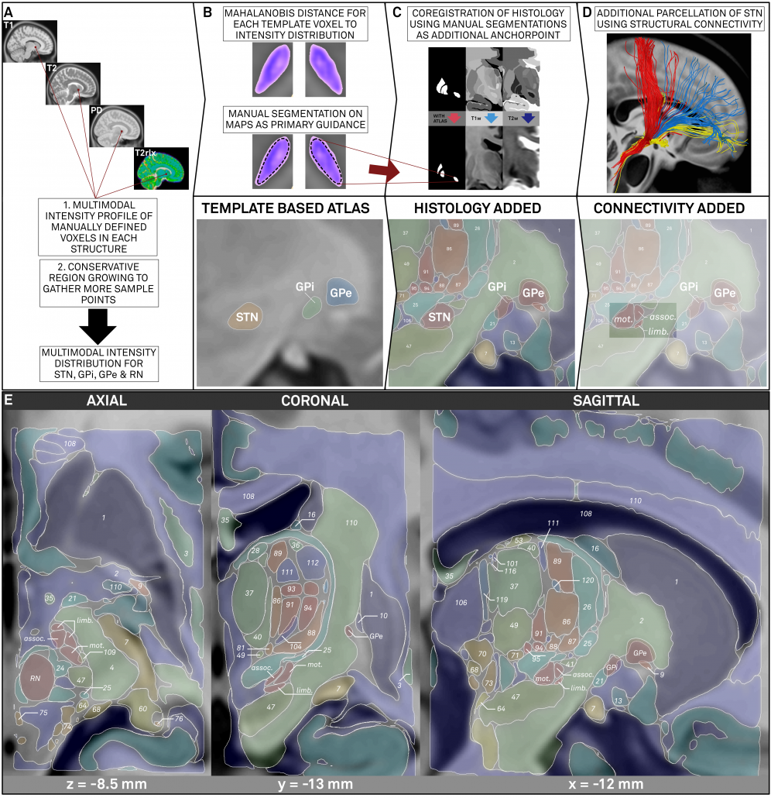

{}
{}
*Left: Summary of methods. The figure shows the three stages described above. First, core nuclei were manually segmented based on multimodal probability maps created directly on the MNI template. Then, these nuclei served as anchor points to register histological data that was used to fill the gaps. Finally, two core structures were further subdivided using structural connectivity.*

{}
{}
---

## Results

The final result is an atlas that is i) precisely coregistered to the ICBM 2009b nonlinear asymmetric MNI template and ii) very detailed (based on histology and structural connectivity).

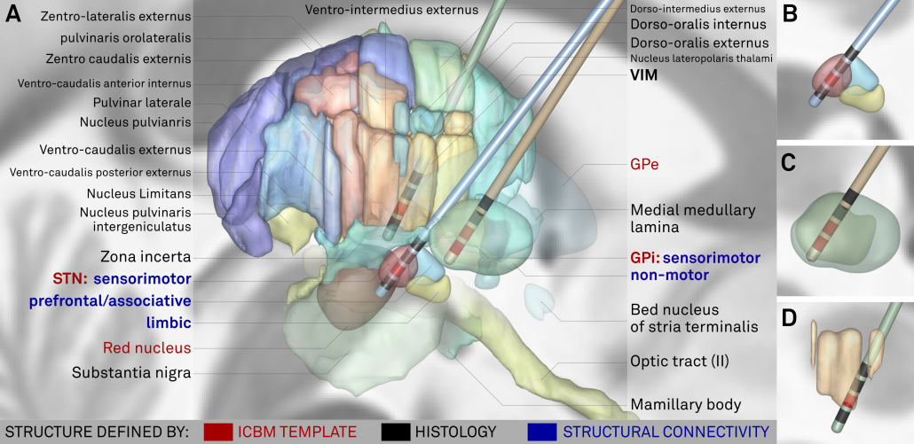

*Above: The “final product”. Structures marked in red were defined based on the multimodal template itself, structures marked in black based on histology. Finally, blue text defines functional zones that further subdivide STN and GPi based on structural connectivity.*

{}
{}
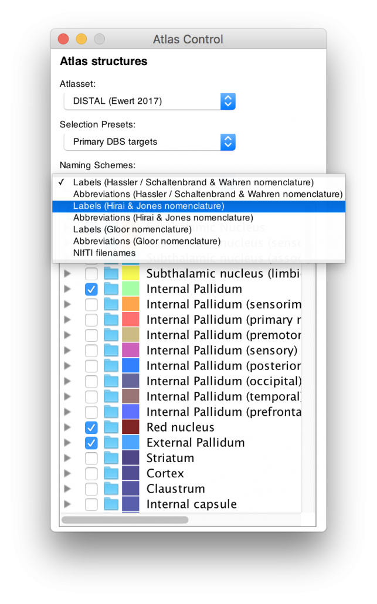

{}
{}
*Left: Based on the highly unique histology dataset graciously provided by our colleagues in Montreal (see above), the DISTAL atlas comes in three nomenclatures as well as their abbreviations. For people that are interested in the thalamus, this represents a rosetta stone of thalamic nomenclatures in MNI space.*

*Structures can be easily explored in the 3D viewer built into Lead-DBS and several presets are available.*

*For instance, you can choose to show “DBS relevant structures” only. Another example is to quickly turn on functional parcellations of the STN/GPi or rather show them as solid structures.*

The video below shows these features (recorded in 2017):

{}
{}


{}
{}
*Right: The DISTAL atlas significantly outperforms other published atlases when performing atlas-based segmentation within Lead-DBS.*

  

### Some release notes

- The DISTAL atlas published within Lead-DBS slightly differs from the one described in the paper in the following ways:
  - Writing the paper and running all the analyses led to a much broader understanding of anatomy on our part. Thus, the final manual segmentations of core regions / anchor points were further refined by the first author of the study who has become an expert in subcortical anatomy while pursuing the complete endeavor.
  - Based on these novel manual segmentations, connectivity-based parcellations were re-run (which is a fully automated approach and yielded extremely similar results).
  - We further refined histology to template warps by iteratively registering pseudo-MRIs to templates and re-generating novel pseudo-MRIs based on the warps until an equilibrium was reached. This further refines registration of histology to the template.
  - In comparison to the manuscript version, we also used the PD weighted template series to do this, leading to a four-fold multispectral warp between pseudo-MRI (histology) and template series / anchor points.
  - We performed this iterative histology-to-template registration only on the left hemisphere and nonlinearly warped the structures to the right hemisphere by applying a multispectral nonlinear left to right warp that is accessible within Lead-DBS.
- The original (manuscript version) atlas is available upon request. We still prefer to only provide this adapted, much better version of the atlas within Lead-DBS to avoid confusion.

{}
{}
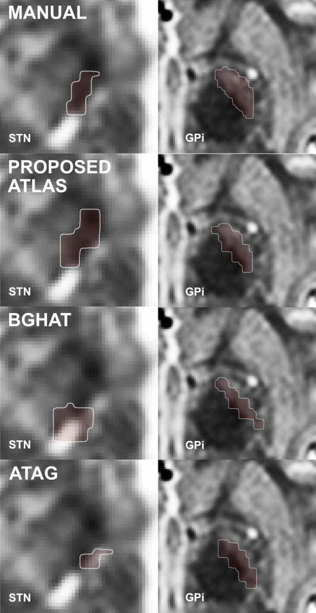

{}
{}
## Change-log {#change-log}

- 09/09/2017: v. 1.0 released
- 05/02/2018: v. 1.1 released: improved registration of left hemispheric histology, symmetrized functional parcellations of STN / GPi subregions.

## Next

DISTAL is one of more than 60 [subcortical atlases](/helpsupport/knowledge-base/atlasesresources/atlases-2/)
you can use in Lead-DBS. To see it with your own patients' electrodes, [download Lead-DBS](/download/)
and take the [first steps](/helpsupport/first-steps/).
