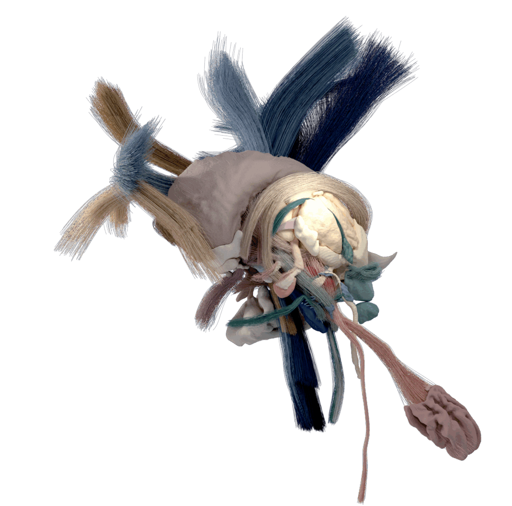
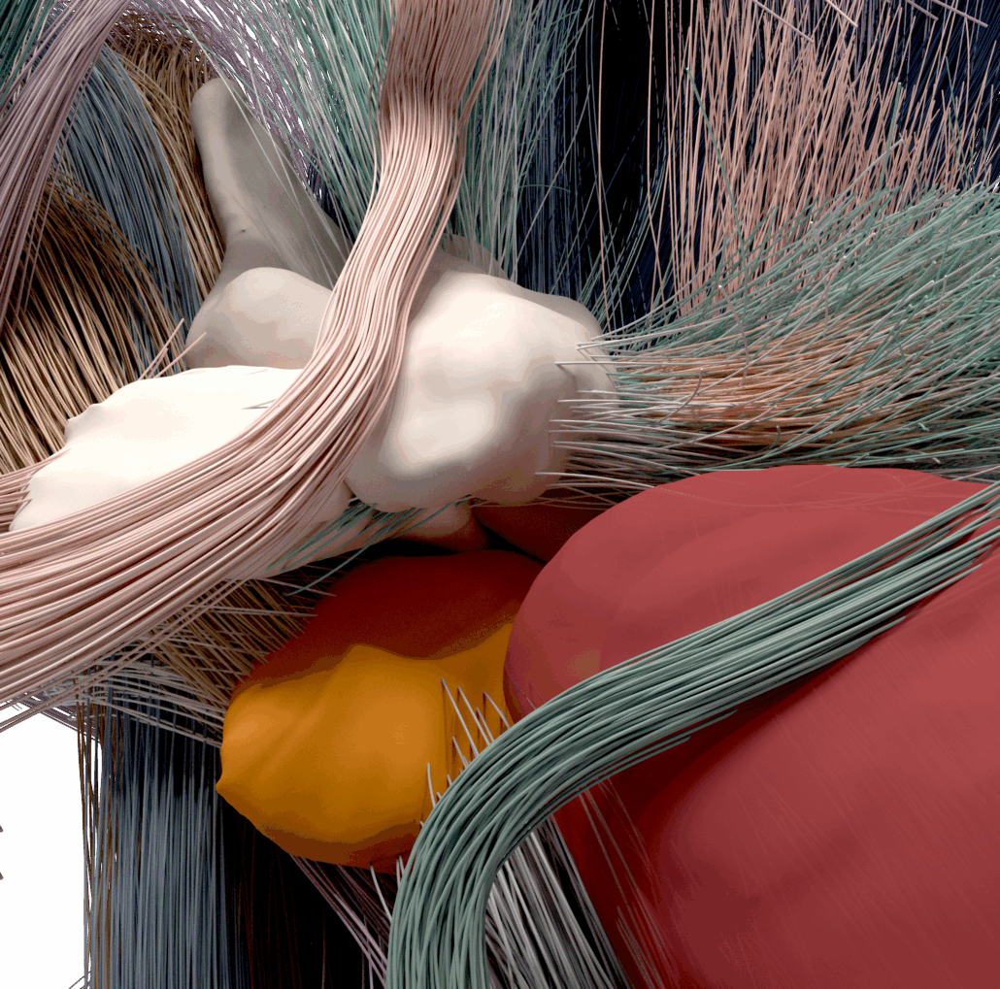
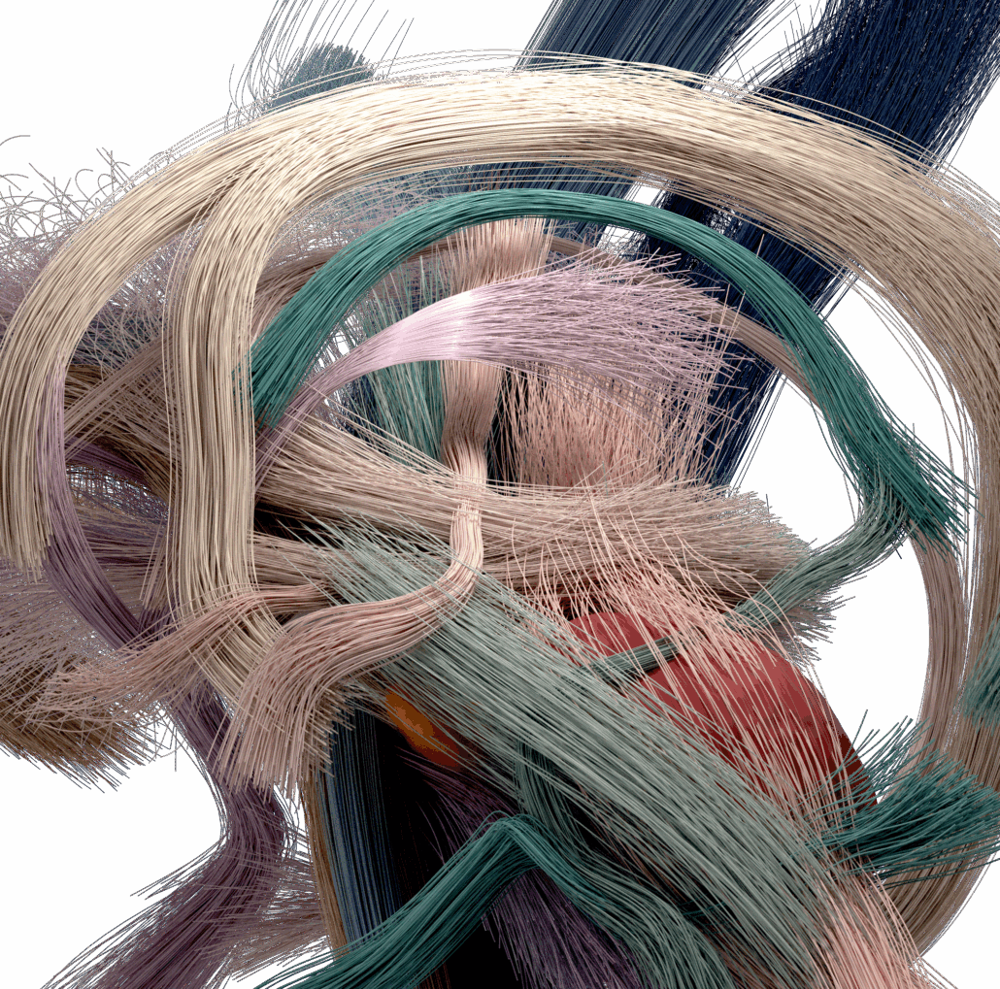


What
: A 100-micron atlas of the human subcortex by the Lead-DBS team: 95 grey and white matter structures, manually segmented, and 82 curated fibre pathways, across the basal ganglia, thalamus, subthalamus, midbrain and cerebellum

Built from
: 7T ex vivo MRI

Space
: Registered to MNI space, at 100-micron isotropic resolution

Get it
: Through the [download form](#download), for academic research only

Cite
: Friedrich et al. 2026, preprint on *bioRxiv* (<time datetime="2026-02">February 2026</time>), [doi:10.64898/2026.02.13.705755](https://doi.org/10.64898/2026.02.13.705755) ([full citation](#what-to-cite))


## What it is

FOCUS gives submillimetre definitions of the nuclei and fibre tracts of the basal ganglia, thalamus,
subthalamus, midbrain and cerebellum, including delicate pathways often invisible on conventional MRI: the
detail needed to model deep brain stimulation (DBS), focused ultrasound and lesion surgery. Its
registration to MNI space allows it to be transformed into an individual brain.

## How to get it {#download}

Fill in the form below. FOCUS is licensed **for academic research only**, not for commercial
applications. Downloading also subscribes you to the Lead-DBS [newsletter](/subscribe-to-our-newsletter/),
which is sent rarely; you can opt out with one click, and your details are not shared with anyone else.



## What to cite

{}
Friedrich, H., Sahin, I. A., Rajamani, N., Alho, E. J. L., Milanese Holanda, V., Oxenford, S., et al. (2026). A precise atlas of the human subcortex. *bioRxiv* (preprint). https://doi.org/10.64898/2026.02.13.705755
{}

## How FOCUS was built

The 95 structures were segmented by hand on 7T ex vivo MRI at 100-micron resolution. Alongside them, a
pathway atlas was curated from anatomical priors (“tract architectonics”), so that complex fibre systems are
reconstructed faithfully to the anatomy. The atlas was validated against 48 additional anatomical
resources, including histology and fibre dissections, and is meant to be refined further, version by
version.

{}
{}

{}
{}

{}
{}

Read the preprint on bioRxiv
