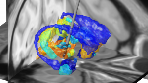

## Macaque atlases in MNI space

Below you find information about how and where to obtain atlases suitable for 2D/3D-visualization using Lead-DBS and its macaque toolbox extension. If an atlas you know of is missing, please [contact us](/contact/).

**Looking for human atlases of the cortex / whole-brain parcellations?** Please see [this page](/helpsupport/knowledge-base/atlasesresources/cortical-atlas-parcellations-mni-space/).  
**Looking for human subcortical atlases?** Please see [this page](/helpsupport/knowledge-base/atlasesresources/atlases-2/).

### INIA19 primate brain atlas

A detailed atlas informed from over 100 structural MR scans of 19 rhesus macaque animals.

Please note that the atlas is not exactly coregistered to macaque MNI space. However, a script to warp between the INIA19 and MNI space is supplied with the Lead-DBS macaque toolbox.

{}
{}
*How to obtain the atlas:*

- [You can get information about this atlas here](https://www.nitrc.org/projects/inia19/)
- The atlas comes preinstalled within the Lead-DBS macaque extension

*Related citations:*

- [Rohlfing, T., Kroenke, C. D., Sullivan, E. V., Dubach, M. F., Bowden, D. M., Grant, K. A., & Pfefferbaum, A. (2012). The INIA19 Template and NeuroMaps Atlas for Primate Brain Image Parcellation and Spatial Normalization. Frontiers in Neuroinformatics, 6, 27. http://doi.org/10.3389/fninf.2012.00027](http://www.ncbi.nlm.nih.gov/pmc/articles/PMC3515865/)

{}
{}

{}
{}
Contact us to make your atlas available for distribution with Lead-DBS
