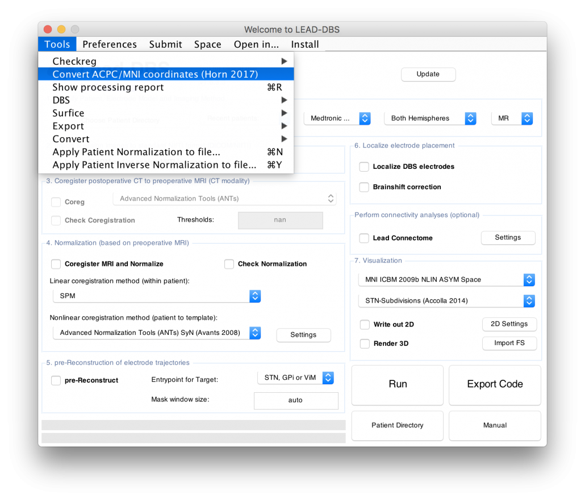
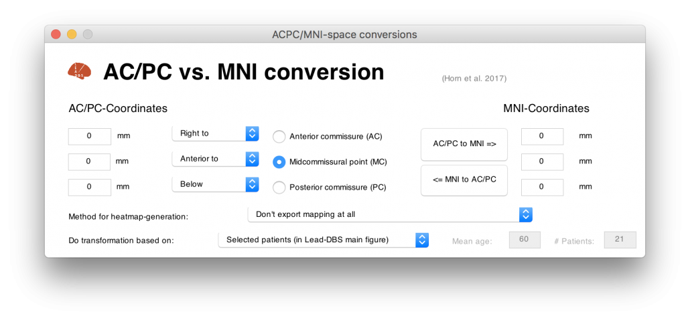
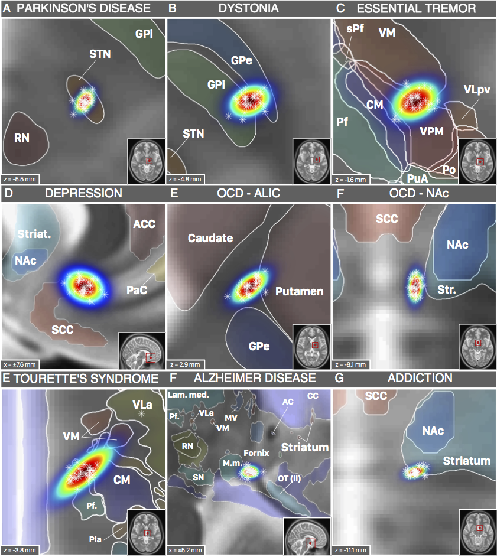

Neurosurgeons report DBS targets in AC/PC coordinates, relative to the anterior and posterior
commissures; imaging research works in MNI space. Lead-DBS converts coordinates from one to the other,
probabilistically: it marks the same AC/PC coordinate in many age-matched brains and warps each one
into MNI space. This made it possible to place the DBS targets of the surgical literature in MNI space
for the first time, next to the atlases and connectomes defined there.

## Use it in Lead-DBS

Open the *AC/PC to MNI conversion tool* from the Tools menu of Lead-DBS.

### The IXI reference data {#ixi}

To convert coordinates without patients of your own, use the preprocessed
[IXI dataset](http://brain-development.org/ixi-dataset/) (open licence) of healthy subjects: Lead-DBS picks
an age-matched sample from it, as described in [Horn et al. 2017](https://doi.org/10.1016/j.neuroimage.2017.02.004).

Download the IXI dataset

## What to cite

> Horn, A., Kühn, A. A., Merkl, A., Shih, L., Alterman, R., & Fox, M. (2017). Probabilistic conversion of neurosurgical DBS electrode coordinates into MNI space. *NeuroImage*, *150*, 395–404. [doi:10.1016/j.neuroimage.2017.02.004](https://doi.org/10.1016/j.neuroimage.2017.02.004)

A short talk on the method, held at AAN 2017: [slides (PDF)](https://www.lead-dbs.org/docs/talks/AAN_presentation_Horn_2017.pdf).

## Background: DBS targets in MNI space {#background}

*This section first appeared on 18 April 2017 as the article "DBS targets in MNI space".*

### What are AC/PC coordinates?

Coordinates relative to the anterior commissure (AC), the posterior commissure (PC) or their midpoint,
the midcommissural point (MCP), are also called "functional coordinates", since they are used in
functional neurosurgery, the field largely shaped by DBS surgery.

The system was popularized by two surgical atlases, Schaltenbrand-Wahren
([1977](http://www.thieme.com/books-main/neurosurgery/product/168-atlas-for-stereotaxy-of-the-human-brain))
and Talairach-Tournoux
([1988](http://www.thieme.com/books-main/neurosurgery/product/414-co-planar-stereotaxic-atlas-of-the-human-brain))
(the idea of stereotactic coordinates goes back to
[Clarke and Horsley in 1906](https://www.ncbi.nlm.nih.gov/pubmed/17912057)). As
[Brett and colleagues (2002)](http://www.nature.com/nrn/journal/v3/n3/abs/nrn756.html) point out, these
atlases brought three innovations: a coordinate system relative to anatomical landmarks; a standard
brain with anatomical labels and the cytoarchitectonic details of Korbinian Brodmann (1925); and a
9-parameter transformation (position, orientation, size) to match one brain to another.

The AC and PC vary little between people, which makes them good reference points. But both atlases
were drawn from single brains that were smaller than average, and, as
[Weiss and colleagues](http://www.ajnr.org/content/24/5/922) point out, the reference points differ:
sometimes the centres of AC and PC are used, sometimes their borders, sometimes a mix of the two.

 The Schaltenbrand-Wahren and Talairach-Tournoux atlases are both based on single brains that are smaller than average. B) The anterior and posterior commissures are not always defined in the same way; it depends on the atlas and on the surgeon's preference.")

### What are MNI coordinates?

In the words of [Matthew Brett](http://www.nil.wustl.edu/labs/kevin/man/answers/mnispace.html): "the MNI
wanted to define a brain that is more representative of the population. They created a new template
that was approximately matched to the Talairach brain in a two-stage procedure. First, they took 241
normal MRI scans, and manually defined various landmarks, in order to identify a line very similar to
the AC-PC line, and the edges of the brain. Each brain was scaled to match the landmarks to equivalent
positions on the Talairach atlas. They then took 305 normal MRI scans (all right handed, 239 M, 66 F,
age 23.4 +/- 4.1), and used an automated 9 parameter linear algorithm to match the brains to the
average of the 241 brains that had been matched to the Talairach atlas. From this they generated an
average of 305 brain scans thus transformed – the **MNI305**."

And: "The **problem introduced by the MNI** standard brains is that the MNI linear transform **has not
matched the brains completely** to the Talairach brain. As a result the MNI brains are slightly larger
(in particular higher, deeper and longer) than the Talairach brain."

Conversions between Talairach and MNI space have been studied in depth (for example in the
[work of Lancaster and colleagues](http://www.brainmap.org/icbm2tal/)). The term "MNI space" itself
covers several templates: see [About the MNI space(s)](/about-the-mni-spaces/).

### Surgical coordinates are not Talairach coordinates

At least not always. Depending on the target and their preference, surgeons report coordinates relative
to the AC, the PC or the MCP, most often in millimetres **lateral**, **anterior** and **below** the MCP,
but sometimes, for example, **lateral**, **posterior** and **above** the AC. Talairach coordinates, in
contrast, are always relative to the AC, and their signs say where a point lies (a negative x is in the
left hemisphere, a positive z is dorsal to the AC). Talairach-to-MNI tools therefore apply only in part
to the coordinates of the neurosurgical literature.

### Why convert to MNI space?

- The atlases used in the neurosurgical literature are based on **single brains** and do not represent
  the average population.
- There are few of them, while **many atlases** exist in MNI space, from histology, fMRI, diffusion MRI
  or meta-analyses.
- **Other resources**, such as normative **connectomes** and whole-brain **histology**, are in MNI space
  too.
- With a conversion, **findings from neurosurgery and from functional imaging can be combined**.
- MNI space comes with detailed **3D templates** and **nonlinear deformation algorithms**, refined over
  some 15 years of fMRI research, that warp single brains into it and back. Whatever is defined in MNI
  space can be carried into any other space, more or less accurately.

### How the conversion works

AC/PC coordinates are relative to the anatomy of a specific clinical population, which is usually
unknown. Ideally one would take MRIs of that population, mark AC, PC and the coordinate in each, and
warp them nonlinearly into MNI space; but MRIs of large clinical cohorts are hard to obtain.

The study used surrogate populations instead. Two DBS cohorts with different surgical targets, whose
coordinates were all known, served as the gold standard. Their AC/PC coordinates were then defined in
young healthy, age-matched, disease-matched and disease-severity-matched surrogate cohorts and warped
into MNI space.

> This is probabilistic: the same point relative to AC/PC lands in slightly different places in
> different brains, so warping it from many brains gives a probabilistic point cloud in MNI space.

The main finding: **an age-matched surrogate cohort gave results similar to the actual cohort**. A young
healthy cohort did worse; a disease-matched or disease-severity-matched cohort was not needed.

### DBS targets in MNI space

With the method validated, the study reviewed the literature for effective DBS targets. For each study
that reported one, an age-matched cohort from the [IXI dataset](http://brain-development.org/ixi-dataset/)
served to warp the AC/PC coordinate into MNI space. The result is an atlas of DBS targets for various
diseases in MNI space.

; its backdrop is the BigBrain dataset, a whole-brain histology stack warped into MNI space.")

The targets can now be compared with other subcortical atlases, not only with the Schaltenbrand-Wahren
atlas common in the neurosurgical literature: for example with the
[Morel](https://www.crcpress.com/Stereotactic-Atlas-of-the-Human-Thalamus-and-Basal-Ganglia/Morel/p/book/9780824728946)
or [Chakravarty](https://www.ncbi.nlm.nih.gov/pubmed/16406816) atlases, both based on histology and
available in MNI space.

### One target, many resources: essential tremor

Atlases are not the only resources in MNI space. The study made this point with the DBS target for
essential tremor, commonly placed in the ventral intermediate nucleus of the thalamus (VIM), an
assumption based on early, pre-MRI studies (for example by Hassler or Jones). The nucleus has many
names: *VIM/Vim* in the Walker and Ohye notations, *Vimi* in those of Hassler and of Van Buren and
Borke, *vim* in Dewulf's; in the Jones and Hirai-Jones notations VLpv or VPM correspond best, and in
those of Ilinsky/Kultas-Ilinsky and of Percheron the VL and LI/LIL nuclei.

So the same nucleus has different names and slightly different borders from atlas to atlas. Moreover,
the effective target for essential tremor has been reported below the thalamus, in the subthalamic
area or dorsal zona incerta, and the dentatorubrothalamic tract seems to play a crucial role in the
therapeutic effect.

Some thalamic atlases are based not on histology but on functional zones defined by functional or
diffusion-weighted imaging. Behrens and colleagues
([2003](https://www.ncbi.nlm.nih.gov/pubmed/12808459)), for example, defined seven zones of the
thalamus by their structural connectivity, reported in MNI space, so they can now be combined with
the neurosurgical findings:

 characterized with resources in MNI space: atlases based on histology, functional or diffusion-weighted MRI locate the target, and normative functional and structural connectomes give its connectivity profile.")

Every step described here is built into Lead-DBS: the [conversion tool](#use-it-in-lead-dbs) applies it
to any AC/PC coordinate with a surrogate cohort of your choice.

## Next

Why there is more than one MNI space: [About the MNI space(s)](/about-the-mni-spaces/). The atlases to
compare targets with: [Subcortical atlases](/helpsupport/knowledge-base/atlasesresources/atlases-2/).
All that Lead-DBS does: [Methods](/helpsupport/knowledge-base/lead-dbs-methods/).
