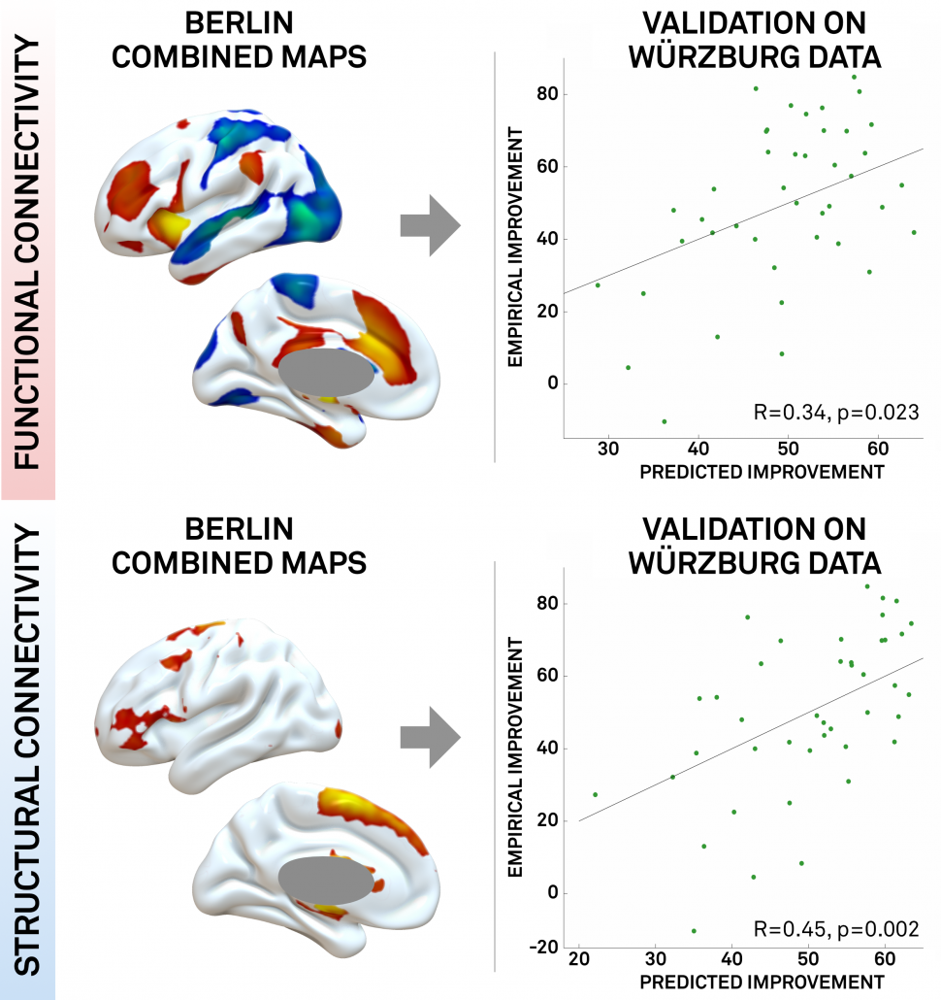

DBS network mapping relates the connections of each patient's stimulation site, estimated with
[normative connectomes](/helpsupport/knowledge-base/atlasesresources/normative-connectomes/), to their clinical outcome.

## Use it in Lead-DBS

Lead-DBS estimates the stimulation volumes and Lead Connectome Mapper their connectivity; Lead Group
relates them to outcome. The manual explains each step under [Connectomics](https://netstim.gitbook.io/leaddbs/connectomics/connectomic-analyses)
and [Lead Group](https://netstim.gitbook.io/leaddbs/lead-group/group-analyses-with-lead-dbs).

## What to cite

The paper that introduced the method:

{}

{}

It was discussed in an editorial in *Nature Reviews Neurology*:
[Ridler 2017, “Parkinson disease: deep brain stimulation — making the right connections”](https://www.nature.com/articles/nrneurol.2017.91).

## How it works {#the-concept}

 derived DBS electrode localizations (B), the stimulation volume is estimated (C). Then, normative connectomes are queried to calculate which other brain structures are – in the average human brain – connected to the stimulation volume. This may be done both for functional (D) and structural (E) connectivity.")

The connectivity profiles of all patients are then related to their clinical improvement: the result is
a map of the regions a well-placed electrode is connected to, and it predicts the outcome of new patients.

The method step by step, from the 2017 paper

 stimulation volumes. Above, functional connectivity profiles of DBS electrodes implanted in 12 Parkinson’s disease patients are shown. At first glance, they look pretty similar (which is not surprising since all electrodes are implanted inside the STN). However, small changes can be seen.")

. Across subjects, it is mostly anticorrelated (cold colours) to the DBS sites but in some patients, it is positive (hot colours).")

. In our article, we estimated three types of maps (for details, see [Horn et al. 2017](https://doi.org/10.1002/ana.24974)). Here, we’ll cover the R-map in detail only: It shows hot colours (positive R-values) for voxels a connectivity to which is positively associated with clinical improvement. Cold colours for the inverse: Weaker or more negative connectivity is associated with clinical improvement.")

An intuitive explanation of this type of map is that it shows areas that a DBS electrode “should be” connected to and areas to which it “should not be” connected for best efficacy.

Finally, these maps may be used to actually predict outcome (right hand scatter plots) in new patients by estimating the similarity between the map and a novel patient’s DBS electrode connectivity profile (maps as shown in figs. 2-3). Similarity between two brain maps can be estimated using many metrics and generally falls into the domain of proximity/distant metrics (treating the two maps as two N-dimensional points in space and calculating their distance). In our case we chose (spatial) correlation as a normalized distance metric.

> The three types of maps may be created using ea_Rmap, ea_Amap and ea_Cmap code included in Lead-DBS.

 active contacts from two cohorts mapped to the STN in MNI space. B) rs-fMRI connectivity based network map (R-map type) for % UPDRS-III improvement. C) connected fibertracts colored by association with good (red), midline (yellow) or poor (blue) symptom improvement.")

### Normative or individualized connectivity

Patient-specific connectomes can replace the normative ones used above (and studies are running to do so). The concept could be used to guide DBS programming and/or DBS surgery. Finally, the connectivity profiles may help to define target maps for noninvasive brain stimulation (in this concept, the [2014 PNAS article by Michael Fox et al. is highly enlightening](https://doi.org/10.1073/pnas.1405003111)).

## Related approaches

The same idea maps the symptoms of stroke and other brain lesions to common networks, and was applied to
transcranial magnetic stimulation (TMS).

Show the studies

> - Darby, R. R., Horn, A., Cushman, F., & Fox, M. D. (2018). Lesion network localization of criminal behavior. *Proceedings of the National Academy of Sciences of the United States of America*, *115*(3), 601–606. [doi:10.1073/pnas.1706587115](https://doi.org/10.1073/pnas.1706587115)
> - Boes, A. D., Prasad, S., Liu, H., Liu, Q., Pascual-Leone, A., Caviness, V. S., Jr, & Fox, M. D. (2015). Network localization of neurological symptoms from focal brain lesions. *Brain : a Journal of Neurology*, *138*(10), 3061–3075. [doi:10.1093/brain/awv228](https://doi.org/10.1093/brain/awv228)
> - Darby, R., Laganiere, S., Pascual-Leone, A., Prasad, S., & Fox, M. D. (2016). Finding the imposter: brain connectivity of lesions causing delusional misidentifications. *Brain : a Journal of Neurology*, 1–11. [doi:10.1093/brain/aww288](https://doi.org/10.1093/brain/aww288)
> - Fischer, D. B., Boes, A. D., Demertzi, A., Evrard, H. C., Laureys, S., Edlow, B. L., et al. (2016). A human brain network derived from coma-causing brainstem lesions. *Neurology*, 10.1212/WNL.0000000000003404–9. [doi:10.1212/WNL.0000000000003404](https://doi.org/10.1212/WNL.0000000000003404)
> - Laganiere, S., Boes, A. D., & Fox, M. D. (2016). Network localization of hemichorea-hemiballismus. *Neurology*, *86*(23), 2187–2195. [doi:10.1212/WNL.0000000000002741](https://doi.org/10.1212/WNL.0000000000002741)
> - Fasano, A., Laganiere, S. E., Lam, S., & Fox, M. D. (2017). Lesions causing freezing of gait localize to a cerebellar functional network. *Annals of Neurology*, *81*(1), 129–141. [doi:10.1002/ana.24845](https://doi.org/10.1002/ana.24845)

Applied to TMS:

> - Weigand, A., Horn, A., Caballero, R., Cooke, D., Stern, A. P., Taylor, S. F., et al. (2017). Prospective validation that subgenual connectivity predicts antidepressant efficacy of transcranial magnetic stimulation sites. *Biological Psychiatry*. [doi:10.1016/j.biopsych.2017.10.028](https://doi.org/10.1016/j.biopsych.2017.10.028)

