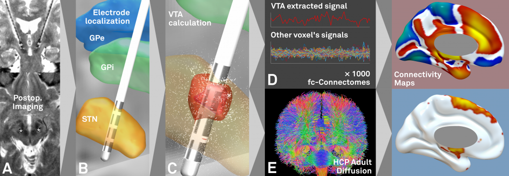
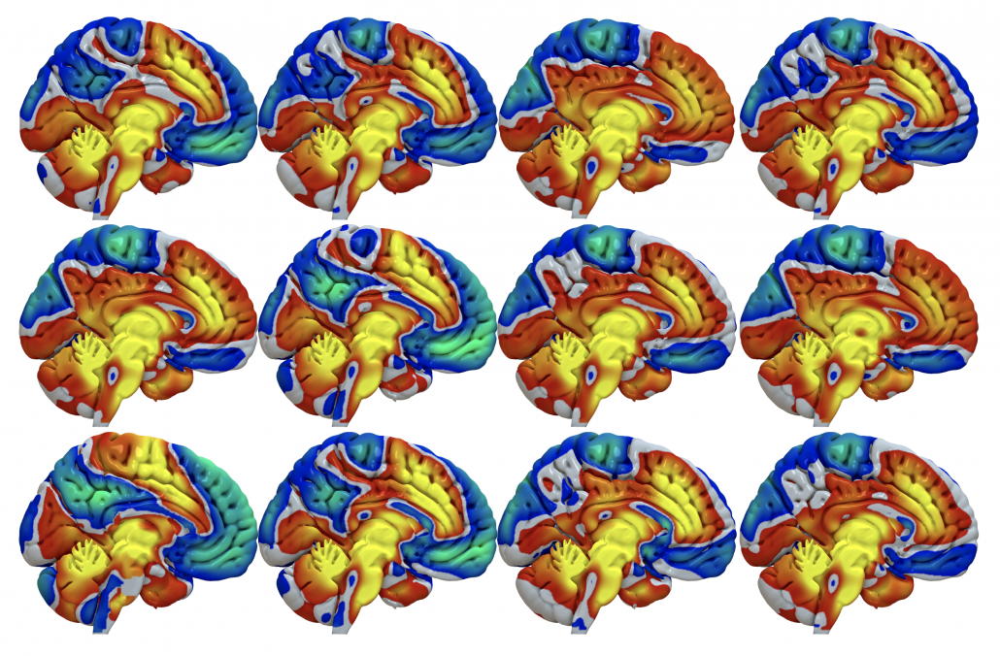
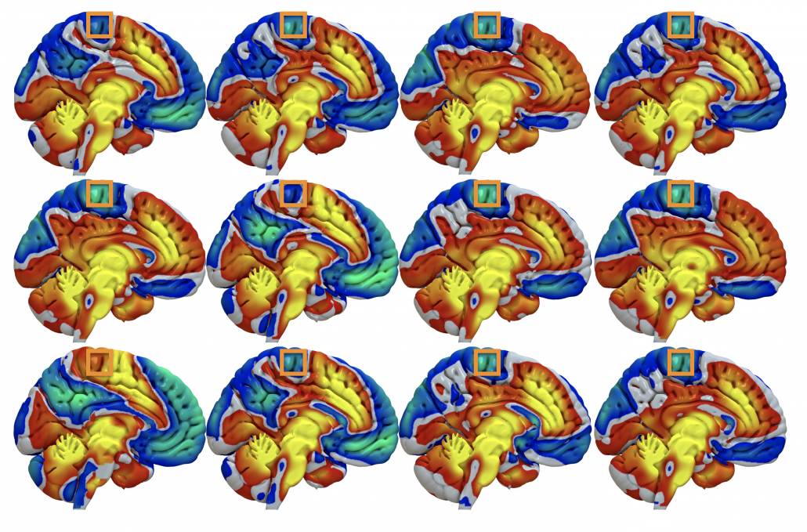
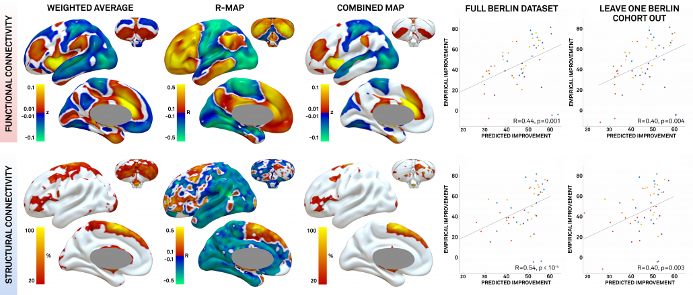
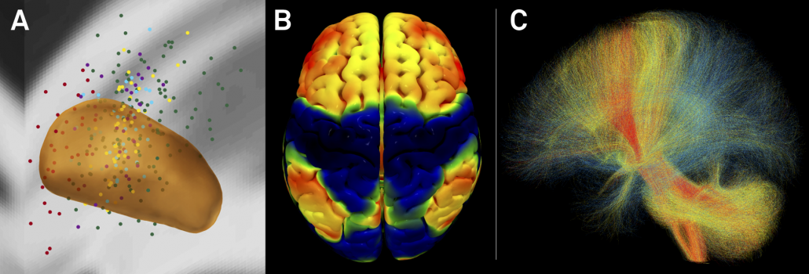

The DBS network mapping approach was first introduced in

> [Horn, A., Reich, M., Vorwerk, J., Li, N., Wenzel, G., Fang, Q., et al. (2017). Connectivity Predicts deep brain stimulation outcome in Parkinson disease. *Annals of Neurology*, *82*(1), 67–78.](https://doi.org/10.1002/ana.24974)

An editorial review of the paper can be found here:

> [Ridler, C. (2017). Parkinson disease: Deep brain stimulation — making the right connections. *Nature Reviews Neurology*, *13*(8), 450–451.](https://www.nature.com/articles/nrneurol.2017.91)

and builds upon the idea that optimally placed deep brain stimulation electrodes will have an “optimal” connectivity profile to other regions in the brain.

It uses [normative connectomes](https://www.netstim.org/research-interests/normative-connectomes/) (i.e. [average group connectomes](https://www.netstim.org/research-interests/normative-connectomes/) of the brain pooled across large cohorts of subjects) to map neurologic symptomology to distributed brain networks. A similar technique has also been applied to map stroke symptoms to common functional networks:

> - [Darby, R. R., Horn, A., Cushman, F., & Fox, M. D. (2017). Lesion network localization of criminal behavior. *Proceedings of the National Academy of Sciences of the United States of America*, *56*, 201706587–6.](https://doi.org/10.1073/pnas.1706587115)
> - [Boes, A. D., Prasad, S., Liu, H., Liu, Q., Pascual-Leone, A., Caviness, V. S., Jr, & Fox, M. D. (2015). Network localization of neurological symptoms from focal brain lesions. *Brain : a Journal of Neurology*, *138*(10), 3061–3075.](https://doi.org/10.1093/brain/awv228)
> - [Darby, R., Laganiere, S., Pascual-Leone, A., Prasad, S., & Fox, M. D. (2016). Finding the imposter: brain connectivity of lesions causing delusional misidentifications. *Brain : a Journal of Neurology*, 1–11.](https://doi.org/10.1093/brain/aww288)
> - [Fischer, D. B., Boes, A. D., Demertzi, A., Evrard, H. C., Laureys, S., Edlow, B. L., et al. (2016). A human brain network derived from coma-causing brainstem lesions. *Neurology*, 10.1212/WNL.0000000000003404–9.](https://doi.org/10.1212/WNL.0000000000003404)
> - [Laganiere, S., Boes, A. D., & Fox, M. D. (2016). Network localization of hemichorea-hemiballismus. *Neurology*, *86*(23), 2187–2195.](https://doi.org/10.1212/WNL.0000000000002741)
> - [Fasano, A., Laganiere, S. E., Lam, S., & Fox, M. D. (2017). Lesions causing freezing of gait localize to a cerebellar functional network. *Annals of Neurology*, *81*(1), 129–141.](https://doi.org/10.1002/ana.24845)

and recently in TMS:

> - [Weigand, A., Horn, A., Caballero, R., Cooke, D., Stern, A. P., Taylor, S. F., et al. (2017). Prospective validation that subgenual connectivity predicts antidepressant efficacy of transcranial magnetic stimulation sites. *Bps*, *0*(0), 888–894.](https://doi.org/10.1016/j.biopsych.2017.10.028)

## The concept

*Fig. 1:* First, based on postoperative imaging (A) derived DBS electrode localizations (B), the stimulation volume is estimated (C). Then, normative connectomes are queried to calculate which other brain structures are – in the average human brain – connected to the stimulation volume. This may be done both for functional (D) and structural (E) connectivity.

> Steps A-C may be done using Lead-DBS while steps D-E using Lead Connectome Mapper.

*Fig. 2:*The result is a connectivity profile from each (pair of) stimulation volumes. Above, functional connectivity profiles of DBS electrodes implanted in 12 Parkinson’s disease patients are shown. At first glance, they look pretty similar (which is not surprising since all electrodes are implanted inside the STN). However, small changes can be seen.

*Fig. 3:*…take, for instance a voxel inside M1 (orange boxes). Across subjects, it is mostly anticorrelated (cold colors) to the DBS sites but in some patients, it is posivite (hot colors).

*Fig. 4:*The connectivity profiles of patients may be concatenated to predictive maps by integrating them with clinical improvement (in our case % UPDRS-III improvement). In our article, we estimated three types of maps (for details, see [Horn et al. 2017](https://doi.org/10.1002/ana.24974)). Here, we’ll cover the R-map in detail only: It shows hot colors (positive R-values) for voxels a connectivity to which is positively associated with clinical improvement. Cold colors for the inverse: Weaker or more negative connectivity is associated with clinical improvement.

An intuitive explanation of this type of map is that it shows areas that a DBS electrode “should be” connected to and areas to which it “should not be” connected for best efficacy.

Finally, these maps may be used to actually predict outcome (right hand scatter plots) in new patients by estimating the similarity between the map and a novel patient’s DBS electrode connectivity profile (maps as shown in figs. 2-3). Similarity between two brain maps can be estimated using many metrics and generally falls into the domain of proximity/distant metrics (treating the two maps as two N-dimensional points in space and calculating their distance). In our case we chose (spatial) correlation as a normalized distance metric.

> The three types of maps may be created using ea_Rmap, ea_Amap and ea_Cmap code included in Lead-DBS.

*Fig. 5:*In our study, we could show that a map learned from data in one DBS center may be used to predict outcome in data from a second DBS center. This may demonstrate the utility of these maps to define optimal connectivity profiles for effective DBS.

*Fig. 6:*Summary of CBM results for STN-DBS in PD. A) active contacts from two cohorts mapped to the STN in MNI space. B) rs-fMRI connectivity based connectivity benefit map (R-map type) for % UPDRS-III improvement. C) connected fibertracts colored by association with good (red), midline (yellow) or poor (blue) symptom improvement.

## Normative vs. Individualized Connectivity

The above example uses normative connectomes to perform connectivity benefit mapping. However, of course these could be exchanged by individualized, patient-specific connectomes (and studies are running to do so). Furthermore, the concept could be used to guide DBS programming and/or DBS surgery. Finally, the connectivity profiles may help to define target maps for noninvasive brain stimulation (in this concept, the [2014 PNAS article by Michael Fox et al. is highly enlightening](https://doi.org/10.1073/pnas.1405003111)).
