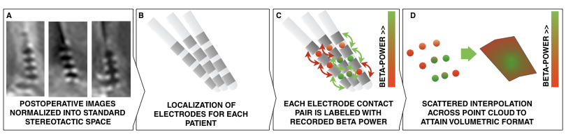
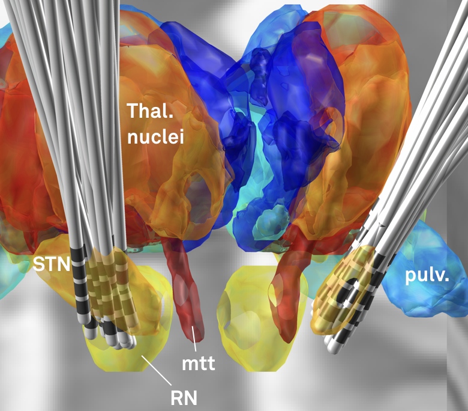
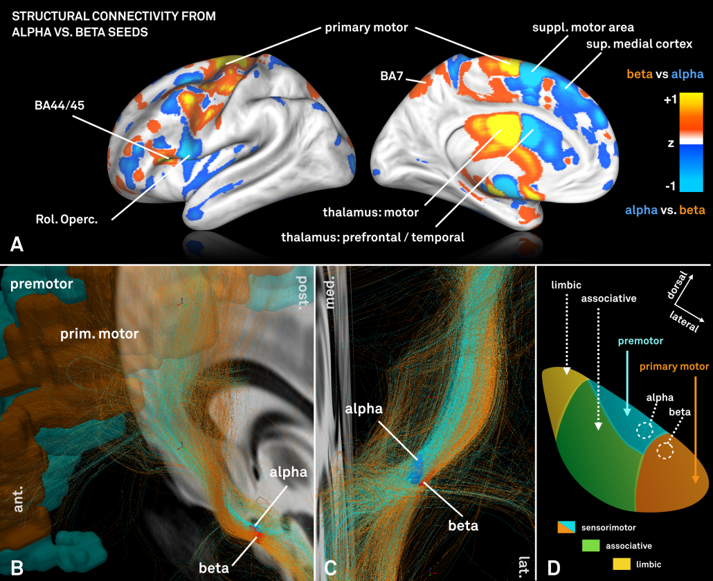

Subcortical electrophysiology mapping (SEM) pools signals recorded from DBS electrodes across many patients and maps them onto anatomical space, so that a recording, such as beta power in the subthalamic nucleus, becomes a 3D map.

*Methods summary. Postoperative images are transformed to standard space (A); electrodes are localized for each patient (B); electrophysiological recording estimates (such as beta power) are projected onto the midpoint of each contact pair (C); This leads to a 3D point cloud, each point associated with a beta power value. These points are used to fit a scattered interpolant to define beta values within covered subcortical space (D).*

## Use it in Lead-DBS

SEM runs in Lead Group, the group-analysis module of Lead-DBS: see the manual's chapter
[Group analyses with Lead-DBS](https://netstim.gitbook.io/leaddbs/lead-group/group-analyses-with-lead-dbs).

## What to cite

The method was first applied to beta power recorded in the subthalamic nucleus:

{}


Accolla, E. A., Horn, A., Herrojo Ruiz, M., Neumann, W.-J., & Kühn, A. A. (2017). Reply: Oscillatory coupling of the subthalamic nucleus in obsessive compulsive disorder. *Brain*, *140*(9), e57. [doi:10.1093/brain/awx165](https://doi.org/10.1093/brain/awx165)
{}

## Studies that used it

The main findings were reproduced and extended by two other labs, and the method was applied to the
pallidum and to recordings during movement.

Show the studies

> van Wijk BCM, Pogosyan A, Hariz MI, Akram H, Foltynie T, Limousin P, Horn A, Ewert S, Brown P, Litvak V (2017). Localization of beta and high-frequency oscillations within the subthalamic nucleus region. NeuroImage: Clinical. [PubMed](https://www.ncbi.nlm.nih.gov/pubmed/28794978)

> Geng, X., Xu, X., Horn, A., Li, N., Ling, Z., Brown, P., & Wang, S. (2018). Intra-operative characterisation of subthalamic oscillations in Parkinson’s disease. *Clinical Neurophysiology*, *0*(0). [Link](https://www.clinph-journal.com/article/S1388-2457(18)30105-6/fulltext)

Similarly, the method was applied to theta oscillations in the internal part of the pallidum in the following publication:

> Neumann, W.-J., Horn, A., Ewert, S., Huebl, J., Brücke, C., Slentz, C., et al. (2017). A localized pallidal physiomarker in cervical dystonia. *Annals of Neurology*. [doi:10.1002/ana.25095](https://doi.org/10.1002/ana.25095)

Finally, the concept was extended to electrophysiological features recorded during movement in this study:

> Lofredi, R., Neumann, W.-J., Bock, A., Horn, A., Huebl, J., Siegert, S., et al. (2018). Dopamine-dependent scaling of subthalamic gamma bursts with movement velocity in patients with Parkinson’s disease. eLife, 7, e31895. [eLife](https://elifesciences.org/articles/31895)

## Mapping other measures

The same mapping works for any measure known per patient, electrode or contact: behavioural or clinical
scores, task signals, demographics or the treating centre. Studies have mapped clinical outcome this way,
some of them with modelled stimulation volumes.

Show the studies that mapped clinical outcome

> Butson, C. R., Cooper, S. E., Henderson, J. M., Wolgamuth, B., & McIntyre, C. C. (2011). Probabilistic analysis of activation volumes generated during deep brain stimulation. *NeuroImage*, *54*(3), 2096–2104. [doi:10.1016/j.neuroimage.2010.10.059](https://doi.org/10.1016/j.neuroimage.2010.10.059)
>
> Schönecker, T., Gruber, D., Kivi, A., Müller, B., Lobsien, E., Schneider, G.-H., et al. (2015). Postoperative MRI localisation of electrodes and clinical efficacy of pallidal deep brain stimulation in cervical dystonia. *Journal of Neurology, Neurosurgery, and Psychiatry*, *86*(8), 833–839. [doi:10.1136/jnnp-2014-308159](https://doi.org/10.1136/jnnp-2014-308159)
>
> Maks, C. B., Butson, C. R., Walter, B. L., Vitek, J. L., & McIntyre, C. C. (2009). Deep brain stimulation activation volumes and their association with neurophysiological mapping and therapeutic outcomes. *Journal of Neurology, Neurosurgery, and Psychiatry*, *80*(6), 659–666. [doi:10.1136/jnnp.2007.126219](https://doi.org/10.1136/jnnp.2007.126219)
>
> Nowinski, W. L., Belov, D., Pollak, P., & Benabid, A.-L. (2005). Statistical analysis of 168 bilateral subthalamic nucleus implantations by means of the probabilistic functional atlas. *Neurosurgery*, *57*(4 Suppl), 319–30– discussion 319–30. [PubMed](https://www.ncbi.nlm.nih.gov/pubmed/16234681)
>
> Garcia-Garcia, D., Guridi, J., Toledo, J. B., Alegre, M., Obeso, J. A., & Rodríguez-Oroz, M. C. (2016). Stimulation sites in the subthalamic nucleus and clinical improvement in Parkinson’s disease: a new approach for active contact localization. *Journal of Neurosurgery*, 1–12. [PubMed](https://www.ncbi.nlm.nih.gov/pubmed/26848922)
>
> Welter, M.-L., Schüpbach, M., Czernecki, V., Karachi, C., Fernandez-Vidal, S., Golmard, J.-L., et al. (2014). Optimal target localization for subthalamic stimulation in patients with Parkinson disease. *Neurology*, *82*(15), 1352–1361. [doi:10.1212/WNL.0000000000000315](https://doi.org/10.1212/WNL.0000000000000315)
>
> Eisenstein, S. A., Koller, J. M., Black, K. D., Campbell, M. C., Lugar, H. M., Ushe, M., et al. (2014). Functional anatomy of subthalamic nucleus stimulation in Parkinson disease. *Annals of Neurology*, *76*(2), 279–295. [doi:10.1002/ana.24204](https://doi.org/10.1002/ana.24204)

## A worked example: beta and alpha power in the STN {#worked-example}

From the study [Toward an electrophysiological “sweet spot” for deep brain stimulation in the subthalamic nucleus](https://doi.org/10.1002/hbm.23594) (*Human Brain Mapping*, 2017): in recordings from 54 patients with Parkinson’s disease, beta power was highest in the dorsolateral (motor) part of the STN, alpha power in a more ventromedial part. The resulting beta atlas comes with Lead-DBS.

Read the worked example: question, methods, results

Electrophysiological signals recorded in deep structures of the human brain are of key interest to the neuroscientific community. For instance, in Parkinson’s disease, the beta-rhythm plays a role that has been shown to be tightly coupled with the expression of clinical symptoms (such as bradykinesia). For instance, enhanced beta band activity is suppressed by levodopa [[Geng et al., 2017](https://www.sciencedirect.com/science/article/pii/S096999611630287X); [Kühn et al., 2006a](https://www.ncbi.nlm.nih.gov/pubmed/16364953), [2006b](https://www.ncbi.nlm.nih.gov/pubmed/16623853), [2009](https://www.ncbi.nlm.nih.gov/pubmed/19070616)] and during DBS [[Eusebio et al., 2011](https://www.ncbi.nlm.nih.gov/pubmed/20935326); [Kühn et al., 2008](https://www.ncbi.nlm.nih.gov/pubmed/18550758)] in parallel with improvement of motor symptoms.

DBS is a treatment option that gives us a unique opportunity to record from deep structures in the brain. However, in each patient, usually, only one or two DBS electrodes are surgically implanted. Common electrodes are composed of four contacts – so in each electrode/hemisphere, one may record from three bipolar channels. Already, this gives great insight into rhythmic activity in the basal ganglia as shown in manifold publications.

However, it would be great to be able to cover larger areas of the subcortex to better characterize electrophysiological signatures. In humans, epilepsy patients sometimes receive multiple electrodes and data obtained in these patients could make this possible. A downside is that electrodes in these patients are implanted in varying areas, making it hard to study a specific area of interest across patients. Another option is to pool electrophysiological recordings *across* DBS patients to increase the “field of view” of the obtained data.

### The question

After developing Lead-DBS, at Charité in Berlin, we wondered whether the precision of DBS reconstructions (which are based on MR/CT imaging) could be precise enough to do this.

> Could we record an electrophysiological signature in multiple patients, map the recording sites onto (standardized) anatomical space and map out a spatial profile of an electrophysiological signal?

Already, we have done so using multiple signals that were acquired at rest or during tasks. The first study that uses this technique [has now been published](https://onlinelibrary.wiley.com/doi/10.1002/hbm.23594/full).

### Methods

- Local field potential (LFP) recordings were recorded in 54 PD patients from six channels each. From each signal, alpha and beta power were calculated.
- This leads to 324 alpha and 324 beta power estimates for 324 channels.
- Electrodes were localized in each patient and localizations were warped into standard space.
- This leads to a 3D point-cloud in subcortical anatomical space.

Fig. 1 is the methods summary at the top of this page.

### Two limitations

Beta power served as a good first example to apply the subcortical mapping method since we already knew from various prior publications that higher beta power can be recorded in the dorsolateral parts of the subthalamic nucleus.

Still, it was not clear this approach could work out from the beginning, mainly because of two major limitations.

> First, recordings were *pooled across patients* and patients may have had different baselines in their electrophysiological activity.
>
> Second, the image resolution and electrode localization method of Lead-DBS may not have been precise enough to map each data point to space precisely enough.

Regarding the second point, this first subcortical mapping study may be seen as a feasibility study, asking the question

> Are Lead-DBS electrode localizations and normalizations precise enough to map electrophysiological values from a large group of patients onto a small structure like the subthalamic nucleus?

### Results

 activity was recorded from the dorsolateral (motor) STN; significantly higher alpha (bottom) activity was recorded from a more ventromedial part of the STN.")

The above results show a clear relationship between alpha/beta power and spatial coordinates of recording site.

> The results from this study shows that i) it is feasible to pool electrophysiological data across patients in space and ii) electrode localizations and warps to standard space are precise enough to get an overview about their spatial distribution

.")

We went ahead and created three-dimensional peak ROI associated with high beta and alpha activity, respectively (above).

### Connectivity of the two hot spots

We were then interested whether our standardized structural connectomes were equally precise enough to find differences in cortical connectivity associated with these regions. Of note, the two regions are both very small and close to each other.

For this analysis – which could only be performed on group level – a standardized high precision structural connectome [[Horn 2017](https://www.sciencedirect.com/science/article/pii/S1053811917301088)] was used to select fiber-tracts connected to the alpha and beta peaks, respectively.

However, the two regions exhibited a (slightly) different connectivity profile that was largely consistent with data presented in [[Acolla 2015](https://academic.oup.com/brain/article-abstract/139/9/2503/1744844/Brain-networks-modulated-by-subthalamic-nucleus?redirectedFrom=fulltext)], before (see below).

### A beta atlas for programming

Finally, given the importance of the beta rhythm in Parkinson’s Disease, the resulting beta-atlas could serve to guide DBS programming (and potentially targeting) once prospectively validated in follow up studies. The atlas is made publicly available within Lead-DBS software and on [Neurovault](https://neurovault.org/collections/2418/).

 shown in synopsis with a hypothetical lead. Based on the reconstruction, the second most dorsal contact could represent a first choice in clinical programming.")

