{}
[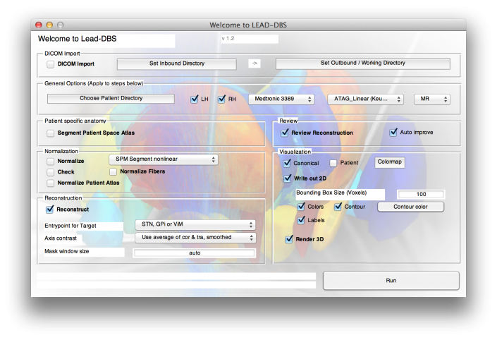](mainwindow-1030x705.png)
[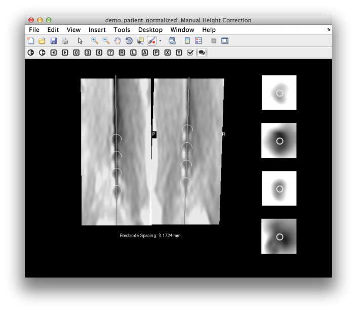](manualcorrection-1030x902.png)
[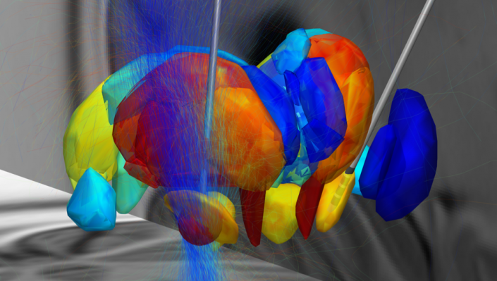](lead1.png)
[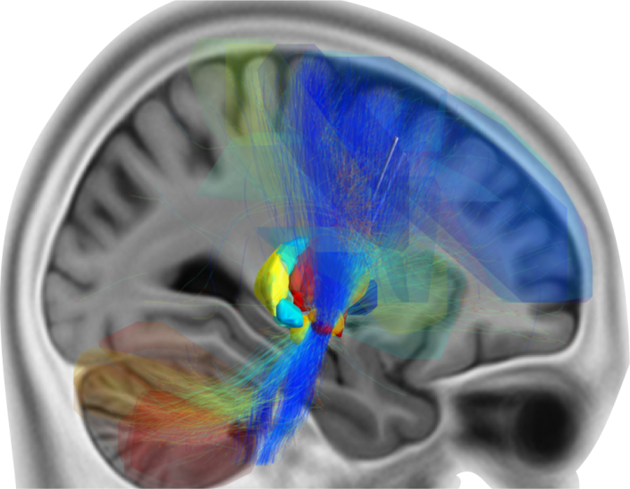](lead2.png)
[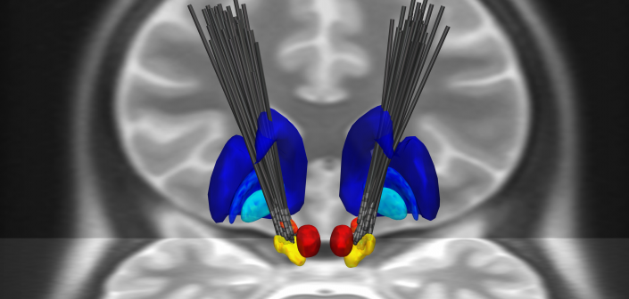](LEAD_Scene-1030x492.png)
[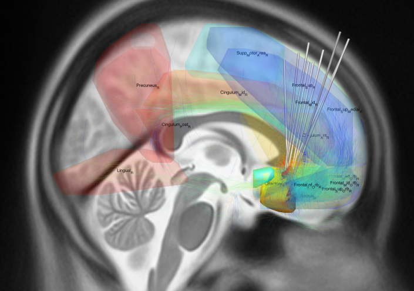](eAuto_Scene10-1030x723.png)
[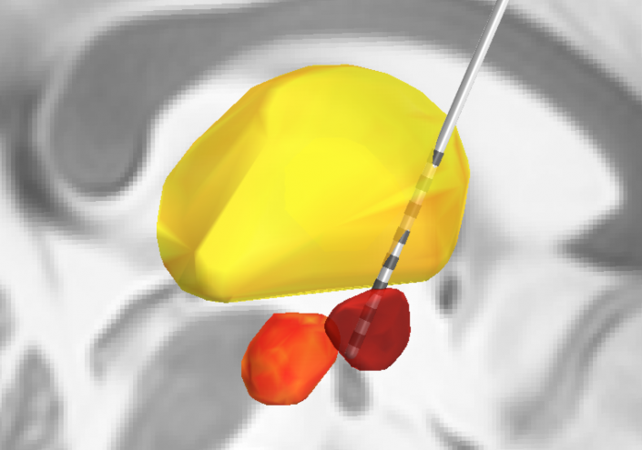](bostonscientific-1030x724.png)
[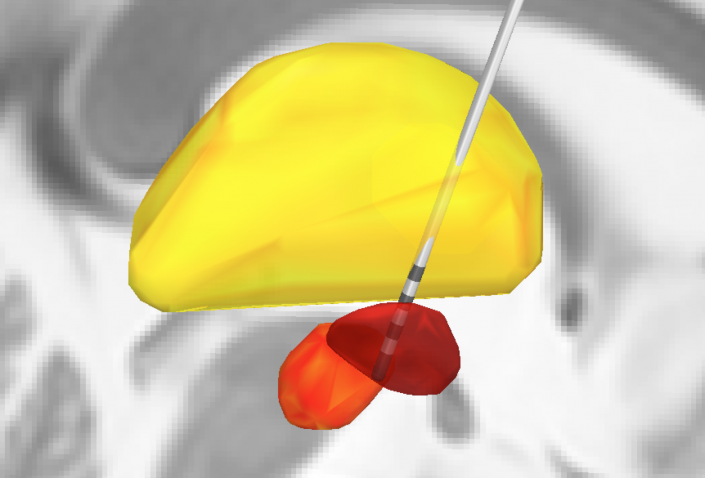](activetip-1030x699.png)
[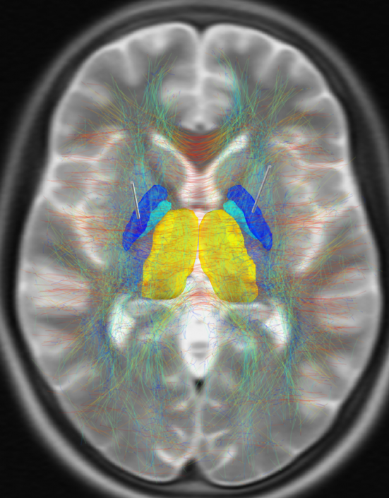](pt_specific_fibers-805x1030.png)
[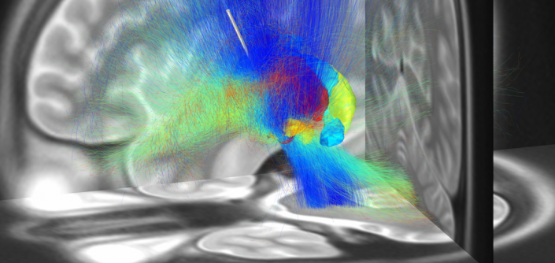](Fibertracking-1030x488.png)
[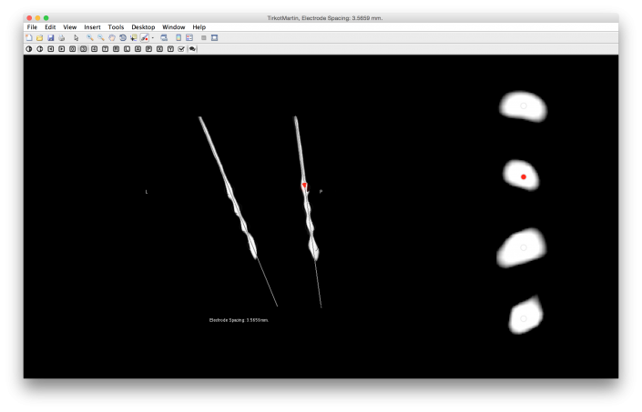](Bildschirmfoto-2014-09-10-um-11.04.05-1030x662.png)
[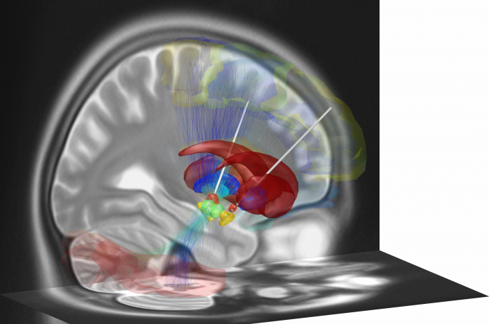](screenshot-1030x684.png)
{}
