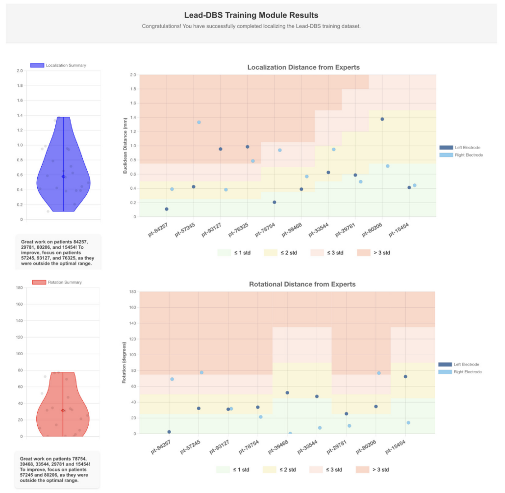
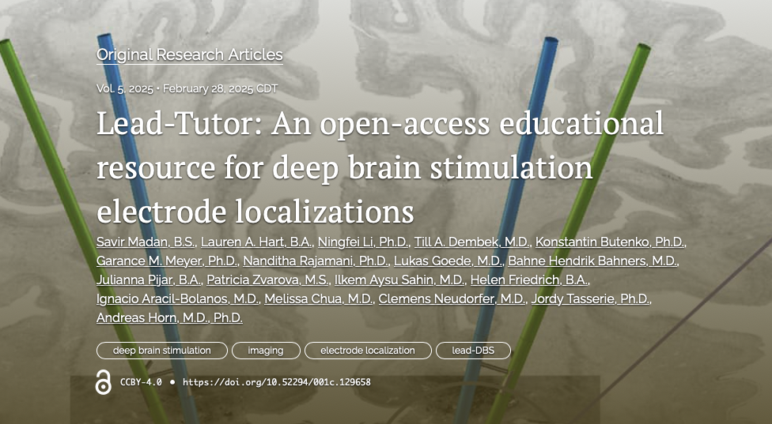

**Practise on imaging data from ten patients,** then compare your electrode localizations with those of two experts.
{.dataset-intro}

Download the dataset

<a class="link link--ext" href="">Guide in the manual </a>



{}
## Your report {#your-report}

**The report shows** positional and rotational differences from expert localizations for each patient, ordered from easy to hard.

The colours show the range of non-expert localizations relative to the expert results.
{.fine-print}
{}

{}
## The dataset {#dataset}

**Open data,** free to download from OSF.

Shared openly with the approval of the institutional review board of Brigham and Women's Hospital, Boston,
where the images were acquired.
{}

{}
## What to cite {#what-to-cite}

**Madan et al. 2025,** Aperture Neuro.

{}

{}

{}
