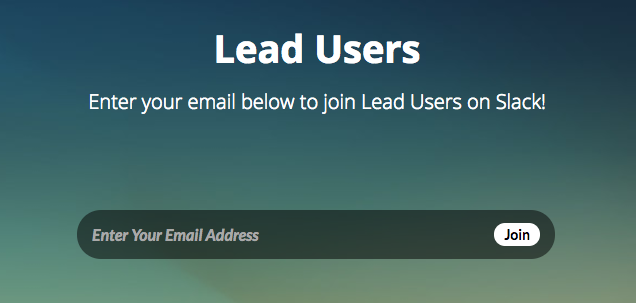
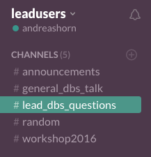

[The Slack channel](https://leadsuite.slack.com/) ([autoinvite yourself here](https://inviter.co/lead-dbs)) provides fast and uncomplicated help from users to users. Also, Ningfei, Philip, Siobhan and Andreas are online often and usually respond fast to questions. If you are not familiar with Slack, it is a great way to communicate on research topics and you can imagine it very similar to Whatsapp or other chat systems. There are [great apps for Slack](https://slack.com/downloads) which allow you to easily communicate with us from your Desktop or mobile device. We can recommend the multi-messenger software “[Franz](http://meetfranz.com/)” which is a combined messenger app for Slack, Whatsapp, Facebook Messenger, Skype and much more.

{}
{}

{}
{}

{}
{}
