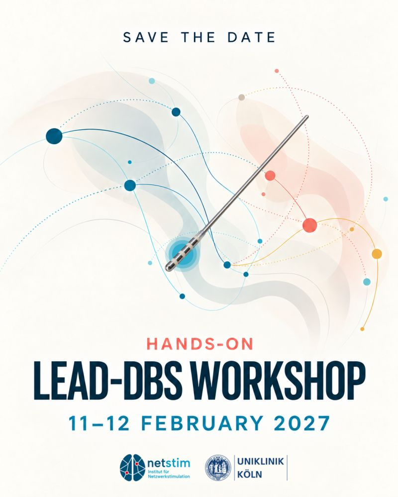

## Next workshop: Hands-on Lead-DBS Workshop, 11–12 February 2027, Cologne

Save the date: the next hands-on Lead-DBS workshop will take place on **11–12 February 2027**, hosted by the [Institute for Network Stimulation](https://www.netstim.org/) and Uniklinik Köln (University Hospital Cologne). Participants will be among the first to try the pre-release of Lead-DBS 4.0, which is being rebuilt completely in Python.

Details and registration will follow. They will be announced in our [newsletter](/subscribe-to-our-newsletter/) and on the [user Slack](https://inviter.co/lead-dbs). The workshop and the developer meetings, which are planned monthly, are listed on the [events page](/events/).

## Past workshops

- [5th International Lead-DBS Workshop, Brisbane, February 2020](/helpsupport/workshops/brisbane-february-2020/)
- [Workshop on Deep Learning for intracranial neurophysiology, Berlin, September 2019](/helpsupport/workshops/berlin-september-2019-maching-learning/)
- [4th International Lead-DBS Workshop, Berlin, September 2019](/helpsupport/workshops/berlin-september-2019/)
- [3rd International Lead-DBS Workshop, Hamburg, February 2019](/helpsupport/workshops/past-workshops/hamburg-februar-2009/)
- [2nd International Lead-DBS Workshop, Shanghai, September 2018](/helpsupport/workshops/past-workshops/shanghai-september-2018/)
- [1st Lead-DBS Workshop, Berlin, November 2016](/helpsupport/workshops/past-workshops/berlin-2016/)
