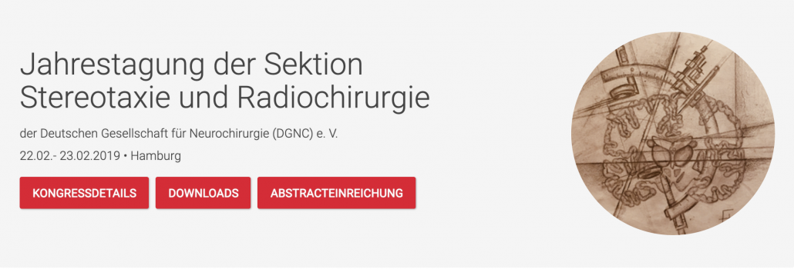

The next workshop and the developer meetings are on the [events page](/events/).

## Brisbane, February 2020 {#brisbane-2020}

**5th International Lead-DBS Workshop**, 22–23 February 2020, Brisbane, Australia.
[Programme (PDF)](https://www.lead-dbs.org/docs/workshops/Lead-DBS_Workshop2020_Programme_BRIS.pdf)

The workshop took place in Brisbane City at the [Customs House](https://customshouse.com.au/). It gave an overview of the Lead-DBS software and its applications in research, with interactive hands-on practice sessions. It covered precise electrode localizations, multispectral spatial normalization, brain shift correction and related topics. Participants were expected to have at least minimal experience with MATLAB and Lead-DBS.

## Berlin, September 2019 {#berlin-2019}

**4th International Lead-DBS Workshop**, 13–15 September 2019, Berlin, Germany.
[Programme (PDF)](https://www.lead-dbs.org/docs/workshops/Lead-DBS_Workshop2019_Programme_BER.pdf)

It gave an overview of the Lead-DBS software and its applications in research, with interactive hands-on practice sessions. It covered precise electrode localizations, multispectral spatial normalization, brain shift correction and related topics. Participants were expected to have at least minimal experience with MATLAB and Lead-DBS.

Directly afterwards, on 16–17 September, a [workshop on deep learning for intracranial neurophysiology](#deep-learning-2019) took place.

### Deep learning for intracranial neurophysiology, 16–17 September 2019 {#deep-learning-2019}

A 2-day workshop on deep learning for intracranial neurophysiology (spikes and LFPs), given by Chadwick Boulay from Ottawa directly after the Lead-DBS workshop.
[Programme (PDF)](https://www.lead-dbs.org/docs/workshops/Applied_Deep_Learning_in_Intracranial_Neurophysiology_Workshop.pdf)

In his words:

- The goal of the workshop is to help attendees gain familiarity with technologies commonly used in DL (e.g., keras/tensorflow on GPU, jupyter notebooks on the cloud), to understand DL programming paradigms (e.g., batch loading data), and to become proficient in building, training, and evaluating deep neural networks as applied to extracellular neurophysiology data.
- You will learn how to load and process electrophysiology datasets (ECoG, single-channel deep brain microelectrode recordings, and multichannel (~192) intracortical microelectrode array datasets). After an introduction to DL, attendees will learn how to apply several DL algorithms and architectures to these types of data, and finally you will explore different ways of using deep learning to advance neuroscientific endeavours. Some of the algorithms we aim to cover include convolutional neural nets (CNN) and several flavours of recurrent neural nets (RNN).
- Attendees are expected to have a basic understanding of machine learning concepts, have basic familiarity with Python syntax, and have an interest in applying deep learning to extracellular neurophysiology data. For each topic, attendees will work through prepared examples using real data and thus are expected to bring their own laptop and have configured their deep learning environment (instructions will be provided in the weeks before the workshop).

## Hamburg, February 2019 {#hamburg-2019}

**3rd International Lead-DBS Workshop**, 21 February 2019, University Hospital Hamburg-Eppendorf (UKE), Germany.
[Programme (PDF)](https://www.lead-dbs.org/docs/workshops/Lead-DBS_Workshop2019_Programme_HH.pdf)

The workshop was a satellite event of the “Jahrestagung der Sektion Stereotaxie und Radiochirurgie” of the German Neurosurgery Society (DGNC) e. V. It took place at UKE Hamburg, building N 55, room 301, 3rd floor; registration was through the congress website.

## Shanghai, September 2018 {#shanghai-2018}

**2nd International Lead-DBS Workshop**, 18–19 September 2018, Fudan University, Shanghai, China.
[Recordings of the talks](/helpsupport/knowledge-base/walkthrough-videos/#workshop-recordings)

The workshop at Fudan University in Shanghai had over 45 participants from across the globe and covered topics from preprocessing over electrode localizations and VTA modelling to connectomic DBS. It was a satellite symposium of the TRDBS meeting; great thanks go to its organizers, especially Prof. Shouyan Wang, who hosted the conference.

## Berlin, November 2016 {#berlin-2016}

**1st Lead-DBS Workshop**, 27–28 November 2016, Berlin, Germany.

The first Lead-DBS workshop was a hands-on workshop and a satellite event to the International DBS Symposium of the Clinical Research Group KFO 247. It gave an extensive overview of the possibilities and potential applications of Lead-DBS, for students and researchers interested in analyses of DBS electrode placements. It took place in the library of the Kaiserin-Friedrich-Haus (Robert-Koch-Platz 7, 10115 Berlin); participants could bring their own data.

{}
{}

{}
{}

{}
{}
