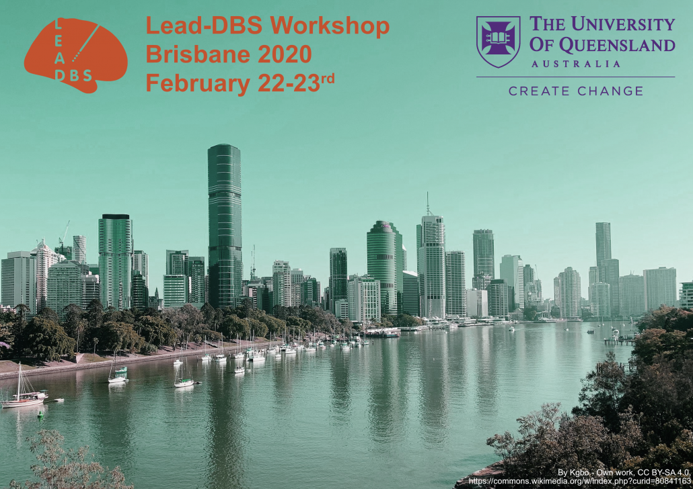
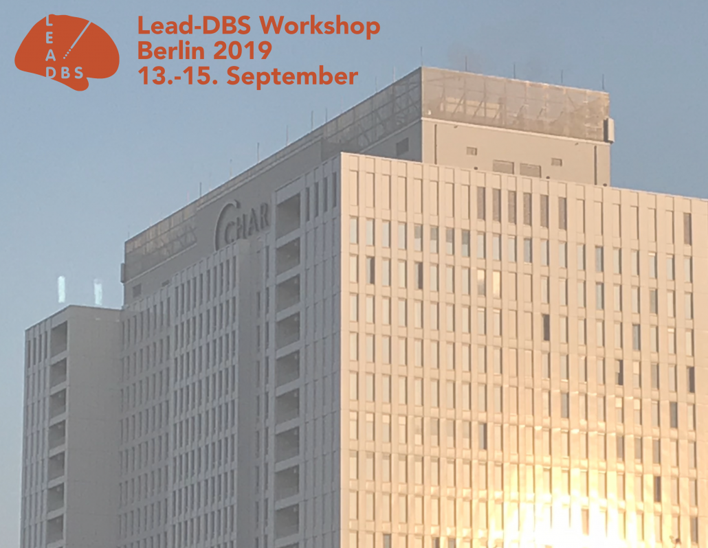
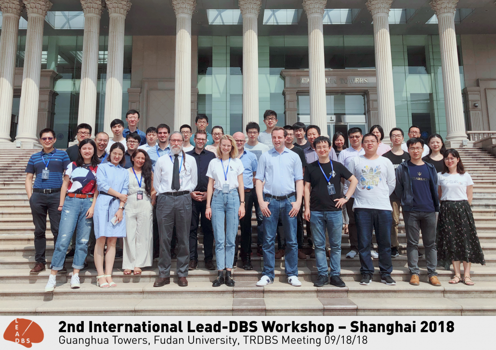
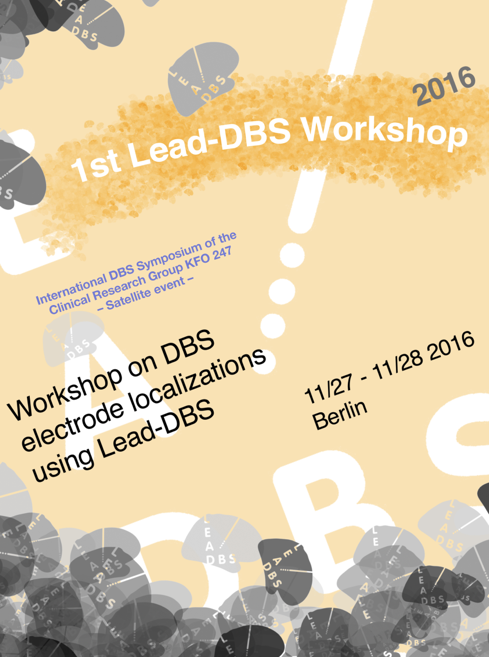
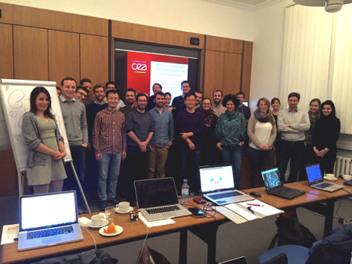
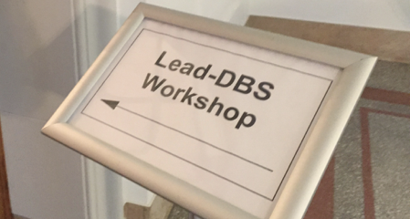

## Brisbane, February 2020 {#brisbane-2020}

**5th International Lead-DBS Workshop** · 22–23 February 2020 · [Customs House](https://customshouse.com.au/), Brisbane · [Program (PDF)](https://www.lead-dbs.org/docs/workshops/Lead-DBS_Workshop2020_Programme_BRIS.pdf)

An overview of Lead-DBS and its research applications, with hands-on sessions on electrode localization,
multispectral normalization and brain shift correction.

Flyer

## Berlin, September 2019 {#berlin-2019}

**4th International Lead-DBS Workshop** · 13–15 September 2019 · Berlin · [Program (PDF)](https://www.lead-dbs.org/docs/workshops/Lead-DBS_Workshop2019_Programme_BER.pdf)

The same program as in Brisbane.

**Deep learning workshop** · 16–17 September 2019 · Berlin · [Program (PDF)](https://www.lead-dbs.org/docs/workshops/Applied_Deep_Learning_in_Intracranial_Neurophysiology_Workshop.pdf)

Directly after the Lead-DBS workshop, Chadwick Boulay from Ottawa taught deep learning on intracranial
recordings (spikes and LFPs).

Flyer

## Hamburg, February 2019 {#hamburg-2019}

**3rd International Lead-DBS Workshop** · 21 February 2019 · University Hospital Hamburg-Eppendorf (UKE) · [Program (PDF)](https://www.lead-dbs.org/docs/workshops/Lead-DBS_Workshop2019_Programme_HH.pdf)

A satellite event of the annual meeting of the stereotaxy and radiosurgery section of the German
Neurosurgery Society (DGNC).

## Shanghai, September 2018 {#shanghai-2018}

**2nd International Lead-DBS Workshop** · 18–19 September 2018 · Fudan University, Shanghai · [Recordings of the talks](/helpsupport/knowledge-base/walkthrough-videos/#workshop-recordings)

Over 45 participants from around the world attended sessions on preprocessing, electrode localization, VTA
modeling and connectomic DBS. A satellite symposium of the TRDBS meeting, hosted by Prof. Shouyan Wang.

Group photo

## Berlin, November 2016 {#berlin-2016}

**1st Lead-DBS Workshop** · 27–28 November 2016 · Kaiserin-Friedrich-Haus, Berlin

A hands-on satellite event of the International DBS Symposium of the Clinical Research Group KFO 247;
participants could bring their own data.

Flyer and photos

