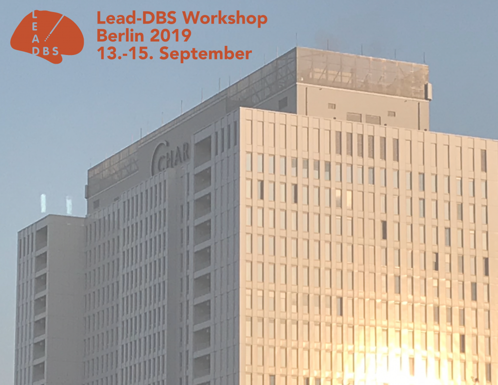

## 4th INTERNATIONAL LEAD-DBS WORKSHOP 09/2019, BERLIN

Dear friends of Lead-DBS,

after a wonderful event in Shanghai 2018, we are pleased to announce our 4th Lead-DBS Workshop, this time in Berlin, 13-15th September 2019!

In this workshop, we give you an overview on the Lead-DBS software and its applications in research while at the same time providing you with the opportunity of interactive hands-on practice sessions. We will cover the processes of precise electrode localizations, multispectral spatial normalization, brain shift correction, and related topics. Ideally, you should have at least minimal pre-existing experience with the use of MATLAB and Lead-DBS.

Click here for the schedule

Of note, directly after the workshop, a 2-day workshop on [Deep Learning for intracranial neurophysiology (spikes and LFPs) will take place (16th-17th September)](/helpsupport/workshops/berlin-september-2019-maching-learning/), as well. Save half the fee of one workshop by registering for both – and enjoy four days of DBS research and a weekend in Berlin!

{}
{}
Registration is now closed.

{}
{}

{}
{}
Registration fees are:

- Students/PhD students:
  - Lead-DBS OR [Machine Learning](/helpsupport/workshops/berlin-september-2019-maching-learning/) workshop: 70€
  - Both workshops: 105 €
- Postdocs:
  - Lead-DBS OR [Machine Learning](/helpsupport/workshops/berlin-september-2019-maching-learning/) workshop: 250€
  - Both workshops: 375 €
- Faculty/Industry:
  - Lead-DBS OR [Machine Learning](/helpsupport/workshops/berlin-september-2019-maching-learning/) workshop: 350€
  - Both workshops: 525 €

Payment details and invoice will be provided upon successful registration.

Kind regards,

Your Lead-DBS Team
