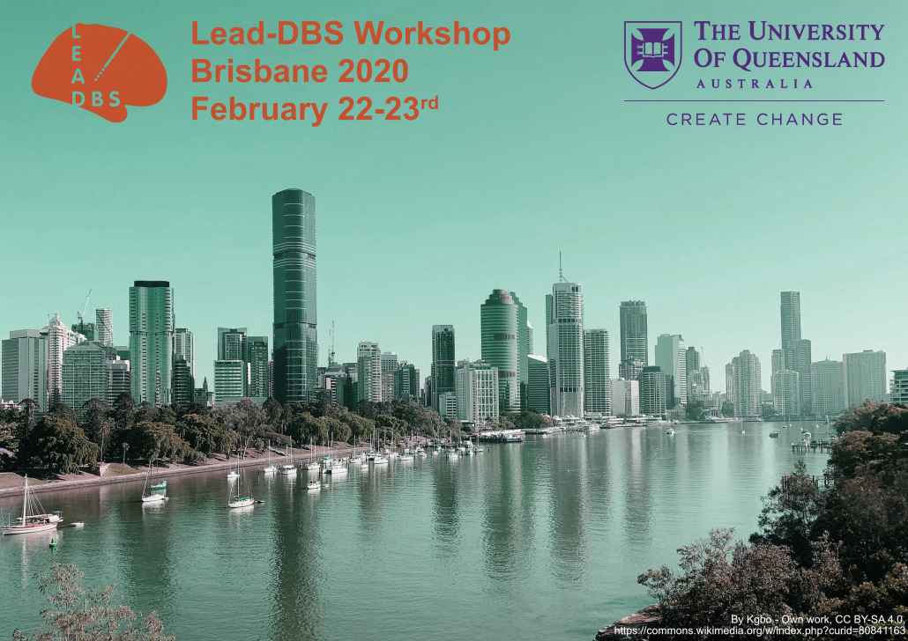

## 5th INTERNATIONAL LEAD-DBS WORKSHOP 02/2020, BRISBANE

  

Dear friends of Lead-DBS,

We are pleased to announce our 5th Lead-DBS Workshop, this time in Brisbane, 22-23rd February 2020!

The workshop will take place in Brisbane City at the [Customs House](https://customshouse.com.au/).

In this workshop, we give you an overview on the Lead-DBS software and its applications in research while at the same time providing you with the opportunity of interactive hands-on practice sessions. We will cover the processes of precise electrode localizations, multispectral spatial normalization, brain shift correction, and related topics. Ideally, you should have at least minimal pre-existing experience with the use of MATLAB and Lead-DBS.

{}
{}
Register here

{}
{}
See the schedule here

{}
{}

Registration fees are:

- Students/PhD students: AUD $200
- Postdocs: AUD $300
- Faculty/Industry: AUD $600

Cancelation policy is as follows:

- Full refund if cancellation is 8 weeks before the meeting  (28 Dec 2019)
- 50% refund if cancellation is 4 weeks before the meeting (24 Jan 2020)
- No refund if cancellation is 2 weeks before the meeting (8 Feb 2020)

Places will be allocated on a first come first serve basis and are limited to 25 seats.

If the meeting is fully booked please email workshop@lead-dbs.org with your interest and we will place you on a waiting list.

Kind regards,

Your Lead-DBS Team
