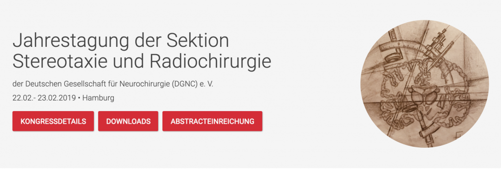

This workshop took place on 21 February 2019 in Hamburg. This page is kept as an archive.

## 3rd International Lead-DBS workshop 02/2019, Hamburg

  

Dear friends of Lead-DBS,

after a wonderful event in Shanghai 2018, we are pleased to announce our 3rd Lead-DBS Workshop, this time at the University Hospital Hamburg, on 21st February.

The workshop is a satellite event of the “Jahrestagung der Sektion Stereotaxie und Radiochirurgie” of the German Neurosurgery Society (DGNC) e. V.

The workshop will take place at UKE Hamburg, building N 55, Room 301, 3. floor. Snacks & coffee will be provided and food can be obtained in the “Health Kitchen” in the basement of the building.

{}
{}
Read the workshop programme

{}
{}

{}
{}

Registration is possible via the congress website.

Kind regards,

the Lead-DBS Team
