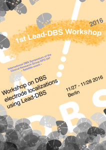

We are happy to announce the first **Lead-DBS workshop!**

The workshop will take place from **Sunday, 27th to Monday, 28th of November 2016**.

In this hands-on workshop organized as a satellite event to the International DBS Symposium of the Clinical Research Group KFO 247, we will give an extensive overview over the possibilities and potential applications of Lead-DBS

A preliminary program can be [downloaded here](http://www.lead-dbs.org/2016_leaddbs_workshop_berlin.pdf).

The workshop will take place in the library of Kaiserin-Friedrich-Haus (Robert-Koch-Platz 7, 10115 Berlin). It is targeted for students & researchers interested in analyses of DBS electrode placements. A methodological basis and experience in working with imaging data is helpful. Each participant may bring own data to the workshop and is expected to bring a laptop to the course. 

A fee to cover expenses of the course is 70€.

To register for the course, please send an email to [ws2016@lead-dbs.org](mailto:ws2016@lead-dbs.org).

We look forward to meeting you in person!

