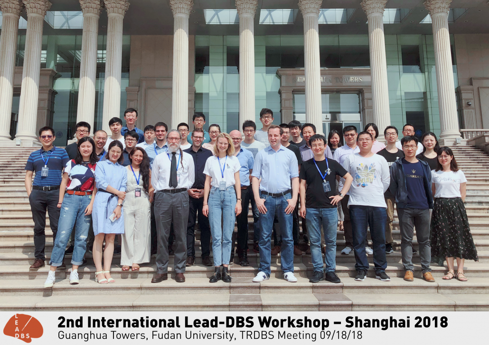

## 2nd international Lead-DBS workshop

The 2nd international Lead-DBS workshop at Fudan University in Shanghai was held between 18th and 19th September 2018 with over 45 participants from across the globe. We had a wonderful time and were able to cover topics from preprocessing over electrode localizations & VTA modeling to connectomic DBS. Great thanks go out to the organizers of the TRDBS meeting (to which the workshop was a satellite symposium) – especially Prof. Shouyan Wang who hosted the conference.

