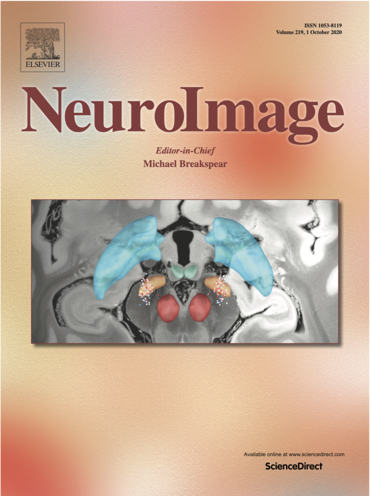

{}
{}
We’re excited that a visualization made with Lead-DBS from [the paper about our novel toolbox, *Lead Group*, spearheaded by Svenja Treu](https://www.researchgate.net/publication/338625914_Deep_Brain_Stimulation_Imaging_on_a_group_level) was featured on the coverart of the NeuroImage.

Svenja described methods & a novel open source toolbox to shift deep brain stimulation analyses onto a group level in a standardized and reproducible way.

The [full study can be found here](https://www.researchgate.net/publication/338625914_Deep_Brain_Stimulation_Imaging_on_a_group_level) or on our [publications page](/about/publications/).

{}
{}

{}
{}
