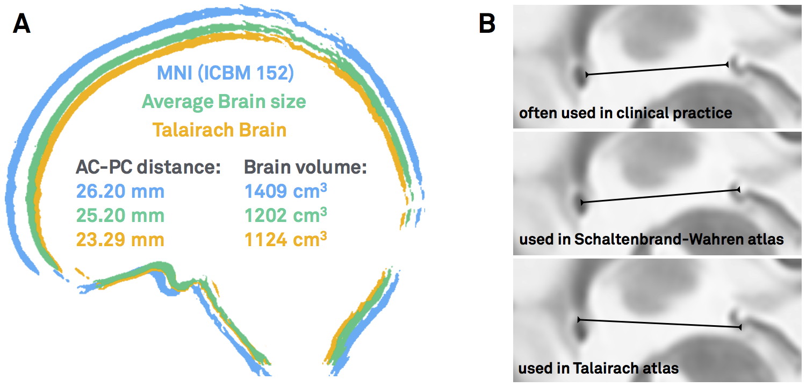
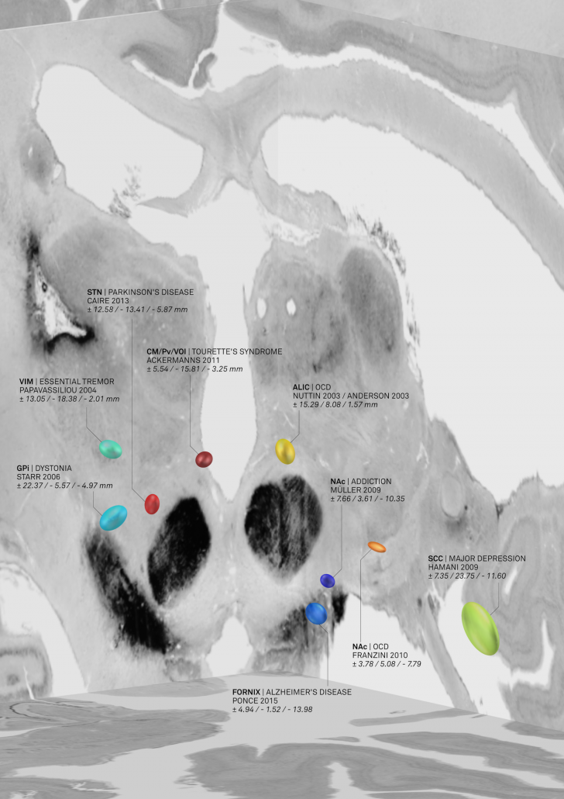
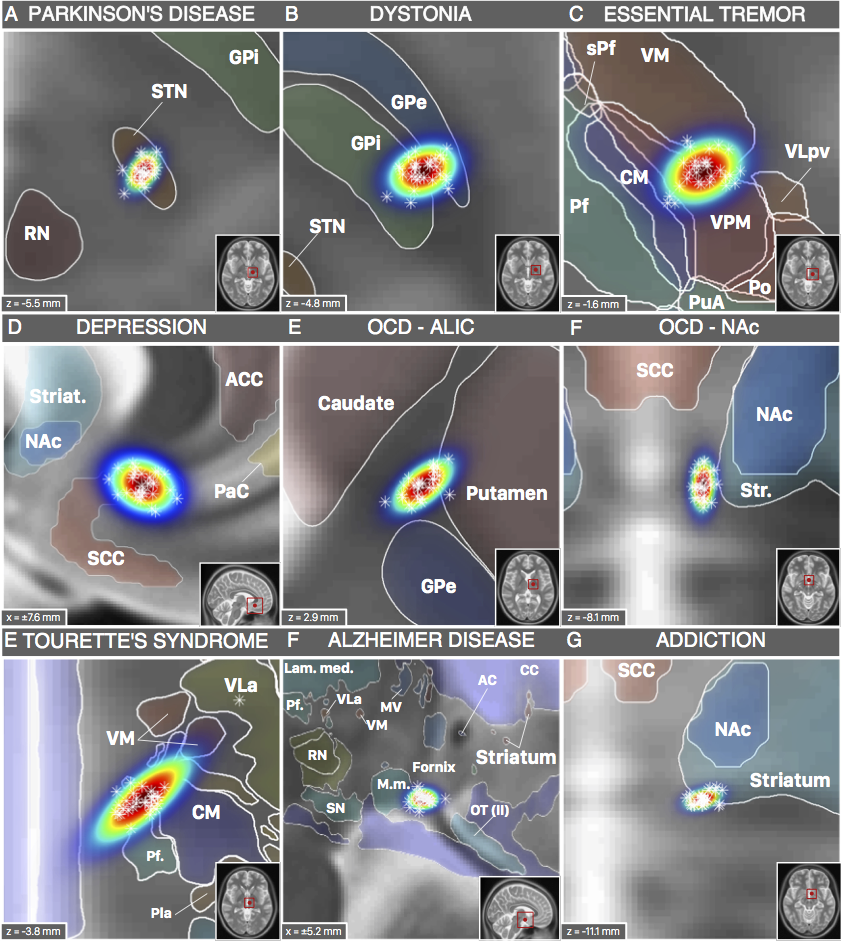
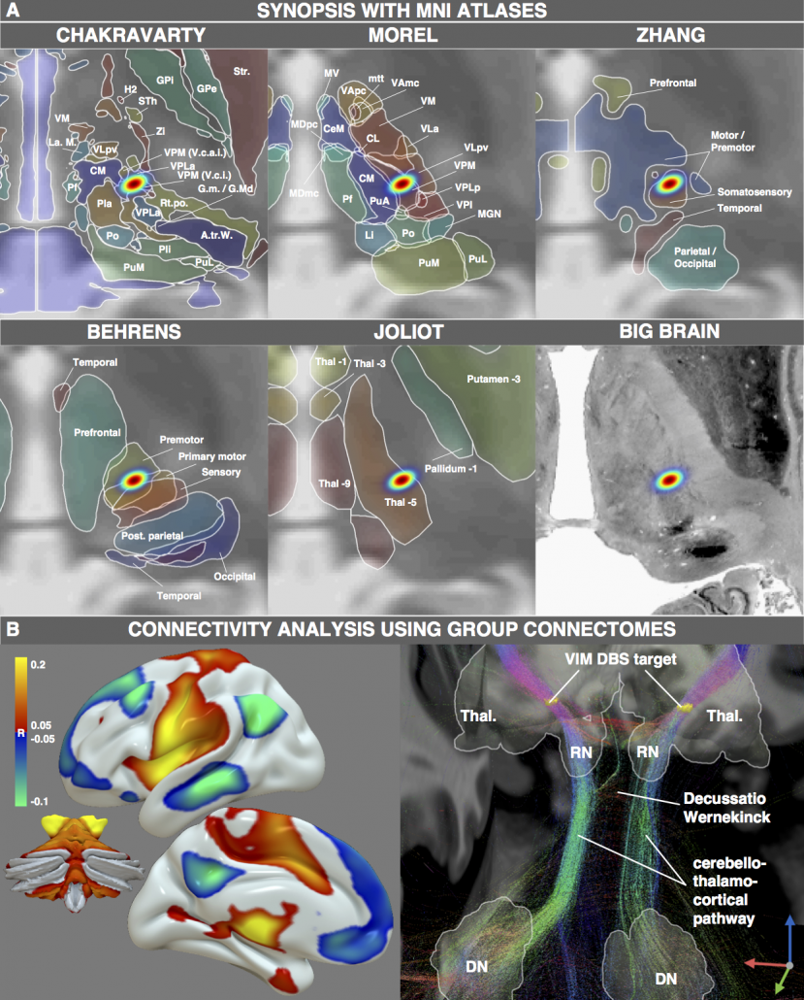
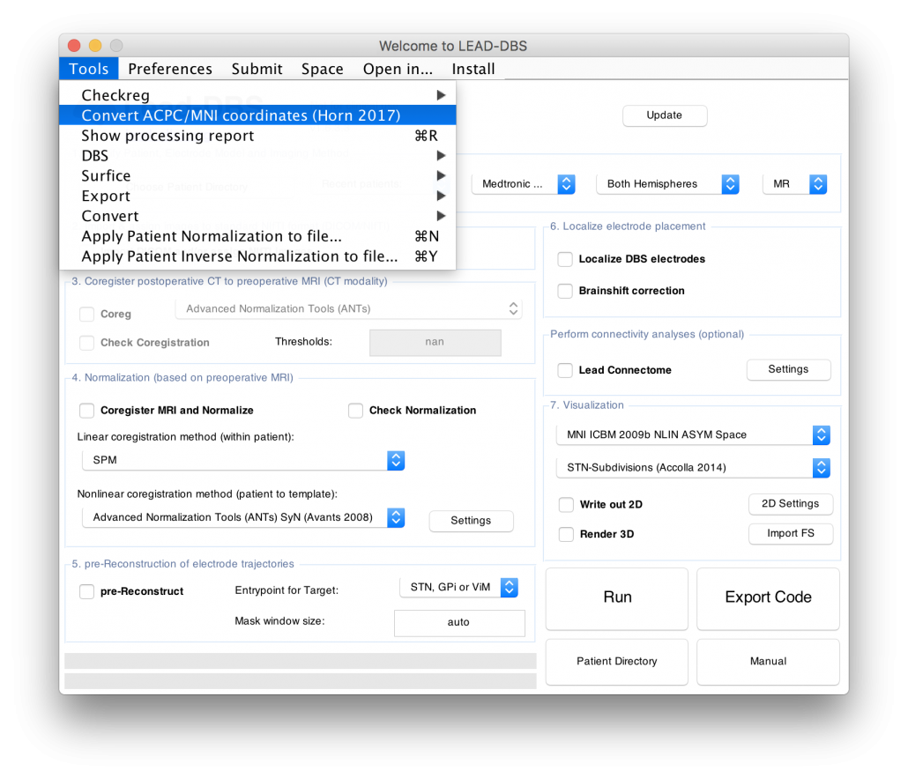
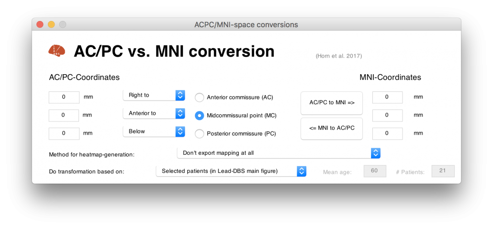

This blog post summarizes the work in

> [Horn, A., Kühn, A. A., Merkl, A., Shih, L., Alterman, R., & Fox, M. (2017). Probabilistic conversion of neurosurgical DBS electrode coordinates into MNI space. *NeuroImage*, *150*, 395–404.](http://doi.org/10.1016/j.neuroimage.2017.02.004)

 The aim of this study was to transform surgical literature targets – that are conventionally reported relative to the anterior and posterior commissures of the brain – within MNI space. We will first quickly revise the definition of these two “standard stereotactic” spaces and then summarize the methodology of the study.

**What are AC/PC coordinates?**

Surgical coordinates defined relative to the anterior (AC), posterior commissure (PC) or their midpoint, the midcommissural point (MCP) are also called “functional coordinates” since they are used in functional neurosurgery (the clinical domain largely dominated by deep brain stimulation surgery).

This coordinate system was popularized by two seminal surgical atlases, the Schaltenbrandt-Wahren ([1977](http://www.thieme.com/books-main/neurosurgery/product/168-atlas-for-stereotaxy-of-the-human-brain)) and Talairach-Tournoux ([1988](http://www.thieme.com/books-main/neurosurgery/product/414-co-planar-stereotaxic-atlas-of-the-human-brain)) atlases [as a side note, the idea of [stereotactic coordinates first appeared as early as 1906 by Clarke & Horsley](https://www.ncbi.nlm.nih.gov/pubmed/17912057)]. As pointed out by [Brett and colleagues (2002)](http://www.nature.com/nrn/journal/v3/n3/abs/nrn756.html), at their time, these atlases introduced three innovations: a coordinate system that helped to identify brain locations relative to anatomical landmarks, an atlas describing a standard brain, with anatomical labels and cytoarchitectonic details contributed by the work of Korbinian Brodmann (1925) and a 9-parameter transformation (adjusting for position, orientation and size) to match one brain to another. In general, the AC and PC are not the worst reference points given their relatively small anatomical variance across subjects. However, the two atlases were both defined based on single brains that were smaller than average. Moreover, as pointed out by [Weiss and colleagues (2002)](http://www.ajnr.org/content/24/5/922), the reference points are not always the same – sometimes the center of the AC and PC are used, sometimes their anterior/posterior borders, sometimes a mixture of the two.

***Figure 1:** AC/PC-coordinates are ill-defined. A) Both the Schaltenbrandt-Wahren and Talairach-Tournoux atlases are based on single brain that are smaller than average. B) The reference points of the anterior and posterior commissures are not always defined exactly the same – depending on the atlas used and the surgeon’s preference.*

**What are MNI coordinates?**

To cite [Matthew Brett again](http://www.nil.wustl.edu/labs/kevin/man/answers/mnispace.html), “the MNI wanted to define a brain that is more representative of the population. They created a new template that was approximately matched to the Talairach brain in a two-stage procedure. First, they took 241 normal MRI scans, and manually defined various landmarks, in order to identify a line very similar to the AC-PC line, and the edges of the brain. Each brain was scaled to match the landmarks to equivalent positions on the Talairach atlas. They then took 305 normal MRI scans (all right handed, 239 M, 66 F, age 23.4 +/- 4.1), and used an automated 9 parameter linear algorithm to match the brains to the average of the 241 brains that had been matched to the Talairach atlas. From this they generated an average of 305 brain scans thus transformed – the **MNI305**”

“The **problem introduced by the MNI** standard brains is that the MNI linear transform **has not matched the brains completely** to the Talairach brain. As a result the MNI brains are slightly larger (in particular higher, deeper and longer) than the Talairach brain.”

This quote highlights the problem of conversions between Talairach and MNI space which has been extensively studied in the imaging literature before (e.g. see pioneering [work by Lancaster & colleagues](http://www.brainmap.org/icbm2tal/)).

> However, surgical coordinates are not even in Talairach space.

…at least not always. As mentioned above, depending on the surgical target and their personal preference, surgeons choose to report their findings relative to the AC, the PC or the MCP. To add another source of confusion, coordinates may be reported in millimeters **lateral**, **anterior** and **below** the MCP. This seems to be the most frequent case, but does not always apply (coordinates could also be reported as **lateral**, **posterior** and **above** the AC). In contrast, Talairach coordinates are standardized to be always relative to the AC and the signs of each coordinate always make clear where one is in the brain (e.g. a negative x-coordinate means left hemisphere, a positive z-coordinate dorsal to the AC).

Thus, existing Talairach to MNI conversion tools only partially apply to the heterogeneous definition of coordinates expressed in the neurosurgical literature.

**Why bother with MNI coordinates, anyways?**

One could argue that the AC/PC system is established and there is no need to convert coordinates into MNI space altogether. However, the following reasons motivated us to still aim at creating a conversion tool that would to exactly that:

- As mentioned, traditional atlases still used in neurosurgical literature (and available “in AC/PC space”) are based on **single brains** and not representative of the average population
- Then, the number of these atlases is very limited. In contrast, **a multitude of atlases** have been defined in MNI space – and stem from various types of data such as histology, fMRI, diffusion MRI or meta analyses
- Beyond atlases, **other resources** – such as normative **connectomes** or whole-brain **histology datasets** are available in MNI space
- If a conversion tool existed, **findings from neurosurgical and functional imaging literature could be combined**
- Finally, the MNI space(s) are defined by detailed **three-dimensional templates** and **nonlinear deformation algorithms** have been trained across ~15 years of fMRI literature to warp single brains into their space and back. This means that once something is defined in MNI space, it may be transformed into the space of any other space, more or less accurately

[As a side note, the term “MNI space” itself is pretty ill-defined. [For an explanation why, please read this blog post](/about-the-mni-spaces/)].

**So how to do it?**

I hope I could convince you that it may be a good idea to build a tool that may transform from AC/PC- to MNI cooordinates (and back). One problematic fact is that AC/PC coordinates are expressed *relative to the AC/PC of a specific (clinical) population* – and the specific anatomy of this population is often unknown.

Clearly, the optimal way would be to obtain MRIs from the specific population, mark their AC and PC fiducials, mark the specific coordinate of interest and nonlinearly warp this coordinate into MNI space. However, obtaining MRIs from large clinical cohorts may render difficult if not impossible.

Instead, we used surrogate populations to do the same thing. Two DBS cohorts with different surgical targets, from which all coordinates were known, served as a gold standard. Then, we defined their AC/PC coordinates in healthy young, age-matched, disease-matched and disease-severity matched surrogate cohorts to warp their AC/PC coordinates into MNI space.

> Notably, this was done in a probabilistic fashion: A single point (relative to AC/PC) could end up in different places if defined in different brains. Defining this point in various brains and warping each of them to MNI space results in a probabilistic point cloud.

Our main finding was that **an age-matched surrogate cohorts yielded similar results** compared to the actual cohort. Only using a Young/Healthy cohort would render inferior results; a disease- or even disease-severity-matched cohort was not needed.

**The conversion tool applied**

Once we showed that it was feasible to convert AC/PC coordinates into MNI space, we performed a literature review of effective stereotactical diseases in MNI space. For each study that reported an effective DBS target, we gathered an age-matched cohort from the [IXI dataset](http://brain-development.org/ixi-dataset/). We then used this surrogate-cohort to probabilistically warp the AC/PC coordinate into MNI space.

The result was an atlas of DBS targets for various diseases defined in MNI space

***Figure 2:** AC/PC coordinates transformed to MNI space based on age-matched surrogate cohorts. This picture was elected for coverart in [NeuroImage Volume 150/June 2017](http://www.sciencedirect.com/science/journal/10538119/150) and directly shows the combination of findings with «MNI resources». Namely, the backdrop of the image is defined by the [BigBrain dataset](http://www.sciencedirect.com/science/journal/10538119/150), a whole-brain histology stack that has been warped into MNI.*

The nice thing about these results is that we could now compare the DBS target sites with other subcortical atlases – i.e. not only with the Schaltenbrandt/Wahren atlas commonly used in the neurosurgical literature. For instance, the [Morel](https://www.crcpress.com/Stereotactic-Atlas-of-the-Human-Thalamus-and-Basal-Ganglia/Morel/p/book/9780824728946) or [Chakravarty](https://www.ncbi.nlm.nih.gov/pubmed/16406816) atlases are based on histology and available in MNI space:

***Figure 3:** DBS targets defined in MNI space. Each target was mapped to MNI space using a healthy cohort that was age-matched to the cohort in which the AC/PC coordinate had been defined. [Various atlases available in MNI space](/helpsupport/knowledge-base/atlasesresources/atlases-2/) can help to interpret anatomical context.*

However, not only structural atlases are available as «ressources in MNI space». We aimed at making this point by characterizing the spatial position of the DBS target for Essential Tremor. This target is commonly assumed to reside within the ventrointermediate (VIM) nucleus of the thalamus. However, this assumption relies on early studies dating back to the pre-MRI era (e.g. by work of Hassler or Jones). Moreover, the nucleus is defined as *VIM/Vim* in the Walker/Ohye notations, respecitvely. It is called *Vimi* in the thalamic nomenclatures by Hassler and Van Buren & Borke and as *vim* in the Dewulf notation. In the popular Jones / Hirai & Jones notations, the VLpv or VPM best corresponds to the nucleus and in the nomenclatures by Ilinski/Kultas-Ilinsky and Percheron, the VL and LI/LIL nuclei best represent the Walker VIM.

Thus, depending on the atlas, the same nucleus will be called differently and not exhibit exactly the same borders. Moreover, the DBS target used to treat Essential Tremor has been reported to reside below the thalamus, in the subthalamic area/dorsal zona incerta. Furthermore, the dentatorubrothalamic tract seems to play a crucial role mediating therapeutic effect.

Finally, thalamic atlases exist that are not based on histology but on functional zones in the thalamus defined by functional or diffusion-weighted imaging. For instance, the seminal work by Behrens and colleagues ([2003](https://www.ncbi.nlm.nih.gov/pubmed/12808459)) defined seven functional zones of the thalamus based on their structural connectivity. This was reported as a group result in MNI space and could thus now be combined with findings from the neurosurgical literature:

***Figure 4:** One exemplary DBS target (to treat Essential Tremor) extensively characterized by various MNI resources. Atlases based on histology, functional or diffusion-weighted MRI may be used to characterize the spatial location of the target. Moreover, normative functional and structural connectome datasets may be used to characterize the connectivity profile of the effective target site.*

Figure 4 summarizes the potential and the gain in knowledge entailed with warping neurosurgical targets into MNI space. The methodology described in this article is fully implemented within Lead-DBS and can be applied to any AC/PC target based on a surrogate cohort of choice using the AC/PC <=> MNI conversion tool:

> Read the full article here: [Horn, A., Kühn, A. A., Merkl, A., Shih, L., Alterman, R., & Fox, M. (2017). Probabilistic conversion of neurosurgical DBS electrode coordinates into MNI space. *NeuroImage*, *150*, 395–404.](http://doi.org/10.1016/j.neuroimage.2017.02.004)
