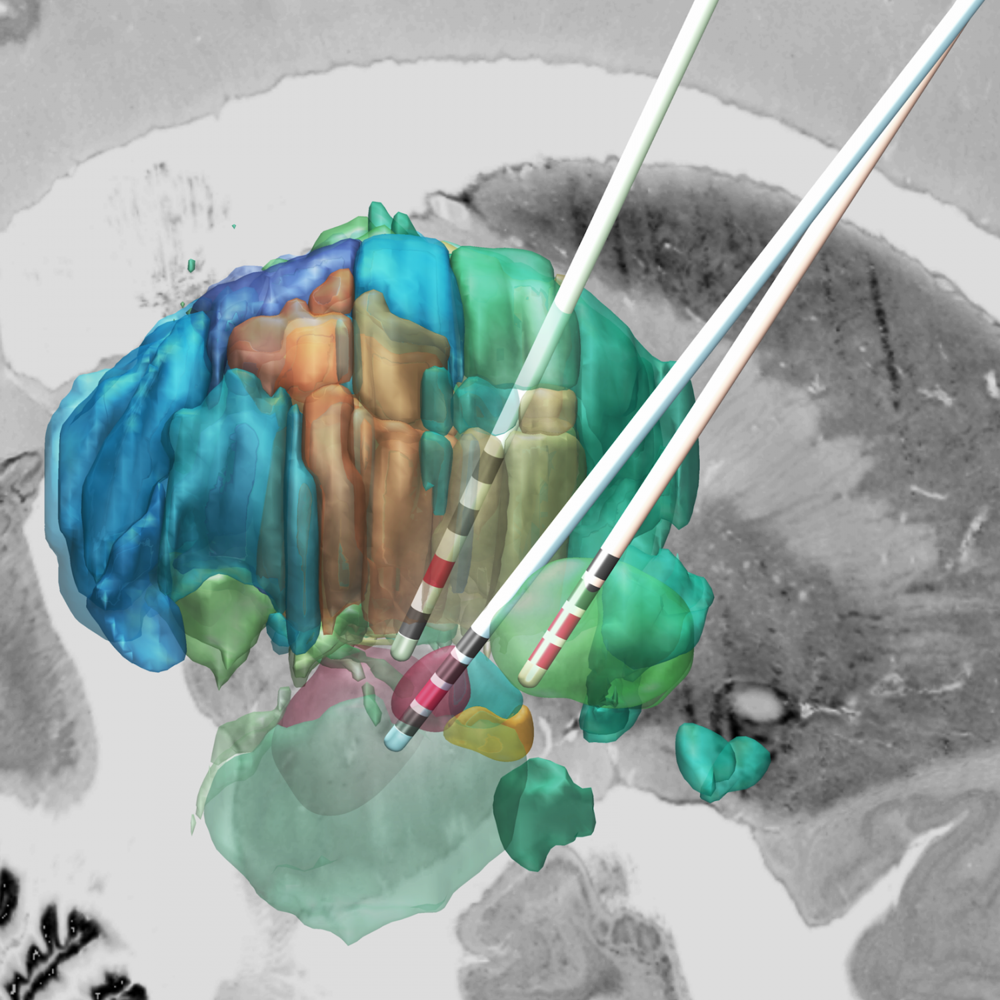

Summary of novel subcortical atlas that is "made for Lead-DBS", based on multispectral high-resolution
MNI template, histology and structural connectivity (Ewert et al., 2017) here:

[http://www.lead-dbs.org/?page_id=2911](/helpsupport/knowledge-base/atlasesresources/distal-atlas/)

Dataset out soon, original publication here: [http://www.sciencedirect.com/science/journal/aip/10538119?sdc=1](http://www.sciencedirect.com/science/journal/aip/10538119?sdc=1)

{.fig-medium}
