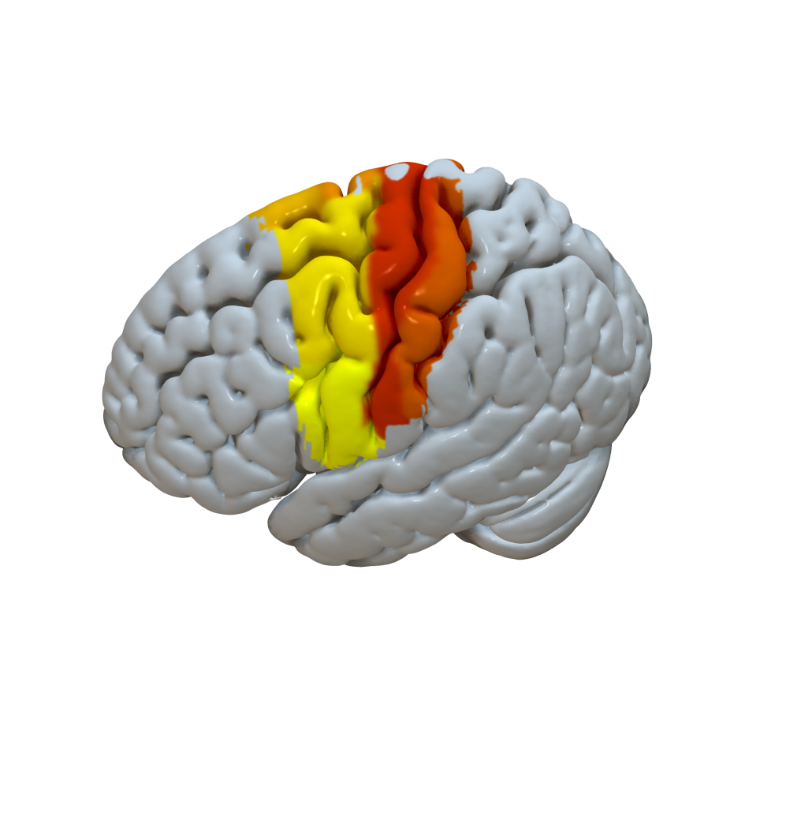
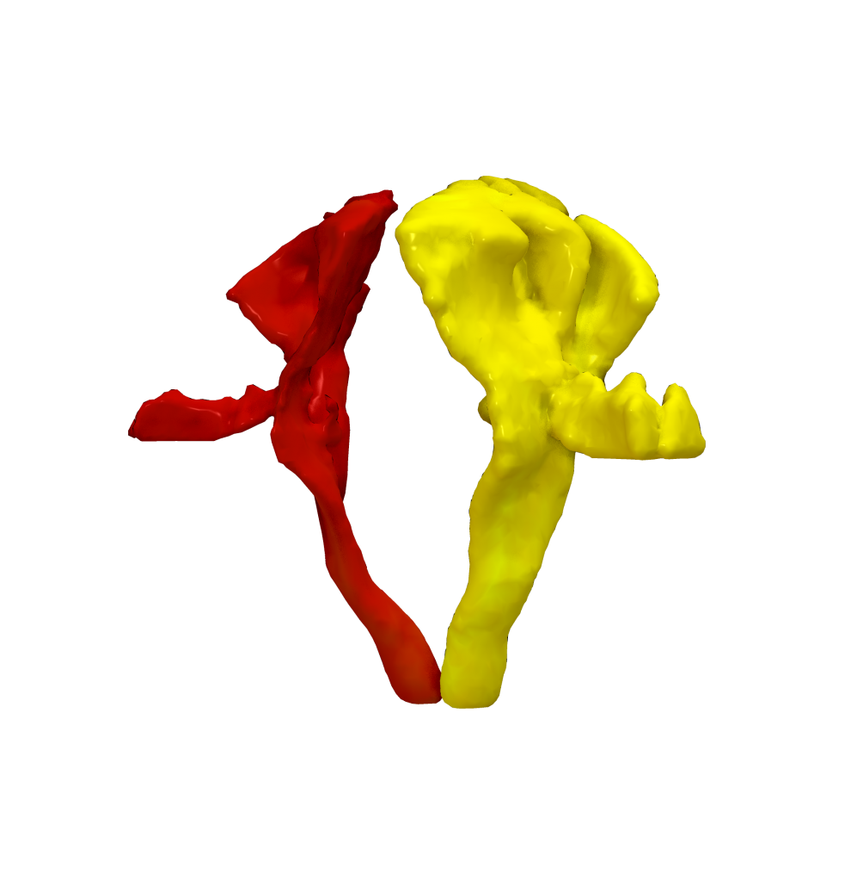
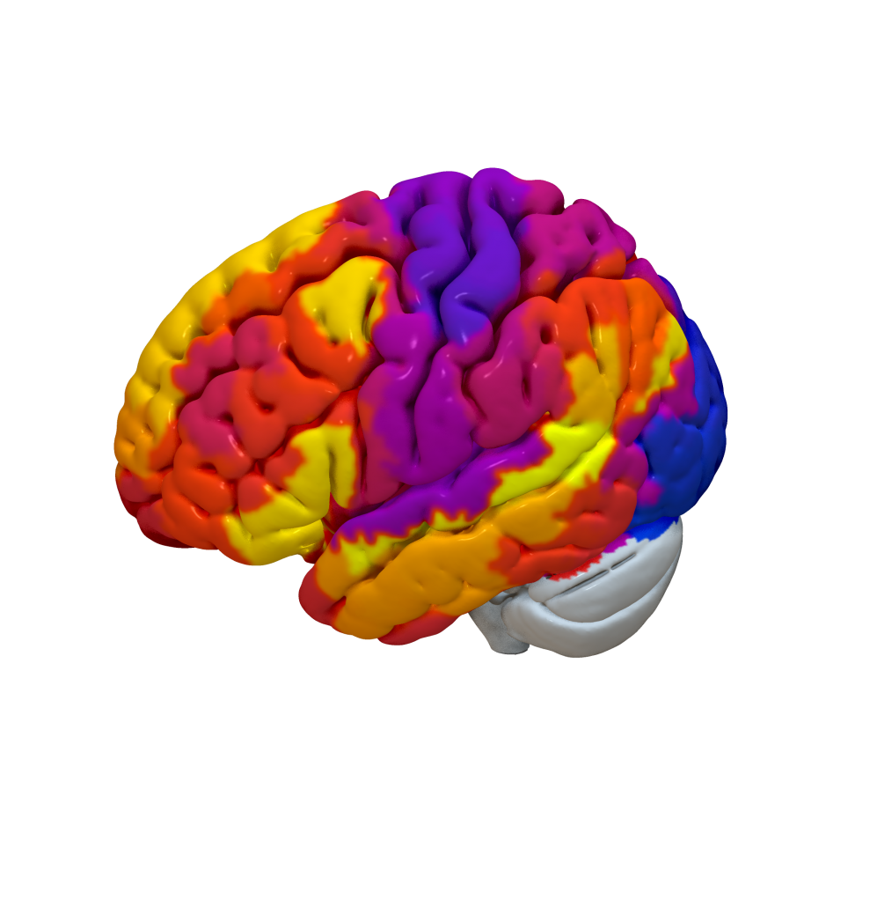

Inside a new version of Lead-DBS (v2.0.0.6) released yesterday, we included the pallidal theta activity
sweet spot defined in [A localized pallidal physiomarker in cervical dystonia](https://www.researchgate.net/publication/321013451_A_localized_pallidal_physiomarker_in_cervical_dystonia)
as well as optimal stimulation targets defined in [Thomas Schönecker](https://www.researchgate.net/profile/Thomas_Schoenecker)'s
article [Postoperative MRI localisation of electrodes and clinical efficacy of pallidal deep brain stimulation in cervical dystonia](https://www.researchgate.net/publication/266026179_Postoperative_MRI_localisation_of_electrodes_and_clinical_efficacy_of_pallidal_deep_brain_stimulation_in_cervical_dystonia)
and Philip Starr's article [Microelectrode-guided implantation of deep brain stimulators into the globus pallidus internus for dystonia: techniques, electrode locations, and outcomes](https://www.researchgate.net/publication/7159920_Microelectrode-guided_implantation_of_deep_brain_stimulators_into_the_globus_pallidus_internus_for_dystonia_Techniques_electrode_locations_and_outcomes).

Since all three spots fall into a very similar region of the GPi, this atlas gives some summarizing
evidence for an optimal target inside the GPi. Of note, the target falls into the sensorimotor part of the
GPi as defined in [Toward defining deep brain stimulation targets in MNI space: A subcortical atlas based on multimodal MRI, histology and structural connectivity](https://www.researchgate.net/publication/317032527_Toward_defining_deep_brain_stimulation_targets_in_MNI_space_A_subcortical_atlas_based_on_multimodal_MRI_histology_and_structural_connectivity)
by [Siobhan Ewert](https://www.researchgate.net/profile/Siobhan_Ewert) et al.

We further included the CIT168 subcortical atlas defined in [A High-Resolution Probabilistic In Vivo Atlas of Human Subcortical Brain Nuclei](https://www.researchgate.net/publication/320756817_A_High-Resolution_Probabilistic_In_Vivo_Atlas_of_Human_Subcortical_Brain_Nuclei)
that Wolfgang Pauli and colleagues from Caltech graciously shared for inclusion in Lead-DBS.

Furthermore, the new Schäfer parcellations defined in [Local-Global Parcellation of the Human Cerebral Cortex from Intrinsic Functional Connectivity MRI](https://www.researchgate.net/publication/320255795_Local-Global_Parcellation_of_the_Human_Cerebral_Cortex_from_Intrinsic_Functional_Connectivity_MRI)
that further subdivide the famous 7/17 rs-fMRI brain parcellation established by [B.T. Thomas Yeo](https://www.researchgate.net/profile/BT_Thomas_Yeo)
et al. in [The organization of the human cerebral cortex estimated by intrinsic functional connectivity](https://www.researchgate.net/publication/51201884_The_organization_of_the_human_cerebral_cortex_estimated_by_functional_correlation)
have been added for DBS connectivity analyses.

Last but not least, we included [lrnlab.org](http://lrnlab.org)'s (PIs Stephen Coombes & David Vaillancourt)
HMAT ([Three-dimensional locations and boundaries of motor and premotor cortices as defined by functional brain imaging: A meta-analysis](https://www.researchgate.net/publication/7208704_Three-dimensional_locations_and_boundaries_of_motor_and_premotor_cortices_as_defined_by_functional_brain_imaging_A_meta-analysis))
and S-MATT ([A Template and Probabilistic Atlas of the Human Sensorimotor Tracts using Diffusion MRI](https://www.researchgate.net/publication/315113494_A_Template_and_Probabilistic_Atlas_of_the_Human_Sensorimotor_Tracts_using_Diffusion_MRI))
templates of the sensorimotor cortex and -tract as brain parcellations for connectivity analyses in
Lead-DBS and Lead-Connectome (for more information on these very helpful templates see [http://lrnlab.org/](http://lrnlab.org/)).

For an updated list of subcortical atlases in Lead-DBS see [http://www.lead-dbs.org/?page_id=45](/helpsupport/knowledge-base/atlasesresources/atlases-2/),
for a list of whole-brain / connectivity brain parcellations see [http://www.lead-dbs.org/?page_id=1004](/helpsupport/knowledge-base/atlasesresources/cortical-atlas-parcellations-mni-space/).

{}
{}

{}
{}

{}
{}

{}
{}
