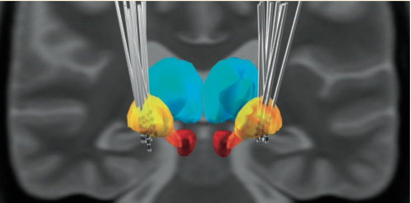

We are happy to announce that the first paper including an analysis with LEAD-DBS is [online here](http://www.ncbi.nlm.nih.gov/pubmed/25212852)

[Barow, E., Neumann, W.-J., Brücke, C., Huebl, J., Horn, A., Brown, P., et al. (2014). Deep brain stimulation suppresses pallidal low frequency activity in patients with phasic dystonic movements. *Brain : a Journal of Neurology*, awu258. doi:10.1093/brain/awu258](http://www.ncbi.nlm.nih.gov/pubmed/25212852)

