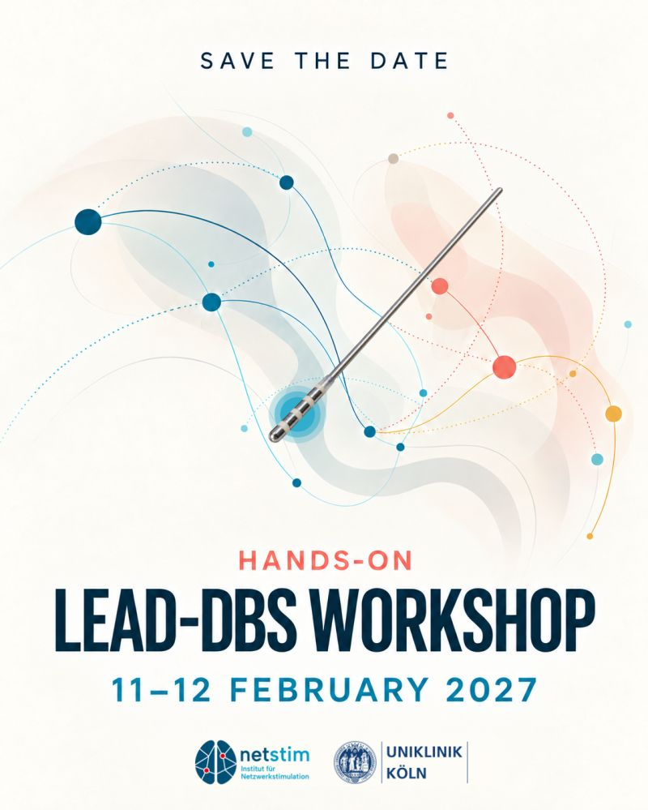

Save the date: the next **Hands-on Lead-DBS Workshop** will take place on **11–12 February 2027**, hosted by the [Institute for Network Stimulation](https://www.netstim.org/) and Uniklinik Köln (University Hospital Cologne). Participants will be among the first to try the pre-release of Lead-DBS 4.0, which is being rebuilt completely in Python.

Details and registration will follow. We will announce them in our [newsletter](/subscribe-to-our-newsletter/) on the [user Slack](https://inviter.co/lead-dbs) and on our [workshops page](/helpsupport/workshops/).

