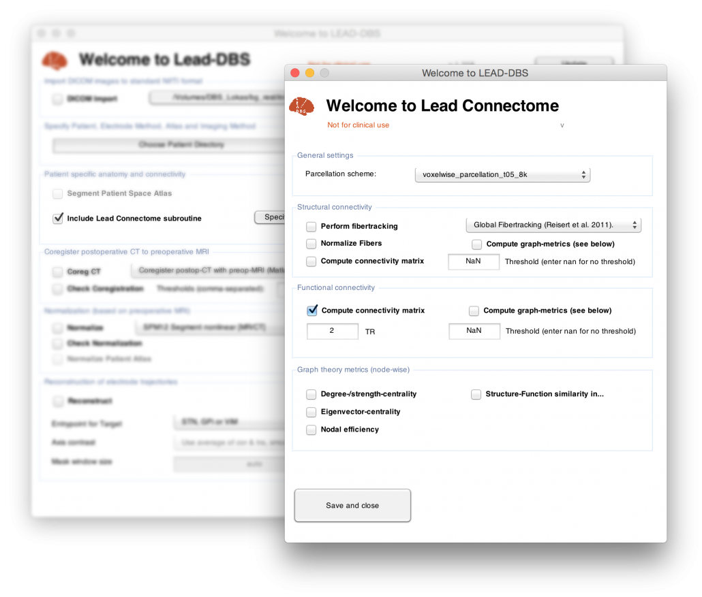

Let’s push the frontier a bit, shall we? Michael Okun recently published a NEJM-article entitled “[Deep-Brain Stimulation — Entering the Era of Human Neural-Network Modulation](http://www.nejm.org/doi/full/10.1056/NEJMp1408779)” and Jamie Henderson wrote a perspective paper in 2012 titled “[Connectomic Surgery](http://www.ncbi.nlm.nih.gov/pubmed/22536176)”.

Thus, from now on, [LEAD-DBS features a fully functional connectomic processing pipeline (DTI, rs-fMRI)](/about/lead-connectome/ "LEAD Connectome") that is simple to use and integrate to your work. In this way, you can now also use LEAD-DBS for patients who did not even undergo surgery (e.g. for connectomic analyses or visualizations).

