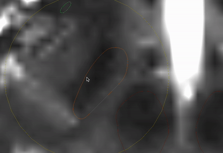
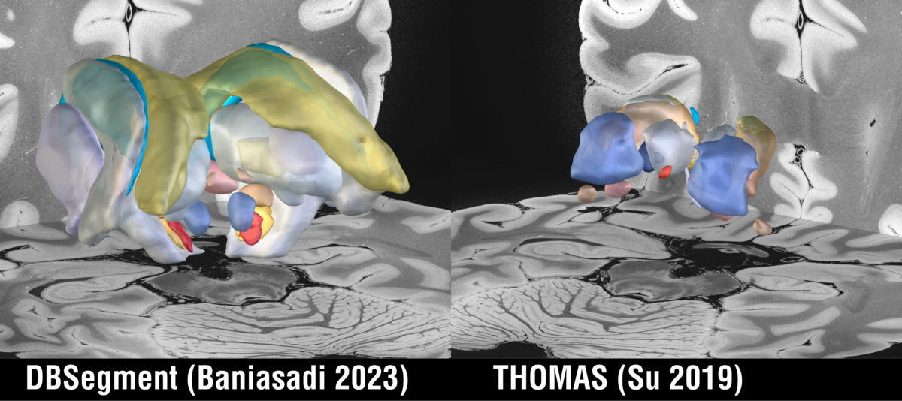

While 3.0 had not been around for long, we are excited to announce the release of Lead-DBS v3.1, which Ningfei Li just pushed to our servers. This version brings many updates; its key feature is the integration of OSS-DBS v2.0, which is much faster, more lightweight and more powerful than v1.0.

Since a lot has changed, it may make sense to [download Lead-DBS again](/download/), or, in case you use GitHub to maintain your installation, to [download the data files](https://www.lead-dbs.org/release/download.php?id=data_pcloud) again and merge them into your current installation.

Download Lead-DBS

## OSS-DBS v2.0

The biggest new feature in Lead-DBS v3.1 is the integration of OSS-DBS v2.0, which has been developed around the team of Ursula van Rienen at the University of Rostock.

OSS-DBS employs heterogeneous, anisotropic and dispersive volume conductor modeling for an accurate estimation of the electric field. In turn, the field can be used to conduct pathway activation modeling using biophysical axon models. Version 2 offers significantly higher efficiency, simpler installation and more transparent code.

We would like to highlight and thank the main developers, Julius Zimmermann, Jan Philipp Payonk and Konstantin Butenko, for this tremendous effort. Further contributors include Johannes Reding, Joachim Schöberl, Shruthi Chakravarthy, Michael Loftus and Till Dembek.

OSS-DBS v2.0 installs automatically within Lead-DBS using pip in our new conda environment (see below). It integrates with the DBS fiber filtering explorer and hence brings more biophysically plausible modeling to Lead-DBS and DBS network mapping.

For the basic methodology, please refer to the [OSS-DBS v1 paper](https://journals.plos.org/ploscompbiol/article?id=10.1371/journal.pcbi.1008023); for an [application in a clinical context, see here](https://www.sciencedirect.com/science/article/pii/S2213158222002509). The code is on [GitHub](https://github.com/SFB-ELAINE/OSS-DBSv2).

Limitations: advanced modeling assumes an understanding of the underlying parameters. At the time of release, testing on non-UNIX systems was still in progress.

## WarpDrive updates

The WarpDrive tool received multiple updates and refinements. It now features a shrink & expand tool, an inverse mode to carry out segmentations in native space, and the ability to move already placed fiducials during additional refinements.

## Built-in conda environment (using miniforge)

Lead-DBS now comes with a built-in conda environment that allows seamless integration of Python packages. This brings the following tools, which are now available from within Lead-DBS:

- DBSegment ([Baniasadi 2023](https://www.ncbi.nlm.nih.gov/pmc/articles/PMC9842883/))
- EasyReg ([Iglesias 2023](https://www.nature.com/articles/s41598-023-33781-0))
- FastSurfer ([Henschel 2020](https://www.sciencedirect.com/science/article/pii/S1053811920304985))
- SynthSR ([Iglesias 2023](https://www.science.org/doi/10.1126/sciadv.add3607))
- SynthSeg ([Billot 2023](https://www.sciencedirect.com/science/article/pii/S1361841523000506))
- SynthStrip ([Hoopes 2022](https://www.sciencedirect.com/science/article/pii/S1053811922005900))
- and OSS-DBS v2

## Native space segmentation routines

DBSegment is a deep-learning-based automated segmentation pipeline focused on DBS targets, [published by the Husch group](https://www.ncbi.nlm.nih.gov/pmc/articles/PMC9842883/). It is now fully integrated into Lead-DBS and produces native space atlases that can be queried statistically in Lead-DBS.

As a second routine, Lead-DBS now integrates the THOMAS thalamic segmentation [created by the Saranathan group](https://pubmed.ncbi.nlm.nih.gov/30894331/), which works especially well with WMnulled (or FGATIR) sequences.

Both tools can be called from the Tools menu in the Lead-DBS main window.

## New atlases

The following new atlases are included with Lead-DBS v3.1. We would like to thank all colleagues who contributed their work to the toolbox:

- [TWH Thalamotomy Sweetspot (Boutet 2018)](https://doi.org/10.1093/brain/awy278)
- [Harvard AAN Atlas (v2.0)](https://doi.org/10.5061/dryad.zw3r228d2)
- [Julich-Brain Cytoarchitectonic Atlas (v3.0)](https://doi.org/10.25493/56EM-75H)
- [Human Dysfunctome Atlas (Hollunder 2024)](https://osf.io/zu9c6/)

## GSP 1000 fMRI connectome on Harvard Dataverse

Thanks to Alexander Cohen, there now is a [Lead Mapper version of the N=1000 Brain Genomics Superstruct Project connectome](https://doi.org/10.7910/DVN/KKTJQC) on Harvard Dataverse.

## Many small additions

Other additions in this release; the biggest thanks again go to Ningfei Li for overseeing the effort and implementing the lion's share of them himself:

- Brainshift-corrected postoperative images added to the backdrop list for 3D visualization
- Improved robustness of SimBio/FieldTrip VTA modeling
- PMT lead models added
- Unified Lead-DBS config folder
- Faster Lead-DBS path setup
- Enhanced runcmd function
- More native binaries and MEX files on Apple silicon Macs

All changes since 3.0.1 are in the [full list of changes on GitHub](https://github.com/netstim/leaddbs/compare/v3.0.1...v3.1).

Read the original announcement [in our newsletter](https://www.lead-dbs.org/?na=view&id=29). As always, feel free to connect with us via the [user Slack](https://inviter.co/lead-dbs), or fork us on [GitHub](https://github.com/netstim/leaddbs) to contribute directly.
