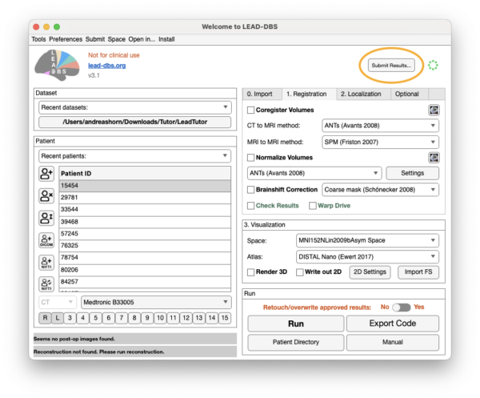
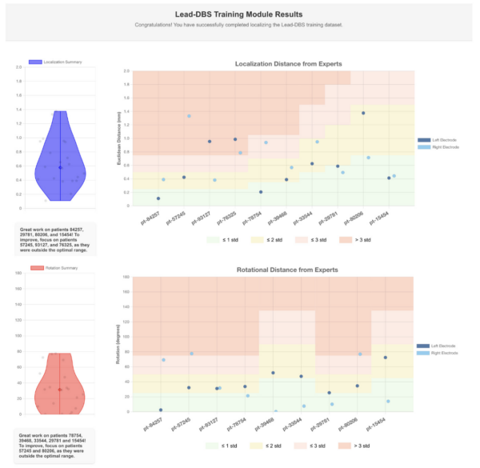
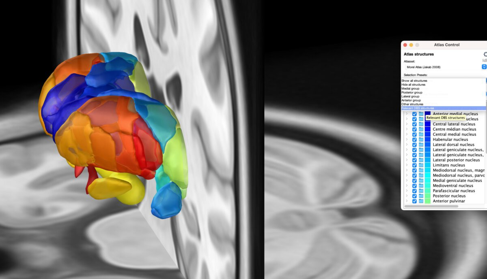

Ningfei Li just pushed Lead-DBS v3.2 to our servers. It comes with many minor fixes and a few larger updates, including [the Lead Tutor package](/manual/lead-dbs/self-tutoring-with-lead-tutor/) to self-train DBS electrode localizations with Lead-DBS.

Download Lead-DBS

## Lead Tutor: learn electrode localizations yourself

Lead Tutor is the first training dataset for Lead-DBS and comes with a tool to evaluate your own results. It is very challenging to openly release DBS imaging datasets, and we are very grateful to the team behind Lead Tutor, especially Lauren Hart and Savir Madan, for making this happen. We are not aware of any other open DBS imaging dataset, so it may be the first of its kind.

Ever wondered how accurate your DBS localizations were? Or are you a new user who wants to get started with Lead-DBS? Simply download the dataset, start localizing and click "Submit Results" to see how you performed compared to expert users.

{}
{}
Download Lead Tutor
{}
{}
Read the Lead Tutor paper
{}
{}
Learn Lead-DBS yourself
{}
{}

## New atlases

New atlas resources in v3.2:

- [Morel Atlas](https://zenodo.org/records/13918589) (Jakab 2008)
- The THOMAS Atlas was updated ([Saranathan 2021](https://www.nature.com/articles/s41597-021-01062-y))
- PD non-motor tracts (Meyer, in prep)
- Von Economo–Koskinas Brain Atlas ([Scholtens 2018](https://pubmed.ncbi.nlm.nih.gov/28040542/))

The Morel atlas used to be available to users who completed a data sharing agreement. It is fantastic news for the community that this legendary atlas has now been made [completely openly available by its authors](https://zenodo.org/records/13918589). We would like to thank Dr. Andras Jakab for reaching out to let us know that we can integrate it into Lead-DBS.

## Institute for Network Stimulation in Cologne

We are excited to share that Andreas Horn is founding a new Institute for Network Stimulation at the University Hospital Cologne this coming May. More details have been posted [on Bluesky](https://bsky.app/profile/andreashorn.org/post/3lidmydib722q).

Neuromodulation is one of the research focus areas of the University Hospital Cologne, which offers extensive stereotactic capabilities through the Stereotaxy Department of Dr. Veerle Visser-Vandewalle and provides deep brain stimulation for both neurological and psychiatric indications.

All changes since 3.1 are in the [full list of changes on GitHub](https://github.com/netstim/leaddbs/compare/v3.1...v3.2).

Read the original announcement [in our newsletter](https://www.lead-dbs.org/?na=view&id=31).
