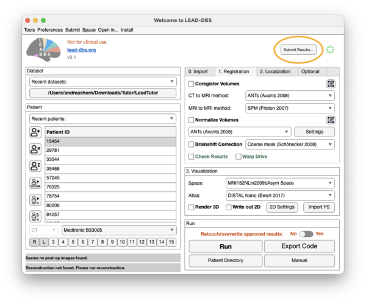
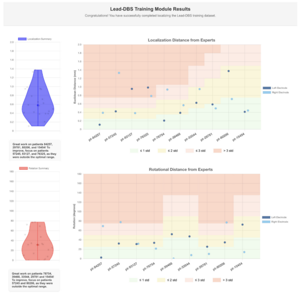
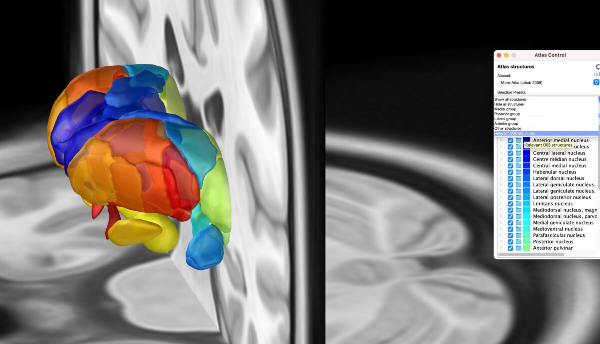

Lead-DBS 3.2, released by Ningfei Li, adds [Lead Tutor](/manual/lead-dbs/self-tutoring-with-lead-tutor/) for practising electrode localization, new atlases and fixes.

Download Lead-DBS

## Lead Tutor: learn electrode localizations yourself

Lead Tutor is the first training dataset for Lead-DBS and includes a tool to compare your localizations with expert results. We thank the team behind it, especially Lauren Hart and Savir Madan, for making the dataset openly available.

Download the dataset, localize the electrodes and select “Submit Results” to compare your localizations with expert results.

{}
{}
Download Lead Tutor
{}
{}
Read the Lead Tutor paper
{}
{}
Lead Tutor
{}
{}

## New atlases

New atlas resources in v3.2:

- [Morel Atlas](https://zenodo.org/records/13918589) (Jakab 2008)
- The THOMAS Atlas was updated ([Saranathan 2021](https://www.nature.com/articles/s41597-021-01062-y))
- PD non-motor tracts (Meyer, in prep)
- Von Economo–Koskinas Brain Atlas ([Scholtens 2018](https://pubmed.ncbi.nlm.nih.gov/28040542/))

The Morel atlas used to be available to users who completed a data sharing agreement. [Its authors have made the atlas openly available](https://zenodo.org/records/13918589). We would like to thank Dr. Andras Jakab for reaching out to let us know that we can integrate it into Lead-DBS.

## Institute for Network Stimulation in Cologne

Andreas Horn is founding a new Institute for Network Stimulation at the University Hospital Cologne this coming May. More details have been posted [on Bluesky](https://bsky.app/profile/andreashorn.org/post/3lidmydib722q).

Neuromodulation is one of the research focus areas of the University Hospital Cologne, which offers extensive stereotactic capabilities through the Stereotaxy Department of Dr. Veerle Visser-Vandewalle and provides deep brain stimulation for both neurological and psychiatric indications.

All changes since 3.1 are in the [full list of changes on GitHub](https://github.com/netstim/leaddbs/compare/v3.1...v3.2).

Read the original announcement [in our newsletter](https://www.lead-dbs.org/?na=view&id=31).
