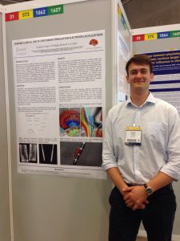

We had a great time presenting a poster about LeadMD, a future certified version of Lead-DBS at the [20th International Congress of Parkinson’s Disease and Movement Disorders](http://www.mdscongress2016.org/Congress-2016.htm) in Berlin on Monday. Thank you all for your helpful comments and suggestions regarding future work. The poster can be [found here](https://www.researchgate.net/publication/304155849_Toward_clinical_use_of_deep_brain_stimulation_electrode_localizations) and the picture below show’s Philip Plettig, who is working on a connectivity based sub-structure segmentation algorithm, in front of the poster.

