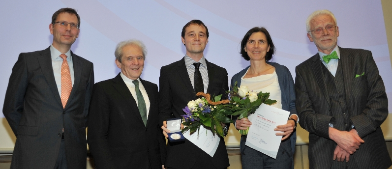

We are happy to announce that LEAD-DBS was awarded with the [Max-Rubner-Prize for Innovation and Technology of Stiftung Charité this January](http://www.stiftung-charite.de/de/foerderung/max-rubner-preis/max-rubner-preis-2015.html "LEAD-DBS Max Rubner Prize"). Prize money will be used for further development and deployment of the toolbox.

