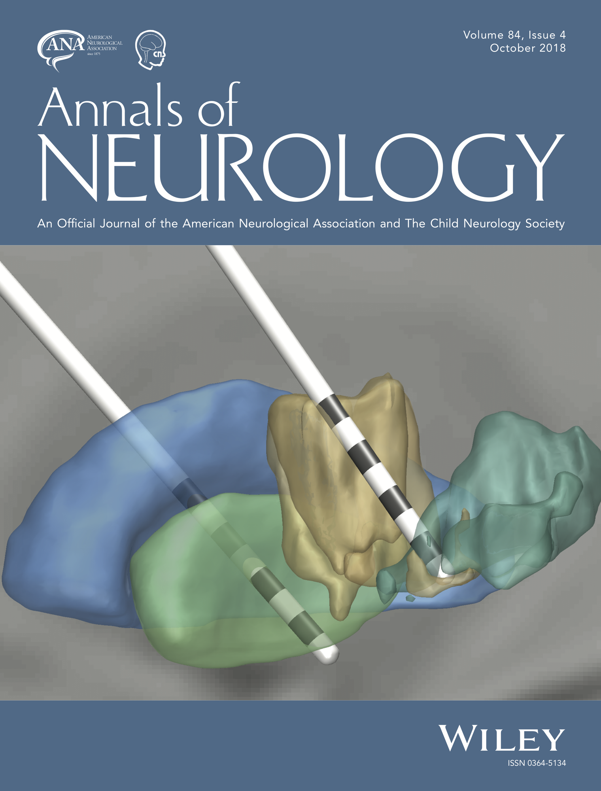

We’re really excited that the current cover of AoN was made with Lead-DBS. It shows pallidal and thalamic electrodes simultaneously implanted in a patient suffering from Tourette’s Syndrom and the picture is part of an electrophysiological Berlin-Hannover study spearheaded by Wolf-Julian Neumann and led by Andrea Kühn. It is the sixth coverart made with Lead-DBS that we know of – [a gallery can be found here](/about/publications/).

