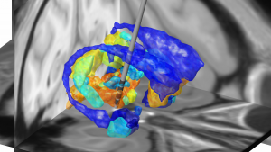

We are happy to announce that the core functionalities of Lead-DBS have been ported to support non-human primate (macaque) MRI and CT data.

Lead-DBS is a Matlab toolbox built to localize deep brain stimulation electrode placements based on postoperative imaging data. With the release of version 1.4.9 and the “macaque toolbox” ([download Lead-DBS](/download/)) you can start up Lead-DBS in macaque mode by entering

***lead macaque***

into the Matlab prompt.

Furthermore, the detailed [INIA19 macaque atlas](/helpsupport/knowledge-base/atlasesresources/atlases-2/#inia19-primate-brain-atlas) has been ported into MNI space and is available in preinstalled form within the Lead-DBS macaque toolbox.

Please do not hesitate to contact us in case of questions or suggestions.

