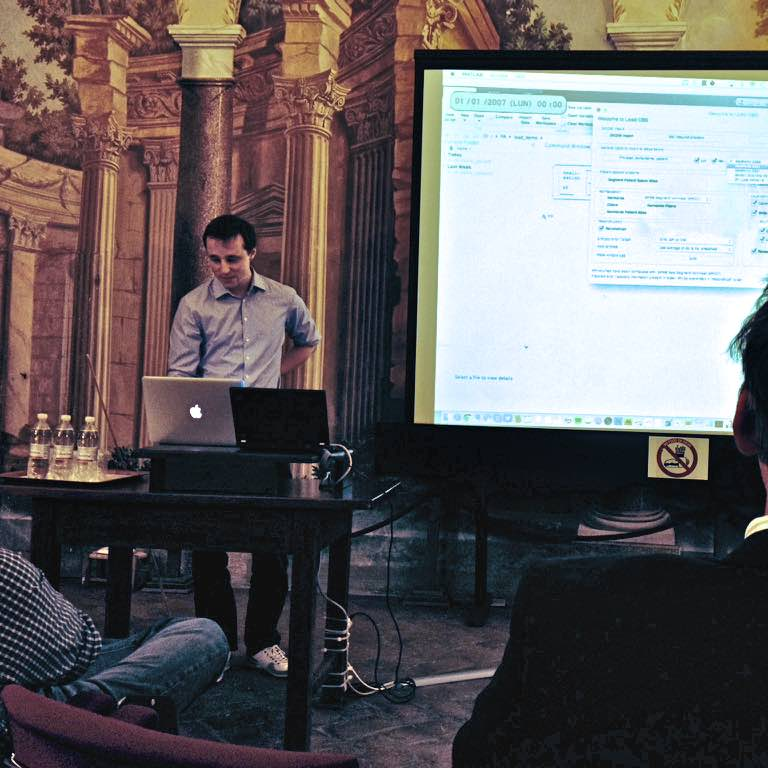

A short presentation of the DBS-localization toolbox was possible at [nsas](http://www.nsas.it/) summer school “[The Future of Deep Brain Stimulation](http://www.nsas.it/the-future-of-deep-brain-stimulation)” in Cortona, Tuscany, Italy was possible and we gained great feedback for further improving the toolbox here. Many thanks go to the organizers of the workshop at this point. Foto by Tora Bonnevie.

The future of Deep Brain Stimulation 2014, Tuscany, Italy, Presentation at Summerschool
