## New features in Lead-DBS 2.0

Today we released Lead-DBS 2.0 and it comes fully loaded with new major features to model deep brain stimulation electrodes in computer simulations.

{}
{}
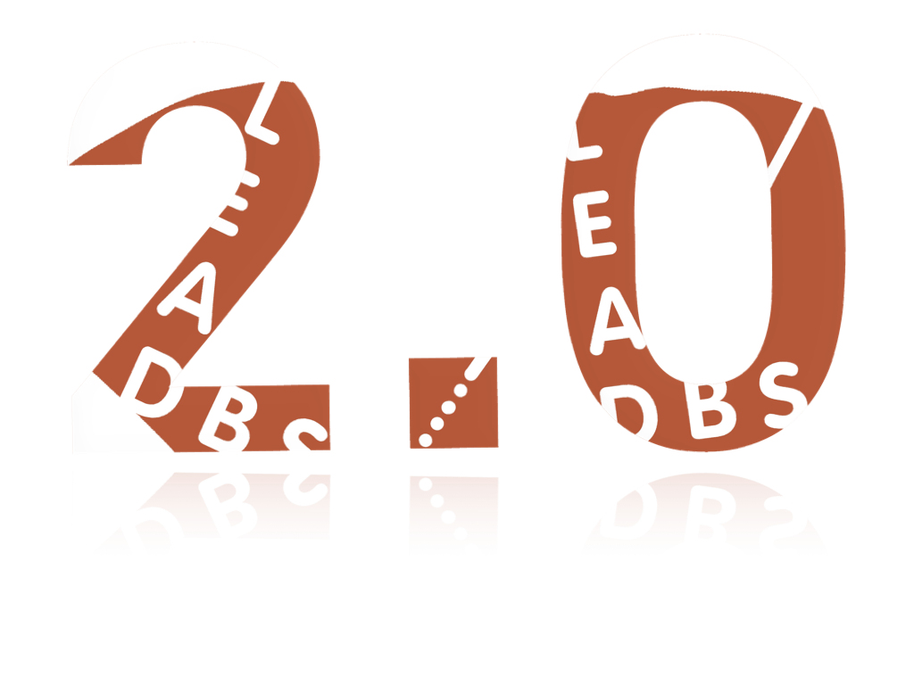

{}
{}
Lead-DBS 2.0 is not just a small incremental update. It comes with multiple major features that were a long time in the making. Our perception is that these following features make Lead-DBS “complete”, as a DBS imaging pipeline, for the first time.

  

Download Lead-DBS now

{}
{}
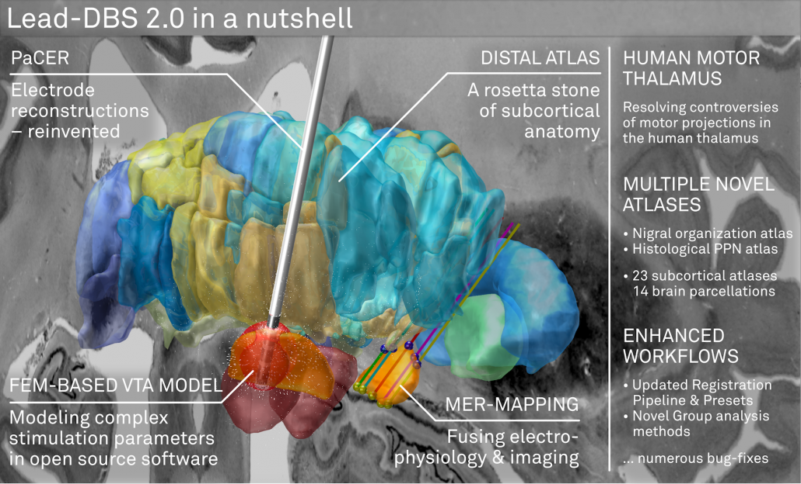

## The DISTAL atlas

  

The [DISTAL atlas](/helpsupport/knowledge-base/atlasesresources/distal-atlas/) is a modern and very detailed neuroimaging atlas that was precisely co-registered to the [default working space of Lead-DBS](/about-the-mni-spaces/).

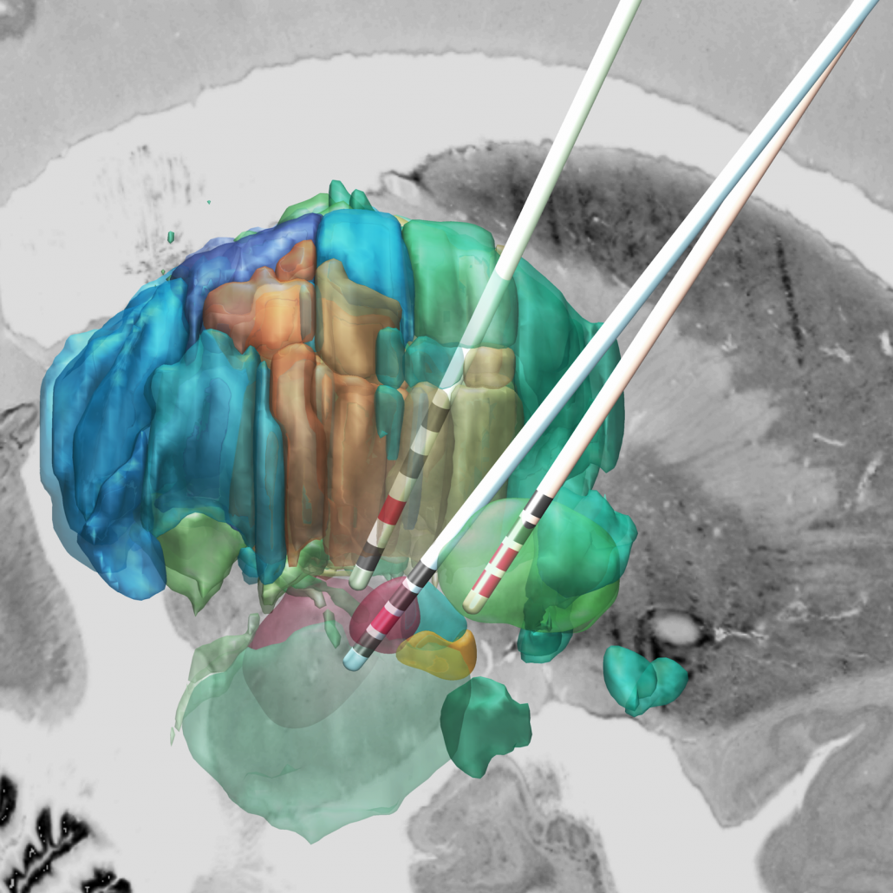

**Combining MRI, histology and connectivity in the same atlas**

It uses three sources of information, namely MRI, histology (graciously shared by Mallar Chakravarty and Louis Collins) and structural connectivity, where appropriate to define all structures that have so far played a role in deep brain stimulation and it was validated to perform atlas based segmentation on MR acquisitions with clinical quality.



**A rosetta stone for thalamic nomenclatures**

The histological data included inside the DISTAL atlas ([Chakravarty et al., 2006](https://www.ncbi.nlm.nih.gov/pubmed/16406816)) comes in three nomenclatures as well as their abbreviations. For people interested in the thalamus, this represents a rosetta stone of thalamic nomenclatures in MNI space. You can see this functionality in action in the video above.

Structures can be easily explored in the 3D viewer built into Lead-DBS and several presets are available. For instance, you can choose to show “DBS relevant structures” only. Another example is to quickly turn on functional parcellations of the STN/GPi or rather show them as solid structures.

{}
{}
Find out more about the DISTAL atlas here

{}
{}
Read the publication here

{}
{}
## A FEM-based VTA model (beta)

To model DBS stimulation settings that go beyond monopolar stimulations, a more complex model is needed that estimates the spatial distribution of voltage using the finite element method (FEM).

Such models have been around for quite some time but somehow never made their way into open source software in the field of DBS. Luckily, similar methods were published in EEG and MEG toolboxes such as [Fieldtrip](http://www.fieldtriptoolbox.org/) and [SimBio](https://www.mrt.uni-jena.de/simbio/index.php/Main_Page).

{}
{}
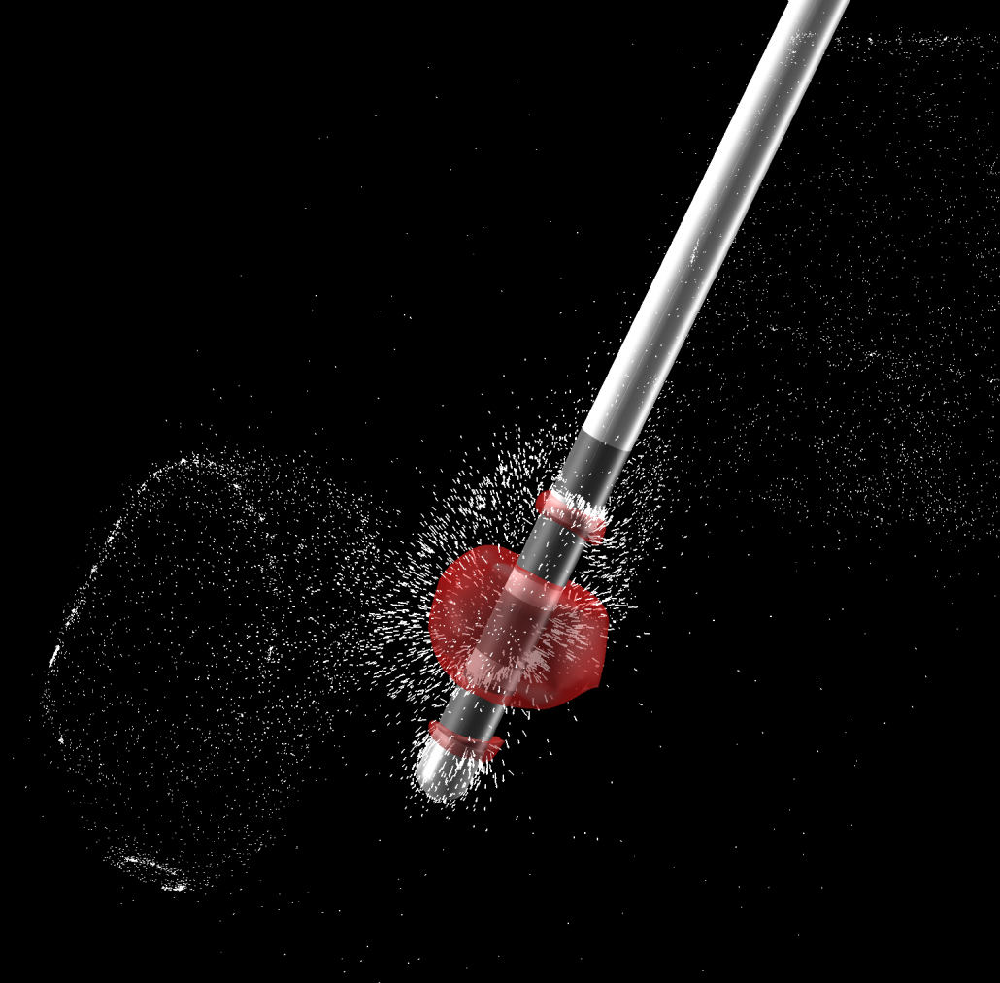

{}
{}
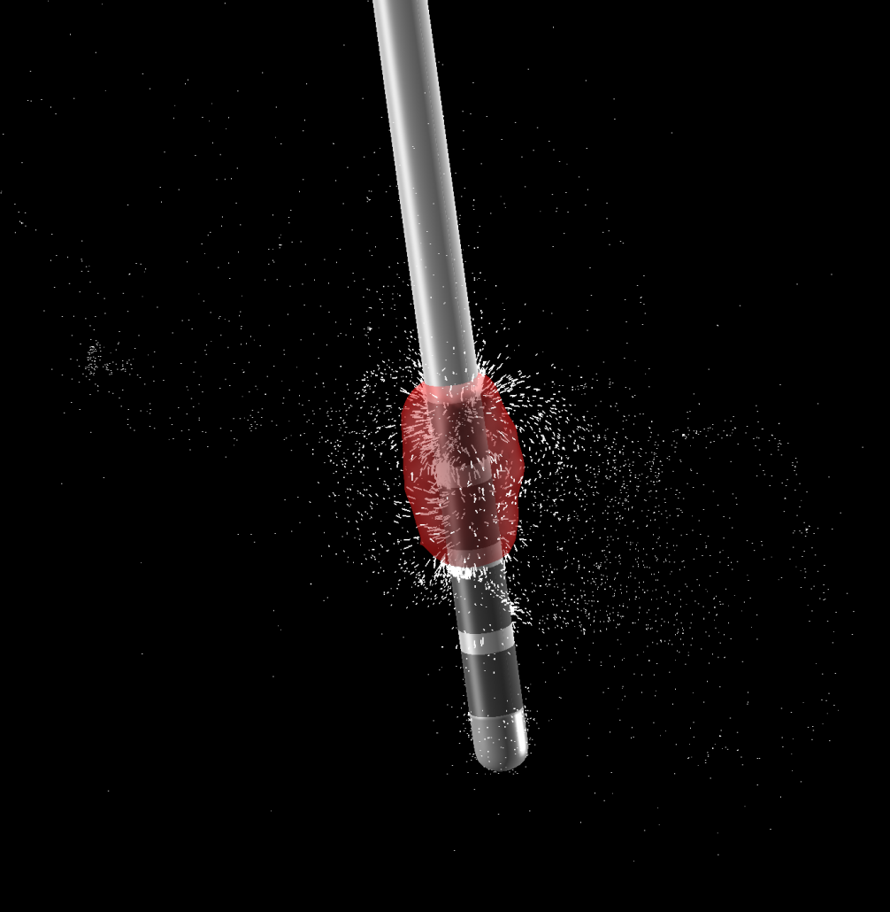

{}
{}

{}
{}
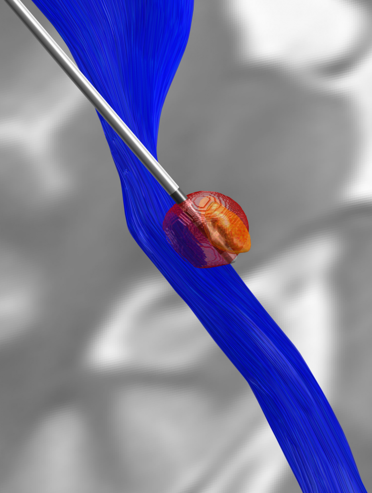

{}
{}
**Constant voltage, constant current, multicompartment model**

The new VTA model works for both constant voltage and current stimulations, is able to model up to four combined sources and multiple cathodes in bipolar and monopolar settings. It models grey and white matter as separate conductivity compartments as well as the effect of inactive contacts and insulating material of the electrode itself.

{}
{}

**The VTA model is in “beta” state but we hope to finish it soon**

Unfortunately, the model may still not be seen as “stable” software and requires some troubleshooting here and there (see [this page](/helpsupport/knowledge-base/atlasesresources/ixi-database/), our [Slack channel](/helpsupport/slack-user-channel/) and [Forum](/helpsupport/slack-user-channel/) for support options). Also, it does not yet work with segmented leads. We are working on getting this done with some support from Till Dembek out of Cologne.

*Note (2026): the forum is closed; please ask on the [user Slack](https://inviter.co/lead-dbs).*

*Of note, this model represents the first open-source FEM based VTA model and numerous people invested countless hours to make this happen. **Great thanks go out to Johannes Vorwerk (Utah), Qianqian Fang (Boston), Ningfei Li (Berlin) & Robert Oostenfeld (Nijmegen), [also see here](/helpsupport/knowledge-base/atlasesresources/ixi-database/).***

{}
{}
Find out more about the VTA model here

{}
{}
Read the publication here

{}
{}
## PaCER – precise automatic DBS reconstruction

{}
{}
Andreas Husch (Hertel lab, Luxembourg) created an incredibly smart method to automatically detect DBS electrodes on postoperative CT – and he graciously shared his algorithm to be included into Lead-DBS.

PaCER is [also available as a standalone tool](https://adhusch.github.io/PaCER/) to reconstruct Leads on postoperative CTs and is surely interesting to people who like to write their own scripts inside and outside the Lead-DBS environment.

  

**If you use postoperative CT, your life just got a lot easier**

PaCER is fast and precise, in most cases there is no manual refinement needed at all. Moreover, PaCER has the ability to reconstruct curved electrodes – we’re not there yet to have this functionality integrated into Lead-DBS, but we’re working on it…

{}
{}
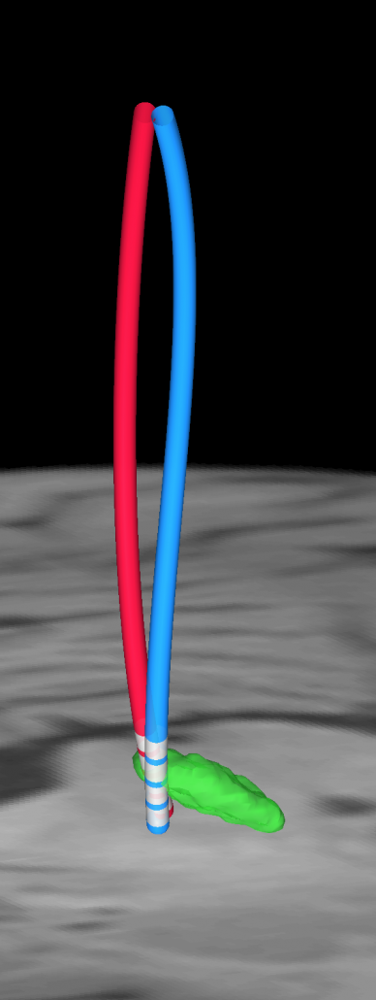

{}
{}

Find out more about PaCER here

## Microelectrode Recordings – mapped onto the brain

In meticulous work, Ari Kappel (Richardson lab, U Pittsburg) and Chadwick Boulay (Sachs lab, U Ottawa) created a tool to map microelectrode recordings (MER) onto the subcortical anatomy of the brain.



**A fusion of electrophysiology and MRI in space**

Using the novel MER tool, it is easy to investigate the overlap between electrophysiological regions and atlas regions, manual segmentations of anatomical structures and/or raw MRI data. The possibilities are countless – we’re looking forward to seeing how people will use them.

See the manual on MER-Recordings here

*Note (2026): this old manual is offline; the current manual is at [netstim.gitbook.io/leaddbs](https://netstim.gitbook.io/leaddbs).*

## Human Motor Thalamus Atlas – resolving controversies and disagreements related to the human motor thalamus

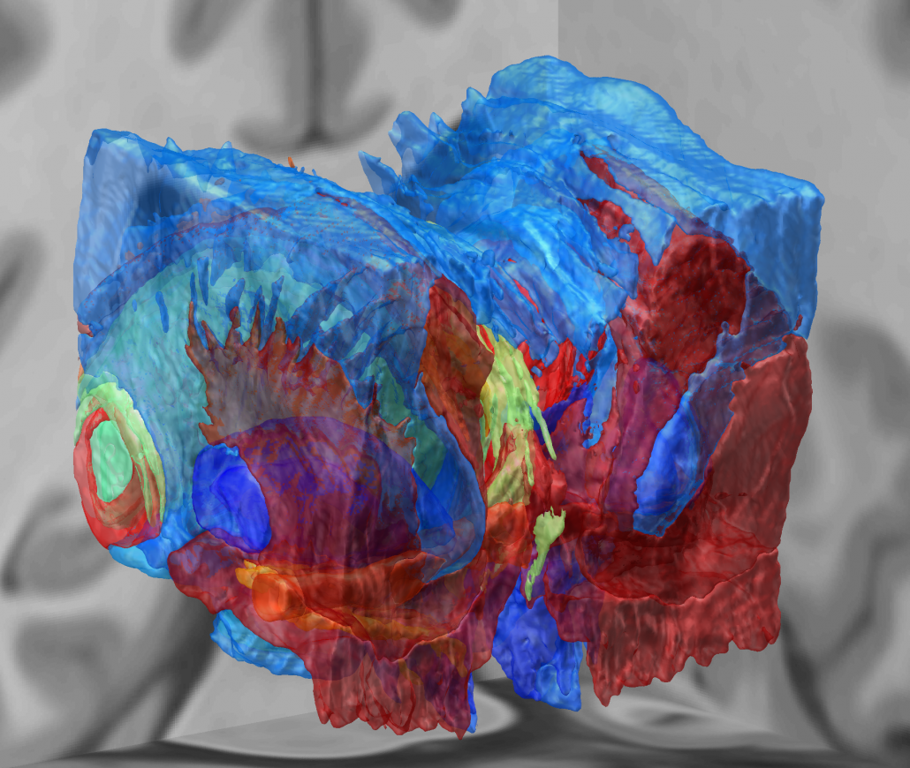

Igor and Kristy Ilinsky created a detailed histological atlas of the human motor thalamus as a seminal contribution to define termination areas of three (nigral, pallidal and cerebellar) afferent systems to the human thalamus.

Their atlas was co-registered using MRI and the pseudoMRI mapping approach introduced by [Chakravarty and colleagues](http://www.sciencedirect.com/science/article/pii/S1361841508000443) that we refined in our work on the [DISTAL atlas](/helpsupport/knowledge-base/atlasesresources/distal-atlas/) including multispectral and multi-iterative nonlinear warps.

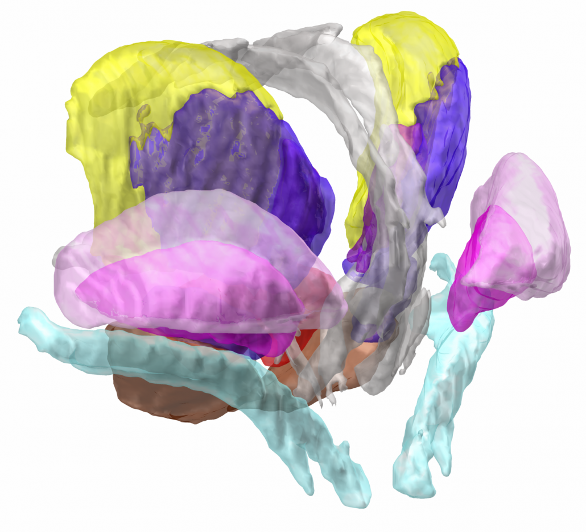

**A detailed map of the human motor thalamus**

Nuclear outlines in this atlas were drawn on the basis of anatomical, immunocytochemical, and functional data. The termination areas of three subcortical afferent systems to the thalamus (nigral, pallidal, and cerebellar) were segregated. Each territory was distinguished by specific cytoarchitectual features and synaptic organization. The most remarkable difference was seen with respect to organization of GABAergic circuitry. At the light microscopic level these differences were reflected in distribution pattern of GABA synthesizing enzyme, glutamic acid decarboxylase (GAD65). The outlines of the nigral (VAn), pallidal (VAp) and cerebellar (VL) input receiving nuclei were determined based on the combination of cytoarchitectural features and GAD65 staining patterns. Correspondence of these nuclear entities to those described under other nomenclatures (Walker, Hassler, Jones) as well as additional info and references are available at the website [humanmotorthalamus.com](http://www.humanmotorthalamus.com).

{}
{}
Find out more about the Human Motor Thalamus here

{}
{}
Read the pre-print publication here

{}
{}
## Enhanced workflows – many things just got easier

{}
{}
A lot of workflows in Lead-DBS v2.0 were remodeled from the ground up. For instance, Lead-DBS now tracks co-registrations and normalizations that you approve or dissaprove in a coregistration viewer that is much faster than before.

  

**Processing large datasets just became much easier**

If you’ve been using Lead-DBS on large datasets (N>100 patients), you know the problem: It is hard to track which patients were co-registered, normalized, localized correctly. Most users went ahead and created Excel-sheets to track their progress in localizing all these DBS electrodes. However, from now on, Lead-DBS takes notes for you. You can approve or disapprove every co-registration and will never need to see or reprocess the ones you have already approved.

In this way, you can select 100 patients, run coregistration and normalization over night, on the next morning quickly check results and re-run only the ones that failed using different presets.

{}
{}
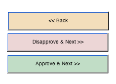  

{}
{}
## Multiple minor features, new atlases, bug fixes

{}
{}
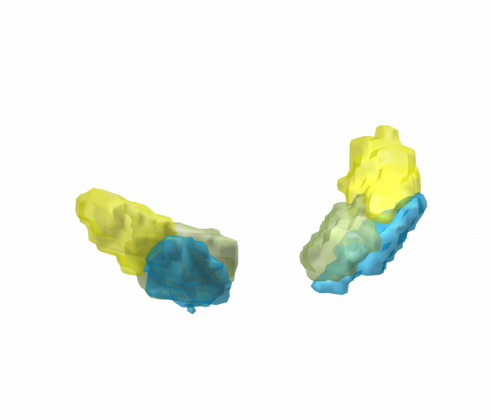  

*[Zhang et al. 2017](https://elifesciences.org/articles/26653) nigral organization atlas*

  
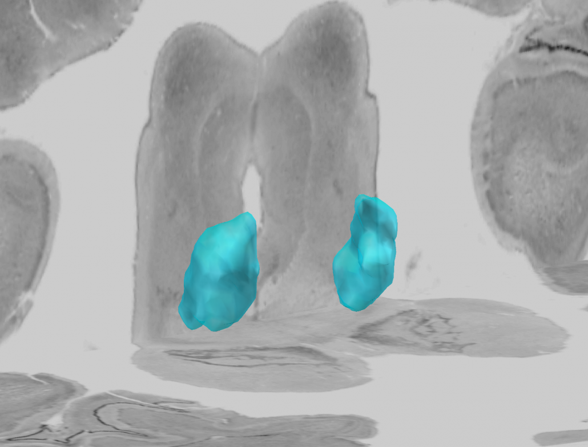  

*[Alho et al. 2017](https://link.springer.com/article/10.1007%2Fs00429-016-1356-0) PPN atlas*

{}
{}
Above & beyond the DISTAL and Humanmotorthalamus atlassets, a few additional new atlases such as the [Nigral organization atlas (Zhang 2017)](https://elifesciences.org/articles/26653) or the [histological PPN atlas (Alho 2017)](https://link.springer.com/article/10.1007%2Fs00429-016-1356-0) were graciously contributed by the authors and have made their way into Lead-DBS v2.0.

  

**23 subcortical atlases, 14 whole-brain parcellations**

In total, Lead-DBS now comes with 23 [subcortical atlases](/helpsupport/knowledge-base/atlasesresources/atlases-2/) and 14 [whole-brain parcellations](/helpsupport/knowledge-base/atlasesresources/cortical-atlas-parcellations-mni-space/) (for connectomic analyses).

  

**Improved workflows for group analyses**

A lot of features were revised inside the lead_group module, making DBS group analyses more efficient and easy. It is now possible to visualize group VTAs – and they may be weighted by a variable (such as associated clinical improvement).

For tech-savvy users: Take a look at the new ea_roi object which lets you visualize the isosurface of any nifti file on a Matlab figure (or the Lead-DBS 3D-viewer).

  

**Additional minor release notes:**

- Updated “effective” ANTs presets
- 2D export now shows correctly if the atlas covers a larger area than the exported slice
- Automated detection of modality (MR vs. CT) when processing multiple patients – locally or on compute clusters
- [Countless fixes of minor glitches](https://github.com/leaddbs/leaddbs/commits/)

{}
{}

{}
{}
See our list of subcortical atlases

{}
{}
See our list of whole-brain parcellations

{}
{}
Download Lead-DBS 2.0 now
