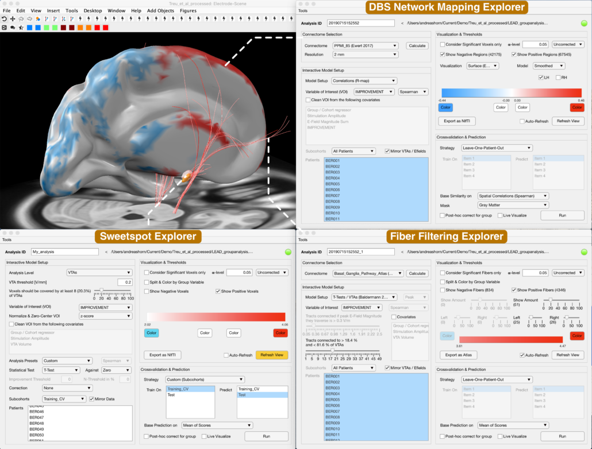

{}
{}
Lead-DBS 2.5 brings three tools to map the effects of DBS on a group level, support for unilateral
leads and new atlases. It also fixes a bug for segmented Abbott leads, so read the first section
if your study uses them.

{}
{}

{}
{}

## A fix for segmented Abbott leads

Up to this version, Lead-DBS could reconstruct the orientation of **segmented Abbott electrodes in native
space** wrongly. Analyses in template (MNI) space are not affected, and no publication is known to be
affected. If your study reconstructed segmented leads in native space, update to 2.5 and reconstruct
their orientation again. Till Dembek and Ningfei Li found and fixed the bug.

## Three tools to map DBS effects

On a group level, Lead-DBS 2.5 maps

- "sweet" and "sour" spots within DBS targets,
- improvement to fibre tracts,
- improvement to brain networks.

The Sweetspot Explorer builds on Till Dembek's comparison of the approaches used to map sweet spots in
the DBS literature; it brings their main choices together in one tool, without reproducing each paper
exactly. A [walkthrough video](https://www.youtube.com/watch?v=xobhQDgtVfs) shows all three tools. Today
they are described under [Methods](/helpsupport/knowledge-base/lead-dbs-methods/).

## Unilateral leads, and new developers

Enrico Opri (Emory), Johannes Achtzehn and Nanditha Rajamani (Charité) sent their first pull requests.
Enrico made the whole pipeline support unilateral leads. Pull requests from anyone are welcome: see
[Contribute](/develop/).

## New atlases

Thanks to the colleagues who contributed them:

- [TOR-PSM](/helpsupport/knowledge-base/atlasesresources/atlases-2/#tor-psm-elias-2020) (Elias 2020): probabilistic sweet spots from 482 patients with five diseases, treated over 15 years at Toronto Western Hospital
- [TOR-signPD](/helpsupport/knowledge-base/atlasesresources/atlases-2/#tor-signpd-boutet-2021) (Boutet 2021): symptom-specific sweet and sour spots for STN-DBS in Parkinson's disease
- [STN sweet spots](/helpsupport/knowledge-base/atlasesresources/atlases-2/#stn-sweetspots-dembek-2019) (Dembek 2019): symptom-specific sweet spots for rigidity, akinesia and side effects, from monopolar reviews
- Essential tremor lesion network (Joutsa 2018): the network of lesions that relieved tremor, peaking at the VIM
- [Subcortical white matter pathways](/helpsupport/knowledge-base/atlasesresources/atlases-2/#subcortical-white-matter-pathways-avecillas-2019) (Avecillas 2019): tracts relevant to DBS
- Cluster headache (Nowacki 2020): a probabilistic map from published cases ([paper](https://doi.org/10.1002/ana.25887))
- Human hypothalamus (Neudorfer 2020): a high-resolution atlas of 13 hypothalamic and 12 extrahypothalamic structures
- Pallidal dyskinesia (Tsuboi 2020): regions linked to stimulation-induced dyskinesia in pallidal DBS ([paper](https://doi.org/10.1002/mds.28324))

Also new: a stimulation bundle linked to good outcome in Parkinson's disease, from the
[Lead Group paper](https://doi.org/10.1016/j.neuroimage.2020.117018) (Treu 2020), and version 3 of the
Automated Anatomical Labeling parcellation (AAL3). All atlases are listed under
[Subcortical atlases](/helpsupport/knowledge-base/atlasesresources/atlases-2/).

## Coming: OSS-DBS

Konstantin Butenko (Ursula van Rienen's group, Rostock) and Ningfei Li completed an interface between
[OSS-DBS](https://doi.org/10.1371/journal.pcbi.1008023) and Lead-DBS. It still needs testing and
documentation and is not public in this version; it was released with [Lead-DBS 3.0](/lead-dbs-3-0-out-now/).

Download Lead-DBS

All changes since 2.3 are in the [list of changes on GitHub](https://github.com/netstim/leaddbs/compare/v2.3...v2.5).
