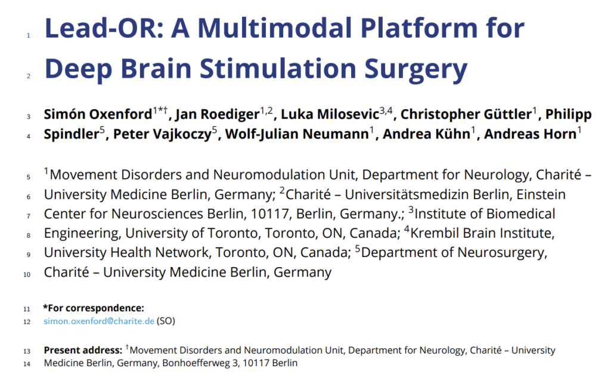
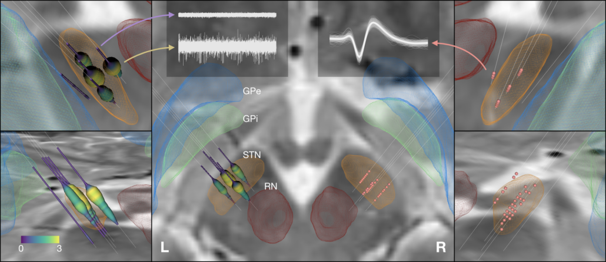

{}
{}

{}
{}

{}
{}

A sister application to Lead-DBS, Lead-OR, has been released as open source by Simon Oxenford et al.

The [preprint describing the effort](https://www.medrxiv.org/content/10.1101/2021.08.09.21261792v1) is on medRxiv. More about the tool: [Lead-OR](/about/lead-or/).

  

Download Lead-OR
