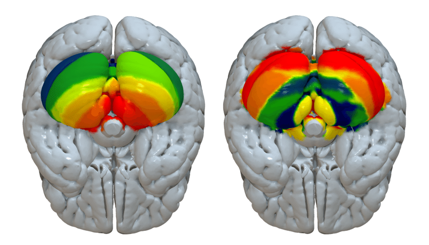
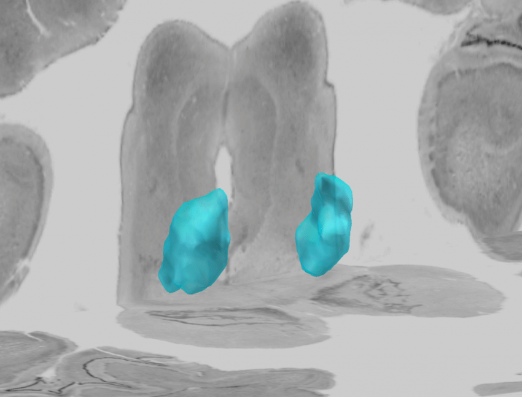

Summary here: [http://us8.campaign-archive2.com/?u=a5b93846a3a2a714edbcce8ef&id=7038e497df](http://us8.campaign-archive2.com/?u=a5b93846a3a2a714edbcce8ef&id=7038e497df)

- Drag'n'Drop support
- Improved ANTs presets
- New Check Normalization viewer
- New NIfTI image classifier
- New atlases (PPN Alho 2017 atlas, [Magnetic resonance diffusion tensor imaging for the pedunculopontine nucleus: proof of concept and histological correlation](https://www.researchgate.net/publication/314653187_Magnetic_resonance_diffusion_tensor_imaging_for_the_pedunculopontine_nucleus_proof_of_concept_and_histological_correlation), cerebellar parcellations)

{}
{}

{}
{}

{}
{}
