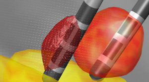

We are happy to announce a major update of Lead-DBS (v1.4).  
Here are some key features:

- Novel electrode format – now any lead design you can think of is possible. This specifically adds support for the novel Boston Scientific Vercise directed leads to the toolbox (see picture). Also, custom made electrodes can be added easily.
- Co-registration between pre-op MRIs and post-op CTs works much more robustly now using BRAINSFit.
- fMRI/dMRI-based connectomic results can now be explored using both a seed-based and graph-theoretical approach in the 3D-viewer. In fMRI, you can even loop across time using a sliding-window approach.

Even more importantly, I am very happy to mention that the development team has grown substantially: Welcome Ningfei Li, Philip Plettig & Siobhán Ewert to the team!

We will continue to improve especially the new features in the upcoming months and there are a few nice new features already in the pipeline. As always, suggestions, comments and help ([fork us on github](https://github.com/andreashorn/lead_dbs)) are most welcome.

*Note (2026): the code now lives at [github.com/netstim/leaddbs](https://github.com/netstim/leaddbs).*
