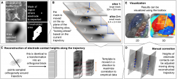

We are happy to announce that a methodological paper describing the toolbox in detail has been [accepted in NeuroImage](http://www.sciencedirect.com/science/article/pii/S1053811914009938).

[The publication can be found here](http://www.sciencedirect.com/science/article/pii/S1053811914009938).

The toolbox also received a SciRes/NIF/Nlx ID which can be provided when citing the toolbox: [SciRes_000188](http://neurolex.org/wiki/Category:Resource:LEAD-DBS).
