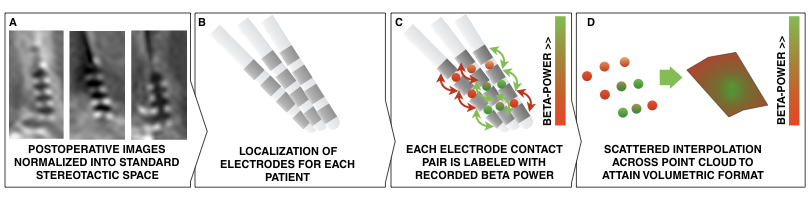
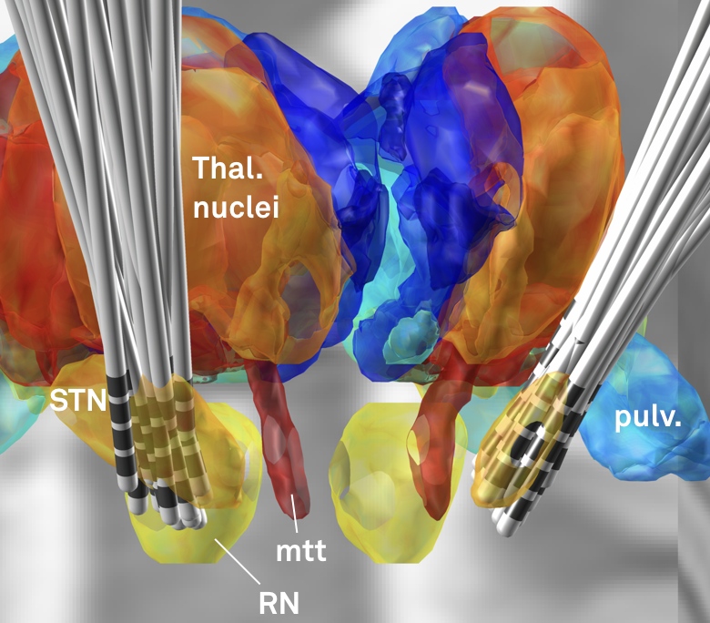
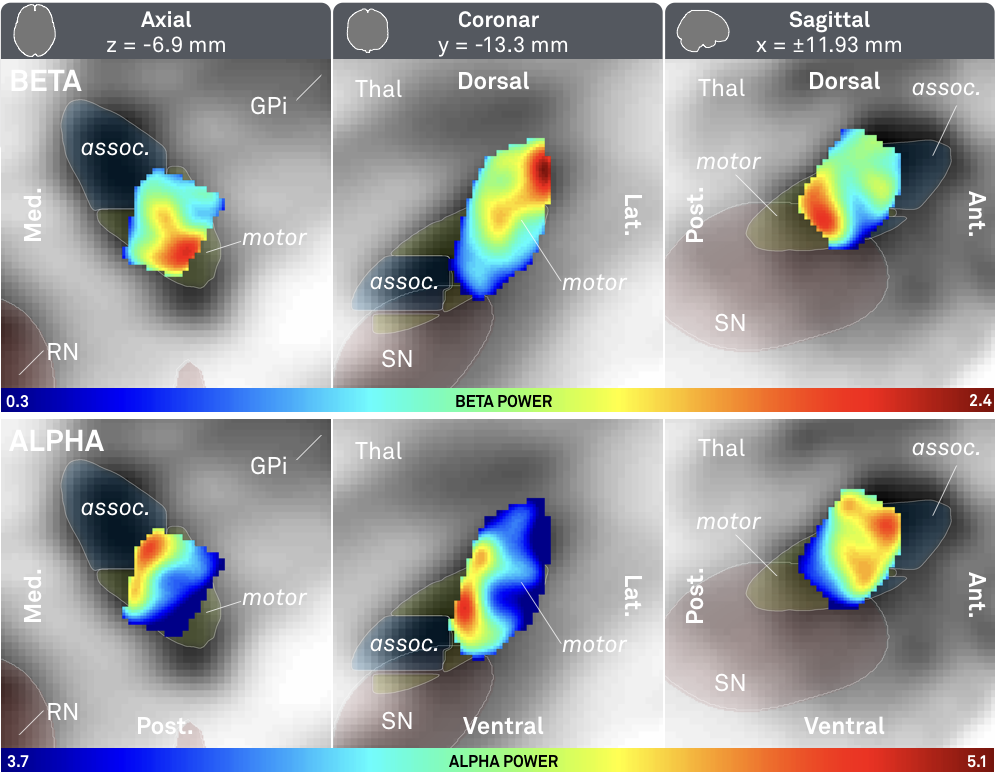
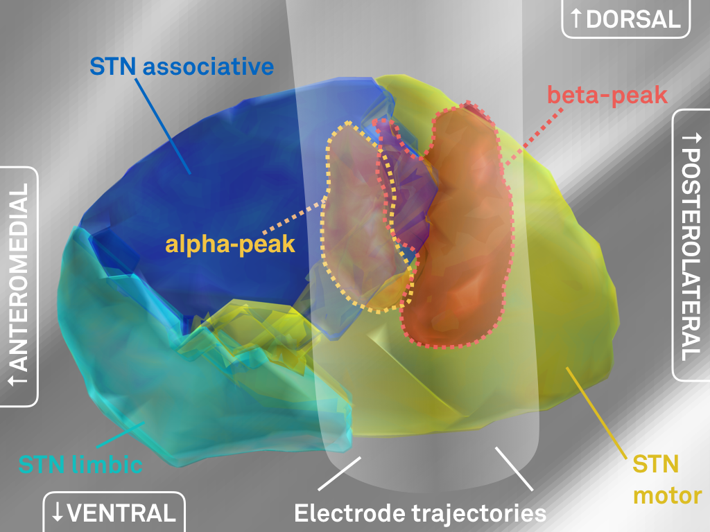
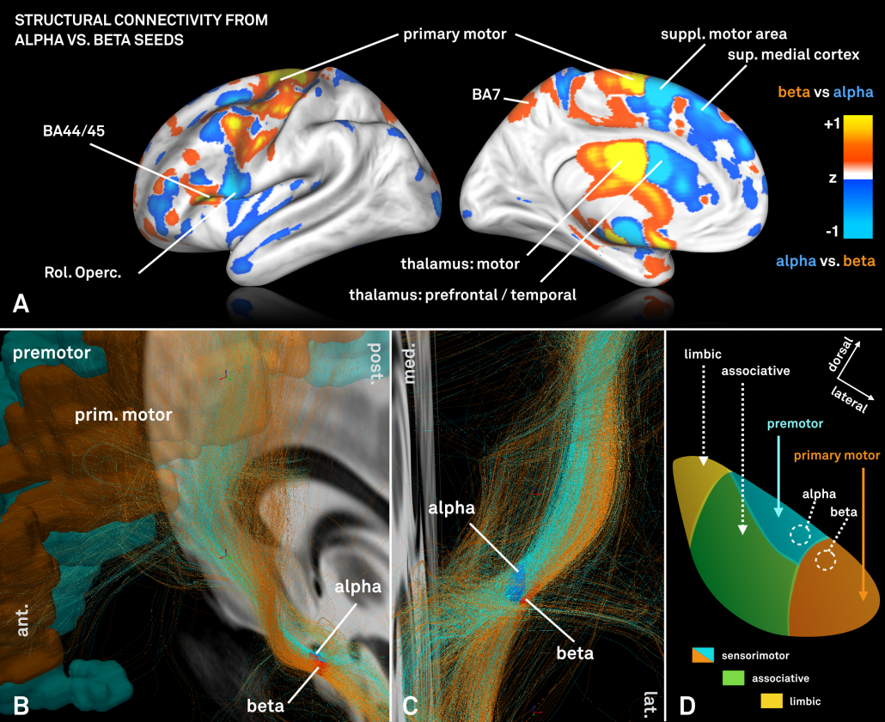
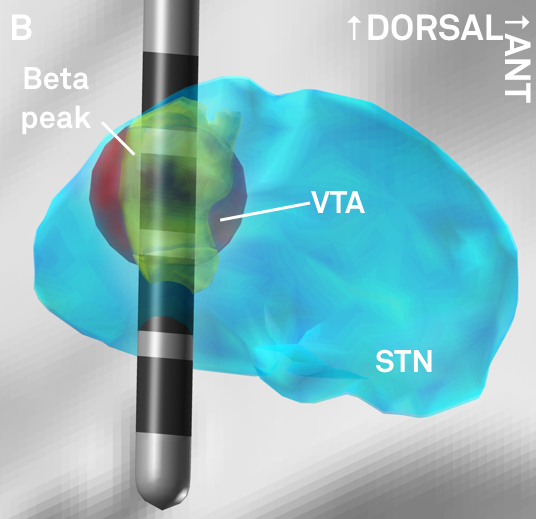

> This post essentially summarizes the study entitled [Toward an electrophysiological “sweet spot” for deep brain stimulation in the subthalamic nucleus that appeared in HBM on 04/2017](http://onlinelibrary.wiley.com/doi/10.1002/hbm.23594/full).
>
> The same technique was applied to theta oscillations in the pallidum recorded from dystonia patients in the study entitled [A localized pallidal physiomarker in cervical dystonia (Annals of Neurology, 11/2017).](http://doi.org/10.1002/ana.25095)

Electrophysiological signals recorded in deep structures of the human brain are of key interest to the neuroscientific community. For instance, in Parknson’s Disease, the beta-rhythm plays a role that has been shown to be tightly coupled with the expression of clinical symptoms (such as bradykinesia). For instance, enhanced beta band activity is suppressed by levodopa [[Geng et al., 2017](http://www.sciencedirect.com/science/article/pii/S096999611630287X); [Kühn et al., 2006a](https://www.ncbi.nlm.nih.gov/pubmed/16364953), [2006b](https://www.ncbi.nlm.nih.gov/pubmed/16623853), [2009](https://www.ncbi.nlm.nih.gov/pubmed/19070616)] and during DBS [[Eusebio et al., 2011](https://www.ncbi.nlm.nih.gov/pubmed/20935326); [Kühn et al., 2008](https://www.ncbi.nlm.nih.gov/pubmed/18550758)] in parallel with improvement of motor symptoms.

DBS is a treatment option that gives us a unique opportunity to record from deep structures in the brain. However, in each patient, usually, only one or two DBS electrodes are surgically implanted. Common electrodes are composed of four contacts – so in each electrode/hemisphere, one may record from three bipolar channels. Already, this gives great insight into rhythmic activity in the basal ganglia as shown in manifold publications.

However, it would be great to be able to cover larger areas of the subcortex to better characterize electrophysiological signatures. In humans, epilepsy patients sometimes receive multiple electrodes and data obtained in these patients could make this possible. A downside is that electrodes in these patients are implanted in varying areas, making it hard to study a specific area of interest across patients. Another option is to pool electrophysiological recordings *across* DBS patients to increase the “field of view” of the obtained data.

After developing Lead-DBS, at Charité in Berlin, we wondered whether the precision of DBS reconstructions (which are based on MR/CT imaging) could be precise enough to do this.

> Could we record an electrophysiological signature in multiple patients, map the recording sites onto (standardized) anatomical space and map out a spatial profile of an electrophysiological signal?

Already, we have done so using multiple signals that were acquired at rest or during tasks. The first study that uses this technique [has now been published](http://onlinelibrary.wiley.com/doi/10.1002/hbm.23594/full). The aim of this blog post is to summarize the underlying methodology on this first, rather simple example.

Brief methods summary:

- Local field potential (LFP) recordings were recorded in 54 PD patients from six channels each. From each signal, alpha and beta power were calculated.
- This leads to 324 alpha and 324 beta power estimates for 324 channels.
- Electrodes were localized in each patient and localizations were warped into standard space.
- This leads to a 3D point-cloud in subcortical anatomical space.

**Fig. 1:** *Methods summary. Postoperative images are transformed to standard space (A); electrodes are localized for each patient (B); electrophysiological recording estimates (such as beta power) are projected onto the midpoint of each contact pair (C); This leads to a 3D point cloud, each point associated with a beta power value. These points are used to fit a scattered interpolant to define beta values within covered subcortical space (D).*

**Fig. 2:** *Electrode reconstructions from 54 STN-DBS patients.*

Beta power served as a good first example to apply the subcortical mapping method since we already knew from various prior publications that higher beta power can be recorded in the dorsolateral parts of the subthalamic nucleus.

Still, it was not clear this approach could work out from the beginning, mainly because of two major limitations.

> First, recordings were *pooled across patients* and patients may have had different baselines in their electrophysiological activity.
>
> Second, the image resolution and electrode localization method of Lead-DBS may not have been precise enough to map each data point to space precisely enough.

Regarding the second point, this first subcortical mapping study may be seen as a feasibility study, asking the question

> Are Lead-DBS electrode localizations and normalizations precise enough to map electrophysiological values from a large group of patients onto a small structure like the subthalamic nucleus?

**Fig. 3:** *Main results of the study – significantly higher beta (top) activity was recorded from the dorsolateral (motor) STN; significantly higher alpha (bottom) activity was recorded from a more ventromedial part of the STN.*

The above results show a clear relationship between alpha/beta power and spatial coordinates of recording site.

> The results from this study shows that i) it is feasible to pool electrophysiological data across patients in space and ii) electrode localizations and warps to standard space are precise enough to get an overview about their spatial distribution

**Fig. 4:** *3D representation of peaks in electrophysiological activity (same data as shown in Fig. 3).*

We went ahead and created three-dimensional peak ROI associated with high beta and alpha activity, respectively (above).

We were then interested whether our standardized structural connectomes were equally precise enough to find differences in cortical connectivity associated with these regions. Of note, the two regions are both very small and close to each other.

For this analysis – which could only be performed on group level – a standardized high precision structural connectome [[Horn 2017](http://www.sciencedirect.com/science/article/pii/S1053811917301088)] was used to select fiber-tracts connected to the alpha and beta peaks, respectively.

However, the two regions exhibited a (slightly) different connectivity profile that was largely consistent with data presented in [[Acolla 2015](https://academic.oup.com/brain/article-abstract/139/9/2503/1744844/Brain-networks-modulated-by-subthalamic-nucleus?redirectedFrom=fulltext)], before (see below).

**Fig. 5:** *Contrasting fiber tract maps seeding either from the “alpha-hotspot” or “beta-hotspot”. Please note that panel B shows a contrast map between the two seeds. Given their spatial proximity, the overall connectivity profiles from both seeds is similar.*

Finally, given the importance of the beta rhythm in Parkinson’s Disease, the resulting beta-atlas could serve to guide DBS programming (and potentially targeting) once prospectively validated in follow up studies. The atlas is made publicly available within Lead-DBS software and on [Neurovault](http://neurovault.org/collections/2418/).

**Fig. 6:** *The peak of beta-activity (yellow) shown in synopsis with a hypothetical lead. Based on the reconstruction, the second most dorsal contact could represent a first choice in clinical programming.*

**Original study**

> [Horn, A., Neumann, W.-J., Degen, K., Schneider, G.-H., & Kühn, A. A. (2017). Toward an electrophysiological “sweet spot” for deep brain stimulation in the subthalamic nucleus. *Human Brain Mapping*, *35*(3), 5083–14. http://doi.org/10.1002/hbm.23594](http://onlinelibrary.wiley.com/doi/10.1002/hbm.23594/full)

**If you are interested doing similar work with Lead-DBS**

> In theory, one could map anything – e.g. behavioral measures, electrophysiological recordings / task signatures, clinical outcome measures, patient demographical information, surgical techniques / treating DBS centers – onto the subcortex using this methodology. Essentially, this work requires the use of the *Lead Group* module. So far, the best documentation of *Lead Group* is provided in [these slides](http://www.lead-dbs.org/docs/tutorials/group_analyses_horn.pdf).
